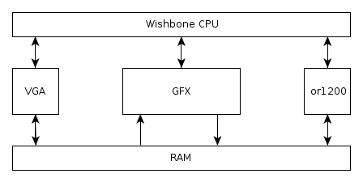
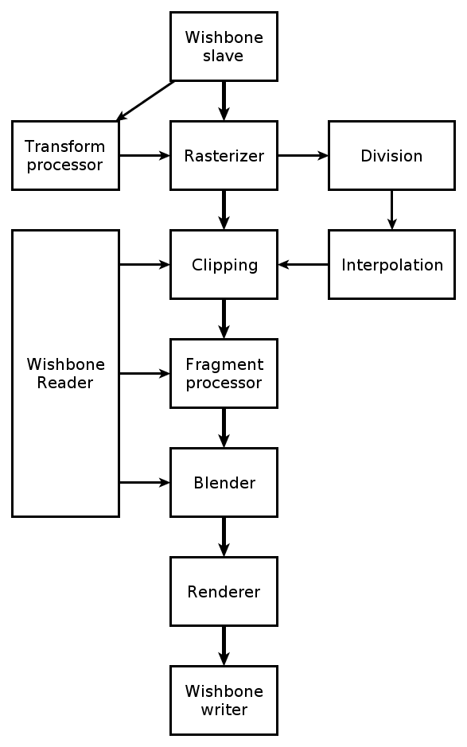

# gfx_top Design Specification

## 1. Introduction
`gfx_top` is a Wishbone-connected 2D/3D graphics acceleration core that renders primitives into external video memory. The core exposes:

- one Wishbone slave interface for register programming,
- one Wishbone master read interface for texture/target/zbuffer fetches, and
- one Wishbone master write interface for framebuffer/zbuffer updates.

The processing architecture is a staged pipeline covering point transform, rasterization, clipping/depth testing, fragment generation, optional blending, and final memory writeback.

## 2. Module Diagram

## 3. Top-Level Interface

### 3.1 Clock and Reset

| Signal | Direction | Width | Description |
| --- | --- | --- | --- |
| `wb_clk_i` | Input | 1 | Common system clock for slave interface, pipeline, and both master interfaces. |
| `wb_rst_i` | Input | 1 | Active-high reset. Top-level submodules use asynchronous reset style (`posedge rst_i`) in RTL. |

### 3.2 Wishbone Slave Interface (CPU/Host Programming)

| Signal | Direction | Width | Description |
| --- | --- | --- | --- |
| `wbs_cyc_i` | Input | 1 | Slave cycle qualifier. |
| `wbs_stb_i` | Input | 1 | Slave strobe qualifier. |
| `wbs_cti_i` | Input | 3 | Cycle type input (present for bus compatibility; not used for burst handling in current register logic). |
| `wbs_bte_i` | Input | 2 | Burst type input (present for bus compatibility; not used for burst handling in current register logic). |
| `wbs_we_i` | Input | 1 | Write enable (`1` write, `0` read). |
| `wbs_adr_i` | Input | 32 | Byte address input; internal register decoding uses word-aligned offsets. |
| `wbs_sel_i` | Input | 4 | Byte lane select; current implementation accepts only full-word (`4'b1111`) accesses. |
| `wbs_dat_i` | Input | 32 | Slave write data. |
| `wbs_ack_o` | Output | 1 | Access acknowledge pulse for valid full-word accesses. |
| `wbs_err_o` | Output | 1 | Error pulse for invalid byte-select accesses. |
| `wbs_dat_o` | Output | 32 | Slave read data. |
| `wb_inta_o` | Output | 1 | Interrupt output. In current RTL, asserted on read/write master error signals. |

### 3.3 Wishbone Master Read Interface (Texture/Depth/Target Reads)

| Signal | Direction | Width | Description |
| --- | --- | --- | --- |
| `wbm_read_cyc_o` | Output | 1 | Read cycle active while a memory read transaction is outstanding. |
| `wbm_read_stb_o` | Output | 1 | Read strobe (driven high in this implementation). |
| `wbm_read_cti_o` | Output | 3 | Read cycle type (`3'b000`, classic single transfer behavior). |
| `wbm_read_bte_o` | Output | 2 | Read burst extension (`2'b00`). |
| `wbm_read_we_o` | Output | 1 | Read/write direction (always `0`, read-only interface). |
| `wbm_read_adr_o` | Output | 32 | Read address. |
| `wbm_read_sel_o` | Output | 4 | Byte lane select for read access. |
| `wbm_read_ack_i` | Input | 1 | Read acknowledge from memory interconnect. |
| `wbm_read_err_i` | Input | 1 | Read error from memory interconnect. |
| `wbm_read_dat_i` | Input | 32 | Read data from memory interconnect. |

### 3.4 Wishbone Master Write Interface (Framebuffer/Depth Writes)

| Signal | Direction | Width | Description |
| --- | --- | --- | --- |
| `wbm_write_cyc_o` | Output | 1 | Write cycle active while a memory write transaction is outstanding. |
| `wbm_write_stb_o` | Output | 1 | Write strobe (driven high in this implementation). |
| `wbm_write_cti_o` | Output | 3 | Write cycle type (`3'b000`, classic single transfer behavior). |
| `wbm_write_bte_o` | Output | 2 | Write burst extension (`2'b00`). |
| `wbm_write_we_o` | Output | 1 | Read/write direction (always `1`, write-only interface). |
| `wbm_write_adr_o` | Output | 32 | Write address. |
| `wbm_write_sel_o` | Output | 4 | Byte lane select for write access. |
| `wbm_write_dat_o` | Output | 32 | Write data to memory interconnect. |
| `wbm_write_ack_i` | Input | 1 | Write acknowledge from memory interconnect. |
| `wbm_write_err_i` | Input | 1 | Write error from memory interconnect. |

### 3.5 Interface Semantics

- The slave interface is register-oriented and uses an internal instruction FIFO to decouple programming writes from pipeline execution.
- The core busy state is observable through `STATUS[0]` and reflects pipeline activity state in the slave controller.
- Slave reads return the currently committed register state and do not account for pending queued writes not yet applied from the instruction FIFO.
- The read master is shared by clip, fragment, and blender stages through an arbiter.
- The write master commits renderer outputs to target (and optional zbuffer) memory.

## 4. Register Model

All registers are 32-bit and word-aligned. Offsets are relative to the slave base address.

### 4.1 Register Address Map

| Name | Offset | Access | Description |
| --- | --- | --- | --- |
| `CONTROL` | `0x00` | RW | Operation/mode control register. |
| `STATUS` | `0x04` | R | Busy and FIFO occupancy status. |
| `ALPHA` | `0x08` | RW | Per-point alpha + global alpha. |
| `COLORKEY` | `0x0C` | RW | Colorkey compare value. |
| `TARGET BASE` | `0x10` | RW | Render-target base address. |
| `TARGET SIZE X` | `0x14` | RW | Render-target width. |
| `TARGET SIZE Y` | `0x18` | RW | Render-target height. |
| `TEX0 BASE` | `0x1C` | RW | Texture 0 base address. |
| `TEX0 SIZE X` | `0x20` | RW | Texture 0 width. |
| `TEX0 SIZE Y` | `0x24` | RW | Texture 0 height. |
| `SRC P0 X` | `0x28` | RW | Source rectangle point 0 X. |
| `SRC P0 Y` | `0x2C` | RW | Source rectangle point 0 Y. |
| `SRC P1 X` | `0x30` | RW | Source rectangle point 1 X. |
| `SRC P1 Y` | `0x34` | RW | Source rectangle point 1 Y. |
| `DEST X` | `0x38` | RW | Destination point X (fixed-point). |
| `DEST Y` | `0x3C` | RW | Destination point Y (fixed-point). |
| `DEST Z` | `0x40` | RW | Destination point Z (fixed-point). |
| `AA` | `0x44` | RW | Transform matrix coefficient. |
| `AB` | `0x48` | RW | Transform matrix coefficient. |
| `AC` | `0x4C` | RW | Transform matrix coefficient. |
| `TX` | `0x50` | RW | Transform matrix coefficient. |
| `BA` | `0x54` | RW | Transform matrix coefficient. |
| `BB` | `0x58` | RW | Transform matrix coefficient. |
| `BC` | `0x5C` | RW | Transform matrix coefficient. |
| `TY` | `0x60` | RW | Transform matrix coefficient. |
| `CA` | `0x64` | RW | Transform matrix coefficient. |
| `CB` | `0x68` | RW | Transform matrix coefficient. |
| `CC` | `0x6C` | RW | Transform matrix coefficient. |
| `TZ` | `0x70` | RW | Transform matrix coefficient. |
| `CLIP P0 X` | `0x74` | RW | Clip rectangle point 0 X. |
| `CLIP P0 Y` | `0x78` | RW | Clip rectangle point 0 Y. |
| `CLIP P1 X` | `0x7C` | RW | Clip rectangle point 1 X. |
| `CLIP P1 Y` | `0x80` | RW | Clip rectangle point 1 Y. |
| `COLOR0` | `0x84` | RW | Color register 0. |
| `COLOR1` | `0x88` | RW | Color register 1. |
| `COLOR2` | `0x8C` | RW | Color register 2. |
| `U0` | `0x90` | RW | Texture coordinate U0. |
| `V0` | `0x94` | RW | Texture coordinate V0. |
| `U1` | `0x98` | RW | Texture coordinate U1. |
| `V1` | `0x9C` | RW | Texture coordinate V1. |
| `U2` | `0xA0` | RW | Texture coordinate U2. |
| `V2` | `0xA4` | RW | Texture coordinate V2. |
| `ZBUFFER BASE` | `0xA8` | RW | Depth-buffer base address. |

### 4.2 Control Register (`CONTROL`, `0x00`)

| Bits | Access | Name | Description |
| --- | --- | --- | --- |
| `[1:0]` | RW | `COLOR_DEPTH` | Color-depth mode selection. |
| `[2]` | RW | `TEXTURE0_ENABLE` | Enable texture fetch in fragment processing. |
| `[3]` | RW | `BLENDING_ENABLE` | Enable alpha blending stage. |
| `[4]` | RW | `COLORKEY_ENABLE` | Enable colorkey compare/discard in fragment stage. |
| `[5]` | RW | `CLIPPING_ENABLE` | Enable clip-rectangle enforcement. |
| `[6]` | RW | `ZBUFFER_ENABLE` | Enable depth-buffer read/check/write behavior. |
| `[8]` | W | `RECT_WRITE` | Trigger rectangle raster operation. |
| `[9]` | W | `LINE_WRITE` | Trigger line raster operation. |
| `[10]` | W | `TRIANGLE_WRITE` | Trigger triangle raster operation. |
| `[11]` | W | `CURVE_WRITE` | Curve/bezier mode control for fragment processing path. |
| `[12]` | W | `INTERPOLATION` | Enable interpolation path for triangle/curve-related shading inputs. |
| `[13]` | W | `INSIDE` | Bezier inside/outside selection. |
| `[17:16]` | RW | `ACTIVE_POINT` | Selected destination point slot (`p0/p1/p2`). |
| `[18]` | W | `FORWARD_POINT` | Forward selected destination point without transform. |
| `[19]` | W | `TRANSFORM_POINT` | Transform selected destination point using matrix. |
| `[31:20]`,`[15:14]`,`[7]` | - | Reserved | Reserved. |

Notes:
- In current RTL, `RECT_WRITE`, `LINE_WRITE`, `TRIANGLE_WRITE`, `FORWARD_POINT`, and `TRANSFORM_POINT` are cleared automatically after command acceptance.
- `CURVE_WRITE` is used as a rendering-mode input in the fragment path and is not auto-cleared by the same logic.

### 4.3 Status Register (`STATUS`, `0x04`)

| Bits | Access | Description |
| --- | --- | --- |
| `[0]` | R | Busy indicator (`1` while slave control is in busy state). |
| `[15:1]` | R | Reserved. |
| `[31:16]` | R | Instruction FIFO occupancy count. |

### 4.4 Numeric and Address Conventions

- Base-address registers (`TARGET BASE`, `TEX0 BASE`, `ZBUFFER BASE`) use word-aligned addressing semantics (`[31:2]` effective).
- Destination coordinates (`DEST X/Y/Z`) and matrix coefficients are represented as signed fixed-point values (`point_width` integer, `subpixel_width` fractional).
- Default precision parameters in top-level RTL are `point_width=16`, `subpixel_width=16`.

## 5. Functional Description

### 5.1 High-Level Operation Flow

1. Software writes registers through Wishbone slave.
2. Command/control writes enter the instruction FIFO.
3. Slave control dispatches operations into the graphics pipeline.
4. Geometry/pixel processing stages generate candidate fragments.
5. Fragment and blender stages request memory reads through shared read arbiter as required.
6. Renderer computes write addresses/data and commits results through write master.

### 5.2 Instruction FIFO and Busy Sequencing

- All full-word slave writes are enqueued into an instruction FIFO (`basic_fifo`).
- The slave controller has `wait` and `busy` states.
- Entering busy is triggered by operation start signals (rect/line/triangle/point-forward/point-transform).
- Returning to wait occurs on completion acknowledgements from pipeline/transform paths.
- While busy, incoming register writes continue to enqueue and are applied in FIFO order when dispatch conditions permit.

### 5.3 Geometry and Rasterization

- `gfx_transform` performs matrix-based point transformation or pass-through forwarding based on control bits.
- `gfx_rasterizer` generates pixel positions for rect/line/triangle operations.
- For interpolated modes, rasterizer also emits triangle edge/area terms for downstream interpolation.

### 5.4 Interpolation, Attribute Evaluation, and Clipping

- `gfx_interp` computes interpolation factors from raster edge functions.
- `gfx_cuvz` derives per-pixel color/depth/UV/alpha values (or flat-mode values as applicable).
- `gfx_clip` enforces render-target bounds and optional clip-rectangle bounds.
- If z-buffering is enabled, `gfx_clip` requests depth reads and performs depth test before forwarding fragment writes.

### 5.5 Fragment, Blending, and Render Writeback

- `gfx_fragment_processor` selects flat color or texture-derived color and applies optional colorkey discard.
- `gfx_blender` optionally blends incoming fragment color with target memory color using alpha controls.
- `gfx_renderer` computes final memory addresses/select/data for color writes and optional depth writes.
- `gfx_wbm_write` performs write transactions to external memory and returns completion acknowledgment.

### 5.6 Read Arbitration Behavior

- `gfx_wbm_read_arbiter` arbitrates read clients from clip, fragment, and blender.
- Current RTL gives highest priority to blender requests, then fragment, then clip.
- `gfx_wbm_read` executes one read request at a time and returns data/ack to the selected client.

## 6. Implementation Details

### 6.1 Top-Level Composition

`gfx_top` instantiates and connects:

- control plane: `gfx_wbs`,
- geometry/raster plane: `gfx_transform`, `gfx_rasterizer`, `gfx_interp`, `gfx_cuvz`,
- fragment/render plane: `gfx_clip`, `gfx_fragment_processor`, `gfx_blender`, `gfx_renderer`,
- memory plane: `gfx_wbm_read_arbiter`, `gfx_wbm_read`, `gfx_wbm_write`.

Dataflow proceeds primarily from transform/raster outputs toward renderer, with memory-read side paths feeding clip/fragment/blender.

### 6.2 Inter-Stage Handshake Model

- Pipeline communication uses write/ack style handshaking between neighboring stages.
- Write and ack signals are intended as bounded control events; upstream stages hold or resume based on downstream acceptance.
- Rasterizer and interpolation stages include internal queueing/counters to manage per-primitive multi-pixel expansion.

### 6.3 Wishbone Interface Realization

- Slave ack/error generation enforces 32-bit access policy.
- Read master is read-only (`we=0`) and single-transfer style (`cti=000`, `bte=00`).
- Write master is write-only (`we=1`) and single-transfer style (`cti=000`, `bte=00`).
- Interrupt output is driven from read/write master `sint` indications, which in current RTL correspond to propagated Wishbone error inputs.

### 6.4 Parameterization

Top-level parameters:

- `point_width` (default 16),
- `subpixel_width` (default 16),
- `fifo_depth` (default 10; FIFO bit depth),
- `REG_ADR_HIBIT` (default 9).

`fifo_depth=10` implies FIFO storage indexed over `2^10` entries in the provided `basic_fifo` implementation.

## 7. Submodule List

| Submodule | Functional Role | Key Interface Role |
| --- | --- | --- |
| `gfx_wbs` | Register file, instruction FIFO, operation dispatch state machine. | Consumes WBS transactions; emits configuration and operation controls; reports status/interrupt. |
| `gfx_transform` | Point transform/forward stage using programmable 3x4 matrix. | Consumes destination point + matrix; outputs transformed point slots and ack. |
| `gfx_rasterizer` | Primitive raster generation for rect/line/triangle. | Consumes operation triggers and points; emits pixel stream and interpolation edge data. |
| `gfx_interp` | Triangle interpolation factor computation. | Consumes edge/area inputs and pixel coordinates; emits interpolation factors and delayed pixel coordinates. |
| `gfx_cuvz` | Per-pixel color/UV/depth/alpha interpolation/packing. | Consumes factors + per-vertex attributes; outputs pixel attributes for clip/fragment path. |
| `gfx_clip` | Target/clip bounds enforcement and optional z-test gating. | Consumes raster/cuvz stream; requests z reads; forwards valid pixels to fragment stage. |
| `gfx_fragment_processor` | Flat/texture fragment color generation with optional colorkey discard. | Consumes clipped pixel + UV/alpha; may request texture reads; outputs fragment pixels. |
| `gfx_blender` | Optional alpha blending against current target pixel. | May request target-color read; outputs blended fragment for renderer. |
| `gfx_renderer` | Final target/zbuffer address/data generation for writes. | Consumes final pixel and mode controls; drives write requests and completion ack. |
| `gfx_wbm_read_arbiter` | Arbitration for shared read master. | Selects among clip/fragment/blender read clients with fixed priority. |
| `gfx_wbm_read` | Wishbone read transaction engine. | Executes read cycles and returns data/ack to arbiter-selected client. |
| `gfx_wbm_write` | Wishbone write transaction engine. | Executes write cycles for renderer output and returns completion ack. |

## 8. Clock and Reset

- All logic is in a single clock domain (`wb_clk_i`).
- Reset is active high (`wb_rst_i`), applied asynchronously in major RTL blocks (`posedge rst_i` sensitivity).
- Reset initializes control/configuration registers, status state, FIFO control, and interface control outputs.
- Matrix defaults are identity-like fixed-point coefficients (`AA=BB=CC=1.0`, others zero) in current RTL initialization.

## 9. Constraints and Integration Notes

- The core expects separate memory bandwidth for read and write master channels for best throughput.
- Slave register logic is 32-bit word oriented; non-full-word accesses return error.
- Because register writes are FIFO-queued, software should poll `STATUS.BUSY` and consider FIFO occupancy when strict ordering visibility is required.
- In current RTL, `wbs_cti_i` and `wbs_bte_i` are present for interface compatibility but are not used to implement burst-mode slave behavior.
- Read arbiter priority can affect latency for lower-priority read clients under contention.
- Documentation states multiple color-depth modes; practical deployment should validate selected mode support against the target RTL revision and testbench coverage.
