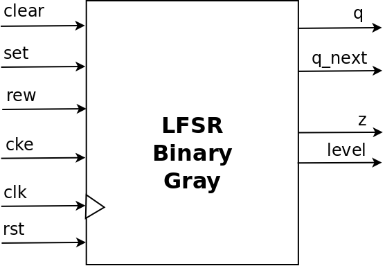
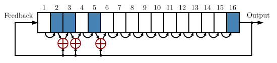

# vcnt Design Specification

## 1. Introduction

`vcnt` is a configurable counter core intended for arithmetic/control sequencing use cases. The design supports binary, Gray-code, and LFSR-based counting styles through compile-time options. The module exposes control inputs for clear, set, direction, and clock enable (when enabled), and can generate status outputs such as zero and programmable level flags.

This specification is based on the provided design document (`versatile_counter.pdf`) and the current RTL implementation (`versatile_counter.v` plus included define/polynomial files). Where implementation behavior differs from documented intent, the difference is explicitly identified for confirmation.

## 2. Module Diagram

## 3. Interface

The top-level interface is compile-time configurable through `CNT_*` macros. `clk` and `rst` are always present; other ports are conditionally present.

### 3.1 Mandatory Signals

| Signal | Direction | Width | Description |
| --- | --- | --- | --- |
| `clk` | Input | 1 | Counter clock. State transitions are synchronized to rising edges of `clk`. |
| `rst` | Input | 1 | Active-high asynchronous reset. Resets internal state and registered status outputs. |

### 3.2 Optional Control Inputs

| Signal | Present When | Direction | Width | Description |
| --- | --- | --- | --- | --- |
| `clear` | `CNT_CLEAR` | Input | 1 | Active-high synchronous clear request. In implemented next-state priority, this forces next state to zero. |
| `set` | `CNT_SET` | Input | 1 | Active-high set request. Intended to load `set_value` per source PDF; behavior in current RTL requires confirmation (see Section 8). |
| `rew` | `CNT_REW` | Input | 1 | Direction/rewind control. Intended to select forward vs rewind behavior; implementation details are described in Section 5. |
| `cke` | `CNT_CE` | Input | 1 | Clock-enable qualifier. State and registered outputs update only when `cke=1`. |

### 3.3 Optional Outputs

| Signal | Present When | Direction | Width | Description |
| --- | --- | --- | --- | --- |
| `q` | `CNT_Q` | Output | `cnt_length` | Counter output. In Gray mode, this is Gray-coded and registered; in non-Gray mode, this is the combinational `q_next` value. |
| `q_bin` | `CNT_TYPE_GRAY` + `CNT_Q_BIN` | Output | `cnt_length` | Binary state visibility output (`qi`). |
| `q_next` | `CNT_QNEXT` | Output | `cnt_length` | Exposes computed next-state value. |
| `z` | `CNT_Z` | Output | 1 | Combinational zero flag (`q==0`). |
| `zq` | `CNT_ZQ` | Output | 1 | Registered next-zero flag (`q_next==0`). |
| `level1` | `CNT_LEVEL1` | Output | 1 | Programmable level indication linked to `level1_value`. |
| `level2` | `CNT_LEVEL2` | Output | 1 | Programmable level indication linked to `level2_value`. |

## 4. Function Description

### 4.1 State Model and Update Event

The counter state is represented by internal register `qi[cnt_length:1]`.

- On `rst=1`, `qi` resets asynchronously to zero.
- Otherwise, `qi` updates on each rising edge of `clk`.
- If `CNT_CE` is enabled, updates occur only when `cke=1`; when `cke=0`, state and registered outputs hold their previous values.

### 4.2 Next-State Priority and Computation

The implemented next-state network applies the following priority:

1. If `clear=1` (when `CNT_CLEAR` enabled), next state is zero.
2. Else if wrap mode is enabled (`CNT_WRAP`) and current state is zero, next state is `wrap_value`.
3. Else:
   - In `CNT_TYPE_LFSR` mode, next state is generated by a right-shift with feedback insertion from the selected polynomial taps.
   - In non-LFSR modes, next state arithmetic is `qi - 1`.

This priority ordering is suitable for assertion derivation (for example, clear dominance over other controls).

### 4.3 Counting Modes

- Binary mode (`CNT_TYPE_BINARY`): output/state progression follows arithmetic next-state behavior.
- Gray mode (`CNT_TYPE_GRAY`): internal `qi` remains binary-state storage; `q` is generated as Gray code from `q_next` using `(q_next >> 1) ^ q_next` and is registered.
- LFSR mode (`CNT_TYPE_LFSR`): feedback polynomial selection is length-dependent via `lfsr_polynom.v`.

Per original PDF note, when Gray mode is selected, `q_next` (if exported) corresponds to the next binary value.

### 4.4 Direction Control (`rew`) and Intended Up/Down Behavior

The source PDF defines `rew` as a direction control (forward vs rewind) and provides up/down usage guidance.

In the current RTL revision, both internal branches selected by `rew` use the same next-state expression. Therefore, `rew` does not change next-state arithmetic in this implementation unless additional design customization is applied.

### 4.5 Output and Flag Semantics

- `q`:
  - Gray configuration: registered Gray-code output derived from `q_next`.
  - Non-Gray configuration: combinational output equal to `q_next`.
- `q_bin`: direct visibility of `qi` in Gray configurations with `CNT_Q_BIN`.
- `z`: combinational assertion when `q==0`.
- `zq`: registered assertion when `q_next==0` at an enabled clock edge.
- `level1`/`level2` (if enabled):
  - Set when `q_next` equals programmed level value.
  - Cleared when rewind condition branch is met (`q == levelX_value` and `rew=1`) in current RTL.

### 4.6 Control Interaction Summary for Property Definition

For assertion generation, key guard/effect relationships are:

- `rst` dominates all sequential behavior in blocks sensitive to `posedge rst`.
- `cke` gates state and registered status updates when enabled.
- `clear` has highest combinational priority in next-state generation.
- Optional wrap behavior (if enabled) only triggers when current state is zero.

## 5. Implementation Details

The design is a single-module counter architecture with:

- one internal state register (`qi`),
- one combinational next-state path (`q_next`),
- optional registered output/status logic (`q` in Gray mode, `zq`, `level1`, `level2`), and
- optional combinational status logic (`z`, non-Gray `q`).

Control-path behavior is macro-specialized at compile time:

- mode selection (binary/Gray/LFSR),
- enabled control features (`clear`, `set`, `rew`, `cke`, `wrap`), and
- enabled status outputs (`q_next`, `z`, `zq`, levels).

For LFSR operation, polynomial tap equations are selected by counter length macros (`CNT_LENGTH_2` through `CNT_LENGTH_32`), which define feedback expressions used in next-state generation.

No submodule hierarchy is instantiated in `vcnt`; behavior is realized in a single top-level module with conditional compilation.

## 6. Submodule List

This design has no instantiated submodules in the top-level counter RTL.

## 7. Clock and Reset

- Clock domain: single domain (`clk`).
- Reset type: active-high asynchronous reset (`rst`).
- Reset effects in current RTL:
  - `qi` resets to zero.
  - Gray-mode registered `q` resets to `CNT_RESET_VALUE`.
  - `zq` resets to `1` when enabled.
  - `level1` and `level2` reset to `0` when enabled.

## 8. Constraints and Confirmation Items

- `CNT_LENGTH` must match enabled length macro usage when LFSR mode is selected so feedback tap definitions are well-formed.
- All control signals are active high, consistent with the source PDF usage notes.
- PDF-defined control priority states `clear` over `set`; the current RTL includes `clear` in next-state logic but does not apply `set` to state update.
- PDF-defined direction semantics (`rew` controlling up/down) require confirmation against current RTL, where both direction branches are functionally identical.
- In Gray configurations, level-flag clear condition uses `q` comparison; confirm whether the intended comparison domain is Gray output or binary state for verification closure.
