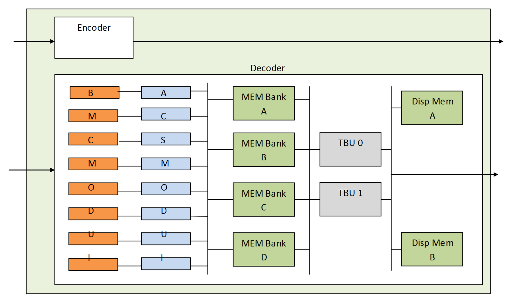
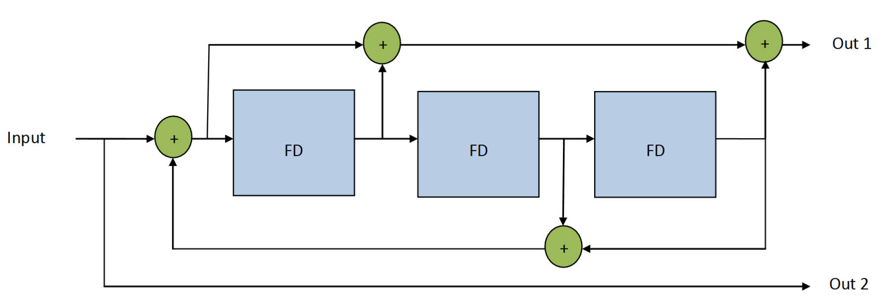

# viterbi_tx_rx Design Specification

## 1. Introduction

`viterbi_tx_rx` is a transceiver-oriented Viterbi reference design that combines a convolutional encoder and a Viterbi decoder in one top-level module. The transmit side converts a 1-bit input stream into a 2-bit encoded stream. The receive side applies branch-metric computation, add-compare-select path processing, trellis storage, traceback, and display-memory staging to reconstruct a 1-bit decoded stream.

The design is stream-oriented and intended for algorithm/function verification rather than bus-based system integration.

## 2. Module Diagram

## 3. Interface

| Signal | Direction | Width | Description |
| --- | --- | --- | --- |
| `clk` | Input | 1 | Global clock for encoder, decoder, and memory/traceback sequencing. |
| `rst_n` | Input | 1 | Active-low reset for top-level control and both submodules. |
| `encoder_i` | Input | 1 | Input bit stream to the encoder. |
| `enable_encoder_i` | Input | 1 | Encoder enable input; also used indirectly to drive decoder processing enable through encoder-valid propagation. |
| `decoder_o` | Output | 1 | Decoded output bit from the decoder output staging path. |

### 3.1 Interface Semantics

- The top module contains no explicit input handshake beyond `enable_encoder_i`.
- No dedicated top-level output-valid signal is provided; `decoder_o` is continuously driven by decoder output staging.
- Decoder activity is enabled internally using encoder validity (`valid_encoder_o`) captured into an internal decoder-enable signal.

## 4. Function Description

### 4.1 End-to-End Flow

1. `encoder_i` is encoded into 2-bit symbols by the convolutional encoder when `enable_encoder_i` is asserted.
2. Encoded symbols are transferred to the decoder input path.
3. The decoder computes branch metrics for possible predecessor transitions and updates path metrics via ACS processing.
4. Survivor decisions are stored in rotating trellis memory banks.
5. Traceback units traverse stored decisions and write reconstructed bits into display memories.
6. Display-memory readout produces the top-level decoded bit `decoder_o`.

### 4.2 Encoder Behavior

- The encoder implements an 8-state transition process with 1-bit input and 2-bit output.
- Encoder state resets to `000` on active-low reset and also returns to `000` when encoder enable is deasserted.
- `valid_o` indicates encoder activity and follows encoder enable behavior.
- Encoder output to downstream logic is forced to `00` when encoder enable is inactive.

### 4.3 Decoder Algorithmic Stages

#### Branch Metric Calculation (BMC)

- Eight BMC units evaluate the received 2-bit symbol against the two candidate branch outputs for each decoder state.
- Each branch metric is represented with 2-bit coding consistent with Hamming-distance style outcomes:
  - `00`: no bit difference,
  - `01`: one bit differs,
  - `10`: two bits differ.

#### Add-Compare-Select (ACS)

- Eight ACS units consume predecessor validity, predecessor path costs, and branch metrics.
- For each state, ACS selects the lower-cost predecessor and emits:
  - survivor selection bit,
  - updated validity,
  - updated path cost.
- Path costs are maintained per state and updated every enabled cycle.

#### Trellis Decision Storage and Traceback

- Survivor selection bits for all states are packed and written into four 8x1024 trellis memory banks in round-robin phases.
- Write and read counters move in opposite directions to support traceback-oriented access.
- Two traceback units operate with phased bank selections to reconstruct decoded bits from stored survivor decisions.

#### Display-Memory Staging and Output

- Traceback outputs are written into two 1x1024 display memories.
- Read/write roles of the two display memories alternate by phase.
- A phase-delayed selector chooses which display-memory read data drives `decoder_o`.

### 4.4 Reset and Enable Behavior

- Active-low reset reinitializes encoder/decoder state, validity tracking, path metrics, counters, and internal enables.
- When decoder enable is inactive, decoder path metrics and validity return to initial conditions.
- Continuous enabled operation is required for trellis build-up and traceback-based output recovery.

## 5. Implementation Details

### 5.1 Top-Level Composition and Control

The top module instantiates one `encoder` and one `decoder` and forwards encoded symbols to the decoder through an internal staging/control path. Decoder processing is not directly controlled by an external port; it is driven by encoder-valid timing captured in the top-level control path.

### 5.2 Decoder Control/Data Relationships

- **Control path:** validity vectors, survivor selection vectors, memory-bank phase, traceback enables, and display-memory phase selection.
- **Datapath:** received symbol -> BMC metrics -> ACS path-cost update -> survivor decision storage -> traceback bit extraction -> display-memory output.
- Control phase signals determine which memory banks are written/read and which traceback/display path is active in each phase.

### 5.3 Path-Metric Update and Normalization

The decoder stores one path metric per trellis state. On each enabled cycle, ACS-updated metrics replace prior values. A normalization condition is applied when all path-metric MSBs are asserted, limiting growth by clearing the MSB contribution in the updated metrics.

### 5.4 Memory and Traceback Sequencing

- Four trellis banks are rotated for write/read operations to decouple survivor capture from traceback consumption.
- Two traceback units run in staggered phases and consume bank outputs according to bank-phase routing.
- Display memories absorb traceback output bits and provide buffered output readback for `decoder_o`.

### 5.5 State and Counter Elements Relevant to Verification

Key internal sequential elements include:

- encoder state register,
- decoder validity and survivor-selection registers,
- eight path-cost registers,
- trellis write/read counters,
- memory-bank phase registers and delayed phase buffers,
- traceback enable and selection registers,
- display-memory read/write counters and output selection phase registers.

These elements govern when decoded data becomes observable at the top-level output.

## 6. Submodule List

### 6.1 Top-Level Processing Blocks

| Submodule | Functional Role | Interface Summary |
| --- | --- | --- |
| `encoder` | Convolutional encoding of 1-bit input to 2-bit encoded symbol with activity validity output. | Inputs: `clk`, `rst_n`, `enable_i`, `d_in`; Outputs: `valid_o`, `d_out[1:0]`. |
| `decoder` | Viterbi decoding pipeline from 2-bit encoded symbol to 1-bit decoded output. | Inputs: `clk`, `rst_n`, `enable`, `d_in[1:0]`; Output: `d_out`. |

### 6.2 Decoder Internal Functional Groups

| Functional Group | Role | Key Interaction |
| --- | --- | --- |
| `BMC` family (`bmc000`..`bmc111`) | Computes two candidate branch metrics per state from the received symbol. | Feeds ACS modules with path-0/path-1 branch costs. |
| `ACS` array | Adds branch metrics to predecessor path costs, compares candidates, and selects survivor path. | Produces state validity, survivor bits, and updated path costs. |
| Trellis memories (`mem`, 4 banks) | Stores survivor-selection vectors over time for traceback traversal. | Written by ACS selection vector; read in phased traceback schedule. |
| Traceback units (`tbu`, 2 units) | Traverses survivor decisions to reconstruct decoded bits. | Consumes trellis bank read data and writes display memories. |
| Display memories (`mem_disp`, 2 banks) | Buffers traceback outputs for phased decoded-bit readout. | Selected by phase logic to drive final decoder output. |

## 7. Clock and Reset

- Single clock domain: `clk`.
- Reset is active-low and asynchronously asserted in top-level and key submodules (`negedge rst_n` sensitivity in sequential reset logic).
- Reset establishes a known start condition for encoder state, decoder state validity, path metrics, counters, and memory-phase control.

## 8. Constraints

- The design is not Wishbone-compatible.
- The top-level output has no dedicated validity indicator; integration should account for decoder pipeline warm-up and traceback staging behavior.
- The decoder initialization assumes a known starting state alignment with the encoder reset state.
- Memory depth (1024) and four-bank trellis organization are part of the implemented traceback precision/throughput structure.
