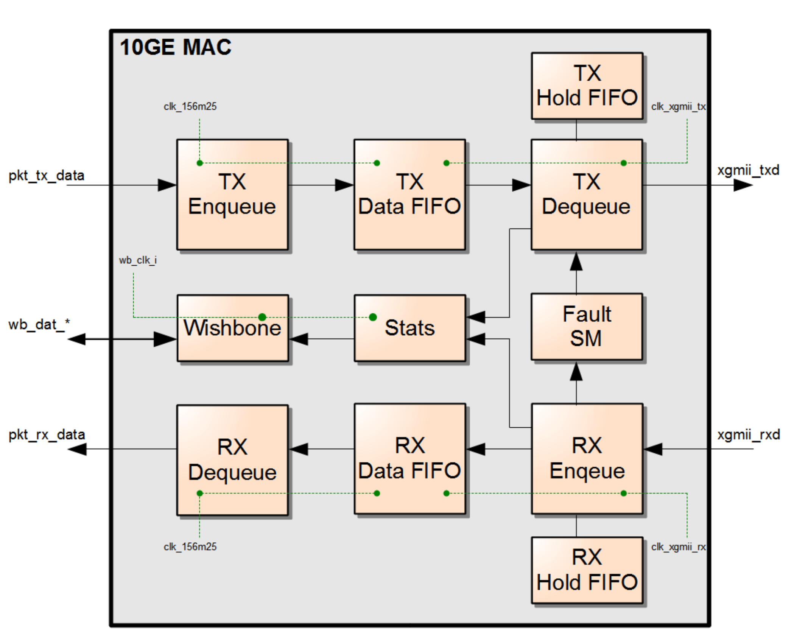
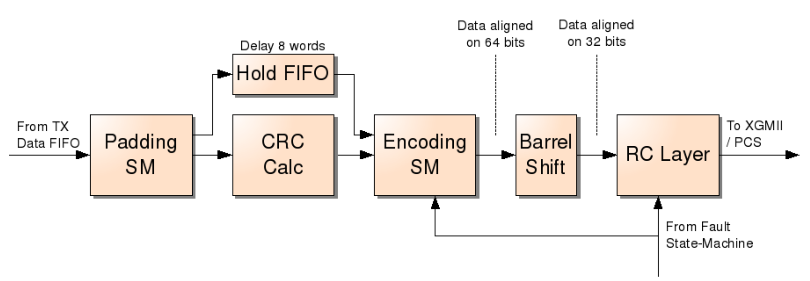
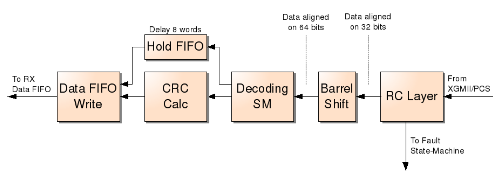

# xge_mac Design Specification

## Introduction
`xge_mac` is a 10 Gigabit Ethernet MAC core intended for integration with custom FPGA/ASIC logic.
The data path uses packet-side TX/RX interfaces toward user logic and a 64-bit XGMII interface toward XAUI/PCS logic.
Management and status are exposed through a Wishbone slave interface.

The core is partitioned across four clock domains:
- `wb_clk_i` for Wishbone control/status.
- `clk_156m25` for packet TX/RX interfaces.
- `clk_xgmii_rx` for XGMII receive processing.
- `clk_xgmii_tx` for XGMII transmit processing.

## Module Diagram

## Interface
### Clock and Reset Ports
| Signal | Dir | Width | Domain | Description |
| --- | --- | --- | --- | --- |
| `wb_clk_i` | Input | 1 | Wishbone | Wishbone interface clock (PDF: 30-156 MHz supported). |
| `clk_156m25` | Input | 1 | Packet-side | Clock for `pkt_tx_*` and `pkt_rx_*` interfaces (PDF nominal 156.25 MHz). |
| `clk_xgmii_rx` | Input | 1 | XGMII RX | Clock for XGMII receive interface and RX enqueue/fault capture logic. |
| `clk_xgmii_tx` | Input | 1 | XGMII TX | Clock for XGMII transmit interface and TX dequeue/encode logic. |
| `wb_rst_i` | Input | 1 | Wishbone | Active-high reset for Wishbone domain; deassert synchronously to `wb_clk_i`. |
| `reset_156m25_n` | Input | 1 | Packet-side | Active-low reset for packet-side logic; deassert synchronously to `clk_156m25`. |
| `reset_xgmii_rx_n` | Input | 1 | XGMII RX | Active-low reset for XGMII RX domain; deassert synchronously to `clk_xgmii_rx`. |
| `reset_xgmii_tx_n` | Input | 1 | XGMII TX | Active-low reset for XGMII TX domain; deassert synchronously to `clk_xgmii_tx`. |

### Wishbone Management Interface
| Signal | Dir | Width | Description |
| --- | --- | --- | --- |
| `wb_adr_i` | Input | 8 | Register address input. Accesses are 32-bit aligned; bits `[1:0]` are not used. |
| `wb_cyc_i` | Input | 1 | Wishbone cycle qualifier. |
| `wb_stb_i` | Input | 1 | Wishbone strobe qualifier. |
| `wb_we_i` | Input | 1 | Write enable: `1` for write, `0` for read. |
| `wb_dat_i` | Input | 32 | Write data bus. |
| `wb_dat_o` | Output | 32 | Read data bus, driven from register/status logic. |
| `wb_ack_o` | Output | 1 | Wishbone acknowledge, generated by the internal WB interface state/register logic. |
| `wb_int_o` | Output | 1 | Interrupt output, asserted when pending interrupt bits are enabled by mask bits. |

### Packet Receive Interface (MAC to User Logic)
| Signal | Dir | Width | Description |
| --- | --- | --- | --- |
| `pkt_rx_ren` | Input | 1 | Read enable from user logic. Assert when receive data is available, and keep asserted through the packet transfer up to EOP. |
| `pkt_rx_avail` | Output | 1 | Indicates receive data availability for packet readout. |
| `pkt_rx_data` | Output | 64 | Packet data word from RX data FIFO. Byte interpretation depends on endian build option. |
| `pkt_rx_val` | Output | 1 | Indicates `pkt_rx_data`/qualifiers are valid for the current transfer beat. |
| `pkt_rx_sop` | Output | 1 | Start-of-packet qualifier on first transferred word of a frame. |
| `pkt_rx_eop` | Output | 1 | End-of-packet qualifier on last transferred word of a frame. |
| `pkt_rx_mod` | Output | 3 | Valid-byte modulus for the final word; valid when `pkt_rx_eop` is asserted. |
| `pkt_rx_err` | Output | 1 | Packet error indicator (for example CRC/length/fragment-related error propagation, or dequeue underflow termination). |

### Packet Transmit Interface (User Logic to MAC)
| Signal | Dir | Width | Description |
| --- | --- | --- | --- |
| `pkt_tx_data` | Input | 64 | Packet data word into transmit path. Byte interpretation depends on endian build option. |
| `pkt_tx_val` | Input | 1 | Valid qualifier for each transmitted data beat. |
| `pkt_tx_sop` | Input | 1 | Start-of-packet qualifier on first word of a frame. |
| `pkt_tx_eop` | Input | 1 | End-of-packet qualifier on last word of a frame. |
| `pkt_tx_mod` | Input | 3 | Valid-byte modulus for final TX word; valid when `pkt_tx_eop` is asserted. |
| `pkt_tx_full` | Output | 1 | TX backpressure indication that TX data FIFO is nearing full; current packet can complete and the next packet should wait until deasserted. |

### XGMII Interfaces
| Signal | Dir | Width | Description |
| --- | --- | --- | --- |
| `xgmii_rxd` | Input | 64 | XGMII RX data bus from XAUI/PCS side (64-bit single-edge representation). |
| `xgmii_rxc` | Input | 8 | XGMII RX control qualifiers, one per byte lane (`1`=control character, `0`=data byte). |
| `xgmii_txd` | Output | 64 | XGMII TX data bus toward XAUI/PCS side (64-bit single-edge representation). |
| `xgmii_txc` | Output | 8 | XGMII TX control qualifiers, one per byte lane (`1`=control character, `0`=data byte). |

## Functional Description
### 1. Top-Level Operation Flow
`xge_mac` operates as two packet pipelines with shared management/status infrastructure:
- TX direction: `pkt_tx_*` -> TX enqueue -> TX data FIFO -> TX dequeue/pad/CRC/encode -> `xgmii_txd/txc`.
- RX direction: `xgmii_rxd/rxc` -> RX enqueue/decode/CRC -> RX data FIFO -> RX dequeue -> `pkt_rx_*`.
- Fault and statistics logic run in parallel and feed Wishbone-readable status/counters.

The TX and RX pipelines are architected for flow-through operation because default data FIFOs are 512 bytes; a frame can start transmission/dequeue before the full frame is buffered.

### 2. Transmit Path Behavior
The transmit datapath in the TX Dequeue Engine is organized as shown below.

#### 2.1 TX Enqueue (`clk_156m25`)
- Captures `pkt_tx_data` when `pkt_tx_val` is asserted.
- Encodes packet qualifiers into an 8-bit status field (`SOP`, `EOP`, `modulus`) written with each data word into TX data FIFO.
- Drives `pkt_tx_full` from TX FIFO almost-full indication (`txdfifo_walmost_full`) to control packet-level backpressure.
- Generates TX overflow event toggle if writes are requested while TX FIFO is full.

#### 2.2 TX Dequeue/Padding/CRC/Encoding (`clk_xgmii_tx`)

TX dequeue contains two coordinated control flows:
- A pad/CRC preparation path that reads TX data FIFO and writes TX hold FIFO.
- An encoding path that reads TX hold FIFO and drives XGMII symbols.

Key behaviors:
- Short packets are zero padded so transmission meets minimum Ethernet frame sizing before FCS insertion.
- CRC is computed over frame payload with 64-bit updates and final-byte handling in 8-bit mode for non-8-byte packet tails.
- Preamble/SFD are inserted at start of frame, then payload is transmitted, followed by CRC and `TERMINATE` control character placement according to EOP lane/modulus.
- IFG placement uses deficit idle count (DIC) tracking and optional lane-4 start alignment via barrel-shift staging.
- TX underflow events are detected and toggled for interrupt reporting if dequeue logic reads empty data FIFO conditions.

#### 2.3 TX Fault Response / RC Layer
Before final XGMII drive:
- If local fault is active, TX RC layer emits remote-fault ordered sets toward link partner.
- If remote fault is active, packet transmission is inhibited and idle characters are emitted.
- Otherwise, normal encoded frame stream is driven.

`TX Enable` control from Wishbone domain is synchronized into TX domain and gates packet transmission start.

### 3. Receive Path Behavior
The transmit datapath in the RX enqueue Engine is organized as shown below.

#### 3.1 RX Enqueue Front-End (`clk_xgmii_rx`)
- Monitors XGMII for local/remote fault ordered sets and forwards detections to fault state machine.
- Uses a barrel-alignment stage so frames starting on lane 4 can be realigned to lane 0 before decode.
- Detects valid frame start sequence (`START`, preamble bytes, `SFD`) to enter receive decode state.

#### 3.2 RX Decode, CRC, and Error Detection
During frame decode:
- Payload words are staged through RX hold FIFO with status qualifiers.
- CRC calculation is performed in 64-bit mode, switching to 8-bit mode for final byte-count residue near EOP.
- `TERMINATE` position determines final word modulus and where FCS bytes are removed from packet payload delivery.
- Fragment and malformed conditions are tracked, including restart before completion and over-length decode progress.
- Control characters during data phase force CRC-fail behavior.
- Pause frames are detected (`PAUSE_FRAME` signature), filtered from packet delivery path, and separately reported.
- Frame length is checked against `MAX_FRAME_SIZE`; oversize frames are marked with error indication.

#### 3.3 RX Hold-to-Data FIFO Transfer
- RX hold FIFO introduces delay to allow CRC result availability before committing packet status into RX data FIFO.
- Data is copied into RX data FIFO with propagated status (`SOP`, `EOP`, `modulus`, `ERR`).
- If RX data FIFO fills during a frame, remaining frame words are dropped and overflow status event is generated.

#### 3.4 RX Dequeue to Packet Interface (`clk_156m25`)
- `pkt_rx_ren` drives FIFO consumption.
- `pkt_rx_val`, `pkt_rx_sop`, `pkt_rx_eop`, `pkt_rx_mod`, `pkt_rx_err`, and `pkt_rx_data` are generated from RX FIFO data+status.
- `pkt_rx_avail` indicates availability state derived from RX FIFO almost-empty tracking.
- Underflow while reading triggers an error termination beat (`val/eop/err`) and toggles RX underflow status event.
- A one-cycle inter-packet separation mechanism (`end_eop`) prevents accidental packet boundary collapse.

### 4. Fault Management
`fault_sm` debounces and classifies link-fault indications based on ordered-set detections from RX enqueue logic:
- Distinguishes local fault and remote fault sequence types.
- Uses a 128-column observation window and requires repeated same-type detections before declaring active fault state.
- Exits fault state when qualifying sequences are no longer observed within the observation window.

Fault status is used in two ways:
- Synchronized to Wishbone domain for status/interrupt visibility.
- Synchronized to TX domain for transmit behavior modification.

### 5. Statistics and Interrupt Behavior
- TX and RX engines generate per-frame byte-count records (`txsfifo_wdata`, `rxsfifo_wdata`) and write strobes.
- Statistics FIFOs transfer these records to Wishbone domain where counters accumulate octets and packet counts.
- Error/fault events from TX/RX domains are exported as toggles and synchronized into Wishbone domain with edge detection.
- Interrupt pending bits latch synchronized events and are combined with mask bits to drive `wb_int_o`.

## Implementation Details
### Datapath and Buffering Structure
- TX/RX data FIFOs carry `64-bit data + 8-bit status` (`72-bit` entries), with default depth derived from `*_DATA_FIFO_AWIDTH=6` (`128` entries).
- TX/RX hold FIFOs are local-domain FIFOs (`*_HOLD_FIFO_AWIDTH=4`, depth `16`) used to absorb CRC pipeline latency and alignment decisions.
- TX/RX stats FIFOs are `14-bit` record FIFOs (`*_STAT_FIFO_AWIDTH=4`, depth `16`) for clock-domain crossing into Wishbone domain.
- Data FIFOs are configured for flow-through behavior via early-read support and almost-empty/full thresholds tuned per path.

### Status Field Encoding in Data FIFOs
| Field | Bit(s) | Meaning |
| --- | --- | --- |
| `TXSTATUS_SOP` | `7` | Start-of-packet marker on TX data words. |
| `TXSTATUS_EOP` | `6` | End-of-packet marker on TX data words. |
| `TXSTATUS mod` | `2:0` | Number of valid bytes in final TX word encoding. |
| `RXSTATUS_SOP` | `7` | Start-of-packet marker on RX data words. |
| `RXSTATUS_EOP` | `6` | End-of-packet marker on RX data words. |
| `RXSTATUS_ERR` | `5` | Packet error marker propagated to packet interface. |
| `RXSTATUS mod` | `2:0` | Number of valid bytes in final RX word encoding. |

### Control-State Organization
- TX dequeue encode FSM states: `SM_IDLE`, `SM_PREAMBLE`, `SM_TX`, `SM_EOP`, `SM_TERM`, `SM_TERM_FAIL`, `SM_IFG`.
- TX pad FSM states: `SM_PAD_EQ`, `SM_PAD_PAD`.
- RX enqueue decode FSM states: `SM_IDLE`, `SM_RX`.
- Fault FSM states: `SM_INIT`, `SM_COUNT`, `SM_FAULT`, `SM_NEW_FAULT`.

These state machines partition responsibilities into packet delineation, padding/CRC handling, XGMII symbol emission, and fault qualification.

### Clock-Domain Crossing Architecture
- `sync_clk_wb` receives event toggles (CRC error, fragment error, length error, FIFO over/underflow, pause frame) and fault levels, then synchronizes them into Wishbone domain.
- For toggle-style event signals, synchronizers run in edge-detect mode, creating pulse-like status assertions per event toggle.
- `sync_clk_xgmii_tx` synchronizes TX enable control and fault-level status into TX clock domain.
- `stats` uses async FIFOs from TX/RX high-speed domains into Wishbone domain before counter accumulation.

### Error and Corner-Case Handling in RTL
- TX FIFO overflow: event toggled when enqueue attempts occur while FIFO full.
- TX FIFO underflow: event toggled when dequeue reads with no data continuity.
- RX FIFO overflow: overflow event and frame drop continuation behavior after overflow onset.
- RX FIFO underflow at dequeue: forced error termination beat and event toggle.
- RX CRC error: event toggle when CRC mismatch detected at frame end.
- RX fragment error: event toggle when frame boundary is malformed.
- RX length error: event toggle (RTL extension) when decoded frame length exceeds `MAX_FRAME_SIZE`.
- Pause frame detection: frame filtered from packet delivery path, pause status event toggled on valid CRC.

## Submodule List
### `tx_enqueue`
Role: packet-side TX ingress adapter; forms TX FIFO entries and packet-level backpressure.

| Signal | Dir | Width | Description |
| --- | --- | --- | --- |
| `clk_156m25` | Input | 1 | TX packet-side clock. |
| `reset_156m25_n` | Input | 1 | TX packet-side active-low reset. |
| `pkt_tx_data` | Input | 64 | TX packet data input. |
| `pkt_tx_val/sop/eop` | Input | 1 each | TX packet qualifiers. |
| `pkt_tx_mod` | Input | 3 | Last-word byte-valid encoding. |
| `txdfifo_wfull/walmost_full` | Input | 1 each | TX data FIFO backpressure inputs. |
| `pkt_tx_full` | Output | 1 | Packet-side backpressure output. |
| `txdfifo_wdata/wstatus/wen` | Output | 64/8/1 | TX data FIFO write bus with status bits. |
| `status_txdfifo_ovflow_tog` | Output | 1 | Overflow event toggle to WB domain synchronizer. |

### `tx_dequeue`
Role: TX egress engine for padding, CRC generation, IFG/DIC handling, and XGMII symbol generation.

| Signal | Dir | Width | Description |
| --- | --- | --- | --- |
| `clk_xgmii_tx` | Input | 1 | TX XGMII clock. |
| `reset_xgmii_tx_n` | Input | 1 | TX-domain active-low reset. |
| `ctrl_tx_enable_ctx` | Input | 1 | Synchronized TX enable control. |
| `status_local_fault_ctx/status_remote_fault_ctx` | Input | 1 each | Synchronized fault status controls TX RC behavior. |
| `txdfifo_rdata/rstatus/rempty/ralmost_empty` | Input | 64/8/1/1 | TX data FIFO read-side interface. |
| `txhfifo_rdata/rstatus/rempty/ralmost_empty` | Input | 64/8/1/1 | TX hold FIFO read-side interface. |
| `txhfifo_wfull/walmost_full` | Input | 1/1 | TX hold FIFO write-side capacity indicators. |
| `txdfifo_ren` | Output | 1 | TX data FIFO read enable. |
| `txhfifo_ren` | Output | 1 | TX hold FIFO read enable for encoding path. |
| `txhfifo_wdata/wstatus/wen` | Output | 64/8/1 | TX hold FIFO write bus from pad/CRC path. |
| `xgmii_txd/txc` | Output | 64/8 | Final XGMII transmit symbols. |
| `status_txdfifo_udflow_tog` | Output | 1 | TX underflow event toggle. |
| `txsfifo_wdata/wen` | Output | 14/1 | TX frame-length record for stats path. |

### `rx_enqueue`
Role: RX front-end decode, CRC checking, pause/fault detection, and RX FIFO entry generation.

| Signal | Dir | Width | Description |
| --- | --- | --- | --- |
| `clk_xgmii_rx` | Input | 1 | RX XGMII clock. |
| `reset_xgmii_rx_n` | Input | 1 | RX-domain active-low reset. |
| `xgmii_rxd/rxc` | Input | 64/8 | Raw XGMII receive data/control lanes. |
| `rxdfifo_wfull` | Input | 1 | RX data FIFO full indication. |
| `rxhfifo_rdata/rstatus/rempty/ralmost_empty` | Input | 64/8/1/1 | RX hold FIFO read-side interface. |
| `rxhfifo_ren` | Output | 1 | RX hold FIFO read enable. |
| `rxhfifo_wdata/wstatus/wen` | Output | 64/8/1 | RX hold FIFO write bus from decode stage. |
| `rxdfifo_wdata/wstatus/wen` | Output | 64/8/1 | RX data FIFO write bus with packet/error status. |
| `local_fault_msg_det/remote_fault_msg_det` | Output | 2/2 | Fault ordered-set detections for fault FSM. |
| `status_*_tog` | Output | 1 each | Event toggles: CRC, fragment, length, overflow, pause. |
| `rxsfifo_wdata/wen` | Output | 14/1 | RX frame-length record for stats path. |

### `rx_dequeue`
Role: packet-side RX egress adapter; maps RX FIFO status/data into `pkt_rx_*` interface behavior.

| Signal | Dir | Width | Description |
| --- | --- | --- | --- |
| `clk_156m25` | Input | 1 | Packet-side RX clock. |
| `reset_156m25_n` | Input | 1 | Packet-side RX active-low reset. |
| `pkt_rx_ren` | Input | 1 | Read request from user logic. |
| `rxdfifo_rdata/rstatus/rempty/ralmost_empty` | Input | 64/8/1/1 | RX data FIFO read-side interface. |
| `rxdfifo_ren` | Output | 1 | RX data FIFO read enable. |
| `pkt_rx_data/val/sop/eop/mod/err/avail` | Output | 64/1/1/1/3/1/1 | Packet-side receive outputs and qualifiers. |
| `status_rxdfifo_udflow_tog` | Output | 1 | RX underflow event toggle. |

### `fault_sm`
Role: debounces/classifies local and remote fault conditions from RX ordered-set detections.

| Signal | Dir | Width | Description |
| --- | --- | --- | --- |
| `clk_xgmii_rx` | Input | 1 | Fault FSM operates in RX clock domain. |
| `reset_xgmii_rx_n` | Input | 1 | RX-domain active-low reset. |
| `local_fault_msg_det` | Input | 2 | Local fault sequence detections from RX enqueue. |
| `remote_fault_msg_det` | Input | 2 | Remote fault sequence detections from RX enqueue. |
| `status_local_fault_crx` | Output | 1 | Qualified local fault status (RX domain). |
| `status_remote_fault_crx` | Output | 1 | Qualified remote fault status (RX domain). |

### `sync_clk_wb`
Role: transfers event/fault status into Wishbone clock domain.

| Signal | Dir | Width | Description |
| --- | --- | --- | --- |
| `wb_clk_i/wb_rst_i` | Input | 1/1 | Destination clock/reset for synchronized status. |
| `status_*_tog` event inputs | Input | 8x1 | Toggle-encoded events from TX/RX domains. |
| `status_local_fault_crx/status_remote_fault_crx` | Input | 1/1 | RX-domain fault levels. |
| `status_*` outputs | Output | 10x1 | WB-domain status lines consumed by `wishbone_if`. |

### `sync_clk_xgmii_tx`
Role: transfers control/fault status into TX XGMII domain.

| Signal | Dir | Width | Description |
| --- | --- | --- | --- |
| `clk_xgmii_tx/reset_xgmii_tx_n` | Input | 1/1 | TX destination clock/reset. |
| `ctrl_tx_enable` | Input | 1 | TX-enable control from Wishbone register. |
| `status_local_fault_crx/status_remote_fault_crx` | Input | 1/1 | RX-domain fault levels. |
| `ctrl_tx_enable_ctx` | Output | 1 | TX-domain synchronized enable control. |
| `status_local_fault_ctx/status_remote_fault_ctx` | Output | 1/1 | TX-domain synchronized fault levels. |

### `stats`
Role: collects TX/RX frame-length records and accumulates 32-bit packet/octet counters in WB domain.

| Signal | Dir | Width | Description |
| --- | --- | --- | --- |
| `clk_xgmii_tx/reset_xgmii_tx_n` | Input | 1/1 | TX stats source clock/reset. |
| `clk_xgmii_rx/reset_xgmii_rx_n` | Input | 1/1 | RX stats source clock/reset. |
| `wb_clk_i/wb_rst_i` | Input | 1/1 | Counter accumulation/readout clock/reset. |
| `txsfifo_wdata/wen` | Input | 14/1 | TX frame-length records. |
| `rxsfifo_wdata/wen` | Input | 14/1 | RX frame-length records. |
| `clear_stats_*` | Input | 4x1 | Counter clear strobes from `wishbone_if`. |
| `stats_tx_octets/stats_tx_pkts` | Output | 32/32 | TX counters to `wishbone_if`. |
| `stats_rx_octets/stats_rx_pkts` | Output | 32/32 | RX counters to `wishbone_if`. |

### `wishbone_if`
Role: register file implementation, interrupt control, and control/status coupling to data-path logic.

| Signal | Dir | Width | Description |
| --- | --- | --- | --- |
| `wb_clk_i/wb_rst_i` | Input | 1/1 | Wishbone domain clock/reset. |
| `wb_adr_i/dat_i/we_i/stb_i/cyc_i` | Input | 8/32/1/1/1 | Wishbone request inputs. |
| `wb_dat_o/wb_ack_o/wb_int_o` | Output | 32/1/1 | Wishbone response and interrupt outputs. |
| `status_*` | Input | 10x1 | Synchronized status/event signals from `sync_clk_wb`. |
| `stats_*` | Input | 4x32 | Accumulated counters from `stats`. |
| `ctrl_tx_enable` | Output | 1 | TX enable control for synchronization to TX domain. |
| `clear_stats_*` | Output | 4x1 | Counter clear strobes to `stats`. |

## Clock and Reset
### Clock Requirements
| Clock | Nominal/Range | Description |
| --- | --- | --- |
| `wb_clk_i` | 30-156 MHz | Wishbone interface and register/statistics domain clock. |
| `clk_156m25` | 156.25 MHz | Packet TX/RX interface timing clock toward user logic. |
| `clk_xgmii_rx` | 156.25 MHz | XGMII receive-side clock. |
| `clk_xgmii_tx` | 156.25 MHz | XGMII transmit-side clock. |

### Reset Requirements
| Reset | Active Level | Domain | Requirement |
| --- | --- | --- | --- |
| `wb_rst_i` | High | Wishbone | Deassert synchronously to `wb_clk_i`. |
| `reset_156m25_n` | Low | Packet-side | Deassert synchronously to `clk_156m25`. |
| `reset_xgmii_rx_n` | Low | XGMII RX | Deassert synchronously to `clk_xgmii_rx`. |
| `reset_xgmii_tx_n` | Low | XGMII TX | Deassert synchronously to `clk_xgmii_tx`. |

For correct TX/RX FIFO initialization, `reset_156m25_n`, `reset_xgmii_rx_n`, and `reset_xgmii_tx_n` should be deasserted within two cycles of each other.

## Constraints and Notes
- Compile-time option `XIL` changes FIFO memory coding style for synthesis tool compatibility.
- FIFO size control macros:
  - `TX_DATA_FIFO_AWIDTH` (default `6`, 512-byte TX data FIFO).
  - `RX_DATA_FIFO_AWIDTH` (default `6`, 512-byte RX data FIFO).
  - `TX_HOLD_FIFO_AWIDTH` and `RX_HOLD_FIFO_AWIDTH` (default `4`, 16-entry hold FIFOs).
  - `TX_STAT_FIFO_AWIDTH` and `RX_STAT_FIFO_AWIDTH` (default `4`, 16-entry stats FIFOs).
- `MAX_FRAME_SIZE` (default `16000`) bounds accepted RX frame size; oversized frames are marked with receive error signaling.
- Endian behavior on packet interfaces is compile-time controlled by `BIGENDIAN` macro. Current RTL defines `BIGENDIAN`; data-byte interpretation and `mod` mapping follow the selected build mode.
- The specification-level intent is taken from the PDF document. Where RTL adds implementation-specific behavior (for example interrupt bit 9 and counter clear-on-read behavior), those differences are documented as implementation notes above.
