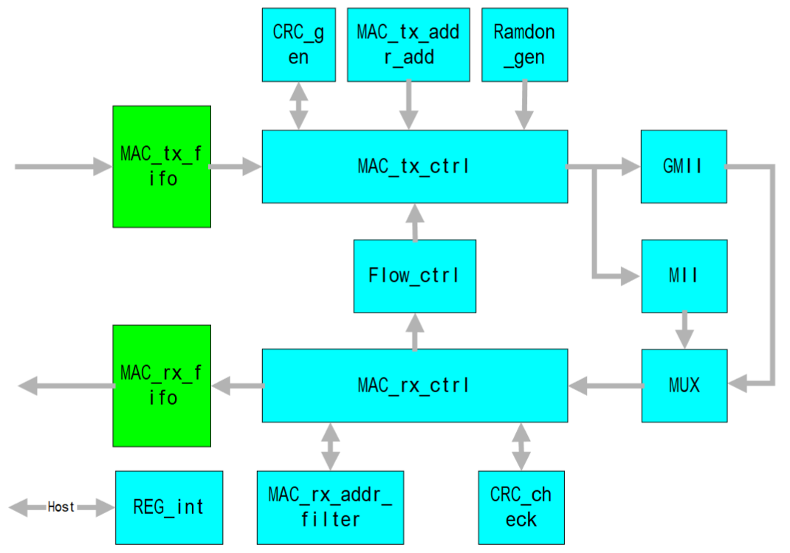
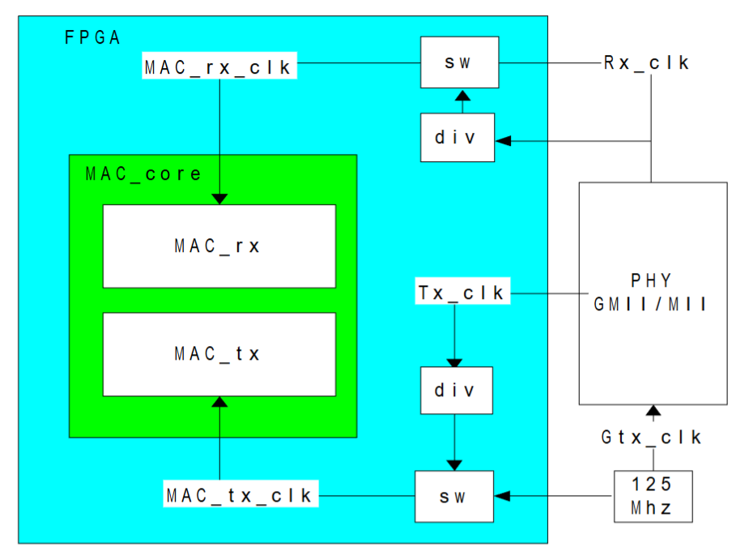

# MAC_top Design Specification

## 1. Introduction

`MAC_top` implements a 10/100/1000 Mbps tri-mode Ethernet MAC subsystem aligned to IEEE 802.3 MAC behavior. The top-level integrates transmit and receive MAC pipelines, PHY-side adaptation, host register control, MDIO management, optional address/broadcast filtering features, and RMON statistics collection.

The design provides:

- packet TX/RX user-side FIFO-style interfaces,
- GMII/MII PHY connectivity with speed-dependent clocking,
- host-programmable control/status register interface,
- MDIO management interface,
- flow-control pause generation/response,
- packet-length sideband FIFO for accepted RX packets.

## 2. Module Diagram

## 3. Top-Level Interface

### 3.1 System and Clocking

| Signal | Direction | Width | Description |
| --- | --- | --- | --- |
| `Reset` | Input | 1 | Global reset input used by major submodules. |
| `Clk_125M` | Input | 1 | 125 MHz reference clock for Gigabit operation and clock generation logic. |
| `Clk_user` | Input | 1 | User-side interface clock domain. |
| `Clk_reg` | Input | 1 | Host register/management clock domain. |
| `Speed` | Output | 3 | Programmed speed mode control exported from host register block. |
| `Gtx_clk` | Output | 1 | PHY transmit reference clock for GMII mode. |
| `Rx_clk` | Input | 1 | PHY receive clock input. |
| `Tx_clk` | Input | 1 | PHY transmit clock input (used in non-gigabit modes). |

### 3.2 User Receive Interface

| Signal | Direction | Width | Description |
| --- | --- | --- | --- |
| `Rx_mac_ra` | Output | 1 | RX data-available indicator to user logic. |
| `Rx_mac_rd` | Input | 1 | User read strobe for RX FIFO data. |
| `Rx_mac_data` | Output | 32 | RX payload data toward user logic. |
| `Rx_mac_BE` | Output | 2 | Byte-enable for final word alignment. |
| `Rx_mac_pa` | Output | 1 | Packet-available pulse/indicator from RX FIFO logic. |
| `Rx_mac_sop` | Output | 1 | Start-of-packet indication on user read side. |
| `Rx_mac_eop` | Output | 1 | End-of-packet indication on user read side. |

### 3.3 User Transmit Interface

| Signal | Direction | Width | Description |
| --- | --- | --- | --- |
| `Tx_mac_wa` | Output | 1 | TX write-allow/backpressure indication toward user logic. |
| `Tx_mac_wr` | Input | 1 | User write strobe for TX FIFO data. |
| `Tx_mac_data` | Input | 32 | TX payload data from user logic. |
| `Tx_mac_BE` | Input | 2 | Byte enable for packet tail word. |
| `Tx_mac_sop` | Input | 1 | Start-of-packet indication from user logic. |
| `Tx_mac_eop` | Input | 1 | End-of-packet indication from user logic. |

### 3.4 Packet-Length FIFO Interface

| Signal | Direction | Width | Description |
| --- | --- | --- | --- |
| `Pkg_lgth_fifo_rd` | Input | 1 | User read strobe for packet-length FIFO. |
| `Pkg_lgth_fifo_ra` | Output | 1 | Packet-length FIFO data-available indicator. |
| `Pkg_lgth_fifo_data` | Output | 16 | RX packet length sideband data. |

### 3.5 PHY Data Interface (GMII/MII)

| Signal | Direction | Width | Description |
| --- | --- | --- | --- |
| `Tx_er` | Output | 1 | PHY transmit error output. |
| `Tx_en` | Output | 1 | PHY transmit enable output. |
| `Txd` | Output | 8 | PHY transmit data bus. |
| `Rx_er` | Input | 1 | PHY receive error input. |
| `Rx_dv` | Input | 1 | PHY receive data-valid input. |
| `Rxd` | Input | 8 | PHY receive data bus. |
| `Crs` | Input | 1 | Carrier-sense input. |
| `Col` | Input | 1 | Collision indication input. |

### 3.6 Host Register Interface

| Signal | Direction | Width | Description |
| --- | --- | --- | --- |
| `CSB` | Input | 1 | Host chip-select (active-low behavior in register logic). |
| `WRB` | Input | 1 | Host read/write qualifier (`0` write, `1` read in register logic timing). |
| `CD_in` | Input | 16 | Host write data bus. |
| `CD_out` | Output | 16 | Host read data bus. |
| `CA` | Input | 8 | Host register address bus. |

### 3.7 MDIO Management Interface

| Signal | Direction | Width | Description |
| --- | --- | --- | --- |
| `Mdo` | Output | 1 | MDIO output data. |
| `MdoEn` | Output | 1 | MDIO output enable. |
| `Mdi` | Input | 1 | MDIO input data. |
| `Mdc` | Output | 1 | MDIO management clock. |

### 3.8 Interface Semantics

- `Tx_mac_wa` is used as TX-side backpressure indication based on programmable TX FIFO watermarks.
- `Rx_mac_ra` indicates RX data availability based on packet presence and RX FIFO watermark conditions.
- `Pkg_lgth_fifo_ra` is asserted when packet-length FIFO is not empty.
- No dedicated top-level packet-valid output exists beyond interface handshake signals.

## 4. Function Description

### 4.1 Architectural Operation

`MAC_top` integrates the following main processing paths:

- TX pipeline: user data buffering, frame formatting/control, optional source address replacement, CRC generation, duplex/collision handling, PHY transmission.
- RX pipeline: PHY adaptation, frame parsing, optional destination check and broadcast filtering, CRC/length checks, user-side buffering and metadata generation.
- Control/management path: host register block, MDIO management controller, RMON statistics counters, and speed/clock control.

### 4.2 TX Pipeline Behavior

- User packet words are accepted through TX FIFO interface under `Tx_mac_wa` flow control.
- TX control inserts preamble/SFD, transmits payload, pads short frames, appends FCS, and enforces IFG.
- In half-duplex operation (10/100 Mbps), collision detection drives jam/backoff/retry behavior with programmable retry limit.
- Pause-frame generation can be host-triggered and can transmit either nonzero quanta (pause) or zero quanta (resume) according to control signals.
- TX statistics events are emitted to the RMON subsystem with packet type/length/error classification.

### 4.3 RX Pipeline Behavior

- PHY receive symbols are adapted to internal MAC receive format according to speed mode.
- RX control performs preamble/SFD recognition, payload reception, IFG enforcement, CRC validation, and length checks.
- Frames can be dropped on CRC error, FIFO-full error, framing error, overlength/underlength conditions, address-check failure, or broadcast-filter throttle events.
- Accepted frames are pushed into RX FIFO and exposed on user RX interface with SOP/EOP and byte-enable indicators.
- RX pause frames are identified and decoded into pause quanta outputs used by TX flow-control logic.
- RX statistics events are emitted to RMON with packet type/length/error classification.

### 4.4 Tri-Mode Speed and PHY Adaptation

Speed register coding:

- `3'b100`: 1000 Mbps mode
- `3'b010`: 100 Mbps mode
- `3'b001`: 10 Mbps mode

Clocking/control blocks use speed information to select GMII vs non-gigabit clocking behavior and corresponding data adaptation behavior in the PHY interface path.

### 4.5 Optional Feature Behavior

The design supports optional feature blocks described by the specification:

- TX source MAC replacement,
- RX destination MAC check,
- RX broadcast-rate filtering.

These features are controlled through host-visible configuration registers and integrated in TX/RX datapaths.

### 4.6 RMON and Counter Read Flow

- TX and RX classification events update statistic counters.
- Counter reads are host-triggered using `CPU_rd_addr` and `CPU_rd_apply`.
- Read availability is indicated by `CPU_rd_grant`; data is returned in low/high 16-bit words (`CPU_rd_dout_l`, `CPU_rd_dout_h` via `CD_out` address mapping).

## 5. Implementation Details

### 5.1 Major Internal Functional Blocks

- `MAC_tx`: TX datapath and control integration (TX FIFO, TX FSM, CRC generation, pause support, optional source-address replacement).
- `MAC_rx`: RX datapath and control integration (RX parser/FSM, RX FIFO, CRC checker, optional destination-address check, optional broadcast filtering).
- `Clk_ctrl`: speed-aware clock divide/switch logic for TX/RX internal clocks and `Gtx_clk` generation.
- `Phy_int`: PHY-side adaptation between internal MAC byte stream and external GMII/MII-style signaling, including optional line loopback.
- `Reg_int`: host register decode/storage and control fanout into MAC, RMON, and MDIO management controls.
- `eth_miim`: MDIO master control path.
- `RMON`: statistics address generation, accumulation, and CPU read path.
- `afifo` packet-length FIFO path: cross-domain export of accepted RX packet length metadata.

### 5.2 Control-Path and Datapath Relationships

- Host register settings drive TX/RX watermarks, IFG limits, duplex/retry policy, pause handling, filter controls, and speed mode.
- TX/RX control FSMs govern frame acceptance, drop conditions, and packet lifecycle markers used by FIFO and RMON logic.
- `Clk_ctrl` and `Phy_int` jointly realize speed-dependent transfer behavior between MAC internal datapaths and PHY pins.
- RX successful packet completion with normal RMON classification is used to push packet length into sideband FIFO.

### 5.3 TX Control Sequencing (Behavioral)

- TX state progression includes defer/IFG/idle/preamble/SFD/data/pad/FCS and collision-related states (jam/backoff/drop).
- CRC generation is initialized at SFD entry, enabled across data/pause/pad, and read out in FCS state.
- Retry/backoff sequencing is bounded by programmable `MaxRetry`.
- Pause-state hold duration is quantized and coupled with flow-control control signals.

### 5.4 RX Control Sequencing (Behavioral)

- RX state progression includes idle/preamble/SFD/data/checkCRC/end/drop/IFG paths.
- CRC check, length window checks, address-check result, and broadcast filter result all participate in packet accept/drop decisions.
- Pause-frame parsing logic detects standard pause frame pattern and captures quanta value.
- RX output control generates SOP/EOP/error metadata for FIFO export and user-side framing.

### 5.5 Clock Domain Considerations

- Distinct domains exist for PHY-side timing, user-side data movement, and host register/management operations.
- Asynchronous FIFO structures and explicit control staging are used where user and MAC clocks differ.
- Register programming and MDIO management are synchronized to `Clk_reg`.

## 6. Submodule List

| Submodule | Functional Role | Key Interfaces |
| --- | --- | --- |
| `MAC_tx` | TX packet pipeline and PHY transmit control. | User TX interface, PHY TX interface, flow-control inputs, host TX controls, RMON TX outputs. |
| `MAC_rx` | RX packet pipeline and frame qualification/filtering. | PHY RX interface, user RX interface, host RX controls, flow-control outputs, RMON RX outputs. |
| `Clk_ctrl` | Speed-dependent clock generation/switching. | `Clk_125M`, `Rx_clk`, `Tx_clk`, `Speed`, generated MAC clocks. |
| `Phy_int` | Internal MAC <-> PHY signal adaptation, loopback support. | Internal MAC TX/RX byte/control signals, external PHY pins, `Speed`, `Line_loop_en`. |
| `Reg_int` | Host register bank and control-signal fanout. | `CSB`, `WRB`, `CA`, `CD_in`, `CD_out`, control/status fields. |
| `eth_miim` | MDIO management controller. | MDIO pins plus management control/status fields from host register block. |
| `RMON` | TX/RX statistic counter accumulation and host read access. | TX/RX RMON event inputs, CPU read control/status signals. |
| `afifo` (packet length path) | Cross-domain export of RX packet lengths. | RX write side (`MAC_rx_clk_div`), user read side (`Clk_user`), availability + data output. |

## 7. Register Map

### 7.1 Host Register Address Map

| Addr | Name | Access | Default (Spec) | Description |
| --- | --- | --- | --- | --- |
| `7'd000` | `Tx_Hwmark` | R/W | `16'h001e` | TX FIFO high watermark for backpressure control. |
| `7'd001` | `Tx_Lwmark` | R/W | `16'h0019` | TX FIFO low watermark for backpressure release. |
| `7'd002` | `pause_frame_send_en` | R/W | `16'h0000` | Enables software-triggered pause-frame generation path. |
| `7'd003` | `pause_quanta_set` | R/W | `16'h0000` | Quanta value used for generated pause frames. |
| `7'd004` | `IFGset` | R/W | `16'h0012` | TX inter-frame gap setting. |
| `7'd005` | `FullDuplex` | R/W | `16'h0001` | Duplex mode control (10/100 behavior impact). |
| `7'd006` | `MaxRetry` | R/W | `16'h0002` | Half-duplex collision retry limit. |
| `7'd007` | `MAC_tx_add_en` | R/W | `16'h0000` | TX source MAC replacement enable. |
| `7'd008` | `MAC_tx_add_prom_data` | R/W | `16'h0000` | TX source MAC programming data byte. |
| `7'd009` | `MAC_tx_add_prom_add` | R/W | `16'h0000` | TX source MAC programming byte address. |
| `7'd010` | `MAC_tx_add_prom_wr` | R/W | `16'h0000` | TX source MAC programming write strobe. |
| `7'd011` | `tx_pause_en` | R/W | `16'h0000` | Enables response to received pause frames. |
| `7'd012` | `xoff_cpu` | R/W | `16'h0000` | Host trigger for pause request frame generation. |
| `7'd013` | `xon_cpu` | R/W | `16'h0000` | Host trigger for pause release frame generation. |
| `7'd014` | `MAC_rx_add_chk_en` | R/W | `16'h0000` | RX destination MAC check enable. |
| `7'd015` | `MAC_rx_add_prom_data` | R/W | `16'h0000` | RX destination MAC programming data byte. |
| `7'd016` | `MAC_rx_add_prom_add` | R/W | `16'h0000` | RX destination MAC programming byte address. |
| `7'd017` | `MAC_rx_add_prom_wr` | R/W | `16'h0000` | RX destination MAC programming write strobe. |
| `7'd018` | `broadcast_filter_en` | R/W | `16'h0000` | Broadcast-rate filter enable. |
| `7'd019` | `broadcast_bucket_depth` | R/W | `16'h0000` | Broadcast token-bucket depth. |
| `7'd020` | `broadcast_bucket_interval` | R/W | `16'h0000` | Broadcast token-bucket refill interval. |
| `7'd021` | `RX_APPEND_CRC` | R/W | `16'h0000` | Controls whether RX path appends FCS to user data. |
| `7'd022` | `Rx_Hwmark` | R/W | `16'h001a` | RX FIFO high watermark for `Rx_mac_ra` behavior. |
| `7'd023` | `Rx_Lwmark` | R/W | `16'h0010` | RX FIFO low watermark for `Rx_mac_ra` behavior. |
| `7'd024` | `CRC_chk_en` | R/W | `16'h0000` | RX FCS check enable control. |
| `7'd025` | `RX_IFG_SET` | R/W | `16'h0012` | RX IFG acceptance threshold. |
| `7'd026` | `RX_MAX_LENGTH` | R/W | `16'h2710` | Maximum accepted RX frame length. |
| `7'd027` | `RX_MIN_LENGTH` | R/W | `16'h0040` | Minimum accepted RX frame length. |
| `7'd028` | `CPU_rd_addr` | R/W | `16'h0000` | RMON counter select address. |
| `7'd029` | `CPU_rd_apply` | R/W | `16'h0000` | RMON counter read-apply trigger. |
| `7'd030` | `CPU_rd_grant` | R | `16'h0000` | RMON read-ready indicator. |
| `7'd031` | `CPU_rd_dout_l` | R | `16'h0000` | Lower 16 bits of selected RMON counter. |
| `7'd032` | `CPU_rd_dout_h` | R | `16'h0000` | Upper 16 bits of selected RMON counter. |
| `7'd033` | `Line_loop_en` | R/W | `16'h0000` | Internal line-loopback enable in PHY adaptation block. |
| `7'd034` | `Speed` | R/W | `16'h0004` | Speed mode selector (`1000/100/10`). |

### 7.2 Register Access Behavior

- Register writes are sampled on `Clk_reg` rising edge when `CSB=0` and `WRB=0`.
- Register reads are returned on `CD_out` when `CSB=0` and `WRB=1`, indexed by `CA[7:1]`.
- RMON counter read flow uses `CPU_rd_addr` + `CPU_rd_apply`, then `CPU_rd_grant` indicates availability of `CPU_rd_dout`.

### 7.3 RMON Counter Address Space (`CPU_rd_addr`)

RX counters: `6'h00` through `6'h10` (packet bytes/count, broadcast/multicast/unicast, CRC/full/length errors, length buckets, pause frames).  
TX counters: `6'h20` through `6'h30` (packet bytes/count, broadcast/multicast/unicast, jam/underflow/overflow errors, length buckets, pause frames).

## 8. Clock and Reset

- `Reset` is distributed as a major asynchronous reset source in top-level and many submodules (`posedge Reset` sensitivity).
- Primary domains:
  - PHY/mac datapath clocks (`Clk_125M`, `Rx_clk`, `Tx_clk`, generated MAC clocks),
  - user interface clock (`Clk_user`),
  - host/management clock (`Clk_reg`).
- `Clk_ctrl` performs speed-dependent divide/switch operations to produce internal TX/RX clocks.

## 9. Constraints and Confirmation Items

- The design is not Wishbone-compatible.
- Specification PDF defaults and RTL register defaults differ for some fields (for example `Tx_Hwmark`, `Tx_Lwmark`, `IFGset`, `RX_IFG_SET`); verify integration assumptions against the intended release baseline.
- Speed selection logic uses encoded `Speed` value; clock-switch logic is primarily keyed by `Speed[2]` for gigabit vs non-gigabit paths.
- User logic should treat `Tx_mac_wa`, `Rx_mac_ra`, SOP/EOP, and byte-enable signals as authoritative packet transfer qualifiers.
- RMON reads are transactional and require `CPU_rd_apply`/`CPU_rd_grant` handshake discipline.
