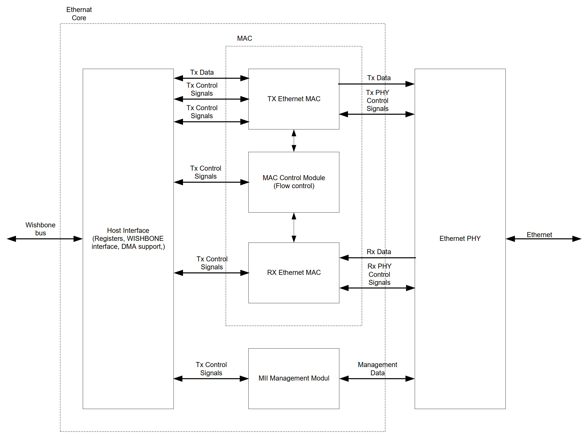
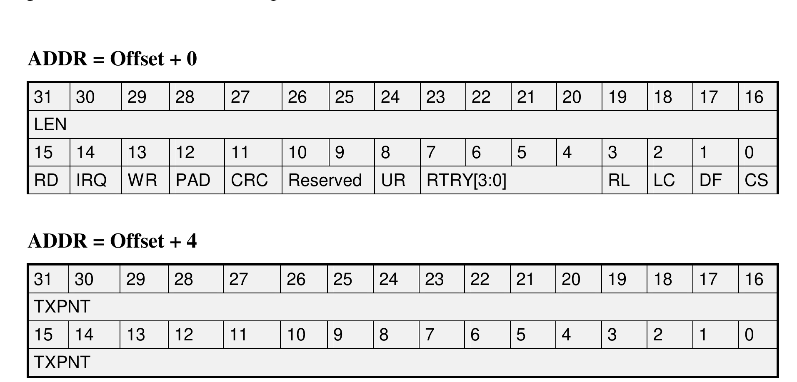
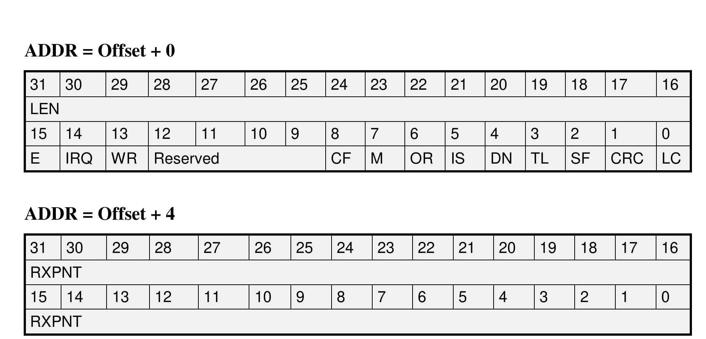

# eth_top Design Specification

## 1. Introduction
`eth_top` integrates an Ethernet MAC subsystem with:
- A WISHBONE slave host interface for configuration registers and buffer-descriptor (BD) RAM access.
- A WISHBONE master DMA interface for frame data movement to/from system memory.
- MII transmit/receive datapaths for the external PHY.
- An MIIM management interface for PHY register access.
- Interrupt generation for transmit, receive, control-frame, and buffer-availability events.

The top-level combines transmit MAC, receive MAC, MAC control, status tracking, register/control logic, MIIM control, and the DMA/descriptor engine into one module.

## 2. Module Diagram

## 3. Top-Level Interface

| Signal | Direction | Width | Description |
| --- | --- | --- | --- |
| `wb_clk_i` | Input | 1 | Host WISHBONE clock domain for register and DMA control logic. |
| `wb_rst_i` | Input | 1 | Active-high reset for top-level integrated blocks. |
| `wb_dat_i` | Input | 32 | WISHBONE slave write data. |
| `wb_dat_o` | Output | 32 | WISHBONE slave read data (register bank or BD RAM read path). |
| `wb_err_o` | Output | 1 | WISHBONE slave error response for invalid access conditions. |
| `wb_adr_i` | Input | 10 (`[11:2]`) | WISHBONE slave word address into register/BD decode space. |
| `wb_sel_i` | Input | 4 | WISHBONE byte-lane select. |
| `wb_we_i` | Input | 1 | WISHBONE slave write/read qualifier. |
| `wb_cyc_i` | Input | 1 | WISHBONE cycle valid. |
| `wb_stb_i` | Input | 1 | WISHBONE strobe valid. |
| `wb_ack_o` | Output | 1 | WISHBONE slave acknowledge. |
| `m_wb_adr_o` | Output | 32 | WISHBONE master DMA address output (`{m_wb_adr_tmp, 2'b00}`). |
| `m_wb_sel_o` | Output | 4 | WISHBONE master DMA byte select. |
| `m_wb_we_o` | Output | 1 | WISHBONE master DMA write/read qualifier. |
| `m_wb_dat_i` | Input | 32 | WISHBONE master DMA read data input. |
| `m_wb_dat_o` | Output | 32 | WISHBONE master DMA write data output. |
| `m_wb_cyc_o` | Output | 1 | WISHBONE master DMA cycle valid. |
| `m_wb_stb_o` | Output | 1 | WISHBONE master DMA strobe valid (`m_wb_stb_o = m_wb_cyc_o`). |
| `m_wb_ack_i` | Input | 1 | WISHBONE master DMA acknowledge input. |
| `m_wb_err_i` | Input | 1 | WISHBONE master DMA error input. |
| `m_wb_cti_o` | Output | 3 | Optional WISHBONE B3 cycle type indicator (`ETH_WISHBONE_B3`). |
| `m_wb_bte_o` | Output | 2 | Optional WISHBONE B3 burst type extension (`ETH_WISHBONE_B3`). |
| `mtx_clk_pad_i` | Input | 1 | MII transmit clock from PHY. |
| `mtxd_pad_o` | Output | 4 | MII transmit nibble to PHY. |
| `mtxen_pad_o` | Output | 1 | MII transmit enable to PHY. |
| `mtxerr_pad_o` | Output | 1 | MII transmit error to PHY. |
| `mrx_clk_pad_i` | Input | 1 | MII receive clock from PHY. |
| `mrxd_pad_i` | Input | 4 | MII receive nibble from PHY. |
| `mrxdv_pad_i` | Input | 1 | MII receive data valid from PHY. |
| `mrxerr_pad_i` | Input | 1 | MII receive error from PHY. |
| `mcoll_pad_i` | Input | 1 | MII collision indication from PHY. |
| `mcrs_pad_i` | Input | 1 | MII carrier sense from PHY. |
| `md_pad_i` | Input | 1 | MIIM MDIO input from pad cell. |
| `mdc_pad_o` | Output | 1 | MIIM management clock to PHY. |
| `md_pad_o` | Output | 1 | MIIM MDIO output to pad cell. |
| `md_padoe_o` | Output | 1 | MIIM MDIO output enable to pad cell. |
| `int_o` | Output | 1 | Interrupt output (masked OR of interrupt source bits). |
| `mbist_si_i` | Input | 1 | Optional MBIST scan-in (`ETH_BIST`). |
| `mbist_so_o` | Output | 1 | Optional MBIST scan-out (`ETH_BIST`). |
| `mbist_ctrl_i` | Input | ``[`ETH_MBIST_CTRL_WIDTH-1:0]`` | Optional MBIST control bus (`ETH_BIST`). |

### 3.1 WISHBONE Slave Address Regions

| Address range | Selection | Function |
| --- | --- | --- |
| `0x000`-`0x3FF` | `RegCs` | Configuration/status register block (`eth_registers`). |
| `0x400`-`0x7FF` | `BDCs` | Internal BD RAM access via `eth_wishbone`. |
| `0x800`-`0xFFF` | `CsMiss` | Miss region; no valid register/BD content returned. |

### 3.2 WISHBONE Slave Response Semantics

- `ByteSelected = |wb_sel_i`. If all byte lanes are deasserted, access is treated as invalid.
- `wb_err_o` is asserted for invalid byte-lane selection or miss-region access.
- `wb_dat_o` is muxed between register-read data and BD path data.
- `wb_ack_o` is generated from register select and BD acknowledge paths.
- If `ETH_AVALON_BUS` is enabled, miss-region accesses are also acknowledged.
- If `ETH_REGISTERED_OUTPUTS` is enabled, `wb_ack_o`, `wb_dat_o`, and `wb_err_o` are registered output versions.

## 4. Register and Descriptor Model

### 4.1 Register Map (byte offsets)

| Offset | Name | Access | Purpose |
| --- | --- | --- | --- |
| `0x00` | `MODER` | RW | MAC mode enable/configuration. |
| `0x04` | `INT_SOURCE` | RW | Latched interrupt source bits (write-1-to-clear). |
| `0x08` | `INT_MASK` | RW | Interrupt masks. |
| `0x0C` | `IPGT` | RW | Back-to-back inter-packet gap setting. |
| `0x10` | `IPGR1` | RW | Non-back-to-back inter-packet gap part 1. |
| `0x14` | `IPGR2` | RW | Non-back-to-back inter-packet gap part 2. |
| `0x18` | `PACKETLEN` | RW | Minimum/maximum frame length limits. |
| `0x1C` | `COLLCONF` | RW | Retry and collision-window settings. |
| `0x20` | `TX_BD_NUM` | RW | Number of Tx descriptors (Rx descriptors are remainder). |
| `0x24` | `CTRLMODER` | RW | Flow-control behavior (`TXFLOW`, `RXFLOW`, `PASSALL`). |
| `0x28` | `MIIMODER` | RW | MIIM preamble/clock divider settings. |
| `0x2C` | `MIICOMMAND` | RW | MIIM command control bits. |
| `0x30` | `MIIADDRESS` | RW | PHY (`FIAD`) and register (`RGAD`) address selection. |
| `0x34` | `MIITX_DATA` | RW | MIIM write payload. |
| `0x38` | `MIIRX_DATA` | R (host-visible) | MIIM read payload captured from PHY. |
| `0x3C` | `MIISTATUS` | R | MIIM status (`NVALID`, `BUSY`, `LINKFAIL`). |
| `0x40` | `MAC_ADDR0` | RW | Lower 32 bits of MAC address bytes [5:2]. |
| `0x44` | `MAC_ADDR1` | RW | Upper 16 bits of MAC address bytes [1:0]. |
| `0x48` | `HASH0` | RW | Hash filter lower 32 bits. |
| `0x4C` | `HASH1` | RW | Hash filter upper 32 bits. |
| `0x50` | `TX_CTRL` | RW | PAUSE control request and timer value. |

Reset values in RTL match documented defaults (for example `MODER=0x0000A000`, `IPGT=0x12`, `IPGR1=0x0C`, `IPGR2=0x12`, `PACKETLEN=0x00400600`, `COLLCONF=0x000F003F`, `TX_BD_NUM=0x40`, `MIIMODER=0x64`).

### 4.2 Key Register Field Semantics

#### `MODER` (`0x00`)
- Enables/disables TX and RX paths (`TXEN`, `RXEN`) and controls duplex, loopback, CRC/pad behavior, filtering modes, and preamble handling.
- In implementation, `r_TxEn` is additionally gated by `TX_BD_NUM > 0`.
- In implementation, `r_RxEn` is additionally gated by `TX_BD_NUM < 0x80`.

#### `INT_SOURCE` (`0x04`) and `INT_MASK` (`0x08`)
- Source bits: `TXB`, `TXE`, `RXB`, `RXE`, `BUSY`, `TXC`, `RXC`.
- Each source bit is latched when its event occurs and cleared by writing `1` to that bit position.
- `int_o` is a masked OR of source bits and corresponding `INT_MASK` bits.

#### `PACKETLEN` (`0x18`) and `COLLCONF` (`0x1C`)
- `PACKETLEN` defines `MINFL` and `MAXFL` checks used by TX/RX logic.
- `COLLCONF` defines retry limit and collision window used by Tx MAC collision handling.

#### `TX_BD_NUM` (`0x20`)
- Specifies count of Tx descriptors in the 128-entry descriptor RAM.
- RTL write is limited to values `<= 0x80`; larger writes are ignored.

#### `CTRLMODER` (`0x24`)
- `TXFLOW`: allows PAUSE control-frame transmission path.
- `RXFLOW`: enables PAUSE receive behavior (pause timer/control response).
- `PASSALL`: controls whether control frames are forwarded as normal received frames.

#### `MIIMODER`/`MIICOMMAND`/`MIIADDRESS`/`MIITX_DATA`/`MIIRX_DATA`/`MIISTATUS`
- MIIM command bits trigger PHY management operations.
- `MIICOMMAND.RSTAT` and `MIICOMMAND.WCTRLDATA` are synchronously cleared by start pulses in RTL.
- `MIIRX_DATA` is updated from MIIM read data when `UpdateMIIRX_DATAReg` pulses.
- `MIISTATUS.BUSY` indicates operation-in-progress; software sequences commands accordingly.

#### `TX_CTRL` (`0x50`)
- `TXPAUSETV[15:0]` carries PAUSE timer value for control-frame generation.
- `TXPAUSERQ` is request bit; in RTL it is synchronously reset after request consumption.

### 4.3 Descriptor RAM Organization

- Internal BD RAM spans WISHBONE slave address range `0x400`-`0x7FF`.
- BD entry size is 64 bits (status/length word + pointer word).
- Up to 128 descriptors are supported.
- Tx descriptor region: first `TX_BD_NUM` entries.
- Rx descriptor region: remaining entries.

### 4.4 Tx Buffer Descriptor (BD) Semantics

The transmit buffer descriptor consists of two 32-bit words. The bit layout below is the authoritative reference for this section.

**Word 0 (Offset + 0): status and length**
- `LEN[31:16]`: transmit frame length in bytes for the associated buffer.
- `RD[15]`: ready bit. When set, the descriptor is owned by the MAC and is eligible for transmission.
- `IRQ[14]`: interrupt enable for this descriptor; requests an interrupt when processing of this BD completes.
- `WR[13]`: wrap bit; marks this BD as the last entry in the Tx BD ring, so the next descriptor access returns to the first Tx BD.
- `PAD[12]`: pad-enable control for this packet.
- `CRC[11]`: CRC-append control for this packet.
- `Reserved[10:9]`: reserved.
- `UR[8]`: transmit underrun status.
- `RTRY[7:4]`: retry count recorded for this transmission attempt.
- `RL[3]`: retry-limit status.
- `LC[2]`: late-collision status.
- `DF[1]`: defer indication.
- `CS[0]`: carrier-sense-lost indication.

**Word 1 (Offset + 4): buffer pointer**
- `TXPNT[31:0]`: pointer to the transmit frame buffer in system memory.

### 4.5 Rx Buffer Descriptor (BD) Semantics

The receive buffer descriptor also consists of two 32-bit words. The figure below is the authoritative reference for the field layout.

**Word 0 (Offset + 0): status and length**
- `LEN[31:16]`: received frame length in bytes.
- `E[15]`: empty bit. When set, the descriptor is available for the MAC to store an incoming frame.
- `IRQ[14]`: interrupt enable for this descriptor; requests an interrupt when reception into this BD completes.
- `WR[13]`: wrap bit; marks this BD as the last entry in the Rx BD ring, so the next descriptor access returns to the first Rx BD.
- `Reserved[12:9]`: reserved.
- `CF[8]`: control-frame indication.
- `M[7]`: address-miss indication.
- `OR[6]`: overrun indication.
- `IS[5]`: invalid-symbol indication.
- `DN[4]`: dribble-nibble indication.
- `TL[3]`: too-long-frame indication.
- `SF[2]`: short-frame indication.
- `CRC[1]`: CRC-error indication.
- `LC[0]`: late-collision indication.

**Word 1 (Offset + 4): buffer pointer**
- `RXPNT[31:0]`: pointer to the receive buffer in system memory.

## 5. Functional Description

### 5.1 Reset and Enable Behavior

- `wb_rst_i` resets integrated control, Tx/Rx MAC, MIIM, and DMA/descriptor state in this top-level integration.
- TX and RX functional enables are controlled by `MODER` but constrained by descriptor partitioning (`TX_BD_NUM`).
- The design expects register configuration before enabling active frame traffic.

### 5.2 Transmit Operation Flow

1. Software prepares frame data in memory.
2. Software programs a Tx BD (length, pointer, control bits) and sets `RD`.
3. `eth_wishbone` reads Tx BD and pointer, performs DMA reads through the WISHBONE master interface, and fills Tx FIFO.
4. `eth_txethmac` transmits nibbles on MII TX pins with collision/defer/backoff handling in half-duplex mode.
5. On completion/error/retry-abort conditions, status is written back to Tx BD and interrupt events are generated according to descriptor IRQ and interrupt mask settings.

Implementation notes:
- Tx start framing is synchronized from WB domain into TX clock domain.
- Tx status writeback is blocked/latched to ensure one status update per packet completion event.

### 5.3 Receive Operation Flow

1. Software marks Rx BDs empty (`E=1`) and configures pointers.
2. `eth_rxethmac` receives MII nibbles, performs framing/CRC/address checks, and outputs byte stream/status events.
3. `eth_wishbone` transfers received data into memory via WISHBONE master writes.
4. At frame end or abort, Rx status and length are written back to Rx BD.
5. Rx interrupt events are generated from status writeback conditions and mask settings.

Implementation notes:
- Rx enable is synchronized and only updated when `mrxdv_pad_i` is inactive.
- Rx abort/status indications are synchronized between RX and WB clock domains.

### 5.4 MAC Control and PAUSE Frames

- `eth_maccontrol` inserts control-frame generation and detection between host-facing and Tx/Rx MAC-facing interfaces.
- Transmit PAUSE generation is requested by writing `TX_CTRL.TXPAUSERQ` with `CTRLMODER.TXFLOW` enabled.
- Received PAUSE behavior depends on `CTRLMODER.RXFLOW` and `CTRLMODER.PASSALL`.
- Pause request and completion indications are synchronized across WB and TX clock domains.

### 5.5 MIIM Management Operation

- `eth_miim` executes PHY management transactions based on register-programmed operation bits and addressing.
- `mdc_pad_o` is generated from host clock and divider setting.
- `md_pad_o` and `md_padoe_o` drive MDIO output/output-enable; `md_pad_i` is sampled for PHY response data.
- Read completion updates `MIIRX_DATA`; status is reflected via `MIISTATUS` bits.

### 5.6 Loopback and MII Signal Selection

- When loopback mode is enabled (`MODER.LOOPBCK`), RX datapath input muxes from TX outputs (`mtxd_pad_o`, `mtxen_pad_o`, `mtxerr_pad_o`) instead of PHY RX pins.
- Collision/carrier inputs are synchronized before use in Tx MAC logic.

## 6. Implementation Details

### 6.1 Top-Level Control Partition

- `eth_top` separates three principal clock domains:
  - `wb_clk_i` for host register, descriptor, and DMA control sequencing.
  - `mtx_clk_pad_i` for TX MAC datapath/control.
  - `mrx_clk_pad_i` for RX MAC datapath/control.
- Register block (`eth_registers`) provides host-visible configuration and interrupt latches.
- Descriptor/DMA block (`eth_wishbone`) performs BD RAM access and WISHBONE-master memory transfers.
- MAC datapath/control blocks handle transmit, receive, flow-control, and status extraction.

### 6.2 Descriptor and DMA Engine Behavior (`eth_wishbone`)

- BD RAM is a synchronous single-port RAM accessed in time-multiplexed stages (host/Tx/Rx accesses).
- `WB_ACK_O` for BD accesses is generated from staged read/write controls.
- DMA master control arbitrates transmit reads vs receive writes and supports burst signaling (`m_wb_cti_o`) when enabled.
- `m_wb_bte_o` is driven to linear burst mode.
- Tx and Rx pointers, lengths, and status fields are latched and updated through dedicated control sequences.

### 6.3 Status/Interrupt Realization

- `eth_macstatus` captures receive and transmit status conditions (CRC, size checks, collision/defer-related status, carrier-sense-lost, etc.).
- `eth_registers` latches interrupt source bits and applies write-1-to-clear semantics.
- `int_o` is combinationally derived from source latches and mask bits.

### 6.4 Clock-Domain Crossing and Synchronization

- `eth_top` includes explicit synchronizers for:
  - Carrier sense and collision into TX clock domain.
  - `WillSendControlFrame` into WB clock domain for pause-request reset.
  - Pause request (`r_TxPauseRq`) into TX clock domain.
  - Rx abort/status-related indications between RX and WB domains.
- `eth_wishbone` includes additional synchronizers for Tx start, Rx status write, and FIFO control interactions across clock domains.

## 7. Submodules

### 7.1 `eth_registers`

Role:
- Implements host-visible configuration/status registers and interrupt controller.

Key interface:

| Signal | Direction | Width | Description |
| --- | --- | --- | --- |
| `DataIn` | Input | 32 | Register write data. |
| `Address` | Input | 8 | Register word address decode (`wb_adr_i[9:2]`). |
| `Cs` | Input | 4 | Byte-lane chip-selects from top-level decode. |
| `DataOut` | Output | 32 | Register read mux output. |
| `int_o` | Output | 1 | Masked interrupt output. |
| `r_*` controls | Output | various | MAC/MIIM configuration and mode signals. |

### 7.2 `eth_wishbone`

Role:
- Owns BD RAM access protocol and WISHBONE master DMA traffic for Tx/Rx frame payload movement.

Key interface:

| Signal | Direction | Width | Description |
| --- | --- | --- | --- |
| `WB_*` slave | In/Out | various | BD RAM access channel from top-level host interface decode. |
| `m_wb_*` master | In/Out | various | DMA channel to system memory for frame data read/write. |
| `Tx*` / `Rx*` datapath | In/Out | various | Tx/Rx byte stream and frame boundary/status handshake to MAC blocks. |
| `TxB_IRQ` ... `Busy_IRQ` | Output | 1 each | Event pulses used by register interrupt latches. |
| `BDCs` | Input | 4 | Descriptor-space byte-lane selects. |

### 7.3 `eth_txethmac`

Role:
- Implements transmit-side Ethernet MAC state machine, MII output generation, collision/defer/backoff handling, and transmit status signaling.

Key interface:

| Signal | Direction | Width | Description |
| --- | --- | --- | --- |
| `TxData`, `TxStartFrm`, `TxEndFrm` | Input | 8/1/1 | Packet data and frame boundary controls. |
| `CarrierSense`, `Collision` | Input | 1 | Synchronized medium state indications. |
| `MTxD`, `MTxEn`, `MTxErr` | Output | 4/1/1 | MII transmit outputs. |
| `TxDone`, `TxRetry`, `TxAbort` | Output | 1 | Tx completion/retry/abort status. |
| `RetryCnt`, `LateCollision`, `DeferIndication` | Output | various | Status fields used for descriptor writeback. |

### 7.4 `eth_rxethmac`

Role:
- Implements receive-side Ethernet MAC framing, length/CRC checks, address filter integration, and Rx status event generation.

Key interface:

| Signal | Direction | Width | Description |
| --- | --- | --- | --- |
| `MRxDV`, `MRxD` | Input | 1/4 | MII receive data-valid and nibble data. |
| `RxData`, `RxValid`, `RxStartFrm`, `RxEndFrm` | Output | 8/1/1/1 | Byte-stream output and frame boundaries. |
| `ByteCnt`, `CrcError`, `RxAbort`, `AddressMiss` | Output | various | Receive status outputs used by status/DMA blocks. |
| `MAC`, `r_Pro`, `r_Bro`, `r_HASH0`, `r_HASH1` | Input | various | Address filtering configuration. |

### 7.5 `eth_maccontrol`

Role:
- Mediates between normal frame path and PAUSE control-frame path for transmit/receive flow-control behavior.

Key interface:

| Signal | Direction | Width | Description |
| --- | --- | --- | --- |
| `TPauseRq`, `TxPauseTV` | Input | 1/16 | PAUSE frame generation request and timer value. |
| `TxDataIn`..`TxAbortIn` | Input | various | Host/TX-MAC transmit-path signals before control mux. |
| `TxDataOut`..`TxAbortOut` | Output | various | Muxed transmit-path outputs to Tx MAC/host. |
| `ReceivedPauseFrm`, `SetPauseTimer` | Output | 1 | Control-frame receive outcomes. |
| `WillSendControlFrame`, `TxCtrlEndFrm` | Output | 1 | Control-frame transmit indicators. |

### 7.6 `eth_macstatus`

Role:
- Captures and latches detailed Rx/Tx status conditions used for descriptor status update and host-visible interrupts.

Key interface:

| Signal | Direction | Width | Description |
| --- | --- | --- | --- |
| `Rx*` status/state inputs | Input | various | Receive-path conditions and counters. |
| `Tx*` status/state inputs | Input | various | Transmit-path retry/collision/defer conditions. |
| `LoadRxStatus`, `RetryCntLatched`, `LateCollLatched` | Output | various | Latched status outputs to descriptor/writeback logic. |
| `LatchedMRxErr`, `CarrierSenseLost` | Output | 1 | Additional status qualifiers. |

### 7.7 `eth_miim`

Role:
- Implements MDIO management transactions and returns PHY status/readback data to register block.

Key interface:

| Signal | Direction | Width | Description |
| --- | --- | --- | --- |
| `Divider`, `NoPre`, `CtrlData`, `Rgad`, `Fiad` | Input | various | MIIM operation configuration from registers. |
| `WCtrlData`, `RStat`, `ScanStat` | Input | 1 | MIIM command controls. |
| `Mdi`, `Mdo`, `MdoEn`, `Mdc` | In/Out | 1 | MDIO and MDC physical interface controls. |
| `Busy`, `Nvalid`, `LinkFail`, `Prsd` | Output | various | MIIM status and read data. |
| `WCtrlDataStart`, `RStatStart`, `UpdateMIIRX_DATAReg` | Output | 1 | Handshake pulses back to register block. |

## 8. Clock and Reset

| Signal | Type | Scope |
| --- | --- | --- |
| `wb_clk_i` | Clock | Register block, BD/DMA control, host-interface decode and top-level control. |
| `mtx_clk_pad_i` | Clock | Transmit MAC data/control path and related CDC endpoints. |
| `mrx_clk_pad_i` | Clock | Receive MAC data/control path and related CDC endpoints. |
| `wb_rst_i` | Reset | Active-high reset used by top-level and connected submodules. |

Clock-domain crossing is handled through explicit synchronizer chains in top-level and DMA blocks for event, control, and status signals.

## 9. Constraints and Integration Notes

- Configure register set and descriptor partition (`TX_BD_NUM`) before enabling active TX/RX traffic.
- Descriptor ownership bits (`RD` for Tx, `E` for Rx) govern whether software or MAC/DMA path may modify descriptor content.
- Byte-lane accesses are supported by register decode (`wb_sel_i`), but all-zero select is invalid and causes error response.
- `md_pad_i`, `md_pad_o`, and `md_padoe_o` require external bidirectional pad-cell integration for MDIO.
- Optional interfaces depend on compile-time macros (`ETH_WISHBONE_B3`, `ETH_BIST`, `ETH_REGISTERED_OUTPUTS`, `ETH_AVALON_BUS`).
- Top-level source comments indicate migration naming toward `ethmac.v`; this specification targets the implemented `eth_top` integration in the provided RTL set.
