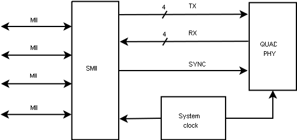
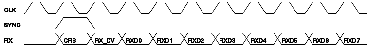
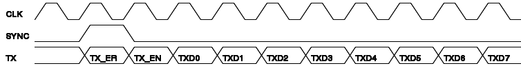

# smii_txrx Design Specification

## 1. Introduction
`smii_txrx` implements one SMII transceiver channel that bridges a serial SMII data pair (`tx`, `rx`) and a conventional MII-side transmit/receive interface. The module uses an externally supplied 10-phase state vector (`state[1:10]`) to align transmit serialization, receive deserialization, and MII clock pulse generation.

This module is intended to be used with a shared SMII synchronization generator. It does not generate `sync` itself.

## 2. Module Diagram

## 3. Interface

| Signal | Direction | Width | Description |
| --- | --- | --- | --- |
| `tx` | Output | 1 | SMII transmit serial output toward PHY/remote endpoint. |
| `rx` | Input | 1 | SMII receive serial input from PHY/remote endpoint. |
| `mtxd` | Input | 4 | MII transmit nibble input. |
| `mtxen` | Input | 1 | MII transmit enable input. |
| `mtxerr` | Input | 1 | MII transmit error input. |
| `mtx_clk` | Output | 1 | MII transmit clock output pulse stream derived from SMII phase state and speed mode. |
| `mrxd` | Output | 4 | MII receive nibble output reconstructed from serial RX stream. |
| `mrxdv` | Output | 1 | MII receive data-valid output. |
| `mrxerr` | Output | 1 | MII receive error status output. |
| `mrx_clk` | Output | 1 | MII receive clock output pulse stream derived from SMII phase state and speed mode. |
| `mcoll` | Output | 1 | MII collision output (`mcrs & mtxen`). |
| `mcrs` | Output | 1 | MII carrier-sense output. |
| `speed` | Output | 1 | Optional status output when `SMII_SPEED` is defined (`0`: 10 Mb/s mode, `1`: 100 Mb/s mode). |
| `duplex` | Output | 1 | Optional status output when `SMII_DUPLEX` is defined (`0`: half duplex, `1`: full duplex). |
| `link` | Output | 1 | Optional status output when `SMII_LINK` is defined (`0`: link down, `1`: link up). |
| `state` | Input | 10 (`[1:10]`) | One-hot SMII phase vector used as the module timing reference for segment-position logic. |
| `clk` | Input | 1 | System reference clock used by all sequential logic (SMII reference-clock domain). |
| `rst` | Input | 1 | Asynchronous reset, active high. |

### 3.1 Interface Semantics

- `state` is an input contract to this module: exactly one phase bit is expected active per clock, and phase progression is expected to follow the SMII 10-bit segment cadence.
- `tx` and `mcoll` are combinational outputs derived from registered internal state and current inputs.
- `mrxd`, `mrxdv`, `mrxerr`, `mcrs`, and optional status bits (`speed`, `duplex`, `link`) are registered outputs.
- `mtx_clk` and `mrx_clk` are generated from registered internal clock-pulse signals; under `ACTEL`, they are routed through global buffer primitives.

## 4. Function Description

### 4.1 Operational Role

The module performs both directions of SMII conversion for one channel:
- MII TX (`mtxd`, `mtxen`, `mtxerr`) -> serialized SMII `tx`.
- Serial SMII `rx` -> MII RX/status outputs (`mrxd`, `mrxdv`, `mrxerr`, `mcrs`, optional `speed`/`duplex`/`link`).

Each SMII segment is treated as a 10-position frame indexed by `state[1:10]`.

### 4.2 Speed-Dependent Segment Handling

The received status bit `speed` controls segment-rate adaptation:
- `speed=1` (100 Mb/s mode): `tx_cnt` and `rx_cnt` are held at zero; TX/RX update opportunities occur every segment.
- `speed=0` (10 Mb/s mode): `tx_cnt` and `rx_cnt` count modulo 10 using `state[10]` as the segment boundary marker; MII-facing update pulses are emitted only when the counter is zero.

This realizes segment repetition behavior in 10 Mb/s mode without changing external `state` cadence.

### 4.3 Transmit Path

Transmit operation is phase-driven and uses a two-nibble assembly scheme:
1. On selected phase points (`state[4]` and `state[9]`, gated by `tx_cnt==0`), input nibbles are captured into `tx_data_reg`.
2. Internal flag `a0` tracks lower/upper nibble capture order, and `tx_data_reg_valid` is asserted after both nibbles are available.
3. At `state[1]` (gated by `tx_cnt==0`), `state_data` latches whether the outgoing segment carries packet data or status information.
4. `tx` is then encoded by phase:
- Phase-1 position carries transmit error indication.
- Phase-2 position carries transmit-enable/data-present indication.
- Remaining positions carry either data bits (when `state_data=1`) or status pattern bits (when `state_data=0`).

### 4.4 Receive Path

Receive processing samples serial `rx` each clock and reconstructs MII outputs under phase control:
1. `rx` is shifted through `rx_tmp` to align serial samples with phase decode logic.
2. Carrier-sense (`mcrs`) is captured at a dedicated phase.
3. Receive-data-valid is tracked via `rx_tmp[3]`; this determines whether subsequent positions are interpreted as packet data or status fields.
4. When data-valid is active, `mrxd` is reconstructed from serial samples and `mrxdv` is asserted at the corresponding update phase.
5. When data-valid is inactive, status fields are updated from serial positions, including receive error and link/mode status (`mrxerr`, `speed`, `duplex`, `link`, plus internal `jabber`).

### 4.5 MII Clock and Collision Outputs

- `mtx_clk` pulse generation is phase- and speed-gated by `state` and `tx_cnt`.
- `mrx_clk` pulse generation is phase- and speed-gated by `state` and `rx_cnt`.
- `mcoll` is asserted whenever `mcrs` and `mtxen` are simultaneously high.

## 5. Implementation Details

### 5.1 Internal Control/Datapath Elements

Key internal elements and roles:
- `tx_data_reg[0:7]`: temporary storage for one transmit byte assembled from two MII nibbles.
- `tx_data_reg_valid`: marks availability of a complete transmit byte.
- `a0`: nibble-order tracker for TX assembly.
- `state_data`: per-segment mode latch selecting data payload versus status payload on `tx`.
- `rx_tmp[3:0]`: serial receive shift/register staging for phase-aligned decode.
- `tx_cnt`, `rx_cnt`: speed-dependent segment repeat counters for TX and RX timing adaptation.
- `mtx_clk_tmp`, `mrx_clk_tmp`: internal pulse sources for MII transmit/receive clocks.

### 5.2 Transmit Realization

The TX path couples control and datapath as follows:
- `state` determines when nibbles are sampled and when serialization positions are emitted.
- `tx_cnt` suppresses repeated updates in 10 Mb/s mode by enabling updates only on count zero.
- `state_data` captures segment payload type once per segment start and stabilizes the encode choice for subsequent bit positions.

### 5.3 Receive Realization

The RX path uses phase-qualified sampling and conditional decode:
- Serial samples are staged in `rx_tmp` and interpreted according to current phase and receive-data-valid context.
- Data decode path updates `mrxd`/`mrxdv`.
- Status decode path updates `mrxerr`, `speed`, `duplex`, `link`, and internal `jabber` state.
- `rx_cnt` uses `speed` and phase boundaries to align MII clock pulse cadence with SMII mode.

### 5.4 Macro-Dependent Behavior

- `SMII_SPEED`, `SMII_DUPLEX`, `SMII_LINK`: expose corresponding status registers as output ports; when not defined, the registers remain internal.
- `ACTEL`: inserts global clock-buffer instances for `mtx_clk` and `mrx_clk` outputs.

## 6. Submodule List

No architecturally required internal submodules are instantiated in `smii_txrx`.

Implementation note: when `ACTEL` is defined, target-specific global buffer primitives (`gbuf`) are conditionally instantiated for MII clock outputs.

## 7. Clock and Reset

- Clock domain: all sequential behavior is synchronous to `clk`.
- Reset: `rst` is asynchronous and active high, applied in all sequential always blocks.
- Reset initializes counters, TX/RX staging registers, status registers, and generated clock pulse state.

## 8. Constraints

- `state[1:10]` must be provided by external SMII synchronization logic and must maintain consistent 10-phase one-hot progression.
- This module assumes SMII segment timing is already established by the shared reference clock and external phase generation.
- In 10 Mb/s mode, MII-side update/clock pulses occur once per repeated segment group; integration and verification should account for this mode-dependent cadence.
- Optional outputs (`speed`, `duplex`, `link`) depend on synthesis defines and may be absent from the compiled interface when corresponding macros are not enabled.
