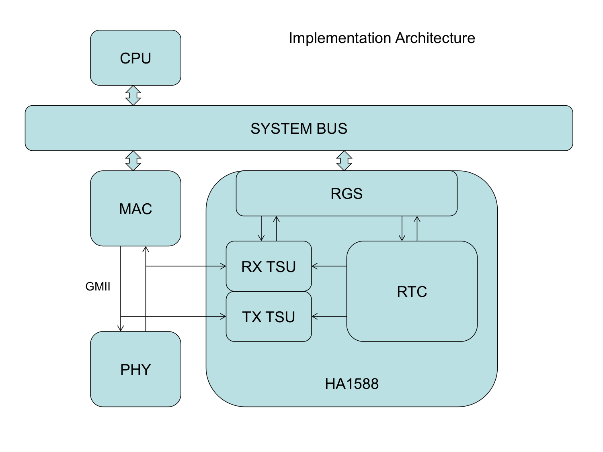
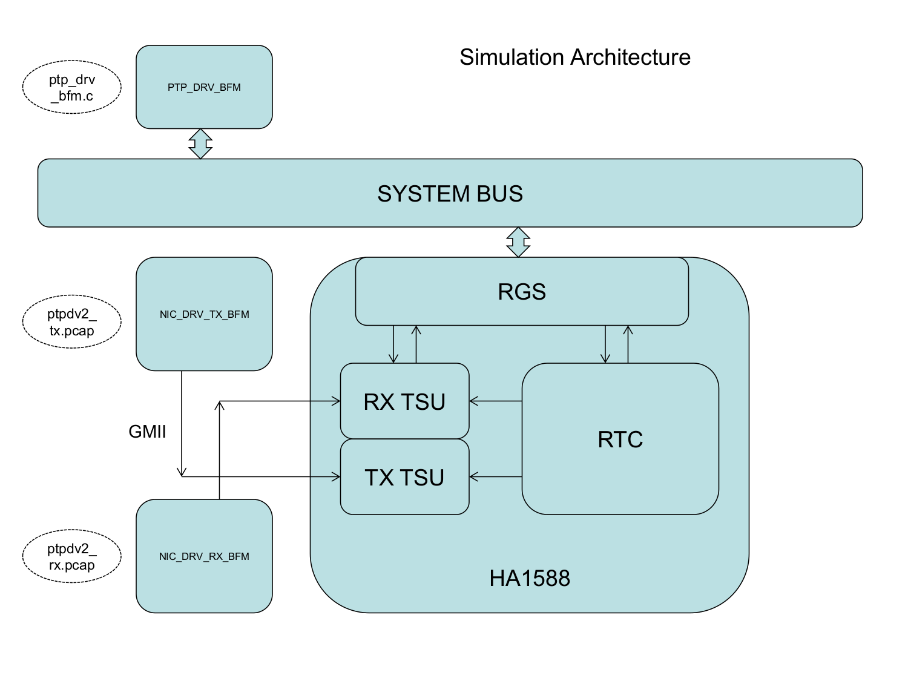

# ha1588_avl Design Specification

## 1. Introduction
`ha1588_avl` is a hardware-assist IEEE 1588 block intended to support a software PTP protocol stack on Ethernet links. The module integrates:
- a real-time clock (RTC) with tunable period and adjustment support,
- receive/transmit timestamp units (TSU) that monitor GMII traffic and identify PTP event packets,
- a register interface for configuration, timestamp retrieval, and status.

The protocol stack and packet transmit/receive control remain in software/MAC logic; this IP provides hardware timestamp generation and time-base maintenance.

## 2. Module Diagram

## 3. Interface

| Signal | Direction | Width | Description |
| --- | --- | --- | --- |
| `rst` | Input | 1 | Active-high reset for control and datapath logic. |
| `clk` | Input | 1 | Register/local-bus clock domain for control access and queue readout control. |
| `wr_in` | Input | 1 | Register write strobe. |
| `rd_in` | Input | 1 | Register read strobe. |
| `addr_in` | Input | 8 | Register address input. In this wrapper configuration, address is interpreted as word address (`addr_is_in_word=1`). |
| `data_in` | Input | 32 | Register write data. |
| `data_out` | Output | 32 | Register read data. |
| `rtc_clk` | Input | 1 | RTC clock domain used by the timestamp time base. |
| `rtc_time_ptp_ns` | Output | 32 | RTC nanosecond field in PTP output format. |
| `rtc_time_ptp_sec` | Output | 48 | RTC second field in PTP output format. |
| `rtc_time_one_pps` | Output | 1 | One-pulse-per-second indication from RTC rollover logic. |
| `rx_gmii_clk` | Input | 1 | RX GMII monitor clock for RX TSU. |
| `rx_gmii_ctrl` | Input | 1 | RX GMII control for RX TSU packet framing. |
| `rx_gmii_data` | Input | 8 | RX GMII data for RX TSU parser path. |
| `rx_giga_mode` | Input | 1 | RX mode selector (`1`: GMII byte mode, `0`: 10/100 nibble-conversion path). |
| `tx_gmii_clk` | Input | 1 | TX GMII monitor clock for TX TSU. |
| `tx_gmii_ctrl` | Input | 1 | TX GMII control for TX TSU packet framing. |
| `tx_gmii_data` | Input | 8 | TX GMII data for TX TSU parser path. |
| `tx_giga_mode` | Input | 1 | TX mode selector (`1`: GMII byte mode, `0`: 10/100 nibble-conversion path). |

### 3.1 Interface Semantics

- `wr_in`/`rd_in` qualify register access on `clk`; address decode is performed inside the register block.
- `data_out` is produced from register-mapped status/data windows, including RTC snapshots and TSU queue data.
- GMII inputs are monitoring inputs; this IP does not drive MAC/PHY data-path outputs.
- Timestamp outputs (`rtc_time_ptp_*`, `rtc_time_one_pps`) are generated by the RTC domain and exported at top level.

## 4. Function Description

### 4.1 Top-Level Operation

`ha1588_avl` is a thin wrapper around core module `ha1588` with `addr_is_in_word=1`. The core combines:
- `rgs` register/control block,
- `rtc` clock/timestamp generator,
- one RX `tsu` and one TX `tsu`.

The two TSUs share the same RTC time source but monitor independent GMII streams.

### 4.2 Register Access Model

The register bank is organized on byte addresses `0x00` to `0x7C` (word-aligned windows). Key regions are:

| Address Range | Function Group | Behavior Summary |
| --- | --- | --- |
| `0x00` | RTC control/status | Includes control bits for RTC reset/time load/period load/adjust load/time read and status (`adj_ld_done`, `time_ok`). |
| `0x04` | Scratch | General-purpose software-visible register. |
| `0x10`-`0x1C` | RTC time set/read | Time seconds and nanoseconds/fraction fields for load and readback. |
| `0x20`-`0x30` | RTC period/adjust | Period value, period adjust value, and adjustment countdown load value. |
| `0x40`, `0x44`, `0x50`-`0x5C` | RX TSU control/status/data | RX queue reset/read controls, message-ID mask, queue status, and 128-bit queue payload readout in 4 words. |
| `0x60`, `0x64`, `0x70`-`0x7C` | TX TSU control/status/data | TX queue reset/read controls, message-ID mask, queue status, and 128-bit queue payload readout in 4 words. |

Control bits in `rgs` are converted into pulse-style outputs for cross-domain operations (RTC commands and queue read/reset strobes).

### 4.3 RTC Behavior

RTC supports three adjustment paths:
1. Direct time load (`time_ld`) using 48-bit seconds and 38-bit ns/ns-fraction format.
2. Period/frequency load (`period_ld`) with 40-bit period representation.
3. Timed temporary adjustment (`adj_ld`) driven by a 32-bit countdown and additive `period_adj` term.

Internal accumulation uses sub-nanosecond fraction fields and generates:
- register-format time (`time_reg_sec`, `time_reg_ns`),
- PTP-format time (`time_ptp_sec`, `time_ptp_ns`),
- `time_one_pps` pulse when the second accumulator increments.

### 4.4 TSU and Parser Behavior

Each TSU performs:
- GMII monitoring with 10/100 mode nibble-to-byte conversion when needed.
- Internal byte-to-32-bit packing for parser input.
- PTP packet detection using parser rules that support L2 PTP and UDP/IP PTP paths with VLAN/MPLS bypass handling.
- Event filtering by configurable `ptp_msgid_mask` (message-type-based selection).

Parser output includes:
- `ptp_found`: qualified event indication,
- `ptp_infor`: 32-bit packet identity summary (`msgId`, checksum fragment, sequenceId).

### 4.5 Timestamp Capture and Queueing

When a qualified PTP event is found and packet end is reached, TSU writes one 128-bit queue entry:
- `{16-bit reserved, 80-bit timestamp, 32-bit parser info}`.

Timestamp capture uses a cross-clock handshake between GMII and RTC domains so each queue record carries RTC-correlated time.

Queue interface behavior includes:
- overflow-protected write (`wrreq` suppressed when full),
- underflow-protected read (`rdreq` suppressed when empty),
- used-word count in low nibble of queue status output (`q_rd_stat`).

## 5. Implementation Details

### 5.1 Block Interactions

- `ha1588_avl` maps external control/data/GMII/RTC ports directly into `ha1588`.
- `ha1588` converts incoming address representation (`addr_is_in_word`) to byte-addressed decode for `rgs`.
- `rgs` drives RTC control pulses and TSU queue control signals and returns read-mapped status/data.
- `rtc` continuously generates current time and services load/adjust commands.
- RX/TX `tsu` instances consume GMII streams, call `ptp_parser`, and push timestamp records into `ptp_queue`.

### 5.2 Multi-Clock Organization

- `clk`: register interface and queue read-control domain.
- `rtc_clk`: RTC accumulation domain and timestamp source domain.
- `rx_gmii_clk` / `tx_gmii_clk`: independent TSU packet-monitor domains.

CDC handshakes are used for:
- RTC snapshot readback acknowledgment (`time_ok` flow),
- timestamp capture transfer from RTC clock to GMII clock path in TSU.

### 5.3 Queue Implementation Dependency

`ptp_queue` is a vendor-dependent wrapper over a dual-clock FIFO primitive selected by macros (`USE_ALTERA_IP` or `USE_XILINX_IP`). Current `define.h` selects Xilinx path.

## 6. Submodule List

### 6.1 `ha1588`

Role:
- Main integration core for register bank, RTC, and dual TSU channels.

Key interface signals:

| Signal | Direction | Width | Description |
| --- | --- | --- | --- |
| `wr_in`, `rd_in`, `addr_in`, `data_in`, `data_out` | I/O | 1/1/8/32/32 | Local register access channel. |
| `rtc_clk`, `rtc_time_ptp_ns`, `rtc_time_ptp_sec`, `rtc_time_one_pps` | I/O | 1/32/48/1 | RTC timing interface. |
| `rx_gmii_*`, `tx_gmii_*` | Input | varies | RX/TX GMII monitor interfaces into TSUs. |

### 6.2 `rgs`

Role:
- Register decode, software-visible mapping, and command/status handshake generation.

Key interface signals:

| Signal | Direction | Width | Description |
| --- | --- | --- | --- |
| `wr_in`, `rd_in`, `addr_in`, `data_in`, `data_out` | I/O | 1/1/8/32/32 | Register bus interface. |
| `time_ld_out`, `period_ld_out`, `adj_ld_out` | Output | 1 each | RTC command pulses. |
| `time_reg_*_out`, `period_out`, `period_adj_out`, `adj_ld_data_out` | Output | 38/48/40/40/32 | RTC programming values. |
| `rx_q_*`, `tx_q_*` | I/O | varies | Queue control, status, mask, and payload interfaces. |

### 6.3 `rtc`

Role:
- Tunable time accumulator with direct load, period control, and timed adjustment.

Key interface signals:

| Signal | Direction | Width | Description |
| --- | --- | --- | --- |
| `time_ld`, `period_ld`, `adj_ld` | Input | 1 each | Time/frequency/adjust command inputs. |
| `time_reg_ns_in`, `time_reg_sec_in` | Input | 38/48 | Direct-load time fields. |
| `period_in`, `period_adj` | Input | 40/40 | Nominal and adjustment period terms. |
| `adj_ld_data`, `adj_ld_done` | I/O | 32/1 | Adjustment countdown load and completion status. |
| `time_reg_ns`, `time_reg_sec`, `time_ptp_ns`, `time_ptp_sec`, `time_one_pps` | Output | 38/48/32/48/1 | Time outputs for internal/software/PTP usage. |

### 6.4 `tsu`

Role:
- Packet monitor and event timestamp producer for one GMII direction.

Key interface signals:

| Signal | Direction | Width | Description |
| --- | --- | --- | --- |
| `gmii_clk`, `gmii_ctrl`, `gmii_data`, `giga_mode` | Input | 1/1/8/1 | GMII monitored stream and mode. |
| `ptp_msgid_mask` | Input | 8 | Event message-type mask. |
| `rtc_timer_clk`, `rtc_timer_in` | Input | 1/80 | RTC time source for timestamp capture. |
| `q_rd_clk`, `q_rd_en`, `q_rd_stat`, `q_rd_data` | I/O | 1/1/8/128 | Timestamp queue read/status channel. |

### 6.5 `ptp_parser`

Role:
- Parses packed frame data to detect PTP event packets and extract packet identity fields.

Key interface signals:

| Signal | Direction | Width | Description |
| --- | --- | --- | --- |
| `int_data`, `int_valid`, `int_sop`, `int_eop`, `int_mod` | Input | 32/1/1/1/2 | Internal packet stream and frame markers. |
| `ptp_msgid_mask` | Input | 8 | Event message selection mask. |
| `ptp_found`, `ptp_infor` | Output | 1/32 | Qualified-event flag and packet info payload. |

### 6.6 `ptp_queue`

Role:
- Dual-clock FIFO wrapper for timestamp records.

Key interface signals:

| Signal | Direction | Width | Description |
| --- | --- | --- | --- |
| `wrclk`, `wrreq`, `data`, `wrfull`, `wrusedw` | I/O | 1/1/128/1/4 | Write-side timestamp insertion and occupancy/full status. |
| `rdclk`, `rdreq`, `q`, `rdempty`, `rdusedw` | I/O | 1/1/128/1/4 | Read-side retrieval and occupancy/empty status. |
| `aclr` | Input | 1 | Queue asynchronous clear. |

## 7. Clock and Reset

- Reset polarity: active high (`rst`) across top-level logic and submodules.
- Clock domains:
- `clk` for register and software-facing control.
- `rtc_clk` for RTC accumulation and RTC-side handshake capture.
- `rx_gmii_clk` and `tx_gmii_clk` for channel-specific packet timestamping paths.
- Queue read/reset controls are pulse-generated from register bits and synchronized to the relevant local domain logic.

## 8. Constraints

- `addr_in` at `ha1588_avl` is interpreted as word address due `addr_is_in_word=1`; internal decode expands to byte-address windows.
- PTP timestamp generation depends on parser recognition and message-ID mask configuration; unmasked non-event packets do not create queue entries.
- TSU parser path is implemented on 32-bit packed data with pipeline stages; implementation notes indicate multicycle timing constraints are required for parser timing closure.
- Queue implementation is macro-selected vendor FIFO IP; integration must provide a compatible dual-clock FIFO primitive for the selected target.
- The architecture figure PDF has been split into separate images and referenced directly by this spec.
