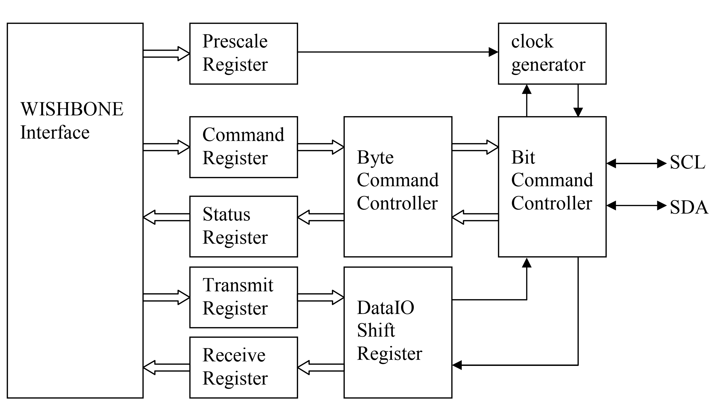
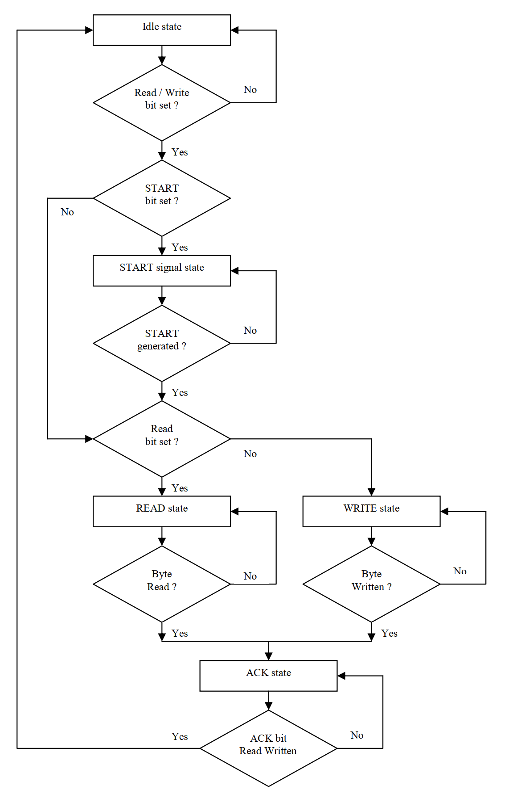

# i2c_master_top Design Specification

## 1. Introduction
`i2c_master_top` is a WISHBONE-accessible I2C master controller that executes software-programmed byte transfers. The module provides register-mapped control and status, generates START/Repeated-START/STOP conditions, supports multimaster arbitration behavior, and can be used in polling or interrupt-driven software flows.

The top-level module implements register, interrupt, and command sequencing functions, and delegates byte-level and bit-level I2C signaling to internal controllers.

## 2. Module Diagram

## 3. Top-Level Interface

| Signal | Direction | Width | Description |
| --- | --- | --- | --- |
| `wb_clk_i` | Input | 1 | WISHBONE master clock. All top-level sequential behavior is synchronized to this clock. |
| `wb_rst_n` | Input | 1 | Synchronous reset, active high. |
| `arst_n` | Input | 1 | Asynchronous reset input. Effective polarity is configured by parameter `ARST_LVL`. |
| `wb_adr_i` | Input | 3 | Register address select. |
| `wb_dat_i` | Input | 8 | Write data from bus master. |
| `wb_dat_o` | Output | 8 | Registered read data to bus master. |
| `wb_we_i` | Input | 1 | Write enable for WISHBONE cycle. |
| `wb_stb_i` | Input | 1 | WISHBONE strobe / core select. |
| `wb_cyc_i` | Input | 1 | WISHBONE valid bus cycle indicator. |
| `wb_ack_o` | Output | 1 | Registered bus acknowledge pulse for valid accesses. |
| `wb_inta_o` | Output | 1 | Registered interrupt request output (`IF` gated by `IEN`). |
| `scl_pad_i` | Input | 1 | Sampled external I2C SCL line state. |
| `scl_pad_o` | Output | 1 | I2C SCL output data value (implemented as constant `0`, open-drain style). |
| `scl_padoen_o` | Output | 1 | I2C SCL output enable, active low (`0`: drive low, `1`: release line). |
| `sda_pad_i` | Input | 1 | Sampled external I2C SDA line state. |
| `sda_pad_o` | Output | 1 | I2C SDA output data value (implemented as constant `0`, open-drain style). |
| `sda_padoen_o` | Output | 1 | I2C SDA output enable, active low (`0`: drive low, `1`: release line). |

### 3.1 Interface Semantics

- `wb_dat_o`, `wb_ack_o`, and `wb_inta_o` are registered outputs.
- `wb_ack_o` is generated from `wb_cyc_i`/`wb_stb_i` through a registered handshake path; software-visible accesses are acknowledged by a pulse on `wb_ack_o`.
- The I2C pads are intended for open-drain integration through external or upper-level tri-state buffering using `*_padoen_o`.

## 4. Register Model

### 4.1 Address Map

| Address | Name | Access | Description |
| --- | --- | --- | --- |
| `0x00` | `PRERlo` | RW | Prescaler low byte |
| `0x01` | `PRERhi` | RW | Prescaler high byte |
| `0x02` | `CTR` | RW | Control register |
| `0x03` | `TXR` / `RXR` | W / R | Transmit register / Receive register |
| `0x04` | `CR` / `SR` | W / R | Command register / Status register |

### 4.2 `PRER` (Clock Prescaler)

`PRER[15:0]` programs the internal I2C timing base used by lower-level bit timing logic.

- Reset value: `16'hFFFF`
- Programming guidance from the original specification: `prescale = (wb_clk_i / (5 * Fscl)) - 1`.
- Update `PRER` only when `CTR.EN=0`.

### 4.3 `CTR` (Control Register, address `0x02`)

| Bit | Name | Access | Description |
| --- | --- | --- | --- |
| 7 | `EN` | RW | Core enable. Command writes are accepted only when `EN=1`. |
| 6 | `IEN` | RW | Interrupt enable for `wb_inta_o`. |
| 5:0 | Reserved | RW | Reserved; software should write zeros. |

- Reset value: `8'h00`

### 4.4 `TXR`/`RXR` (address `0x03`)

- `TXR` (write): byte to be transmitted in the next write/address phase.
- `RXR` (read): last received byte.
- Reset value of `TXR`: `8'h00`.
- `RXR` is updated from the byte controller receive path after a completed read command.

### 4.5 `CR`/`SR` (address `0x04`)

#### Command Register `CR` (write-only architectural view)

| Bit | Name | Access | Description |
| --- | --- | --- | --- |
| 7 | `STA` | W | Request START or Repeated START before transfer phase. |
| 6 | `STO` | W | Request STOP after current transfer phase. |
| 5 | `RD` | W | Request byte read from bus. |
| 4 | `WR` | W | Request byte write to bus. |
| 3 | `ACK` | W | Read-mode acknowledge control (`0`: ACK, `1`: NACK). |
| 2:1 | Reserved | W | Reserved; cleared by hardware. |
| 0 | `IACK` | W | Interrupt acknowledge; clears pending interrupt flag. |

- Reset value: `8'h00`
- In the implemented top-level logic, `STA`/`STO`/`RD`/`WR` (`CR[7:4]`) clear on byte completion (`done`) or arbitration loss (`i2c_al`).
- `CR[2:1]` (reserved) and `CR[0]` (`IACK`) are single-cycle pulse bits: they are cleared unconditionally on every non-write clock cycle, so they are only effective for the one cycle in which the CR write is latched.
- `STA`, `STO`, `RD`, `WR`, and `IACK` are always read as zeros when accessed through the documented register map (address `0x04` returns `SR` on read, not `CR`).
- Command writes are ignored when `CTR.EN=0`.

#### Status Register `SR` (read-only)

| Bit | Name | Access | Description |
| --- | --- | --- | --- |
| 7 | `RxACK` | R | Acknowledge result from addressed slave (`1`: no acknowledge, `0`: acknowledge received). |
| 6 | `BUSY` | R | Bus busy indication derived from START/STOP detection. |
| 5 | `AL` | R | Arbitration lost indicator (latched until a new START command or reset). |
| 4:2 | Reserved | R | Read as zeros. |
| 1 | `TIP` | R | Transfer in progress indication derived from active read/write command bits. |
| 0 | `IF` | R | Interrupt pending flag (byte completed or arbitration lost). |

- Reset value: `8'h00`

## 5. Functional Description

### 5.1 Operational Overview

`i2c_master_top` performs I2C transfers through software-issued command sequences:

1. Program prescaler (`PRER`) and control (`CTR`).
2. Load `TXR` when a write/address byte must be sent.
3. Write `CR` to request `STA`, `WR`, `RD`, `STO`, and read-ack behavior (`ACK`) as needed.
4. Wait for completion using `SR.IF` (or `wb_inta_o` if enabled), and check `SR.TIP`, `SR.RxACK`, and `SR.AL`.
5. Continue with next command byte, issue Repeated START, or terminate with STOP.

The core is byte-oriented: each command corresponds to one byte transfer phase plus associated acknowledge handling.

### 5.2 Transaction and Byte Flow

- A standard software-driven transfer follows START -> address byte -> data byte(s) -> STOP, with acknowledge sampled on the ninth SCL clock for each byte.
- The first byte after START is the slave address: bits `[7:1]` carry the 7-bit slave address and bit `[0]` is the R/W direction bit (`0` = write to slave, `1` = read from slave). The core treats this address byte as an ordinary write operation via `TXR`.
- Repeated START is requested by setting `STA` on a later command without first issuing STOP.
- Write flow: `TXR` is loaded into the internal 8-bit DataIO shift register, shifted out MSB-first (one bit per SCL cycle), and after all eight bits the slave acknowledge bit is sampled on the ninth SCL cycle and reflected in `SR.RxACK`.
- Read flow: SDA is shifted into the DataIO shift register from the LSB side on each SCL rising edge for eight bits. After all eight bits, the received byte is available through `RXR` (which is directly wired to the shift register output).
- Read flow acknowledge phase: the controller drives ACK/NACK on SDA based on `CR.ACK` (`ACK=0` sends ACK, `ACK=1` sends NACK to indicate end of read).
- `STO` may be combined with read/write commands so STOP is generated after that byte's acknowledge phase.

### 5.3 Command Completion, Validity, and Interrupt Behavior

- Byte completion from the byte controller raises internal `done`.
- On `done`, command bits are cleared and `SR.IF` is set.
- `SR.IF` is also set on arbitration loss.
- `SR.IF` remains set until software writes `CR.IACK=1`.
- `wb_inta_o` reflects `SR.IF` when `CTR.IEN=1`.
- `SR.TIP` tracks active `RD`/`WR` command state and deasserts after those command bits are cleared.
- A standalone STOP command is not represented by `TIP`, because `TIP` is derived from `RD`/`WR`.
- `RXR` contents are valid for software consumption after completion (`IF=1`) of a read command.

### 5.4 Arbitration, Busy, and Clock-Dependent Behavior

- The lower-level control path tracks bus busy state by detecting START and STOP conditions on sampled SCL/SDA.
- Arbitration lost is detected when the master attempts to release SDA high but SDA is observed low, or when a STOP is observed that was not requested by this controller.
- Clock synchronization and slave clock stretching are handled in the bit-level controller by monitoring external SCL behavior and adapting internal timing enable generation.
- Transfer duration depends on prescaler settings and bus behavior (including stretching/arbitration effects), so command completion is software-observed through status/interrupt rather than fixed-cycle latency.

## 6. Implementation Details

### 6.1 Top-Level Control and Datapath

- Internal architecturally visible state includes `PRER`, `CTR`, `TXR`, `CR`, and status latches (`rxack`, `tip`, `al`, `irq_flag`).
- Register updates occur on `wb_clk_i` with asynchronous reset path (`arst_n` combined with `ARST_LVL`) plus synchronous reset (`wb_rst_n`).
- Command decode maps `CR` bits to byte-controller controls (`start`, `stop`, `read`, `write`, `ack_in`).
- `CR` write acceptance is gated by `CTR.EN`; reserved command bits are forced low.
- Completion/arbitration events clear command control bits and update status/interrupt latches.

### 6.2 Byte-Level Controller Realization

`i2c_master_byte_ctrl` converts each byte command into bit-level operations.

- FSM states (5-bit one-hot encoded): `ST_IDLE`, `ST_START`, `ST_READ`, `ST_WRITE`, `ST_ACK`, `ST_STOP`.
- `go` condition: `go = (read | write | stop) & ~cmd_ack`. Processing starts when a read, write, or stop command is requested and no command-acknowledge is currently being pulsed.
- From `ST_IDLE`, if `go` is asserted: if `start` is set, the FSM enters `ST_START` first; otherwise it proceeds directly to `ST_READ`, `ST_WRITE`, or `ST_STOP` based on command priority (start > read > write > stop).
- From `ST_START`, after the bit-level START completes (`core_ack`), the FSM loads the shift register and transitions to `ST_READ` or `ST_WRITE` depending on the `read` signal.
- For writes (`ST_WRITE`): the controller issues eight `I2C_CMD_WRITE` bit commands (tracked by a 3-bit counter `dcnt` initialized to 7), shifting out the MSB of the shift register (`sr[7]`) each cycle. After all eight bits (`cnt_done`), the FSM enters `ST_ACK` and issues `I2C_CMD_READ` to sample the slave's acknowledge bit.
- For reads (`ST_READ`): the controller issues eight `I2C_CMD_READ` bit commands, shifting received data into the LSB of the shift register on each `core_ack`. After all eight bits, the FSM enters `ST_ACK` and issues `I2C_CMD_WRITE` to drive ACK/NACK (from `ack_in`) onto SDA.
- In `ST_ACK`, after the bit-level acknowledge completes: if `stop` is set, the FSM transitions to `ST_STOP` to generate a STOP condition; otherwise it returns to `ST_IDLE` and pulses `cmd_ack`. The received acknowledge value (`core_rxd`) is captured into `ack_out`.
- In `ST_STOP`, after the bit-level STOP completes, the FSM returns to `ST_IDLE` and pulses `cmd_ack`.
- On synchronous reset or arbitration loss (`i2c_al`), the FSM resets to `ST_IDLE` with all outputs cleared.

### 6.3 Bit-Level Controller Realization

`i2c_master_bit_ctrl` drives low-level SCL/SDA behavior.

- **Input synchronization and filtering**: External `scl_i` and `sda_i` are double-registered to reduce metastability, then passed through a 3-sample glitch filter clocked at `clk_cnt >> 2` rate. The filtered values (`sSCL`, `sSDA`) are determined by 2-of-3 majority voting on the filter register, rejecting transient glitches.
- **Clock enable generation**: A 16-bit prescaler counter (`cnt`) counts down from `clk_cnt` and generates a single-cycle `clk_en` pulse when it reaches zero; all bit-level state transitions are gated by `clk_en`. The counter reloads on reset, when it expires, when the core is disabled, or on a clock synchronization event (`scl_sync`).
- **Clock stretching**: When the master releases SCL high (`scl_oen` transitions from driving to releasing) but the filtered SCL remains low, `slave_wait` is asserted and holds the prescaler counter, pausing the bit state machine until the slave releases SCL.
- **Clock synchronization**: If another master pulls SCL low while this master has released it (`dSCL=1, sSCL=0, scl_oen=1`), the counter reloads to begin counting the low period, synchronizing SCL timing across masters.
- **START/STOP detection**: A START condition is detected as a falling edge on filtered SDA while filtered SCL is high (`~sSDA & dSDA & sSCL`). A STOP condition is detected as a rising edge on filtered SDA while filtered SCL is high (`sSDA & ~dSDA & sSCL`).
- **Bus busy**: Set on START detection, cleared on STOP detection: `busy <= (sta_condition | busy) & ~sto_condition`.
- **Arbitration lost**: Detected when (1) the master has released SDA (`sda_oen=1`) but filtered SDA is low while `sda_chk` is active, indicating another device is driving SDA against this master; or (2) a STOP condition is detected while the FSM is active and the current command is not a STOP (`|c_state & sto_condition & ~cmd_stop`).
- **SDA data sampling**: The bit read output (`dout`) latches the filtered SDA value on the rising edge of filtered SCL (`sSCL & ~dSCL`).
- **Bit command sub-states**: Each bit-level command is decomposed into prescaler-timed sub-states. The state machine uses an 18-bit one-hot encoding:
  - **START**: 5 sub-states (A through E). Releases SDA high, then raises SCL, then pulls SDA low (creating the falling SDA edge while SCL is high), holds, then pulls SCL low.
  - **STOP**: 4 sub-states (A through D). Pulls SDA low, raises SCL, holds SCL high, then releases SDA high (creating the rising SDA edge while SCL is high).
  - **WRITE**: 4 sub-states (A through D). Sets SDA to the `din` value while SCL is low (phase A), raises SCL (phase B), enables SDA arbitration check (`sda_chk=1`, phase C), then pulls SCL low (phase D).
  - **READ**: 4 sub-states (A through D). Tri-states SDA (releases the line) while SCL is low, raises SCL, holds SCL high for sampling, then pulls SCL low.
- **Output constants**: `scl_o` and `sda_o` are hardwired to `1'b0`; line state is controlled entirely through the active-low output enables (`scl_oen`, `sda_oen`).

## 7. Submodules

### 7.1 `i2c_master_byte_ctrl`

Role:
- Directly instantiated by `i2c_master_top`.
- Converts top-level byte commands into bit-level command sequences and returns byte completion/acknowledge/data status.

Interface (direction is with respect to `i2c_master_byte_ctrl`):

| Signal | Direction | Width | Description |
| --- | --- | --- | --- |
| `clk` | Input | 1 | System clock (`wb_clk_i`). |
| `rst` | Input | 1 | Synchronous reset (`wb_rst_n`). |
| `nReset` | Input | 1 | Asynchronous reset (active low, derived from `arst_n` and `ARST_LVL`). |
| `ena` | Input | 1 | Core enable (`CTR.EN`). |
| `clk_cnt` | Input | 16 | Prescaler value (`PRER`). |
| `start` | Input | 1 | START/Repeated-START request (`CR.STA`). |
| `stop` | Input | 1 | STOP request (`CR.STO`). |
| `read` | Input | 1 | Read-byte request (`CR.RD`). |
| `write` | Input | 1 | Write-byte request (`CR.WR`). |
| `ack_in` | Input | 1 | ACK/NACK control for read completion (`CR.ACK`). |
| `din` | Input | 8 | Byte to transmit (`TXR`). |
| `cmd_ack` | Output | 1 | Byte command completion (`done`). |
| `ack_out` | Output | 1 | Captured acknowledge bit (`irxack`). |
| `dout` | Output | 8 | Received byte (`RXR`). |
| `i2c_busy` | Output | 1 | Bus busy state for status reporting. |
| `i2c_al` | Output | 1 | Arbitration-lost event indication. |
| `scl_i` | Input | 1 | External SCL sample input. |
| `scl_o` | Output | 1 | SCL drive data (constant-low open-drain style). |
| `scl_oen` | Output | 1 | SCL output enable, active low. |
| `sda_i` | Input | 1 | External SDA sample input. |
| `sda_o` | Output | 1 | SDA drive data (constant-low open-drain style). |
| `sda_oen` | Output | 1 | SDA output enable, active low. |

### 7.2 `i2c_master_bit_ctrl` (internal to byte controller)

Role:
- Handles bit timing and physical bus signaling.
- Performs clock generation/synchronization, START/STOP detection, arbitration checks, and per-bit command execution.

Interface (direction is with respect to `i2c_master_bit_ctrl`):

| Signal | Direction | Width | Description |
| --- | --- | --- | --- |
| `clk` | Input | 1 | System clock. |
| `rst` | Input | 1 | Synchronous reset. |
| `nReset` | Input | 1 | Asynchronous reset (active low). |
| `ena` | Input | 1 | Core enable. |
| `clk_cnt` | Input | 16 | Prescaler configuration. |
| `cmd` | Input | 4 | Bit-level command (`START`, `STOP`, `READ`, `WRITE`, `NOP`). |
| `cmd_ack` | Output | 1 | Bit-command completion pulse. |
| `busy` | Output | 1 | Bus busy state from start/stop detection. |
| `al` | Output | 1 | Arbitration-lost indication. |
| `din` | Input | 1 | Write-bit value to place on SDA (via open-drain enable). |
| `dout` | Output | 1 | Read-bit sample from SDA. |
| `scl_i` | Input | 1 | External SCL sample. |
| `scl_o` | Output | 1 | SCL output data value (constant low). |
| `scl_oen` | Output | 1 | Active-low SCL output enable. |
| `sda_i` | Input | 1 | External SDA sample. |
| `sda_o` | Output | 1 | SDA output data value (constant low). |
| `sda_oen` | Output | 1 | Active-low SDA output enable. |

## 8. Clock and Reset

| Signal | Type | Description |
| --- | --- | --- |
| `wb_clk_i` | Clock | Primary clock for top-level register and bus interface logic. |
| `wb_rst_n` | Reset | Synchronous active-high reset applied to top and propagated to submodules. |
| `arst_n` | Reset | Asynchronous reset input; effective active level is configured by `ARST_LVL`. |

Reset behavior:
- `PRER` resets to `16'hFFFF`.
- `CTR`, `TXR`, `CR`, and status latches (`RxACK`, `TIP`, `AL`, `IF`) reset to `0`.
- Interrupt output resets inactive.

## 9. Constraints and Integration Notess

- I2C pins must be integrated as open-drain/open-collector style with external pull-up resistors on SCL and SDA.
- Use either asynchronous reset (`arst_n`) or synchronous reset (`wb_rst_n`) as the active system reset path; keep the unused reset input in its inactive state.
- Program `PRER` while `CTR.EN=0`.
- Deasserting `CTR.EN` during an active transfer is not recommended; complete or stop the ongoing transfer first.
- Issue `STA` together with `WR` or `RD` for normal START sequencing.
- Reserved bits are read as zero and should be written as zero for forward compatibility.
- 10-bit addressing is supported through software command sequencing (two address-byte transfers), not through a separate dedicated address register.
- The implemented read-data mux also decodes addresses `0x05` and `0x06` for internal register visibility; software-facing programming model should use the documented map (`0x00`-`0x04`).
