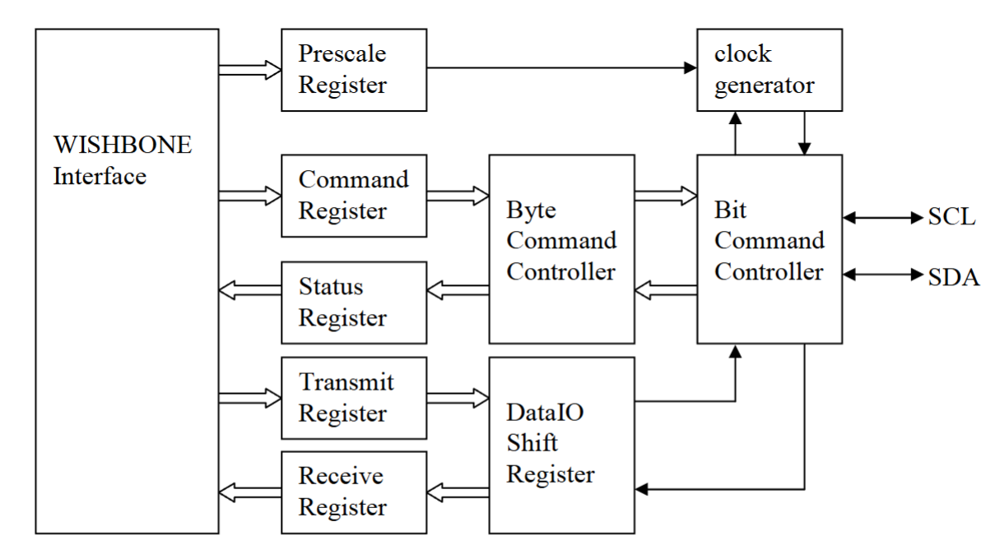
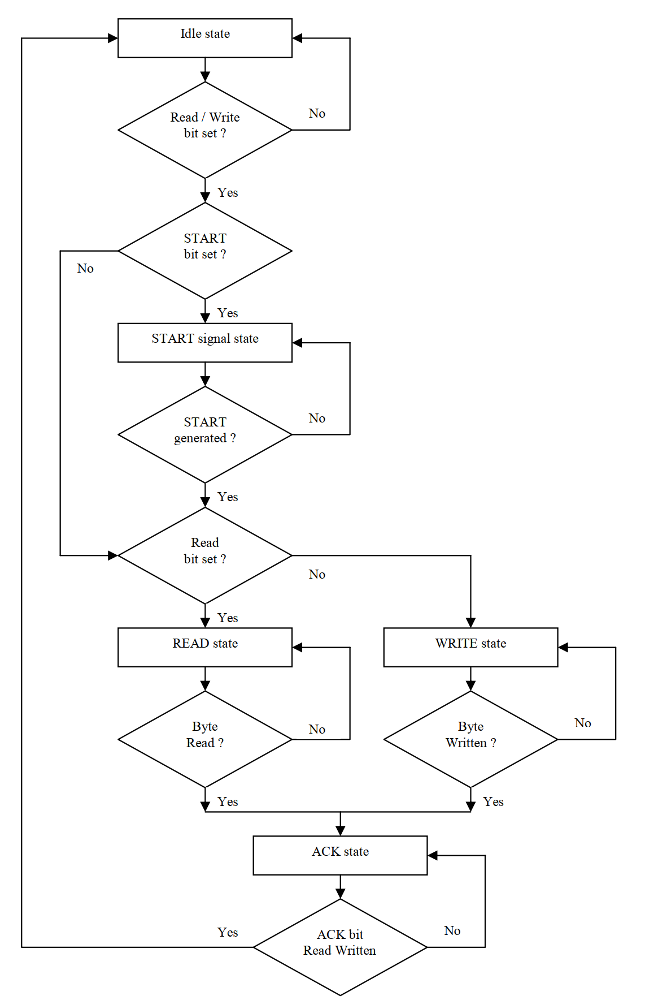

# i2c_master_top Design Specification

## 1. Introduction

`i2c_master_top` is a WISHBONE-accessible I2C master controller that executes software-programmed byte transfers on a two-wire I2C bus. The module provides a register-mapped programming model for clock configuration, transfer command issuance, status observation, and interrupt-driven completion.

The design supports multimaster operation, START/Repeated START/STOP generation, acknowledge handling, arbitration monitoring, and clock-stretch-aware transfer sequencing. The top module contains the software-visible registers and interrupt/status logic, and delegates byte/bit bus execution to internal controller blocks.

## 2. Module Diagram

## 3. Top-Level Interface

| Signal | Direction | Width | Description |
| --- | --- | --- | --- |
| `wb_clk_i` | Input | 1 | WISHBONE clock for all top-level sequential logic. |
| `wb_rst_i` | Input | 1 | Synchronous reset, active high. |
| `arst_i` | Input | 1 | Asynchronous reset input; active level selected by parameter `ARST_LVL`. |
| `wb_adr_i` | Input | 3 | Register address select. |
| `wb_dat_i` | Input | 8 | WISHBONE write data. |
| `wb_dat_o` | Output | 8 | WISHBONE read data (registered). |
| `wb_we_i` | Input | 1 | WISHBONE write enable. |
| `wb_stb_i` | Input | 1 | WISHBONE strobe / core select. |
| `wb_cyc_i` | Input | 1 | WISHBONE cycle valid indicator. |
| `wb_ack_o` | Output | 1 | WISHBONE acknowledge pulse (registered). |
| `wb_inta_o` | Output | 1 | Interrupt request output (registered). |
| `scl_pad_i` | Input | 1 | Sampled external SCL line state. |
| `scl_pad_o` | Output | 1 | SCL output data value; driven as constant `0` for open-drain style signaling. |
| `scl_padoen_o` | Output | 1 | SCL output enable, active low (`0`: pull line low, `1`: release line). |
| `sda_pad_i` | Input | 1 | Sampled external SDA line state. |
| `sda_pad_o` | Output | 1 | SDA output data value; driven as constant `0` for open-drain style signaling. |
| `sda_padoen_o` | Output | 1 | SDA output enable, active low (`0`: pull line low, `1`: release line). |

### 3.1 Bus and Interface Semantics

- The core implements a WISHBONE Classic compatible register interface with registered outputs.
- `wb_ack_o` is generated as a one-cycle acknowledge pulse for valid bus cycles.
- Software command writes are accepted only when `CTR.EN = 1`.
- External I2C pads are intended for open-drain integration with pull-up resistors and upper-level tri-state buffering controlled by `*_padoen_o`.

## 4. Register Model

### 4.1 Address Map

| Address | Name | Access | Description |
| --- | --- | --- | --- |
| `0x00` | `PRERlo` | RW | Prescaler low byte |
| `0x01` | `PRERhi` | RW | Prescaler high byte |
| `0x02` | `CTR` | RW | Control register |
| `0x03` | `TXR` / `RXR` | W / R | Transmit register / Receive register |
| `0x04` | `CR` / `SR` | W / R | Command register / Status register |

### 4.2 `PRER` - Prescaler Register (`0x00`, `0x01`)

- `PRER[15:0]` configures the SCL timing base used by the internal bit-level controller.
- Programming formula from the source specification:  
  `prescale = (wb_clk_i / (5 * Fscl)) - 1`
- Reset value: `16'hFFFF`
- `PRER` should be programmed while `CTR.EN = 0`.

### 4.3 `CTR` - Control Register (`0x02`)

| Bit | Name | Access | Description |
| --- | --- | --- | --- |
| 7 | `EN` | RW | Core enable. New commands are accepted only when `EN=1`. |
| 6 | `IEN` | RW | Interrupt enable for `wb_inta_o`. |
| 5:0 | Reserved | RW | Reserved; software should write `0`. |

- Reset value: `8'h00`

### 4.4 `TXR` / `RXR` - Data Registers (`0x03`)

- `TXR` (write): byte sent in the next write phase, including address byte transfers.
- `RXR` (read): last received byte from the internal receive shift path.
- `TXR` reset value: `8'h00`

### 4.5 `CR` - Command Register (`0x04`, write)

| Bit | Name | Access | Description |
| --- | --- | --- | --- |
| 7 | `STA` | W | Request START or Repeated START before transfer. |
| 6 | `STO` | W | Request STOP after transfer completion. |
| 5 | `RD` | W | Request one byte read from bus. |
| 4 | `WR` | W | Request one byte write to bus. |
| 3 | `ACK` | W | Read-mode acknowledge control (`0`: ACK, `1`: NACK). |
| 2:1 | Reserved | W | Reserved; hardware clears these bits. |
| 0 | `IACK` | W | Interrupt acknowledge; clears pending interrupt flag. |

- Reset value: `8'h00`
- `STA/STO/RD/WR` are cleared by hardware on byte-command completion or arbitration loss.
- `IACK` is treated as a pulse control; it is cleared by hardware after write.
- Reading address `0x04` returns `SR`, not `CR`.

### 4.6 `SR` - Status Register (`0x04`, read)

| Bit | Name | Access | Description |
| --- | --- | --- | --- |
| 7 | `RxACK` | R | Slave acknowledge result (`1`: NACK received, `0`: ACK received). |
| 6 | `BUSY` | R | Bus busy indication based on START/STOP detection. |
| 5 | `AL` | R | Arbitration lost flag. |
| 4:2 | Reserved | R | Read as `0`. |
| 1 | `TIP` | R | Transfer in progress for active read/write command execution. |
| 0 | `IF` | R | Interrupt pending flag (byte done or arbitration lost). |

- Reset value: `8'h00`

## 5. Function Description

### 5.1 Operating Model

The core is programmed as a byte-oriented I2C master. Software performs transfers through register commands:

1. Configure `PRER` for required bus speed and set `CTR.EN`.
2. Write `TXR` with address/data byte when a write phase is required.
3. Write `CR` to request `STA`, `WR`, `RD`, `STO`, and read acknowledge behavior (`ACK`) for the next byte operation.
4. Wait for command completion using `SR.IF` (polling) or `wb_inta_o` (interrupt mode), then inspect status (`TIP`, `RxACK`, `AL`, `BUSY`) and continue.

The first byte after START is the slave address with R/W direction in bit `0`. Subsequent bytes represent payload or additional address/data bytes according to software sequencing.

### 5.2 Transfer Semantics

- **Write command (`WR`)**: the controller shifts out `TXR` MSB-first on SDA and samples the slave acknowledge bit after 8 data bits.
- **Read command (`RD`)**: the controller samples 8 data bits from SDA into receive storage and updates `RXR` at byte completion.
- **Read acknowledge phase**: after a read byte, the core drives ACK/NACK on SDA according to `CR.ACK` (`0` = ACK, `1` = NACK).
- **STOP control (`STO`)**: can be combined with read/write commands to terminate the transfer after the current byte acknowledge phase.
- **Repeated START**: requested by asserting `STA` for a subsequent command without issuing STOP first.

### 5.3 Completion and Interrupt Behavior

- Byte-command completion (`done`) sets `SR.IF`.
- Arbitration loss also sets `SR.IF`.
- `SR.IF` remains set until software writes `CR.IACK=1`.
- `wb_inta_o` is asserted when `SR.IF=1` and `CTR.IEN=1`.
- `SR.TIP` indicates active read/write command execution and clears when the command completes.

### 5.4 Bus Monitoring and Multimaster Behavior

- `SR.BUSY` is driven by detected START and STOP conditions on filtered SCL/SDA inputs.
- Arbitration loss is detected when:
  - the core releases SDA high but observes SDA low during arbitration check, or
  - a STOP condition is observed while this master did not request STOP.
- The bit-level controller supports SCL synchronization with other masters and supports clock stretching when a slave holds SCL low.

## 6. Implementation Details

### 6.1 Top-Level Organization

The top module contains:

- WISHBONE register bank (`PRER`, `CTR`, `TXR`, `CR`) and readback mux.
- Command decode from `CR` into byte-control requests (`start`, `stop`, `read`, `write`, `ack_in`).
- Status/interrupt latches (`RxACK`, `TIP`, `AL`, `IF`) and interrupt output generation.
- `i2c_master_byte_ctrl` instance for byte-to-bit command conversion and I2C line control.

### 6.2 Byte Command Controller Behavior

`i2c_master_byte_ctrl` executes byte-level sequences using an FSM (`IDLE`, `START`, `READ`, `WRITE`, `ACK`, `STOP`) and an 8-bit shift register/counter pair.

Key behavior:

- Optional START phase before read/write.
- Eight bit-level operations per byte, followed by a ninth acknowledge phase.
- Capture of slave acknowledge (`ack_out`) after write/address byte transfer.
- Controlled ACK/NACK drive after read byte transfer based on `ack_in`.
- Optional STOP phase after acknowledge.
- One-cycle `cmd_ack` pulse on command completion.

### 6.3 Bit Command Controller Behavior

`i2c_master_bit_ctrl` implements bus-level signaling and timing:

- Synchronizes and filters external `scl_i`/`sda_i` samples before protocol condition detection.
- Generates prescaled timing enables from `clk_cnt` and adapts timing for SCL synchronization/stretching.
- Executes low-level START, STOP, READ, and WRITE bit commands through sub-state sequences.
- Drives open-drain style outputs (`scl_o=0`, `sda_o=0`) through active-low output-enable controls.
- Detects START/STOP conditions, updates `busy`, and reports arbitration loss (`al`).

## 7. Submodule List

### 7.1 `i2c_master_byte_ctrl`

Role: Byte-level I2C command engine between top-level registers and bit-level bus execution.

| Signal | Direction | Width | Description |
| --- | --- | --- | --- |
| `clk` | Input | 1 | System clock |
| `rst` | Input | 1 | Synchronous reset |
| `nReset` | Input | 1 | Asynchronous reset, active low |
| `ena` | Input | 1 | Core enable |
| `clk_cnt` | Input | 16 | Prescaler value |
| `start` | Input | 1 | START/Repeated START request |
| `stop` | Input | 1 | STOP request |
| `read` | Input | 1 | Read-byte request |
| `write` | Input | 1 | Write-byte request |
| `ack_in` | Input | 1 | ACK/NACK control for read completion |
| `din` | Input | 8 | Byte to transmit |
| `cmd_ack` | Output | 1 | Byte command completion pulse |
| `ack_out` | Output | 1 | Captured acknowledge from bus |
| `dout` | Output | 8 | Received byte |
| `i2c_busy` | Output | 1 | Bus busy indication |
| `i2c_al` | Output | 1 | Arbitration lost indication |
| `scl_i` | Input | 1 | SCL sampled input |
| `scl_o` | Output | 1 | SCL output data (constant low) |
| `scl_oen` | Output | 1 | SCL output enable, active low |
| `sda_i` | Input | 1 | SDA sampled input |
| `sda_o` | Output | 1 | SDA output data (constant low) |
| `sda_oen` | Output | 1 | SDA output enable, active low |

### 7.2 `i2c_master_bit_ctrl`

Role: Bit-level I2C sequencer used by `i2c_master_byte_ctrl` for command execution, bus timing, and arbitration handling.

| Signal | Direction | Width | Description |
| --- | --- | --- | --- |
| `clk` | Input | 1 | System clock |
| `rst` | Input | 1 | Synchronous reset |
| `nReset` | Input | 1 | Asynchronous reset, active low |
| `ena` | Input | 1 | Core enable |
| `clk_cnt` | Input | 16 | Prescaler value |
| `cmd` | Input | 4 | Bit-level command (`NOP/START/STOP/WRITE/READ`) |
| `cmd_ack` | Output | 1 | Bit-command completion pulse |
| `busy` | Output | 1 | Bus busy state |
| `al` | Output | 1 | Arbitration lost state |
| `din` | Input | 1 | Write-bit control |
| `dout` | Output | 1 | Read-bit sample |
| `scl_i` | Input | 1 | SCL sampled input |
| `scl_o` | Output | 1 | SCL output data (constant low) |
| `scl_oen` | Output | 1 | SCL output enable, active low |
| `sda_i` | Input | 1 | SDA sampled input |
| `sda_o` | Output | 1 | SDA output data (constant low) |
| `sda_oen` | Output | 1 | SDA output enable, active low |

## 8. Clock and Reset

| Signal | Type | Description |
| --- | --- | --- |
| `wb_clk_i` | Clock | Primary clock for register interface and control logic. |
| `wb_rst_i` | Reset | Synchronous active-high reset. |
| `arst_i` | Reset | Asynchronous reset input; effective active level is controlled by `ARST_LVL`. |

Reset effects:

- `PRER` resets to `16'hFFFF`.
- `CTR`, `TXR`, `CR`, status bits, and interrupt output reset low.
- Internal command/status state returns to idle.

## 9. Constraints and Integration Notes

- Integrate SCL/SDA as open-drain lines with pull-up resistors.
- Use one active reset strategy in system integration (`wb_rst_i` or `arst_i`), keeping the unused reset input at inactive level.
- Program `PRER` while `CTR.EN=0`.
- Do not disable the core during an active byte transfer; complete transfer or issue STOP first.
- Reserved register bits should be written as `0`.
- 10-bit addressing is performed by software command sequencing (multiple address-byte transfers).
