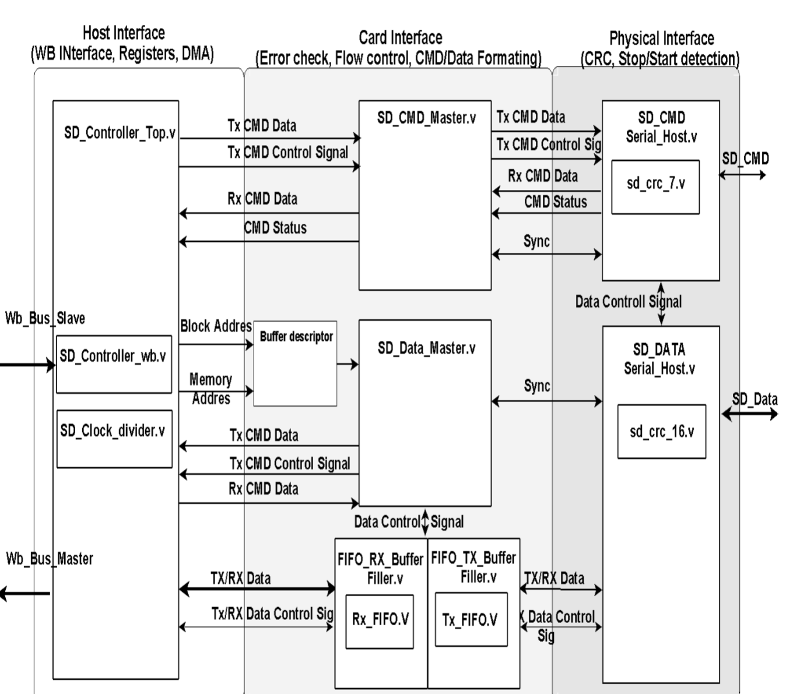

# sdc_controller Design Specification

## 1. Introduction

`sdc_controller` is an SD/MMC communication controller that bridges a system Wishbone bus and an SD card interface. The design provides command transfer, block-data transfer, DMA-style memory movement through a Wishbone master interface, and interrupt reporting for command and data paths.

The controller is intended for systems that access SD/MMC cards through buffered block transfers and descriptor-driven operation. It supports SD 4-bit data mode in the provided configuration and uses internal CRC generation/checking on command and data paths.

## 2. Module Diagram

## 3. Interface

### 3.1 Compile-Time Configuration

The design behavior is affected by compile-time definitions in `sd_defines.v`. Key externally relevant options are:

- Endianness selection for data packing on the SD data path (`BIG_ENDIAN` or `LITLE_ENDIAN`).
- SD clock source selection:
  - `SDC_CLK_BUS_CLK`: SD logic clock sourced from `wb_clk_i`.
  - `SDC_CLK_SEP`: SD logic clock sourced from `sd_clk_i_pad`.
- SD clock generation mode:
  - `SDC_CLK_STATIC`: `sd_clk_o_pad` follows selected SD input clock.
  - `SDC_CLK_DYNAMIC`: `sd_clk_o_pad` generated by programmable divider.
- Optional interrupt outputs: `SDC_IRQ_ENABLE` enables `int_a`, `int_b`, `int_c`.
- Buffer descriptor and FIFO sizing (`BD_*`, `FIFO_*`) and block size (`BLOCK_SIZE`, default 512 bytes).

### 3.2 Top-Level Ports

| Signal | Dir | Width | Description |
| --- | --- | --- | --- |
| `wb_clk_i` | Input | 1 | System/Wishbone clock for control, descriptor, and DMA-control logic. |
| `wb_rst_i` | Input | 1 | Active-high reset for controller logic. |
| `wb_dat_i` | Input | 32 | Wishbone slave write data. |
| `wb_dat_o` | Output | 32 | Wishbone slave read data. |
| `card_detect` | Input | 1 | Card-detect input used by command path status logic. |
| `wb_adr_i` | Input | 8 | Wishbone slave address. |
| `wb_sel_i` | Input | 4 | Wishbone slave byte select. |
| `wb_we_i` | Input | 1 | Wishbone slave write enable. |
| `wb_cyc_i` | Input | 1 | Wishbone slave cycle qualifier. |
| `wb_stb_i` | Input | 1 | Wishbone slave strobe qualifier. |
| `wb_ack_o` | Output | 1 | Wishbone slave acknowledge. |
| `m_wb_adr_o` | Output | 32 | Wishbone master address for DMA data movement. |
| `m_wb_sel_o` | Output | 4 | Wishbone master byte select (implemented as full-word select). |
| `m_wb_we_o` | Output | 1 | Wishbone master write enable. |
| `m_wb_dat_i` | Input | 32 | Wishbone master read data (memory-to-controller path). |
| `m_wb_dat_o` | Output | 32 | Wishbone master write data (controller-to-memory path). |
| `m_wb_cyc_o` | Output | 1 | Wishbone master cycle. |
| `m_wb_stb_o` | Output | 1 | Wishbone master strobe. |
| `m_wb_ack_i` | Input | 1 | Wishbone master acknowledge. |
| `m_wb_cti_o` | Output | 3 | Wishbone master cycle type identifier. |
| `m_wb_bte_o` | Output | 2 | Wishbone master burst type extension. |
| `sd_dat_dat_i` | Input | 4 | SD DAT input bus from card. |
| `sd_dat_out_o` | Output | 4 | SD DAT output bus toward card. |
| `sd_dat_oe_o` | Output | 1 | SD DAT output enable for external tri-state control. |
| `sd_cmd_dat_i` | Input | 1 | SD CMD input from card. |
| `sd_cmd_out_o` | Output | 1 | SD CMD output toward card. |
| `sd_cmd_oe_o` | Output | 1 | SD CMD output enable for external tri-state control. |
| `sd_clk_o_pad` | Output | 1 | SD clock output to card. |
| `sd_clk_i_pad` | Input | 1 | Optional external SD clock input (present with `SDC_CLK_SEP`). |
| `int_a` | Output | 1 | Optional command-normal interrupt output (`SDC_IRQ_ENABLE`). |
| `int_b` | Output | 1 | Optional command-error interrupt output (`SDC_IRQ_ENABLE`). |
| `int_c` | Output | 1 | Optional data interrupt output (`SDC_IRQ_ENABLE`). |

### 3.3 Interface Semantics

- Wishbone slave interface is used for register access and descriptor writes.
- Wishbone master interface is used for DMA-like data movement between memory and internal FIFOs.
- SD command/data signals are split into `*_out` and `*_oe` for integration with top-level bidirectional pad control.
- `card_detect` is sampled by command control logic and contributes to command-status reporting.
- Optional ports are compile-time controlled and are only present when corresponding defines are enabled.

## 4. Function Description

### 4.1 Functional Overview

The controller coordinates three concurrent functions:

1. Command handling on the SD CMD line, including command framing, response collection, and command-level checks.
2. Descriptor-driven data transfer on SD DAT[3:0], including FIFO management and CRC16 checks.
3. Host and memory interfacing through a Wishbone slave register bank and a Wishbone master DMA path.

### 4.2 Core Bring-Up and Configuration Flow

A typical software sequence is:

1. Reset the core (`wb_rst_i` and/or software reset register).
2. Program timeout and clock divider settings.
3. Configure interrupt enables.
4. Program command settings and command argument to issue a command.
5. Poll or service interrupts for completion and error reporting.
6. For data transfer, populate buffer descriptors and monitor data interrupt status.

### 4.3 Command Transfer Flow

Command execution uses `sd_cmd_master` and `sd_cmd_serial_host`:

1. Software writes command format/control fields in the Command Setting register.
2. Software writes argument register; this write triggers new command launch.
3. `sd_cmd_master` composes a 40-bit command token and transfers it to `sd_cmd_serial_host` using request/acknowledge synchronization.
4. `sd_cmd_serial_host` serializes command bits on CMD, appends CRC7, receives response (if expected), and reports status/response back.
5. `sd_cmd_master` evaluates timeout, optional CRC/index checks, updates response and command interrupt registers, and marks completion/error.

Command completion and errors are reflected through normal/error interrupt status registers and optional interrupt outputs (when enabled).

### 4.4 Data Transfer Flow

Data transfer uses descriptors and a command-data handshake:

1. Software enqueues TX or RX descriptors in BD storage.
2. `sd_data_master` fetches descriptor entries (system memory address + card block address).
3. `sd_data_master` requests internal access to command registers and issues a block-read or block-write command.
4. After command acceptance/validation, it starts TX or RX FIFO filler module:
   - TX filler reads system memory via Wishbone master and fills TX FIFO.
   - RX filler drains RX FIFO and writes system memory via Wishbone master.
5. `sd_data_serial_host` performs SD DAT transfer, including token/data serialization/deserialization and CRC16 handling.
6. On transfer completion or failure, `sd_data_master` updates data interrupt status bits and releases processed descriptors.

### 4.5 Buffer Descriptor Semantics

TX and RX descriptor entries are 64-bit logical records:

- Upper word: system memory pointer.
- Lower word: SD card block address.

Descriptors are consumed in queue order by `sd_data_master`. Descriptor free-count status is exposed through BD status registers.

### 4.6 Completion, Error, and Retry Behavior

Command path errors include timeout, response CRC check failure, and response index mismatch.

Data path errors include:

- FIFO underflow/overflow conditions.
- CRC failure on data transfer completion.
- Command-phase failure during data operation.
- Retry exhaustion during stop/recovery handling.

Data-transfer stop and retry behavior is managed by `sd_data_master`, with status reflected in data interrupt status register bits.

### 4.7 Interrupt Behavior

When `SDC_IRQ_ENABLE` is enabled:

- `int_a` asserts when any enabled normal-command interrupt status bit is set.
- `int_b` asserts when any enabled error-command interrupt status bit is set.
- `int_c` asserts when any enabled data interrupt status bit is set.

Interrupt outputs are level-style reductions of status bits masked by corresponding enable registers.

## 5. Register Model

### 5.1 Register Access Behavior

- Registers are accessed through the Wishbone slave interface.
- Writing the argument register initiates command processing with the current command setting.
- Writing interrupt status registers is used as clear/reset control (per documented behavior).
- BD registers are written as multiword descriptor entries; acknowledge behavior depends on configured internal RAM width.

### 5.2 Key Registers (Addressed by `wb_adr_i`)

| Address | Name | Width | Access | Functional Use |
| --- | --- | --- | --- | --- |
| `0x00` | Argument | 32 | RW | Command argument; write triggers command launch. |
| `0x04` | Command Setting | 16 | RW | Command index, response type, and response-check control. |
| `0x08` | Status | 16 | R | Command-path status, including command inhibit state. |
| `0x0C` | Response | 32 | R | Response data capture for command path. |
| `0x28` | Software Reset | 8 | RW | Software reset control. |
| `0x2C` | Timeout | 16 | RW | Command timeout threshold. |
| `0x30` | Normal Int Status | 16 | RW | Command completion/error summary status. |
| `0x34` | Error Int Status | 16 | RW | Command error detail status. |
| `0x38` | Normal Int Enable | 16 | RW | Enable mask for normal interrupt status bits. |
| `0x3C` | Error Int Enable | 16 | RW | Enable mask for error interrupt status bits. |
| `0x4C` | Clock Divider | 8 | RW | SD clock divider control (dynamic clock mode). |
| `0x50` | BD Buffer Status | 16 | R | Free RX/TX descriptor counters. |
| `0x54` | Data Int Status | 8 (implemented) | RW | Data-path status: success, retry exhaustion, FIFO error, command error, transfer CRC error. |
| `0x58` | Data Int Enable | 8 (implemented) | RW | Enable mask for data interrupt status bits. |
| `0x60` | BD RX | 64 logical | W | RX descriptor enqueue (memory address + block address). |
| `0x80` | BD TX | 64 logical | W | TX descriptor enqueue (memory address + block address). |

## 6. Implementation Details

### 6.1 Architectural Partitioning

Top-level `sdc_controller` integrates:

- Wishbone slave register block (`sd_controller_wb`).
- Command control path (`sd_cmd_master` + `sd_cmd_serial_host` + `sd_crc_7`).
- Data control path (`sd_data_master` + `sd_data_serial_host` + `sd_crc_16`).
- Descriptor storage (`sd_bd` for TX and RX queues).
- DMA buffers (`sd_fifo_tx_filler`/`sd_fifo_rx_filler` with internal TX/RX FIFOs).
- Optional SD clock divider (`sd_clock_divider`).

### 6.2 Command and Data Control Coupling

`sd_data_master` issues block commands through internal register access arbitration instead of direct CMD-line ownership:

- It requests command-register access through `write_req_s`.
- `sd_controller_wb` grants access and writes command setting/argument on its behalf.
- Busy/inhibit coordination prevents overlapping command ownership between host access and internal data operation.

### 6.3 Wishbone Master Arbitration for DMA

Both TX and RX FIFO filler modules can drive Wishbone master transfers. The top-level mux selects active driver based on `start_tx_fifo` and `start_rx_fifo` from `sd_data_master`.

- TX path consumes `m_wb_dat_i` (memory read into controller FIFO).
- RX path drives `m_wb_dat_o` (controller FIFO write to memory).
- Master select output is fixed to full-word operation (`m_wb_sel_o = 4'b1111` in implementation).

### 6.4 Descriptor and FIFO Handling

- Descriptor queues track free entries and produce queued descriptors to `sd_data_master`.
- TX and RX FIFOs decouple SD-side timing from Wishbone memory timing.
- Data-master control monitors FIFO status flags and classifies FIFO-related failures into data interrupt status.

### 6.5 Clocking Implementation Modes

The design supports multiple SD clock integration modes:

- SD logic clock sourced from `wb_clk_i` or `sd_clk_i_pad`.
- SD output clock either direct-pass or divider-generated.

In dynamic mode, divider value controls SD output frequency by toggling after programmable counts.

## 7. Submodule List

### 7.1 `sd_controller_wb`

Functional role: Wishbone slave register interface, descriptor write front-end, and internal command-access arbiter.

| Signal Group | Description |
| --- | --- |
| `wb_*` slave interface | Register read/write and acknowledge generation. |
| `we_m_tx_bd`, `we_m_rx_bd`, `dat_in_m_*` | BD write control/data toward descriptor memories. |
| `new_cmd`, `we_ack`, `cmd_int_busy`, `int_busy` | Command launch and internal-vs-host command access coordination. |
| Register outputs (`argument_reg`, `cmd_setting_reg`, etc.) | Control/configuration outputs to command/data modules. |

### 7.2 `sd_cmd_master`

Functional role: Command transaction orchestrator between register model and serial CMD host.

| Signal Group | Description |
| --- | --- |
| `ARG_REG`, `CMD_SET_REG`, `TIMEOUT_REG` | Command and timeout inputs from register block. |
| `req_out/ack_in`, `req_in/ack_out` | Handshake with serial CMD host. |
| `cmd_out`, `settings`, `go_idle_o` | Command frame and control toward serial CMD host. |
| `STATUS_REG`, `RESP_1_REG`, `ERR_INT_REG`, `NORMAL_INT_REG` | Command result/status outputs to register block. |

### 7.3 `sd_cmd_serial_host`

Functional role: SD CMD physical-line serializer/deserializer with CRC7 and response capture.

| Signal Group | Description |
| --- | --- |
| `CMD_IN`, `SETTING_IN`, `REQ_IN` | Command request and settings input. |
| `cmd_out_o`, `cmd_oe_o`, `cmd_dat_i` | Physical CMD line drive/sense interface. |
| `CMD_OUT`, `STATUS`, `REQ_OUT`, `ACK_OUT` | Response/status return path. |
| `st_dat_t` | Data-transfer start/stop indication toward data serial host. |

### 7.4 `sd_data_master`

Functional role: Descriptor-driven block transfer controller with command/data sequencing, error handling, and retries.

| Signal Group | Description |
| --- | --- |
| Descriptor interface (`dat_in_*`, `free_*`, `re_s_*`, `a_cmp_*`) | Dequeue and release TX/RX descriptors. |
| Command-access interface (`we_req`, `we_ack`, `d_write`, `d_read`, `cmd_arg`, `cmd_set`) | Issues data-related commands via register arbiter. |
| FIFO/DMA control (`start_tx_fifo`, `start_rx_fifo`, `sys_adr`) | Starts DMA filler paths and provides memory base address. |
| Data host status (`transm_complete`, `crc_ok`, `busy_n`) | Completes/validates transfer and updates data interrupt status. |

### 7.5 `sd_data_serial_host`

Functional role: SD DAT[3:0] physical transfer engine with CRC16 generation/checking.

| Signal Group | Description |
| --- | --- |
| FIFO-side interface (`data_in`, `rd`, `data_out`, `we`) | Connects to TX and RX FIFOs. |
| SD DAT interface (`DAT_dat_o`, `DAT_oe_o`, `DAT_dat_i`) | Physical SD data line control and sampling. |
| Control/status (`start_dat`, `ack_transfer`, `busy_n`, `transm_complete`, `crc_ok`) | Transfer control and completion/error status. |

### 7.6 `sd_bd`

Functional role: Buffer descriptor storage and free-count management for TX/RX descriptor queues.

| Signal Group | Description |
| --- | --- |
| `we_m`, `dat_in_m` | Descriptor write side (host/control side). |
| `re_s`, `ack_o_s`, `dat_out_s` | Descriptor read side (data-master side). |
| `free_bd`, `a_cmp` | Free-entry tracking and descriptor release. |

### 7.7 `sd_fifo_tx_filler`

Functional role: Wishbone-master read engine that fills TX FIFO from system memory.

| Signal Group | Description |
| --- | --- |
| Wishbone master outputs (`m_wb_*`) | Memory read transactions. |
| FIFO-side (`dat_o`, `rd`, `empty`, `fe`) | TX FIFO read side toward data serial host; status reporting to data master. |
| Control (`en`, `adr`) | Transfer start and base address. |

### 7.8 `sd_fifo_rx_filler`

Functional role: Wishbone-master write engine that drains RX FIFO into system memory.

| Signal Group | Description |
| --- | --- |
| Wishbone master outputs (`m_wb_*`) | Memory write transactions. |
| FIFO-side (`dat_i`, `wr`, `full`) | RX FIFO write side from data serial host; fullness reporting to data master. |
| Control (`en`, `adr`) | Transfer start and base address. |

### 7.9 `sd_clock_divider`

Functional role: Programmable SD output clock generation in dynamic clock mode.

| Signal | Description |
| --- | --- |
| `CLK` | Input source clock for divider. |
| `DIVIDER[7:0]` | Divider control value from register. |
| `RST` | Divider reset. |
| `SD_CLK` | Divided SD clock output. |

## 8. Clock and Reset

### 8.1 Reset

- `wb_rst_i` resets top-level control, register state, command/data control logic, and FIFO filler control.
- Software reset register provides an additional reset path for command/data path modules and clock divider control.

### 8.2 Clock Domains

- Wishbone/control domain: `wb_clk_i`.
- SD serial command/data domain: `sd_clk_o` (derived per selected clock mode).
- FIFO modules bridge memory-side and SD-side timing for sustained transfers.

### 8.3 SD Clock Behavior

- In separated-clock mode, `sd_clk_i_pad` is the SD clock source.
- In bus-clock mode, `wb_clk_i` is the SD clock source.
- In dynamic mode, divider register controls `sd_clk_o_pad` frequency.

## 9. Constraints and Integration Notes

- SD CMD and DAT signals are intended for push-pull operation; CMD and DAT lines require pull-ups in board-level integration per SD physical-layer guidance.
- Current operation model is descriptor-driven block transfer with DMA via Wishbone master interface.
- Block size is documented as 512 bytes in this implementation context.
- SD data path in provided configuration is 4-bit mode.
- Optional top-level ports are compile-time dependent:
  - `sd_clk_i_pad` when `SDC_CLK_SEP` is enabled.
  - `int_a`, `int_b`, `int_c` when `SDC_IRQ_ENABLE` is enabled.
