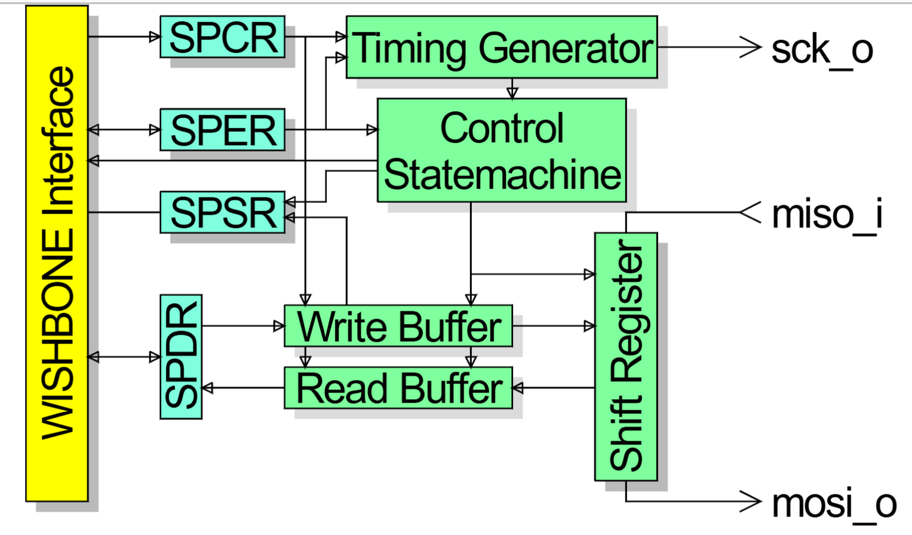

# simple_spi_top Design Specification

## 1. Introduction

`simple_spi_top` is an OpenCores simple SPI master with an 8-bit WISHBONE RevB.3 classic slave interface.  
The core is compatible with the Motorola M68HC11 SPI programming model and extends it with 4-entry transmit and receive FIFOs, programmable interrupt cadence, and a wider SPI clock-divider range.

The module provides byte-oriented full-duplex SPI transfers. Software enqueues transmit bytes through the data register and dequeues received bytes from the same address through an independent receive FIFO.

## 2. Module Diagram

[Placeholder: Insert module/block diagram manually.]

Provided architecture figure:

## 3. Interface

### 3.1 Top-Level Ports

| Signal | Direction | Width | Description |
| --- | --- | --- | --- |
| `clk_i` | Input | 1 | System/WISHBONE clock. Internal logic is referenced to the rising edge of this clock. |
| `rst_n` | Input | 1 | Asynchronous active-low reset input. |
| `cyc_i` | Input | 1 | WISHBONE cycle valid indication. |
| `stb_i` | Input | 1 | WISHBONE strobe/core select. |
| `adr_i` | Input | 2 | Register address (`00` SPCR, `01` SPSR, `10` SPDR, `11` SPER). |
| `we_i` | Input | 1 | WISHBONE write/read qualifier (`1` write, `0` read). |
| `dat_i` | Input | 8 | WISHBONE write data bus. |
| `dat_o` | Output | 8 | WISHBONE read data bus. |
| `ack_o` | Output | 1 | WISHBONE acknowledge for valid accesses. |
| `inta_o` | Output | 1 | Interrupt request output; asserted when interrupt enable and interrupt flag are both set. |
| `sck_o` | Output | 1 | SPI serial clock generated by the core in master mode. |
| `mosi_o` | Output | 1 | SPI master-out serial data. |
| `miso_i` | Input | 1 | SPI master-in serial data. |

### 3.2 Bus Access Semantics

- A WISHBONE access is recognized when `cyc_i` and `stb_i` are asserted.
- `ack_o` provides normal termination of valid accesses.
- Register reads are returned on `dat_o` based on `adr_i`.
- `SPDR` writes enqueue transmit bytes into the write FIFO; `SPDR` reads dequeue bytes from the read FIFO.

### 3.3 Register Map

| Register | Address (`adr_i[1:0]`) | Access | Description |
| --- | --- | --- | --- |
| `SPCR` | `2'b00` | R/W | Serial Peripheral Control Register |
| `SPSR` | `2'b01` | R/W | Serial Peripheral Status Register |
| `SPDR` | `2'b10` | R/W | Serial Peripheral Data Register (FIFO data port) |
| `SPER` | `2'b11` | R/W | Serial Peripheral Extension Register |

### 3.4 Register Definitions

#### 3.4.1 SPCR (Control Register, reset `0x10`)

| Bit(s) | Name | Access | Description |
| --- | --- | --- | --- |
| 7 | `SPIE` | R/W | SPI interrupt enable. |
| 6 | `SPE` | R/W | SPI core enable. When cleared, transfer logic and FIFOs are reset. |
| 5 | Reserved | R/W (reserved) | Reserved. |
| 4 | `MSTR` | R/W | Master mode select. This implementation operates in master mode; bit is forced high in register writes. |
| 3 | `CPOL` | R/W | SPI clock polarity. |
| 2 | `CPHA` | R/W | SPI clock phase. |
| 1:0 | `SPR` | R/W | Base SPI clock-rate select bits. |

#### 3.4.2 SPSR (Status Register, reset `0x05`)

| Bit(s) | Name | Access | Description |
| --- | --- | --- | --- |
| 7 | `SPIF` | R/W1C | Transfer-block complete flag. Set when programmed transfer count completes. Cleared by writing `1` to bit 7 of `SPSR`. |
| 6 | `WCOL` | R/W1C | Write collision flag. Set when writing `SPDR` while write FIFO is full. Cleared by writing `1` to bit 6 of `SPSR`. |
| 5:4 | Reserved | R | Reserved, read as `0` in this implementation. |
| 3 | `WFFULL` | R | Write FIFO full status. |
| 2 | `WFEMPTY` | R | Write FIFO empty status. |
| 1 | `RFFULL` | R | Read FIFO full status. |
| 0 | `RFEMPTY` | R | Read FIFO empty status. |

#### 3.4.3 SPDR (Data Register, reset value undefined)

| Bit(s) | Access | Description |
| --- | --- | --- |
| 7:0 | W | Write FIFO data input. Each successful write enqueues one transmit byte. |
| 7:0 | R | Read FIFO data output. Each successful read dequeues one received byte. |

#### 3.4.4 SPER (Extension Register, reset `0x00`)

| Bit(s) | Name | Access | Description |
| --- | --- | --- | --- |
| 7:6 | `ICNT` | R/W | Interrupt count select: number of completed transfers per `SPIF` set event. |
| 5:2 | Reserved | R/W (reserved) | Reserved. |
| 1:0 | `ESPR` | R/W | Extended SPI clock-rate select bits. Combined with `SPR` as `{ESPR,SPR}`. |

`ICNT` behavior:

| `ICNT` | `SPIF` set condition |
| --- | --- |
| `00` | After every completed transfer |
| `01` | After every 2 completed transfers |
| `10` | After every 3 completed transfers |
| `11` | After every 4 completed transfers |

Clock divider coding (`{ESPR,SPR}`):

| `ESPR` | `SPR` | Divide `clk_i` by |
| --- | --- | --- |
| `00` | `00` | 2 |
| `00` | `01` | 4 |
| `00` | `10` | 16 |
| `00` | `11` | 32 |
| `01` | `00` | 8 |
| `01` | `01` | 64 |
| `01` | `10` | 128 |
| `01` | `11` | 256 |
| `10` | `00` | 512 |
| `10` | `01` | 1024 |
| `10` | `10` | 2048 |
| `10` | `11` | 4096 |
| `11` | `xx` | Reserved (do not use) |

## 4. Function Description

### 4.1 Overview

The core performs full-duplex SPI byte transfers in master mode.  
For each transmitted byte, one byte is simultaneously received. Transmit and receive buffering decouple software bus accesses from serial bit transfer timing.

### 4.2 Transfer Initiation and Data Flow

1. Software programs `SPCR`/`SPER` and sets `SPE=1`.
2. Software writes data bytes to `SPDR`; each write pushes a byte into the 4-entry write FIFO.
3. When enabled and write FIFO is non-empty, the core automatically starts SPI transfer of the oldest queued byte.
4. During transfer, `mosi_o` shifts out transmit bits and `miso_i` is sampled into the receive shift path.
5. At byte completion, the received byte is pushed into the 4-entry read FIFO.
6. Software reads `SPDR` to pop received bytes from the read FIFO.

To receive data from an external SPI slave, software writes dummy bytes to trigger clocking while collecting return data in the read FIFO.

### 4.3 Clocking Mode and Serial Timing

- `CPOL` and `CPHA` select one of the four SPI transfer modes.
- `sck_o` is generated from `clk_i` using the programmable divider selected by `{ESPR,SPR}`.
- Both ends of the SPI link must use matching `CPOL`/`CPHA` mode settings.

### 4.4 Status, Interrupt, and Exceptional Conditions

- `SPIF` indicates completion of a transfer block sized by `ICNT`.
- `inta_o` is asserted when `SPIF=1` and `SPIE=1`.
- `WCOL` is set if software writes `SPDR` while the write FIFO is full.
- Write FIFO and read FIFO are circular buffers. On overrun, oldest buffered data may be overwritten.
- Clearing `SPE` resets both FIFOs and internal transfer state, which is the recovery mechanism for FIFO alignment after destructive overrun scenarios.

## 5. Implementation Details

### 5.1 Architectural Blocks

The design is organized around the following functional blocks:

- Register/control block (`SPCR`, `SPSR`, `SPER`) for mode, enable, divider, status, and interrupt control.
- Timing generator that converts `{ESPR,SPR}` into a countdown-based transfer enable pulse.
- Transfer control state machine that sequences idle/load/shift phases and drives `sck_o`, FIFO handshakes, and bit/byte completion.
- Shift datapath (`treg`) that drives `mosi_o` and captures `miso_i`.
- 4-entry write/read FIFOs for decoupled bus and serial domains at byte granularity.

### 5.2 Control and Datapath Interaction

- Write-path control dequeues one byte from write FIFO when a new transfer starts.
- Shift control moves one bit per SPI clock event until 8 bits are transferred.
- Byte completion triggers read-FIFO write enable and updates transfer-count logic.
- Transfer-count logic (`ICNT`-controlled) generates the event that sets `SPIF`.
- Status and interrupt logic convert FIFO conditions, collision events, and transfer-count events into `SPSR` flags and `inta_o`.

### 5.3 FIFO Behavior in This Design

- Two `fifo4` instances are used: one for transmit queueing and one for receive queueing.
- `SPE=0` asserts FIFO clear controls, resetting both FIFOs.
- Write-collision reporting is explicit for write FIFO (`WCOL`), while read FIFO overrun has no dedicated flag and can overwrite oldest buffered data.

## 6. Submodule List

### 6.1 `fifo4`

Role: 4-entry circular byte FIFO used for both transmit and receive buffering.

| Signal | Direction | Width | Description |
| --- | --- | --- | --- |
| `clk` | Input | 1 | FIFO clock |
| `rst` | Input | 1 | Asynchronous active-low reset |
| `clr` | Input | 1 | Synchronous clear control |
| `din` | Input | `dw` | Write data input |
| `we` | Input | 1 | Write enable |
| `dout` | Output | `dw` | Read data output |
| `re` | Input | 1 | Read enable |
| `full` | Output | 1 | FIFO full indicator |
| `empty` | Output | 1 | FIFO empty indicator |

Parameterization: `dw` defaults to 8 in this design.

Top-level usage:

- `wfifo`: queues bytes written to `SPDR` for SPI transmit.
- `rfifo`: queues received bytes for `SPDR` reads.

## 7. Clock and Reset

- Clock: `clk_i` is the functional clock for bus logic, control logic, and transfer sequencing.
- Reset: `rst_n` is asynchronous and active low.
- Reset effects include register initialization (`SPCR=0x10`, `SPER=0x00`), handshake/state reset, and output/control reinitialization.
- Independently of external reset, clearing `SPE` returns transfer logic and FIFOs to disabled/cleared state.

## 8. Constraints

- Only SPI master operation is supported by this implementation (`MSTR` remains set).
- No dedicated SPI slave-select output is provided; chip-select generation is external to this core.
- Reserved divider encoding `{ESPR,SPR} = 11xx` is unspecified and shall not be used.
- For lossless receive operation, software must service the read FIFO frequently enough to avoid overwrite (FIFO depth is 4 bytes).
