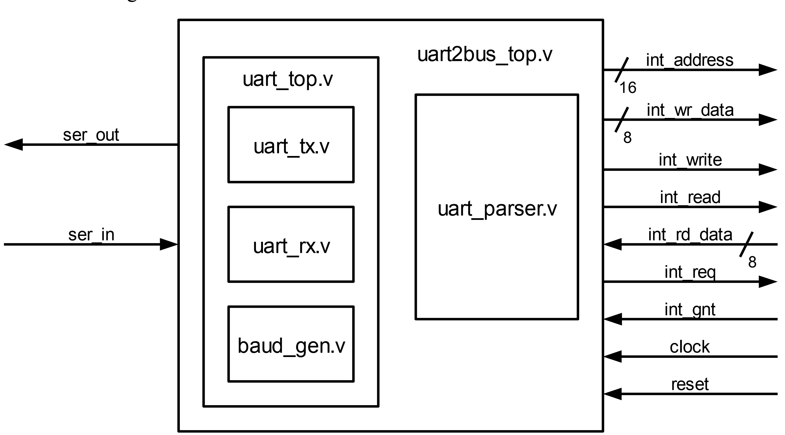

# uart_top Design Specification

## 1. Introduction

`uart_top` is a UART interface wrapper used as the serial front end for higher-level logic. It integrates three blocks:
- a programmable baud-rate enable generator,
- an 8-bit UART receiver, and
- an 8-bit UART transmitter.

The module provides byte-level transmit and receive signaling and exports the internal 16x baud enable used by both RX and TX paths.

## 2. Module Diagram

## 3. Interface

| Direction | Width | Name | Description |
| --------- | ----- | ---- | ----------- |
| Input | 1 | `clock` | Global clock. All sequential logic is triggered on the rising edge of `clock`. |
| Input | 1 | `reset` | Global asynchronous reset, active high. |
| Input | 1 | `ser_in` | UART serial input. This signal is asynchronous to `clock`. |
| Output | 1 | `ser_out` | UART serial output. Idle line level is high. |
| Input | 8 | `tx_data` | Transmit byte input. |
| Input | 1 | `new_tx_data` | Transmit request signal for `tx_data`. |
| Output | 1 | `tx_busy` | Transmitter busy indication. |
| Output | 8 | `rx_data` | Received byte output. Updated when a receive frame completes. |
| Output | 1 | `new_rx_data` | Receive event pulse indicating that `rx_data` was updated. |
| Input | 12 | `baud_freq` | Baud generator increment parameter. |
| Input | 16 | `baud_limit` | Baud generator threshold parameter. |
| Output | 1 | `baud_clk` | Exported 16x baud enable (`ce_16`) from `baud_gen`. |

Interface semantics:
- `new_tx_data` is accepted when `tx_busy` is low; no transmit queue is implemented in `uart_top`.
- `tx_data` is consumed for frame launch on request acceptance.
- `new_rx_data` is a pulse-style event in the `clock` domain when a received byte is committed.
- `baud_clk` is a timing-enable output, not a separate clock domain.
- No top-level parity, framing-error, or overrun status signals are provided.

## 4. Functional Description

### 4.1 Top-level behavior

`uart_top` structurally connects `baud_gen`, `uart_rx`, and `uart_tx`:
- `baud_gen` generates `ce_16`, exported as `baud_clk`.
- `uart_rx` uses `ce_16` to sample and deserialize `ser_in` into `rx_data` with `new_rx_data` indication.
- `uart_tx` uses `ce_16` to serialize `tx_data` onto `ser_out` and drives `tx_busy` while a frame is active.

The top level does not add packet parsing, buffering, or bus command processing.

### 4.2 Baud-enable generation behavior

The baud generator implements an accumulator-style counter controlled by `baud_freq` and `baud_limit`.
- On each `clock`, the internal counter either increments by `baud_freq` or, when threshold is reached, subtracts `baud_limit`.
- `ce_16` is asserted on threshold events and used as the timing-enable reference for RX and TX bit timing.

For system integration, the design specifies parameter calculation:
- `D_BAUD_FREQ = (16 * BaudRate) / gcd(GlobalClockFreq, 16 * BaudRate)`
- `D_BAUD_LIMIT = (GlobalClockFreq / gcd(GlobalClockFreq, 16 * BaudRate)) - D_BAUD_FREQ`

### 4.3 Transmit operation

The transmitter uses `ce_16` to derive a bit-rate enable (`ce_1`) and serializes one frame per accepted request.

Transmit flow:
1. Idle state: `tx_busy = 0`, `ser_out = 1`.
2. Request acceptance: when `new_tx_data` is asserted while idle, transmitter enters busy state and loads a 9-bit shift buffer with `{tx_data, 1'b0}` (start bit in LSB position).
3. Bit output timing: while busy, `ser_out` drives the shift-buffer LSB. At each `ce_1` event, the shift buffer shifts right and inserts `1` at MSB, naturally generating stop-bit level after data bits.
4. Completion: after output progression through start bit, 8 data bits (LSB first), and stop bit timing, `tx_busy` is deasserted and output returns/stays at idle high.

Requests presented while `tx_busy` is high are not queued by this module.

### 4.4 Receive operation

The receiver synchronizes `ser_in`, detects frame timing using `ce_16`, samples data near bit centers, and assembles an 8-bit byte.

Receive flow:
1. Input synchronization: `ser_in` passes through a two-flop synchronizer (`in_sync`).
2. Start detection and timing: when line activity indicates a low start condition, an internal 4-bit counter (`count16`) advances on `ce_16` to create:
   - `ce_1_mid`: mid-bit sample enable,
   - `ce_1`: end-of-bit enable.
3. Busy control: `rx_busy` is asserted at a mid-bit event after start detection and remains asserted during byte reception.
4. Data sampling: on each mid-bit event while busy, the synchronized serial value is shifted into `data_buf`.
5. Byte commit: after eight sampled data bits, `rx_data` is updated and `new_rx_data` pulses to indicate availability of a new byte.

The implemented receiver path does not expose parity checking, framing-error indication, or overrun reporting at top level.

## 5. Implementation Details

### 5.1 Structural composition in `uart_top`

`uart_top` contains:
- one `baud_gen` instance,
- one `uart_rx` instance,
- one `uart_tx` instance,
- and a direct assignment `baud_clk = ce_16`.

No additional top-level state machine is added; timing/control behavior is encapsulated in submodules.

### 5.2 `baud_gen` internal control

Key internal state:
- `counter[15:0]`: accumulator/threshold state.
- `ce_16`: registered enable output.

Control behavior:
- `counter` resets to zero on `reset`.
- If `counter >= baud_limit`, `counter` is reduced by `baud_limit`; otherwise it is incremented by `baud_freq`.
- `ce_16` is asserted when the threshold condition is met and deasserted otherwise.

### 5.3 `uart_tx` datapath and control

Key internal state:
- `count16[3:0]`: divides `ce_16` to bit-rate events.
- `bit_count[3:0]`: tracks transmitted bit positions within a frame.
- `data_buf[8:0]`: serial shift buffer containing start/data/stop progression.
- `tx_busy`, `ser_out` registers.

Control behavior:
- `ce_1` is derived from `count16` and `ce_16`.
- `bit_count` increments on `ce_1` while busy.
- `data_buf` loads `{tx_data, 1'b0}` when idle and shifts on `ce_1` while busy.
- `tx_busy` is asserted on accepted request and deasserted after frame completion condition.

### 5.4 `uart_rx` datapath and control

Key internal state:
- `in_sync[1:0]`: input synchronizer for asynchronous `ser_in`.
- `count16[3:0]`: bit-phase counter used for start detection and sampling cadence.
- `rx_busy`: receive-in-progress indicator.
- `bit_count[3:0]`: sampled data-bit count.
- `data_buf[7:0]`: receive shift buffer.
- `rx_data`, `new_rx_data` registers.

Control behavior:
- `ce_1_mid` and `ce_1` are derived from `count16` with `ce_16`.
- `rx_busy` and `bit_count` sequence reception around mid-bit sample events.
- `data_buf` shifts in synchronized serial bits at sample points.
- On receive-complete condition, `rx_data` captures `data_buf` and `new_rx_data` is asserted as an event pulse.

## 6. Submodules

### 6.1 `baud_gen`

Role:
Generates the 16x baud timing enable used by UART RX and TX.

| Signal | Direction | Width | Description |
| ------ | --------- | ----- | ----------- |
| `clock` | Input | 1 | Global clock. |
| `reset` | Input | 1 | Asynchronous active-high reset. |
| `ce_16` | Output | 1 | 16x baud enable output. |
| `baud_freq` | Input | 12 | Baud increment parameter. |
| `baud_limit` | Input | 16 | Baud threshold parameter. |

### 6.2 `uart_rx`

Role:
Receives UART serial data, reconstructs bytes, and reports byte-complete events.

| Signal | Direction | Width | Description |
| ------ | --------- | ----- | ----------- |
| `clock` | Input | 1 | Global clock. |
| `reset` | Input | 1 | Asynchronous active-high reset. |
| `ce_16` | Input | 1 | 16x baud enable from `baud_gen`. |
| `ser_in` | Input | 1 | Serial input line. |
| `rx_data` | Output | 8 | Most recently completed receive byte. |
| `new_rx_data` | Output | 1 | Byte-complete pulse. |

### 6.3 `uart_tx`

Role:
Transmits UART frames from byte input using shared baud timing enable.

| Signal | Direction | Width | Description |
| ------ | --------- | ----- | ----------- |
| `clock` | Input | 1 | Global clock. |
| `reset` | Input | 1 | Asynchronous active-high reset. |
| `ce_16` | Input | 1 | 16x baud enable from `baud_gen`. |
| `tx_data` | Input | 8 | Byte to transmit. |
| `new_tx_data` | Input | 1 | Transmit request indication. |
| `ser_out` | Output | 1 | Serial output line. |
| `tx_busy` | Output | 1 | Transmit-in-progress status. |

## 7. Clock and Reset

- Single clock domain: `clock`.
- `reset` is asynchronous and active high for `uart_top` and all instantiated submodules.
- `baud_clk` is an enable pulse exported from internal timing logic; it is not an independent clock domain.

## 8. Constraints and Notes

- This specification covers `uart_top` only.
- Text/binary command parsing and internal bus transactions belong to higher-level parser/core modules and are out of scope here.
- `baud_freq` and `baud_limit` are applied directly by `baud_gen` (no top-level handshake or shadow register).
- `ser_in` is asynchronous to `clock`; input synchronization is implemented inside `uart_rx`.
