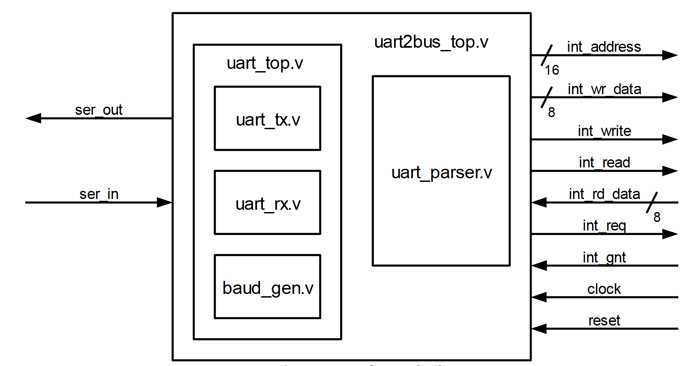
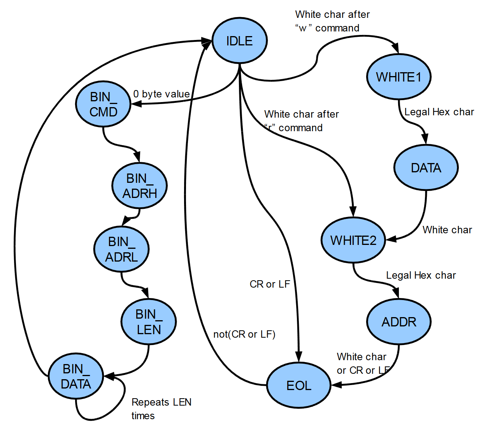

# UART to Bus Core Specification (`uart2bus_top`)

## 1. Introduction

The UART to Bus core provides access to an internal 16-bit-address/8-bit-data bus through a UART serial interface. It is intended for board bring-up, debug access, and low-bandwidth control paths where a simple serial command channel is sufficient.

The core combines:
- a UART front-end (`uart_top`: baud generator, UART receiver, UART transmitter), and
- a command parser (`uart_parser`) that decodes text and binary commands and issues internal bus read/write transactions.

This specification describes externally visible behavior and architecture-level implementation semantics of the integrated top module `uart2bus_top`.

## 2. Module Diagram

## 3. Interface

### 3.1 Top-Level Ports (`uart2bus_top`)

| Signal | Direction | Width | Description |
| --- | --- | --- | --- |
| `clock` | Input | 1 | Global core clock. |
| `reset` | Input | 1 | Global asynchronous active-high reset. |
| `ser_in` | Input | 1 | UART serial input to the core. |
| `ser_out` | Output | 1 | UART serial output from the core. |
| `int_address` | Output | 16 | Internal bus address. |
| `int_wr_data` | Output | 8 | Write data for bus write transactions. |
| `int_write` | Output | 1 | One-cycle bus write strobe. |
| `int_rd_data` | Input | 8 | Bus read data returned by target logic. |
| `int_read` | Output | 1 | One-cycle bus read strobe. |
| `int_req` | Output | 1 | Bus access request; asserted while waiting for grant. |
| `int_gnt` | Input | 1 | Bus grant for request/grant arbitration. |

### 3.2 Bus Handshake Semantics

- The parser raises `int_req` when a read or write operation is pending.
- `int_req` remains asserted until `int_gnt` is observed.
- When granted, the core issues exactly one-cycle strobe on `int_write` or `int_read`.
- `int_rd_data` is sampled by the core on the cycle following `int_read` assertion.
- If arbitration is not needed, `int_gnt` may be tied high, effectively making accesses immediate.

### 3.3 UART Front-End Integration

`uart2bus_top` instantiates `uart_top` and ties baud configuration inputs to fixed local constants (`D_BAUD_FREQ`, `D_BAUD_LIMIT`). UART transport between parser and serial pins uses:
- parser TX side: `tx_data`, `new_tx_data`, `tx_busy`
- parser RX side: `rx_data`, `new_rx_data`

## 4. Functional Description

### 4.1 Operating Overview

The core converts UART command streams into internal bus transactions:

1. UART receiver reconstructs bytes from `ser_in`.
2. Parser consumes received bytes and tracks command state.
3. On valid command completion points, parser requests bus access (`int_req`) and issues read/write strobes on grant.
4. For read commands, returned data is formatted and transmitted over UART.
5. Optional binary-mode ACK/status byte (`0x5A`) is transmitted when requested.

The parser supports two command modes:
- Text mode protocol (ASCII-friendly, terminal-oriented).
- Binary mode protocol (more compact, supports buffered transfers and optional auto-increment).

### 4.2 Text Mode Protocol

Text mode recognizes two commands:
- Read command: starts with `R` or `r`.
- Write command: starts with `W` or `w`.

Accepted delimiters and symbols:
- Whitespace: space (`0x20`) or tab (`0x09`).
- End-of-line: CR (`0x0D`) or LF (`0x0A`).
- Hex digits: `0-9`, `A-F`, `a-f`.

### 4.2.1 Text Read Command

Format:
- Field 1: `R` or `r`
- Field 2: one or more whitespace characters
- Field 3: hexadecimal address
- Field 4: EOL (CR or LF)

Behavior:
- On EOL reception after valid command parse, core issues one bus read.
- Read response is transmitted as two uppercase hexadecimal ASCII characters, followed by CR and LF.

### 4.2.2 Text Write Command

Format:
- Field 1: `W` or `w`
- Field 2: whitespace
- Field 3: hexadecimal data byte
- Field 4: whitespace
- Field 5: hexadecimal address
- Field 6: EOL (CR or LF)

Behavior:
- On EOL reception after valid command parse, core issues one bus write using parsed data/address.
- No text-mode data response is transmitted for writes.

### 4.2.3 Error Handling in Text Mode

If an illegal character or invalid sequence is detected, parser transitions to an end-of-line wait state and ignores input until CR or LF, then returns to idle.

### 4.3 Binary Mode Protocol

Binary commands are distinguished by an initial zero byte (`0x00`) while in idle.

Binary command frame:
- Byte 1: binary command indicator (`0x00`)
- Byte 2: command/options byte
- Byte 3: address high byte
- Byte 4: address low byte
- Byte 5: length byte
- Following bytes (write commands only): payload data bytes

Command byte semantics:
- Bits `[5:4]` command type:
  - `00`: NOP
  - `01`: READ
  - `10`: WRITE
- Bit `[1]`: address auto-increment control
  - `0`: auto-increment enabled
  - `1`: auto-increment disabled
- Bit `[0]`: ACK enable
  - `1`: transmit `0x5A` at command completion
  - `0`: no ACK byte

Length semantics:
- `length = 0` represents 256 bytes.
- Otherwise, transfer size is the explicit length value.

### 4.3.1 Binary Read

- First bus read request is issued after the length byte is received.
- For multi-byte reads, additional read requests are issued after each transmitted read byte.
- Read data is transmitted as raw binary bytes.
- If ACK is enabled, `0x5A` is transmitted after the final data byte.

### 4.3.2 Binary Write

- Each payload byte generates a write request/transaction.
- If auto-increment is enabled, address increments after each write.
- If ACK is enabled, `0x5A` is transmitted after the final payload byte.

### 4.3.3 Binary NOP

- No bus transaction is issued.
- If ACK is enabled, `0x5A` is transmitted.

### 4.4 Parser State Behavior

The receive-side parser is organized as:
- text-mode states (`IDLE`, whitespace/data/address parsing, EOL recovery), and
- binary-mode states (command byte, address bytes, length, optional data stream).

Parser state reference figure:

## 5. Implementation Details

### 5.1 Architectural Composition

`uart2bus_top` integrates two major blocks:
- `uart_top`: serial byte transport and baud timing.
- `uart_parser`: protocol decode, command sequencing, bus control, and return formatting.

Within `uart_top`:
- `baud_gen` creates `ce_16` timing enable.
- `uart_rx` uses `ce_16` oversampling to reconstruct received bytes and pulse `new_rx_data`.
- `uart_tx` serializes outgoing bytes and exposes `tx_busy` for flow control.

### 5.2 Command-to-Bus Control Path

- Parsed command fields are accumulated into internal parameter registers (`addr_param`, `data_param`, length counter).
- Read and write operations are queued via internal request flags.
- `int_req` is the OR of pending read/write request flags.
- When `int_gnt` is asserted, pending request converts to one-cycle `int_read` or `int_write` pulse.
- Address update policy:
  - Text mode: address taken from parsed command.
  - Binary mode: address initialized from command and optionally incremented after each granted transfer.

### 5.3 Read Return Path and TX Formatting

- After a read strobe, returned data is sampled and marked done internally.
- TX state machine behavior:
  - Text-mode read: transmit high nibble ASCII, low nibble ASCII, CR, LF.
  - Binary-mode read: transmit raw byte.
  - Optional ACK/status byte generation (`0x5A`) at command completion conditions.
- TX progression is synchronized to `tx_busy` falling-edge detection (`tx_end_p`).

### 5.4 Baud Configuration Behavior

`uart2bus_top` ties baud control inputs of `uart_top` to fixed constants. `baud_gen` uses `baud_freq` and `baud_limit` to generate `ce_16`. The documented equation in the source comments defines parameter calculation for a target baud rate and system clock.

## 6. Submodule List

### 6.1 `uart2bus_top`

Role: Integration top for UART front-end and command parser, exposing internal bus interface.

| Signal Group | Description |
| --- | --- |
| UART serial I/O | `ser_in`, `ser_out` |
| Bus interface | `int_address`, `int_wr_data`, `int_write`, `int_rd_data`, `int_read`, `int_req`, `int_gnt` |
| Global control | `clock`, `reset` |

### 6.2 `uart_top`

Role: UART byte transport wrapper.

| Key I/O | Description |
| --- | --- |
| TX path | `tx_data`, `new_tx_data`, `tx_busy`, `ser_out` |
| RX path | `rx_data`, `new_rx_data`, `ser_in` |
| Baud config | `baud_freq`, `baud_limit`, `baud_clk` |

### 6.3 `uart_parser`

Role: Protocol parser and bus transaction controller supporting text and binary command modes.

| Key I/O | Description |
| --- | --- |
| RX command input | `rx_data`, `new_rx_data` |
| TX response output | `tx_data`, `new_tx_data`, `tx_busy` |
| Bus control | `int_address`, `int_wr_data`, `int_write`, `int_read`, `int_req`, `int_gnt`, `int_rd_data` |

### 6.4 `uart_rx`

Role: UART receive engine producing byte data and new-byte strobe.

### 6.5 `uart_tx`

Role: UART transmit engine consuming byte data and reporting busy status.

### 6.6 `baud_gen`

Role: Baud timing generator producing 16x enable (`ce_16`) from programmable frequency/limit registers.

## 7. Clock and Reset

- Clock domain: all major logic is synchronous to `clock`.
- Reset: asynchronous active-high reset (`reset`) initializes parser state, UART TX/RX state, counters, and handshake control outputs.
- UART timing depends on `ce_16` generated by `baud_gen` from fixed configuration constants in `uart2bus_top`.

## 8. Constraints

- Text commands must follow required field ordering and delimiter rules; malformed lines are ignored until EOL.
- Binary commands must begin with `0x00` while parser is idle.
- Binary length `0` means 256-byte transfer.
- `int_gnt` must be asserted for each requested transfer; otherwise requests remain pending.
- For auto-increment-disabled binary mode, repeated transfer bytes target the same address.
- ACK byte value is fixed to `0x5A` when enabled by command bit `[0]`.
