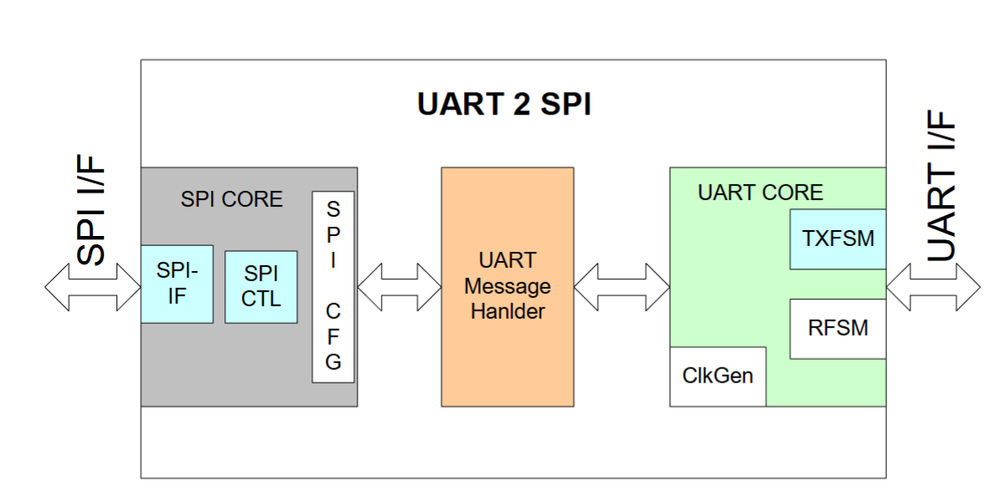
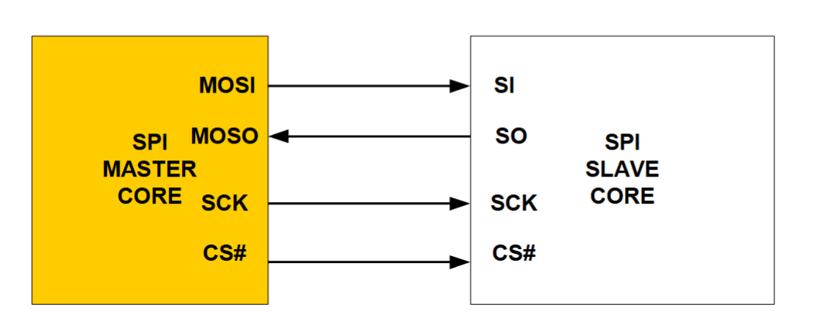

# UART-to-SPI Core Specification (`top`)

## 1. Introduction

The `top` module integrates a UART front-end, a UART message parser, and an SPI controller so that SPI transactions can be initiated from UART text commands.

The core is intended for bring-up, debug, and protocol exploration use-cases where a simple UART command channel is preferred over a full host bus integration. The SPI control path is register-based internally, and UART commands are translated into SPI register reads/writes and SPI operations.

This specification is based on:
- `UARTtoSPISpecification.pdf` (primary design intent)
- RTL implementation in `top.v` and included submodules
- `st-m25p10.pdf` and `st-m25p20.pdf` (used for integration examples)

## 2. Module Diagram

[Placeholder: Insert module/block diagram manually.]

Provided architecture figures:

## 3. Interface

### 3.1 Top-Level Ports

| Signal | Direction | Width | Description |
| --- | --- | --- | --- |
| `line_reset_n` | Input | 1 | Global asynchronous active-low reset. |
| `line_clk` | Input | 1 | Main input clock for UART core and baud generation. |
| `cfg_tx_enable` | Input | 1 | UART transmit path enable. |
| `cfg_rx_enable` | Input | 1 | UART receive path enable. |
| `cfg_stop_bit` | Input | 1 | UART stop-bit configuration (`0`: 1 stop bit, `1`: 2 stop bits). |
| `cfg_pri_mod` | Input | 2 | UART parity mode control (implementation behavior described below). |
| `cfg_baud_16x` | Input | 12 | UART 16x baud divider configuration. |
| `frm_error` | Output | 1 | UART framing error indication from RX path. |
| `par_error` | Output | 1 | UART parity error indication from RX path. |
| `baud_clk_16x` | Output | 1 | Generated 16x UART baud clock. |
| `rxd` | Input | 1 | UART receive serial input. |
| `txd` | Output | 1 | UART transmit serial output. |
| `sck` | Output | 1 | SPI serial clock output. |
| `so` | Output | 1 | SPI serial data output (master-to-slave). |
| `si` | Input | 1 | SPI serial data input (slave-to-master). |
| `cs_n` | Output | 4 | Active-low SPI chip-select outputs (`cs_n[3:0]`). |

### 3.2 Clock and Reset Semantics

- `line_reset_n` is active low and is used asynchronously by major sequential blocks.
- `baud_clk_16x` is derived from `line_clk` by `clk_ctl` and is used as the operating clock for:
  - UART TX/RX state machines
  - UART message handler
  - SPI core in the top-level integration
- The baud clock generator behavior follows the documented relation: `baud_clk_16x ≈ line_clk / (2 + cfg_baud_16x)`.

### 3.3 UART Configuration Semantics

- `cfg_stop_bit` selects one or two stop bits in both TX and RX framing logic.
- `cfg_pri_mod` controls parity behavior. The implemented RX/TX FSM behavior is:
  - `2'b00`: parity disabled
  - `2'b10`: even parity
  - `2'b11`: odd parity
  - `2'b01`: not explicitly defined by dedicated branch logic (treat as reserved)

### 3.4 SPI Line Semantics

- `sck`, `so`, and selected `cs_n[x]` are driven by the SPI core.
- Only one chip-select output is actively driven low at a time (based on target selection); non-selected outputs stay high.

## 4. Functional Description

### 4.1 High-Level Operation

1. UART receiver decodes serial bytes from `rxd`.
2. `uart_msg_handler` parses textual commands and generates internal register-bus accesses (`reg_req`, `reg_wr`, `reg_addr`, `reg_wdata`).
3. `spi_cfg` exposes SPI control/data registers and acknowledges accesses.
4. `spi_ctl` executes SPI transfers based on register settings and returns read data to `spi_cfg`.
5. For UART read commands, returned register data is formatted and transmitted over `txd`.

### 4.2 UART Message Protocol

The parser supports text commands in lowercase form as implemented:
- Write command: `wm <addr> <data><LF>`
- Read command: `rm <addr><LF>`

Parser behavior details:
- Command termination uses `LF` (`0x0A`) in the implemented state machine.
- Address and data fields are parsed as hexadecimal nibbles.
- Spaces are used as token separators; additional spaces are tolerated in several parser phases.
- Unsupported/invalid sequences return parser flow to idle/menu path.

On reset/idle re-entry, the handler transmits menu/help text and then prompt context.

### 4.3 Command Effects

- `wm` command:
  - Parses hex address and hex data.
  - Issues register-bus write request (`reg_wr=1`, `reg_req=1`).
  - Waits for `reg_ack`.
  - Returns textual completion message (`cmd success`).

- `rm` command:
  - Parses hex address.
  - Issues register-bus read request (`reg_wr=0`, `reg_req=1`).
  - Waits for `reg_ack` and samples `reg_rdata`.
  - Returns `reg_rdata` as 8 uppercase hexadecimal characters plus line termination.

### 4.4 SPI Register Interface Model

The SPI core is controlled through three active registers (word-addressed in software view):

1. Control register (`reg_addr[3:0] = 0x0` in SPI core decode)
- Bit `[31]`: operation request (`cfg_op_req`)
- Bits `[24:23]`: target select (`cfg_tgt_sel`)
- Bits `[22:21]`: operation type (`cfg_op_type`)
- Bits `[20:19]`: transfer size (`cfg_transfer_size`, encoded as bytes minus one)
- Bits `[18:13]`: SCK period (`cfg_sck_period`)
- Bits `[12:8]`: CS setup/hold period (`cfg_sck_cs_period`)
- Bits `[7:0]`: per-byte CS control (`cfg_cs_byte`)

2. Data-in register (`reg_addr[3:0] = 0x1`)
- `cfg_datain[31:0]` used as write/command payload (MSB transmitted first).

3. Data-out register (`reg_addr[3:0] = 0x2`)
- `cfg_dataout[31:0]` captures received SPI bytes.

Request/ack behavior:
- `reg_ack` is generated by `spi_cfg` for read or write accesses.
- Operation request bit is implemented with request-register semantics: set by software write of request bit, cleared by hardware operation done indication.

Address mapping note:
- `uart_msg_handler` produces a 16-bit register address.
- Top-level maps `reg_addr[5:2]` into `spi_core.reg_addr[3:0]`, so command addresses are effectively word-aligned for SPI register decode.

### 4.5 SPI Transfer Execution Semantics

`spi_ctl` executes each requested SPI operation through a staged state machine:
- chip-select setup
- byte transfer (read or write)
- chip-select hold
- optional next byte until configured transfer size completes
- operation-done signaling and wait for request deassertion

Byte ordering and size:
- SPI transmit byte order is MSB-first within each byte.
- Multi-byte transfers use `cfg_datain` byte lanes from `[31:24]` downward.
- `cfg_transfer_size` encodes number of bytes as:
  - `2'b00`: 1 byte
  - `2'b01`: 2 bytes
  - `2'b10`: 3 bytes
  - `2'b11`: 4 bytes

Operation type:
- `cfg_op_type == 2'b00`: write-style transfer
- nonzero `cfg_op_type`: read-style transfer path in current RTL implementation

### 4.6 UART RX/TX Framing and Error Behavior

- RX path samples asynchronous `rxd` with synchronization and 16x timing.
- RX checks start condition, data bits, optional parity, and stop bits.
- `frm_error` indicates stop-bit framing failure.
- `par_error` indicates parity mismatch when parity is enabled.
- TX path emits start bit, 8 data bits, optional parity, and configured stop bits.

### 4.7 SPI-Flash Integration Examples (Non-Normative)

The following examples show how common flash operations (as documented in ST M25P10/M25P20 command sets) can be mapped onto this core’s register interface. These examples are integration guidance; the normative behavior of this IP is the register/SPI engine behavior described above.

Example sequence pattern:
1. Write `cfg_datain` with up to 4 command/address/data bytes.
2. Write control register with target select, op type, transfer size, timing, and request bit.
3. Poll/read control request completion (request bit clears on operation done) and/or read data-out register for receive operations.

Representative flash command bytes from ST M25P10/M25P20 datasheets:
- `0x06` (`WREN`)
- `0x05` (`RDSR`)
- `0x03` (`READ`)
- `0x02` (`PP`, page program)
- `0xD8` (`SE`, sector erase)

Typical composite usage:
- Program/erase flows generally require `WREN` before `PP`/`SE`.
- After program/erase, poll status (`RDSR`) until write-in-progress clears.

## 5. Implementation Details

### 5.1 Top-Level Structural Composition

`top` instantiates and connects:
- `uart_core`: UART line handling and baud generation
- `uart_msg_handler`: UART command parser and register-bus master
- `spi_core`: SPI register bank, SPI transfer controller, and SPI line interface

Data/control flow:
- `uart_core` RX bytes -> `uart_msg_handler`
- `uart_msg_handler` register requests -> `spi_core`
- `spi_core` read data/ack -> `uart_msg_handler`
- `uart_msg_handler` response bytes -> `uart_core` TX path

### 5.2 UART Message Handler FSM Roles

The handler includes dedicated phases for:
- command token reception (`wm`/`rm`)
- write address/data collection
- read address collection
- request dispatch and wait-for-ack
- formatted transmit output sequencing

It uses nibble conversion helper functions for ASCII-hex parsing and formatting.

### 5.3 SPI Core Internal Block Roles

- `spi_cfg`: register decode/storage, access acknowledge, control/data register exposure.
- `spi_ctl`: SPI transaction sequencing, SCK generation control, byte counting, and completion signaling.
- `spi_if`: serial shift interface for `so`/`si` and target chip-select fanout.

### 5.4 Behavior Requiring Integration Attention

- Target select field intent is 2-bit; integration should verify effective accessibility of both bits in the deployed RTL build.
- Parser command recognition is implemented using lowercase command tokens (`wm`, `rm`).
- Command termination in parser FSM is driven by `LF` (`0x0A`) handling.

## 6. Submodule List

### 6.1 `uart_core`

Role: UART timing, transmit, receive, and error signaling.

| Key Interface | Description |
| --- | --- |
| `cfg_*` | UART enable, parity, stop-bit, baud configuration |
| `tx_data_avail/tx_data/tx_rd` | TX byte handshake with message handler |
| `rx_ready/rx_wr/rx_data` | RX byte handshake with message handler |
| `frm_error/par_error` | RX protocol error indications |
| `rxd/txd` | External UART line interface |

### 6.2 `uart_msg_handler`

Role: Text command parser and register-bus transaction generator.

| Key Interface | Description |
| --- | --- |
| UART side | `rx_wr/rx_data/rx_ready`, `tx_data_avail/tx_data/tx_rd` |
| Register side | `reg_addr/reg_wr/reg_wdata/reg_req/reg_ack/reg_rdata` |

### 6.3 `spi_core`

Role: Register-programmable SPI transaction engine and physical SPI line driver.

| Key Interface | Description |
| --- | --- |
| Register side | `reg_cs/reg_wr/reg_addr/reg_wdata/reg_be/reg_ack/reg_rdata` |
| SPI line side | `sck/so/si/cs_n` |

### 6.4 `spi_cfg`

Role: SPI control/data register bank with request/ack and operation-complete interaction.

### 6.5 `spi_ctl`

Role: SPI transaction control FSM (timing, transfer length, read/write sequencing, completion).

### 6.6 `spi_if`

Role: SPI serial shifters and chip-select routing to one of four targets.

### 6.7 `uart_rxfsm` / `uart_txfsm`

Role: UART receive/transmit framing state machines used by `uart_core`.

### 6.8 `clk_ctl`

Role: Programmable clock divider producing `baud_clk_16x` from `line_clk`.

## 7. Clock and Reset

- Primary input clock: `line_clk`.
- Derived clock used by parser/SPI/UART FSM logic: `baud_clk_16x`.
- Active-low asynchronous reset: `line_reset_n`.
- Reset initializes parser state, UART FSM state, SPI control state, request flags, and interface outputs to idle-safe behavior.

## 8. Constraints

- UART command parser is text-mode only in this core revision.
- Command tokens are expected in implemented lowercase format (`wm`, `rm`).
- SPI register accesses should use word-aligned addressing consistent with `reg_addr[5:2]` mapping.
- SPI operation request must be issued through control register bit 31 and cleared by hardware completion handshake.
- `cfg_pri_mod=2'b01` is not explicitly defined by dedicated RX/TX parity logic branches and should be treated as reserved unless integration defines behavior.
