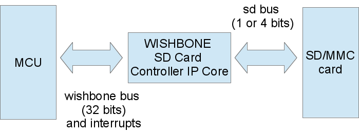
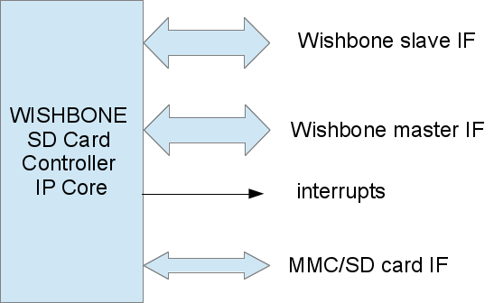
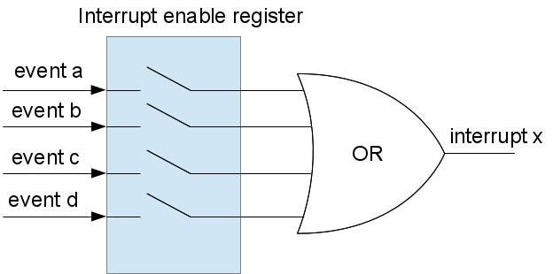

# sdc_controller Design Specification

## 1. Introduction

`sdc_controller` is a Wishbone-connected MMC/SD card controller IP intended for SoC integration.
It provides:

- A Wishbone slave register interface for software control and status.
- A Wishbone master interface used by the internal DMA path to move payload data between system memory and SD data channels.
- SD command and data pin control for 1-bit or 4-bit SD/MMC bus operation.
- Separate interrupt outputs for command-transaction and data-transaction events.

The core supports generic command indices and command arguments, optional response checking, and block-based data transfers. SPI mode is not supported.

## 2. Module Diagram

[Placeholder: Insert module/block diagram manually.]

The following provided figures document top-level integration, interface grouping, and interrupt structure:

## 3. Interface

### 3.1 Wishbone Common Signals

| Signal | Direction | Width | Description |
| --- | --- | --- | --- |
| `wb_clk_i` | Input | 1 | Wishbone clock for slave interface and internal Wishbone-master control logic. |
| `wb_rst` | Input | 1 | Active-high reset for the controller. |

### 3.2 Wishbone Slave (Register Access)

| Signal | Direction | Width | Description |
| --- | --- | --- | --- |
| `wb_dat_i` | Input | 32 | Write data for register programming. |
| `wb_dat_o` | Output | 32 | Read data returned from register map. |
| `wb_adr_i` | Input | 8 | Register address offset (byte addressing; lower 8 bits are decoded). |
| `wb_sel_i` | Input | 4 | Byte select from bus master. |
| `wb_we_i` | Input | 1 | Write enable (`1` write, `0` read). |
| `wb_cyc_i` | Input | 1 | Wishbone cycle qualifier. |
| `wb_stb_i` | Input | 1 | Wishbone strobe qualifier. |
| `wb_ack_o` | Output | 1 | Wishbone acknowledge pulse for accepted accesses. |

### 3.3 Wishbone Master (DMA Memory Access)

| Signal | Direction | Width | Description |
| --- | --- | --- | --- |
| `m_wb_adr_o` | Output | 32 | DMA memory address. |
| `m_wb_sel_o` | Output | 4 | DMA byte select, fixed to `4'b1111` (full-word accesses). |
| `m_wb_we_o` | Output | 1 | DMA write enable (`1` memory write, `0` memory read). |
| `m_wb_dat_i` | Input | 32 | Data returned by memory during DMA reads. |
| `m_wb_dat_o` | Output | 32 | Data written to memory during DMA writes. |
| `m_wb_cyc_o` | Output | 1 | DMA cycle qualifier. |
| `m_wb_stb_o` | Output | 1 | DMA strobe qualifier. |
| `m_wb_ack_i` | Input | 1 | DMA transfer acknowledge from memory target. |
| `m_wb_cti_o` | Output | 3 | Cycle type identifier, fixed to `3'b000`. |
| `m_wb_bte_o` | Output | 2 | Burst type extension, fixed to `2'b00`. |

### 3.4 SD/MMC Physical Interface

| Signal | Direction | Width | Description |
| --- | --- | --- | --- |
| `sd_cmd_dat_i` | Input | 1 | SD command line input. |
| `sd_cmd_out_o` | Output | 1 | SD command line output drive value. |
| `sd_cmd_oe_o` | Output | 1 | SD command line output enable. |
| `sd_dat_dat_i` | Input | 4 | SD data line inputs (`DAT[3:0]`). |
| `sd_dat_out_o` | Output | 4 | SD data line output drive values. |
| `sd_dat_oe_o` | Output | 1 | SD data bus output enable control. |
| `sd_clk_i_pad` | Input | 1 | Clock source for SD clock divider. |
| `sd_clk_o_pad` | Output | 1 | Generated SD interface clock output. |

### 3.5 Interrupt Outputs

| Signal | Direction | Width | Description |
| --- | --- | --- | --- |
| `int_cmd` | Output | 1 | Active-high command event interrupt (`cmd_event_status & cmd_event_enable`). |
| `int_data` | Output | 1 | Active-high data event interrupt (`data_event_status & data_event_enable`). |

### 3.6 Interface Semantics

- Register accesses use the Wishbone slave interface; software-visible control and status are in this map.
- A write to the argument register starts a command transaction using previously programmed command settings.
- `wb_dat_o` is a registered read-data output.
- DMA transfers use the Wishbone master interface and increment address by 4 bytes per acknowledged data beat.
- SD command and data lines are tri-state controlled through `*_oe_o` signals.

## 4. Software Register Interface

### 4.1 Register Map

| Name | Address | Access | Reset Value | Description |
| --- | --- | --- | --- | --- |
| `argument` | `0x00` | RW | `0x00000000` | Command argument; write triggers command start. |
| `command` | `0x04` | RW | `0x00000000` | Command transaction configuration. |
| `response0` | `0x08` | R | `0x00000000` | Response bits `[31:0]`. |
| `response1` | `0x0C` | R | `0x00000000` | Response bits `[63:32]`. |
| `response2` | `0x10` | R | `0x00000000` | Response bits `[95:64]`. |
| `response3` | `0x14` | R | `0x00000000` | Response bits `[119:96]`. |
| `controller` | `0x1C` | RW | `0x00000000` | Bus-width control and reserved control bits. |
| `timeout` | `0x20` | RW | `0x00000000` | Command watchdog threshold in `sd_clk_o_pad` cycles. |
| `clock_d` | `0x24` | RW | `0x00000000` | SD clock divider ratio (`f_sd_clk_o = f_sd_clk_i_pad/(2*(clock_d+1))`). |
| `reset` | `0x28` | RW | `0x0` | Software reset control bit. |
| `voltage` | `0x2C` | R | `3300` | Supply voltage information in mV (HDL parameter). |
| `capa` | `0x30` | R | `0x00000000` | Capabilities information (currently reserved value). |
| `cmd_isr` | `0x34` | RW | `0x00000000` | Command event status; any write clears all command event bits. |
| `cmd_iser` | `0x38` | RW | `0x00000000` | Command event enable mask. |
| `data_isr` | `0x3C` | RW | `0x00000000` | Data event status; any write clears all data event bits. |
| `data_iser` | `0x40` | RW | `0x00000000` | Data event enable mask. |
| `blksize` | `0x44` | RW | `0x00000200` | Bytes per block (`12`-bit field). |
| `blkcnt` | `0x48` | RW | `0x00000000` | Block-count field; value encodes block count minus one. |
| `dst_src_addr` | `0x60` | RW | `0x00000000` | DMA source/destination base address. |

### 4.2 Key Register Fields

#### `command` Register (`0x04`)

| Bits | Name | Description |
| --- | --- | --- |
| `[13:8]` | `CMD_INDEX` | SD command index. |
| `[6:5]` | `CMD_WITH_DATA` | `00`: no data phase, `01`: read data phase, `10`: write data phase. |
| `[4]` | `CMD_IDX_CHECK` | Enable command index check in response. |
| `[3]` | `CMD_CRC_CHECK` | Enable response CRC check. |
| `[2]` | `CMD_BUSY_CHECK` | After command completion, wait while SD busy indication is active. |
| `[1:0]` | `CMD_RESPONSE_CHECK` | `00`: no response expected, `01`: short response, `10`: long response. |

#### `controller` Register (`0x1C`)

| Bits | Name | Description |
| --- | --- | --- |
| `[0]` | `bus_4bit` | `0`: 1-bit SD data mode, `1`: 4-bit SD data mode. |

#### `reset` Register (`0x28`)

| Bits | Name | Description |
| --- | --- | --- |
| `[0]` | `sw_reset` | `1` applies software reset to transfer engines; `0` releases software reset. |

#### `cmd_isr` / `cmd_iser` Bits

| Bit | Event | Meaning |
| --- | --- | --- |
| `[0]` | `INT_CMD_CC` | Command transaction completed. |
| `[1]` | `INT_CMD_EI` | Command error aggregate flag. |
| `[2]` | `INT_CMD_CTE` | Command timeout error. |
| `[3]` | `INT_CMD_CCRCE` | Command response CRC error. |
| `[4]` | `INT_CMD_CIE` | Command response index error. |

#### `data_isr` / `data_iser` Bits

| Bit | Event | Meaning |
| --- | --- | --- |
| `[0]` | `INT_DATA_CC` | Data transaction completed. |
| `[1]` | `INT_DATA_CCRCE` | Data CRC error. |
| `[2]` | `INT_DATA_CFE` | FIFO error (TX underrun or RX overflow condition). |

### 4.3 Register Access and Clear Behavior

- Writing `argument` starts command execution.
- Writing `cmd_isr` clears all command status bits.
- Writing `data_isr` clears all data status bits.
- Interrupt outputs remain asserted while corresponding status bits are set and enabled.

## 5. Function Description

### 5.1 Operational Overview

The controller executes SD command transactions and optional block data transfers under software control.
Software configures command/data parameters through Wishbone registers, then starts a transaction by writing the command argument register.
Command and data completion/error events are reported through status registers and optional interrupt outputs.

### 5.2 Command Transaction

1. Software configures `command`, `timeout`, optional bus settings, and interrupt masks.
2. Software writes `argument`; this generates an internal command-start pulse.
3. Command path builds the command frame from command index and argument and drives the SD command line.
4. Depending on `CMD_RESPONSE_CHECK`, the command path either completes without response capture, captures a short response, or captures a long response.
5. Optional checks controlled by `CMD_CRC_CHECK` and `CMD_IDX_CHECK` determine whether CRC/index mismatch events are recorded.
6. If watchdog count exceeds `timeout`, timeout and error status bits are set.
7. If `CMD_BUSY_CHECK` is enabled, command completion is held until card busy indication is released.

Command responses are exported to `response0..response3` for software reads.

### 5.3 Data Transaction

If `CMD_WITH_DATA` indicates a data phase, the data-transfer path performs block transfer using `blksize`, `blkcnt`, and `dst_src_addr`.

- Read direction: SD data is captured, CRC is checked, and data is written to memory through the Wishbone-master DMA path.
- Write direction: Data is fetched from memory through the Wishbone-master DMA path and transmitted to SD data lines with CRC generation/checking.

Block transfer count is controlled by `blkcnt` with the encoded value representing `(number_of_blocks - 1)`.
Data status bits report completion, CRC error, or FIFO error conditions.

### 5.4 DMA and Data Buffering Behavior

The DMA datapath uses dual-clock FIFOs to decouple Wishbone clock and SD clock domains:

- TX path (memory-to-card): memory reads populate TX FIFO; SD serializer drains FIFO.
- RX path (card-to-memory): SD deserializer fills RX FIFO; DMA writes FIFO content to memory.

DMA address starts from `dst_src_addr` and advances by 4 bytes per acknowledged Wishbone-master transfer.

### 5.5 Interrupt Behavior

Two interrupt outputs are provided:

- `int_cmd` for command events.
- `int_data` for data events.

Each interrupt is the logical OR of status bits masked by its enable register.
Events can be handled by polling status registers or by enabling interrupt outputs.

### 5.6 Reset and Sequencing Semantics

- `wb_rst` resets the full core, including register state and transfer engines.
- `reset[0]` applies software reset to command/data engines, FIFO/DMA path, and SD-side transfer logic.
- Recommended software sequence:
  1. Program transfer configuration registers.
  2. Program interrupt masks as needed.
  3. Write `argument` to launch command.
  4. Wait by polling status or via interrupts.
  5. Clear handled status bits by writing `cmd_isr`/`data_isr`.

## 6. Implementation Details

### 6.1 Architectural Partitioning

The top-level integrates these major functional partitions:

- `sd_controller_wb`: software-visible register bank and Wishbone slave protocol handling.
- Command path: `sd_cmd_master` plus `sd_cmd_serial_host` for command framing, response capture, and command-event generation.
- Data path: `sd_data_master` plus `sd_data_serial_host` for block transfer sequencing, SD data-line serialization/deserialization, and data-event generation.
- DMA/FIFO path: `sd_fifo_filler` with dual-clock FIFOs bridging SD transfer logic and Wishbone master memory transactions.
- Clocking and CDC: `sd_clock_divider` and CDC helper modules (`edge_detect`, `monostable_domain_cross`, `bistable_domain_cross`).

### 6.2 Clock Domains and CDC

Two primary domains are used:

- `wb_clk_i` domain for register interface and DMA-side control.
- `sd_clk_o` domain for command/data engines and SD line protocol timing.

`sd_clk_o` is generated by dividing `sd_clk_i_pad` using `clock_d`.
Pulse-type controls (for start/reset strobes) cross domains through monostable synchronizers; multi-bit register/status values cross domains through bistable synchronizers.

### 6.3 Command Datapath/Control Interaction

`sd_cmd_master` controls command lifecycle (idle, execute, optional busy-check) and latches command-event status.
`sd_cmd_serial_host` performs bit-level command transmission and response acquisition on CMD line, including CRC7 generation/check support.
Command status and response registers are transferred back to Wishbone domain for software observation.

### 6.4 Data Datapath/Control Interaction

`sd_data_master` sequences start of FIFO activity and SD data transfer phases, monitors completion, and records data event status.
`sd_data_serial_host` handles SD DAT line protocol in 1-bit or 4-bit mode, CRC16 generation/checking, and block progression.
`sd_data_xfer_trig` links command-with-data configuration and command-status outcomes to data-transfer start requests.

### 6.5 DMA Transfer Control

`sd_fifo_filler` generates Wishbone-master read/write transactions based on FIFO occupancy and transfer direction.
This block is responsible for memory-side backpressure handling and for maintaining incrementing DMA addresses.

## 7. Submodule List

### 7.1 `sd_controller_wb`

Role: Wishbone slave register interface and software control/status register implementation.

| Signal | Direction | Width | Description |
| --- | --- | --- | --- |
| `wb_clk_i`, `wb_rst` | Input | 1 each | Wishbone clock/reset. |
| `wb_dat_i`, `wb_dat_o` | In/Out | 32 | Register write/read data. |
| `wb_adr_i` | Input | 8 | Register address decode input. |
| `wb_we_i`, `wb_cyc_i`, `wb_stb_i`, `wb_ack_o` | In/Out | 1 each | Wishbone handshake/control. |
| `cmd_start` | Output | 1 | Command start pulse after argument write. |
| `cmd_int_rst`, `data_int_rst` | Output | 1 each | Status-clear strobes for event registers. |

### 7.2 `sd_cmd_master`

Role: Command transaction controller, timeout handling, response register update, command event status generation.

| Signal | Direction | Width | Description |
| --- | --- | --- | --- |
| `start_i` | Input | 1 | Start command transaction. |
| `command_i`, `argument_i`, `timeout_i` | Input | 14/32/16 | Command configuration and timeout. |
| `start_xfr_o`, `cmd_o` | Output | 1/40 | Command-serial host control/payload. |
| `response_i`, `crc_ok_i`, `index_ok_i`, `finish_i` | Input | 120/1/1/1 | Return path from command serializer. |
| `int_status_o` | Output | 5 | Command status bits. |

### 7.3 `sd_cmd_serial_host`

Role: Bit-level CMD line protocol engine for command send and response receive.

| Signal | Direction | Width | Description |
| --- | --- | --- | --- |
| `setting_i` | Input | 2 | Response mode settings from command master. |
| `cmd_i` | Input | 40 | Encoded command payload (index + argument framing fields). |
| `start_i`, `finish_o` | In/Out | 1 | Transaction launch/completion. |
| `cmd_dat_i`, `cmd_out_o`, `cmd_oe_o` | In/Out | 1 | SD command pin input/output/enable. |
| `response_o` | Output | 120 | Captured response payload. |

### 7.4 `sd_data_master`

Role: Data-transfer sequencing FSM and data event status generation.

| Signal | Direction | Width | Description |
| --- | --- | --- | --- |
| `start_tx_i`, `start_rx_i` | Input | 1 each | Directional transfer start controls. |
| `start_tx_fifo_o`, `start_rx_fifo_o` | Output | 1 each | DMA FIFO-enable controls. |
| `d_write_o`, `d_read_o` | Output | 1 each | SD data-serializer start/stop controls. |
| `xfr_complete_i`, `crc_ok_i` | Input | 1 each | Transfer completion and CRC result. |
| `int_status_o` | Output | 3 | Data status bits. |

### 7.5 `sd_data_serial_host`

Role: DAT-line serializer/deserializer with block-length/count control and CRC16 handling.

| Signal | Direction | Width | Description |
| --- | --- | --- | --- |
| `data_in`, `rd` | In/Out | 32/1 | TX FIFO data and read control. |
| `data_out`, `we` | Out/Out | 32/1 | RX FIFO data and write control. |
| `DAT_dat_i`, `DAT_dat_o`, `DAT_oe_o` | In/Out | 4/4/1 | SD DAT bus input/output/enable. |
| `blksize`, `blkcnt`, `bus_4bit` | Input | 12/16/1 | Transfer format and block controls. |
| `start` | Input | 2 | Transfer start coding (`read`/`write`). |
| `busy`, `crc_ok` | Output | 1 each | Transfer-active and CRC result indicators. |

### 7.6 `sd_fifo_filler`

Role: Dual-clock FIFO bridge and Wishbone-master DMA transaction generator.

| Signal | Direction | Width | Description |
| --- | --- | --- | --- |
| `en_rx_i`, `en_tx_i` | Input | 1 each | Directional DMA enable controls. |
| `adr_i` | Input | 32 | Base DMA address. |
| `wbm_*` | In/Out | various | Wishbone-master DMA bus. |
| `dat_i`, `wr_i`, `dat_o`, `rd_i` | In/Out | 32/1/32/1 | SD-side FIFO interfaces. |

### 7.7 `sd_data_xfer_trig`

Role: Generates read/write data-start pulses from command-with-data settings and command status.

### 7.8 `sd_clock_divider`

Role: Generates SD transfer clock domain (`sd_clk_o_pad`) from `sd_clk_i_pad` and programmable divider value.

## 8. Clock and Reset

- Primary control clock: `wb_clk_i`.
- SD transfer clock source: `sd_clk_i_pad`.
- Generated SD transfer clock: `sd_clk_o_pad`.
- Global reset: active-high `wb_rst`.
- Software reset: `reset[0]`, applied to transfer engines and related datapath blocks.

## 9. Constraints and Integration Notes

- SD/MMC transfer mode supports 1-bit and 4-bit bus widths; SPI mode is not supported.
- Wishbone-master outputs are fixed as classic-cycle signaling (`m_wb_cti_o=3'b000`, `m_wb_bte_o=2'b00`).
- DMA transfers are full-word (`m_wb_sel_o=4'b1111`) and address-incremented by 4 bytes per acknowledged beat.
- In the provided PDF table, `data event enable` address is shown as `0x38`; RTL register decode uses `0x40`. The implementation uses `0x40` and this should be treated as the effective integration address unless project documentation is updated.
- `CMD_RESPONSE_CHECK=2'b11` is treated as long-response mode by RTL. Software should use documented encodings (`00`, `01`, `10`) unless intentionally relying on this implementation behavior.
