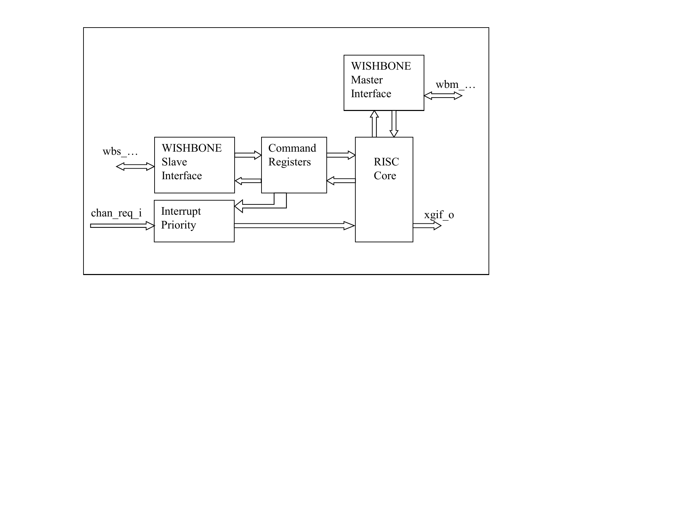
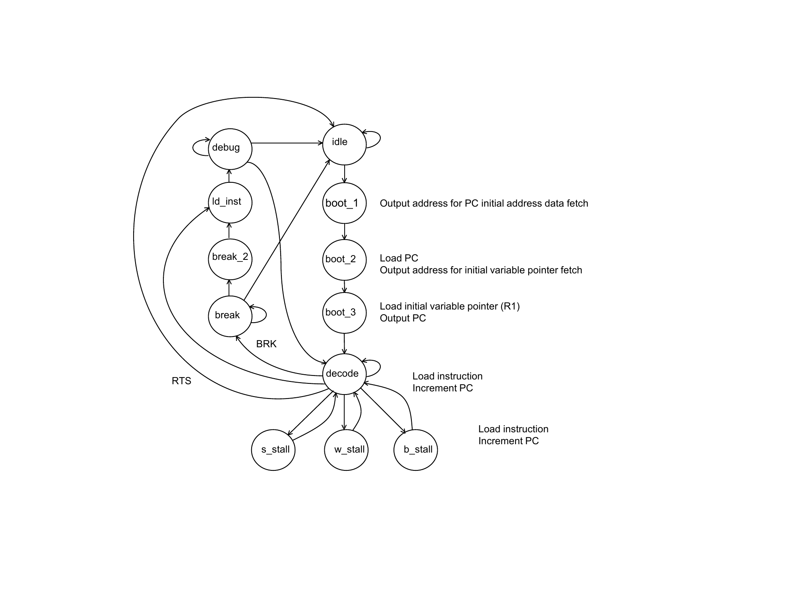
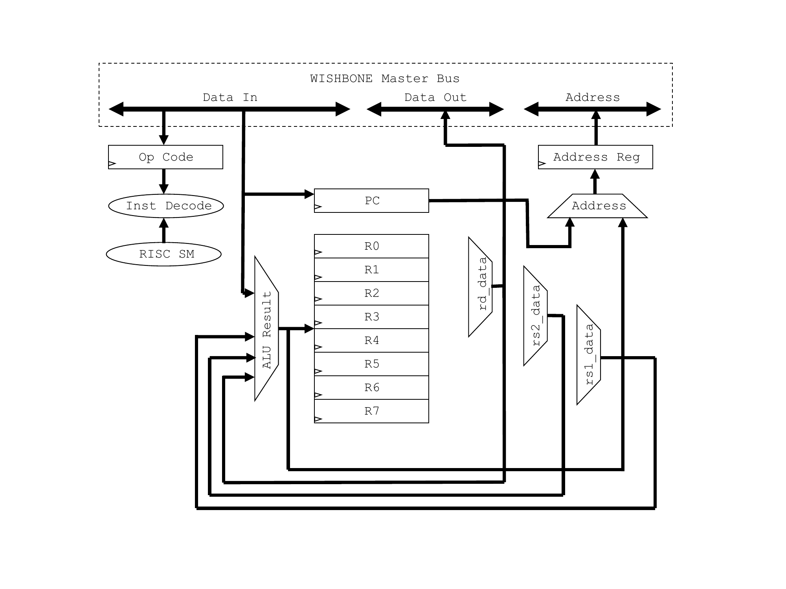
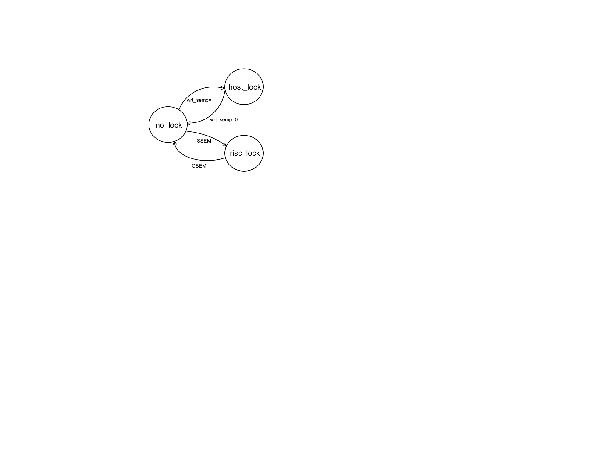

# xgate_top Design Specification

## 1. Introduction

`xgate_top` is a 16-bit programmable XGATE-compatible co-processor intended to offload interrupt-oriented processing from a host CPU.
It integrates:

- A WISHBONE slave interface for host access to control/status registers.
- A WISHBONE master interface for instruction/data memory access by the XGATE RISC core.
- An interrupt front end supporting up to `MAX_CHANNEL` interrupt request inputs.
- A bypass path that can route selected interrupt channels directly to host interrupt outputs.
- A software-trigger mechanism and semaphore bits for host/RISC coordination.

This specification targets externally visible behavior and verification-relevant architectural behavior.

## 2. Module Diagram

## 3. Parameters and Interface

### 3.1 Top-Level Parameters

| Parameter | Default | Description |
| --- | --- | --- |
| `ARST_LVL` | `1'b0` | Active level for asynchronous reset input `arst_i`. |
| `DWIDTH` | `16` | WISHBONE data width for slave and master ports. |
| `SINGLE_CYCLE` | `1'b0` | WISHBONE slave timing mode; `0` inserts wait-state behavior, `1` enables single-cycle acknowledge. |
| `MAX_CHANNEL` | `127` | Maximum interrupt channel index (channels are `[MAX_CHANNEL:1]`). |
| `WB_RD_DEFAULT` | `0` | Default read-bus value for unmapped/unused read decode cases. |

### 3.2 Top-Level Port List

| Signal | Dir | Width | Description |
| --- | --- | --- | --- |
| `wbs_dat_o` | Output | `DWIDTH` | WISHBONE slave read data output. |
| `wbs_ack_o` | Output | 1 | WISHBONE slave acknowledge. |
| `wbs_err_o` | Output | 1 | WISHBONE slave bus error indicator. |
| `wbs_clk_i` | Input | 1 | WISHBONE slave clock. |
| `wbs_rst_i` | Input | 1 | WISHBONE synchronous reset. |
| `arst_i` | Input | 1 | Asynchronous reset input (polarity via `ARST_LVL`). |
| `wbs_adr_i` | Input | `[6:1]` | WISHBONE slave register address bus (word-oriented). |
| `wbs_dat_i` | Input | `DWIDTH` | WISHBONE slave write data. |
| `wbs_we_i` | Input | 1 | WISHBONE slave write enable. |
| `wbs_stb_i` | Input | 1 | WISHBONE slave strobe. |
| `wbs_cyc_i` | Input | 1 | WISHBONE slave cycle valid. |
| `wbs_sel_i` | Input | 2 | WISHBONE slave byte-lane select. |
| `wbm_dat_o` | Output | `DWIDTH` | WISHBONE master write data. |
| `wbm_we_o` | Output | 1 | WISHBONE master write enable. |
| `wbm_stb_o` | Output | 1 | WISHBONE master strobe. |
| `wbm_cyc_o` | Output | 1 | WISHBONE master cycle valid. |
| `wbm_sel_o` | Output | 2 | WISHBONE master byte-lane select. |
| `wbm_adr_o` | Output | 16 | WISHBONE master address. |
| `wbm_dat_i` | Input | `DWIDTH` | WISHBONE master read data. |
| `wbm_ack_i` | Input | 1 | WISHBONE master acknowledge. |
| `xgswt` | Output | 8 | Software-trigger output bus. |
| `xg_sw_irq` | Output | 1 | Software error interrupt output. |
| `xgif` | Output | `[MAX_CHANNEL:1]` | Interrupt outputs to host side. |
| `chan_req_i` | Input | `[MAX_CHANNEL:1]` | Interrupt request inputs from peripherals. |
| `risc_clk` | Input | 1 | RISC core clock. |
| `debug_mode_i` | Input | 1 | External debug-mode request input. |
| `secure_mode_i` | Input | 1 | Security-related control input. |
| `scantestmode` | Input | 1 | Scan-test mode input. |

### 3.3 Interface Semantics

- The slave register interface is 16-bit with byte-lane write support (`wbs_sel_i`) for selected registers.
- The slave address input is word-address oriented (`wbs_adr_i[6:1]`); byte offsets in this spec correspond to that decode.
- WISHBONE master requests are generated by the RISC core for instruction fetches and data accesses.
- `xgif` is the host-visible interrupt output vector after bypass/mux logic.
- `xg_sw_irq` indicates RISC software error conditions and is gated by interrupt enable control.

## 4. Functional Description

### 4.1 High-Level Operation

`xgate_top` accepts interrupt requests (`chan_req_i`), selects a channel for XGATE thread execution (unless bypassed), fetches channel-specific vector information, executes XGATE program code through WISHBONE master memory accesses, and optionally raises host interrupt outputs (`xgif`) based on instruction-driven event signaling.

The host CPU configures operation via the WISHBONE slave register map.

### 4.2 Host Initialization and Runtime Flow

Recommended usage flow:

1. Load XGATE program/data in shared memory.
2. Program `XGVBR` to the interrupt vector base.
3. Configure `IRQ_BP0..IRQ_BP7` so channels intended for XGATE processing are not bypassed.
4. Enable XGATE (`XGE`) and interrupt output controls.
5. Service host-visible interrupts and clear status/flag bits as required.

### 4.3 Interrupt Ingress, Priority, and Bypass

- Incoming requests are `chan_req_i[MAX_CHANNEL:1]`.
- Bypass control bits (`chan_bypass`) select whether each channel is:
  - routed to XGATE scheduling (not bypassed), or
  - forwarded directly to `xgif` (bypassed).
- For non-bypassed active requests, the encoded `int_req` selects the active channel. In the provided RTL, the lowest-index active non-bypassed channel has highest priority.
- `xgif` outputs are formed per channel as:
  - bypassed channels: direct `chan_req_i`,
  - non-bypassed channels: `xgif_status` generated by the RISC core (typically via `SIF` instruction and clear operations).

### 4.4 RISC Thread Lifecycle

At a functional level, the RISC core operates through phases that include:

- **Idle/scheduling**: waits for enabled channel requests.
- **Boot/vector fetch**: uses `XGVBR` and active channel ID (`XGCHID`) to fetch initial PC and variable pointer.
- **Decode/execute**: executes instruction stream; instruction/data memory traffic is driven on the WISHBONE master interface.
- **Stall states**: used for control-flow changes and memory-access sequencing.
- **Break/debug states**: entered by debug control or `BRK` handling; supports single-step progression.
- **Return-to-scheduler**: `RTS` ends current thread and returns to scheduling behavior.

### 4.5 Software Trigger and Semaphore Behavior

- `XGSWT` provides host-programmable trigger bits to request software-driven channels/tasks.
- `XGSEM` provides 8 semaphore bits coordinating host and RISC ownership.
- Semaphore protocol supports lock/unlock behavior from both sides with ownership-dependent visibility.
- In the implemented semaphore state logic, host lock requests from `NO_LOCK` are resolved ahead of RISC lock requests when both are asserted simultaneously.

### 4.6 Debug and Control Behavior

- Debug state can be entered by control-register actions and break/error conditions.
- `XGCHID`, `XGPC`, `XGCCR`, and `XGR1..XGR7` host writes are constrained by runtime state (debug-active or core-disabled conditions, as described in register sections).
- Single-step execution support is provided through control and handshake between the RISC control path and WISHBONE master interface.

### 4.7 Software Error Interrupt

`xg_sw_irq` reflects latched software-error conditions, including instruction/address-related errors and configured break-related error signaling, and is gated by interrupt-enable control.

## 5. Register Interface

The slave register map is 16-bit wide, byte-addressed in software view (word-address decode in hardware via `wbs_adr_i[6:1]`).

### 5.1 Register Map

| Name | Address | Width | Access | Purpose |
| --- | --- | --- | --- | --- |
| `XGMCTL` | `0x00` | 16 | RW | Module control and masked write controls. |
| `XGCHID` | `0x02` | 16 | RW | Active channel ID / debug-triggered channel selection. |
| Reserved | `0x04` | 16 | RW | Reserved decode location. |
| Reserved | `0x06` | 16 | RW | Reserved decode location. |
| `XGVBR` | `0x08` | 16 | RW | Vector base address register (`[15:1]`). |
| `XGIF_7` | `0x0A` | 16 | RW | Interrupt flag bank for highest channels. |
| `XGIF_6` | `0x0C` | 16 | RW | Interrupt flag bank. |
| `XGIF_5` | `0x0E` | 16 | RW | Interrupt flag bank. |
| `XGIF_4` | `0x10` | 16 | RW | Interrupt flag bank. |
| `XGIF_3` | `0x12` | 16 | RW | Interrupt flag bank. |
| `XGIF_2` | `0x14` | 16 | RW | Interrupt flag bank. |
| `XGIF_1` | `0x16` | 16 | RW | Interrupt flag bank. |
| `XGIF_0` | `0x18` | 16 | RW | Interrupt flag bank for lowest channels. |
| `XGSWT` | `0x1A` | 16 | RW | Software trigger register (mask + data format). |
| `XGSEM` | `0x1C` | 16 | RW | Semaphore register (mask + data format). |
| Reserved | `0x1E` | 16 | R | Reserved. |
| `XGCCR` | `0x20` | 16 | RW | Condition code bits (`N,Z,V,C`). |
| `XGPC` | `0x22` | 16 | RW | Program counter view/control. |
| Reserved | `0x24` | 16 | R | Reserved. |
| `XGR1` | `0x26` | 16 | RW | General-purpose register 1. |
| `XGR2` | `0x28` | 16 | RW | General-purpose register 2. |
| `XGR3` | `0x2A` | 16 | RW | General-purpose register 3. |
| `XGR4` | `0x2C` | 16 | RW | General-purpose register 4. |
| `XGR5` | `0x2E` | 16 | RW | General-purpose register 5. |
| `XGR6` | `0x30` | 16 | RW | General-purpose register 6. |
| `XGR7` | `0x32` | 16 | RW | General-purpose register 7. |
| `IRQ_BP0` | `0x40` | 16 | RW | Bypass control bits `[15:0]`. |
| `IRQ_BP1` | `0x42` | 16 | RW | Bypass control bits `[31:16]`. |
| `IRQ_BP2` | `0x44` | 16 | RW | Bypass control bits `[47:32]`. |
| `IRQ_BP3` | `0x46` | 16 | RW | Bypass control bits `[63:48]`. |
| `IRQ_BP4` | `0x48` | 16 | RW | Bypass control bits `[79:64]`. |
| `IRQ_BP5` | `0x4A` | 16 | RW | Bypass control bits `[95:80]`. |
| `IRQ_BP6` | `0x4C` | 16 | RW | Bypass control bits `[111:96]`. |
| `IRQ_BP7` | `0x4E` | 16 | RW | Bypass control bits `[127:112]`. |

### 5.2 Key Register Semantics

#### `XGMCTL` (`0x00`)

- Uses mask-and-data semantics: upper control mask bits gate updates to lower control bits in the same write.
- Controls include module enable (`XGE`), debug entry/exit control, single-step request, fake-activity control, break-interrupt enable, software-error clear, and interrupt output enable.
- Full-word writes are required for this register in the documented interface.

#### `XGCHID` (`0x02`)

- Reflects currently active channel ID.
- Host writes are intended for debug-driven channel control.
- In RTL, host write is accepted only when debug is active.

#### `XGVBR` (`0x08`)

- Defines vector-base address used for thread start fetches.
- RTL update is blocked while `XGE=1`.

#### `XGIF_7..0` (`0x0A..0x18`)

- Reflect output interrupt flags generated by XGATE thread behavior.
- Writing `1` to a bit clears that flag bit; writing `0` leaves it unchanged.

#### `XGSWT` (`0x1A`)

- Upper byte is write mask; lower byte is trigger bits.
- Bit update behavior: `new = (mask & write_data) | (~mask & old)`.

#### `XGSEM` (`0x1C`)

- Upper byte is write mask; lower byte is semaphore request/state data.
- Host-visible low-byte reflects host semaphore ownership status.

#### `XGCCR`, `XGPC`, `XGR1..XGR7`

- Provide host visibility/control for condition flags, program counter, and general-purpose registers.
- Write access is constrained to debug-active or processor-disabled contexts.

#### `IRQ_BP0..IRQ_BP7` (`0x40..0x4E`)

- Control channel bypass behavior.
- `0`: channel is processed by XGATE (not directly bypassed).
- `1`: channel bypasses XGATE processing and is forwarded directly to host interrupt output.

### 5.3 Reset-Related Register Notes

- `XGVBR` reset is `FE00h` in both documentation and RTL behavior.
- `IRQ_BP*` reset defaults to all ones (all channels bypassed until configured otherwise).
- `XGSWT`, `XGIF_*`, `XGSEM`, `XGCHID`, `XGCCR`, `XGPC`, `XGR*` reset to zero.
- `XGMCTL` reset is specified as `0004h` in PDF, while the provided RTL control flops reset to zero; this requires integration confirmation.

## 6. Implementation Details

### 6.1 Architectural Partition

`xgate_top` composes five primary functional blocks:

1. `xgate_wbs_bus`: WISHBONE slave decode, access timing, read muxing, register-write strobes.
2. `xgate_regs`: control register storage, interrupt-flag clear decode, bypass register storage, trigger/sequencer control outputs.
3. `xgate_irq_encode`: interrupt-priority encoding and bypass/output muxing.
4. `xgate_risc`: XGATE instruction execution core, thread scheduling, flags/registers/semaphores, software-error and interrupt-flag generation.
5. `xgate_wbm_bus`: WISHBONE master adaptation for memory reads/writes and single-step memory request handling.

### 6.2 Control and Datapath Interaction

- Host writes enter through `xgate_wbs_bus` decode strobes and `wbs_dat_i` data distribution.
- `xgate_regs` converts decoded writes into stable control/state (enable, vector base, bypass masks, trigger/semaphore controls).
- `xgate_irq_encode` computes active channel request code and host interrupt output vector.
- `xgate_risc` uses encoded channel requests and register controls to fetch vectors/program words and execute instruction flow.
- `xgate_wbm_bus` translates RISC memory requests to WISHBONE master transactions and returns read data/acknowledge to the core.

### 6.3 WISHBONE Slave Timing Behavior

- With default `SINGLE_CYCLE=0`, slave acknowledge is delayed by internal wait-state logic (documented as 2-cycle access behavior).
- `wbs_err_o` indicates module deselection during outstanding wait-state condition.
- In `SINGLE_CYCLE=1`, acknowledge follows direct module select behavior.

### 6.4 RISC/Memory Handshake Behavior

- Instruction/data fetch and store operations are synchronized by `mem_req_ack` from WISHBONE master acknowledge.
- Single-step requests can issue memory access handshakes through `ss_mem_req` / `ss_mem_ack` path in `xgate_wbm_bus`.

## 7. Submodule List

### 7.1 `xgate_wbs_bus`

Role: WISHBONE slave protocol handling, register address decode, write-strobe generation, read-data mux.

| Key Interface | Description |
| --- | --- |
| `wbs_*` | Slave bus handshake and address/data/control. |
| `write_*` strobes | Register and control write enables dispatched to downstream blocks. |
| `read_risc_regs`, `irq_bypass` | Readback vectors used to form `wbs_dat_o`. |
| `sync_reset`, `async_rst_b` | Derived reset outputs for internal blocks. |

### 7.2 `xgate_regs`

Role: Stores module control state, trigger/semaphore control outputs, bypass map, and clear strobes for interrupt flags.

| Key Interface | Description |
| --- | --- |
| `write_xgmctl`, `write_xgvbr`, `write_xgswt`, `write_irw_en_*` | Control register updates. |
| `clear_xgif_*`, `clear_xgif_data` | Decoded clear controls consumed by RISC flag logic. |
| `chan_bypass`, `irq_bypass` | Bypass controls feeding interrupt mux/host readback. |

### 7.3 `xgate_irq_encode`

Role: Encodes active channel request and combines bypass/non-bypass interrupt paths.

| Key Interface | Description |
| --- | --- |
| `chan_req_i`, `chan_bypass` | Inputs for channel request selection and bypass decision. |
| `int_req` | Encoded channel index provided to scheduler/core. |
| `xgif` | Host interrupt output vector. |

### 7.4 `xgate_risc`

Role: Thread scheduler and instruction engine; maintains program-visible registers/flags and interrupt flag status.

| Key Interface | Description |
| --- | --- |
| `int_req`, `xgvbr`, `xge`, debug controls | Scheduling and execution controls. |
| `xgate_address`, `mem_access`, write strobes/data | Memory access command path to WISHBONE master adapter. |
| `xgif_status`, `xg_sw_irq`, `host_semap` | Host-visible status outputs. |

### 7.5 `xgate_wbm_bus`

Role: WISHBONE master adaptor for RISC memory operations and single-step memory request completion.

| Key Interface | Description |
| --- | --- |
| `wbm_*` | WISHBONE master transaction signals. |
| `mem_access`, `xgate_address`, write strobes/data | RISC-driven bus request inputs. |
| `read_mem_data`, `mem_req_ack`, `ss_mem_ack` | Return-path handshake/data outputs to RISC. |

## 8. Clock and Reset

- `wbs_clk_i`: WISHBONE slave/control domain clock.
- `risc_clk`: RISC execution and memory-request domain clock.
- `wbs_rst_i`: synchronous reset input used for register reinitialization.
- `arst_i`: asynchronous reset input, active level controlled by `ARST_LVL`.
- Internal asynchronous reset net is generated as `async_rst_b = arst_i ^ ARST_LVL`.

Documented integration guidance indicates `risc_clk` should be phase-aligned with `wbs_clk_i` and run at the same rate or 2x rate.

## 9. Constraints and Integration Notes

- `xgate_top` is the architectural top module for this design; prior autogenerated spec content based on `xgate_wbs_bus` alone is incomplete for system behavior.
- Interrupt bypass registers reset to bypass-all-channels; host software must clear selected bits to route channels into XGATE processing.
- Some registers require word writes (`XGMCTL`, `XGSWT`, `XGSEM`); byte-lane writes are supported for other locations per decode strobes.
- `secure_mode_i` and `scantestmode` are present as top-level pins but are not consumed by internal logic in the provided RTL integration.
- Documentation states `xgswt` is active-low; provided RTL exports `xgswt` register bits directly. Polarity at system integration boundary should be confirmed.
- PDF and RTL disagree on `XGMCTL` reset (`0004h` in PDF vs zeroed control flops in RTL); treat as a required confirmation item for verification planning.
