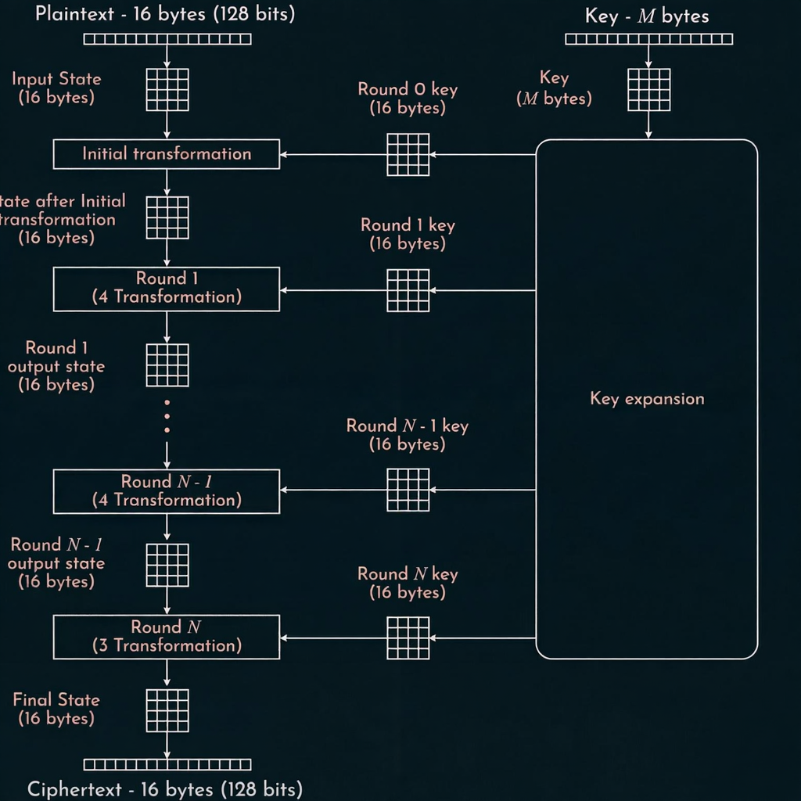
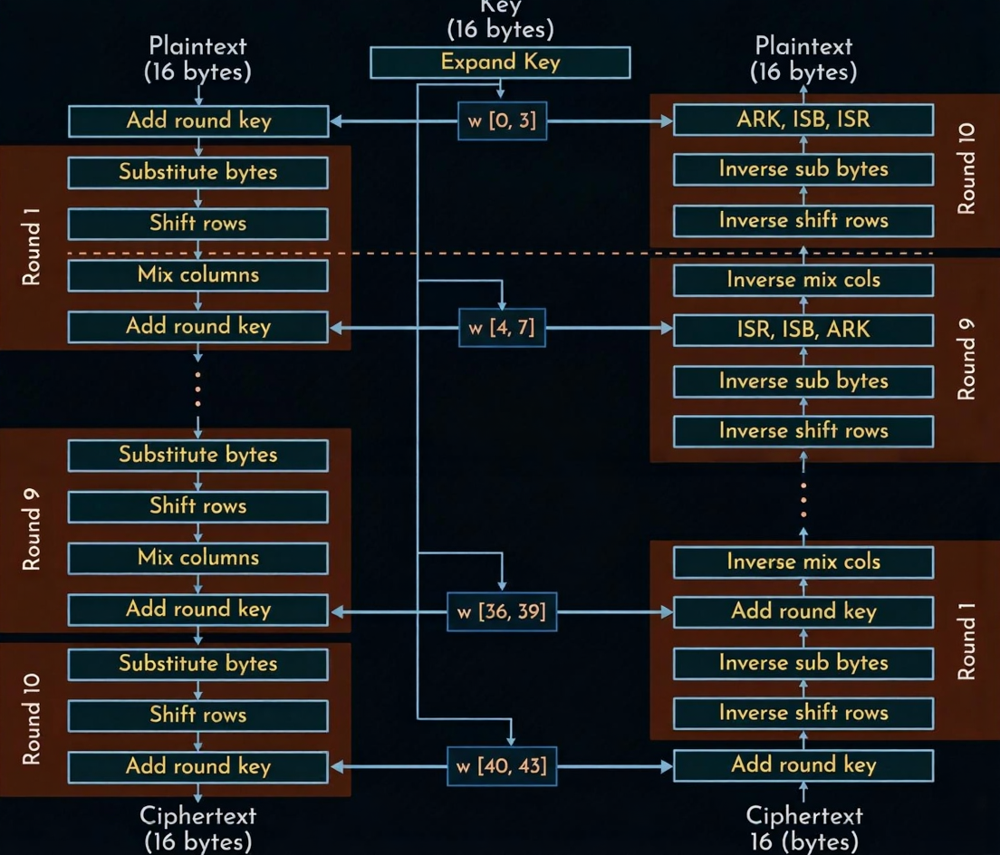

# gcm_aes_v0 Design Specification

## 1. Introduction

`gcm_aes_v0` is a 128-bit authenticated-encryption hardware block implementing Galois/Counter Mode with AES-128 as the block cipher. The module processes one frame at a time and performs both payload encryption and authentication-tag generation.

The design consumes an IV, one or more AAD blocks, and zero or more message blocks. It outputs ciphertext for message blocks and a final tag at frame completion.

## 2. Module Diagram

## 3. Top-Level Interface

`SIZE` is fixed at 128 bits.

| Signal | Direction | Width | Description |
| --- | --- | --- | --- |
| `clk` | Input | 1 | Design clock. |
| `rst` | Input | 1 | Active-high asynchronous reset for control state and key internal registers. |
| `dii_data` | Input | 128 | Data input word; carries IV, AAD block, or message block depending on phase. |
| `dii_data_vld` | Input | 1 | Indicates `dii_data` and sideband fields are valid for acceptance. |
| `dii_data_type` | Input | 1 | Data classification: asserted for AAD block, deasserted for message block. |
| `dii_data_not_ready` | Output | 1 | Backpressure indicator; asserted when the core cannot accept a new data block. |
| `dii_last_word` | Input | 1 | Marks the final accepted block of the current frame data stream. |
| `dii_data_size` | Input | 4 | Encodes valid-byte count: `0` means 1 valid byte, `15` means 16 valid bytes. |
| `cii_ctl_vld` | Input | 1 | Setup/start control input for a new frame. |
| `cii_IV_vld` | Input | 1 | Indicates IV is present on `dii_data` during setup. |
| `cii_K` | Input | 128 | AES-128 key used by the encryption datapath. |
| `Out_data` | Output | 128 | Output data bus; carries ciphertext when `Out_vld` is asserted, and carries tag when `Tag_vld` is asserted. |
| `Out_vld` | Output | 1 | Ciphertext-valid indicator. |
| `Out_data_size` | Output | 4 | Valid-byte encoding associated with ciphertext output. |
| `Out_last_word` | Output | 1 | Last-block marker associated with ciphertext output. |
| `Tag_vld` | Output | 1 | Tag-valid indicator. |

### 3.1 Interface Semantics

- Data acceptance occurs when `dii_data_vld` is asserted while `dii_data_not_ready` is deasserted.
- During setup and internal processing phases, `dii_data_not_ready` remains asserted.
- `Out_vld` and `Tag_vld` identify output type without requiring additional output-type signaling.
- For a partial final block, `dii_data_size` determines how many bytes are interpreted as valid.
- IV loading for counter initialization requires `cii_IV_vld` during setup.

## 4. Function Description

### 4.1 Functional Scope

The module implements the encryption and authentication path of GCM at 128-bit block granularity:

- Counter-mode AES encryption for payload confidentiality.
- GF(2^128) authentication accumulation for AAD and ciphertext integrity.
- Final tag emission after payload completion and length-block processing.

### 4.2 Frame Processing Sequence

1. A frame starts when `cii_ctl_vld` is asserted.
2. The core derives hash subkey `H` by encrypting an all-zero 128-bit block with `cii_K`.
3. When `cii_IV_vld` is asserted, the IV on `dii_data` is captured as the initial counter context.
4. The initial counter value is encrypted and stored for final tag composition.
5. The core enters the input-accept phase and processes AAD and message blocks one at a time.
6. Each accepted block updates the authentication accumulator.
7. After the block marked by `dii_last_word`, the core processes a final length block containing AAD and ciphertext lengths in bits.
8. The core outputs the authentication tag and returns to idle.

### 4.3 AAD and Message Behavior

- AAD path (`dii_data_type` asserted):
  - block contributes to authentication only,
  - no ciphertext output is generated.
- Message path (`dii_data_type` deasserted):
  - counter is incremented,
  - updated counter is AES-encrypted to generate keystream,
  - valid message bytes are XORed with keystream to produce ciphertext,
  - resulting ciphertext contributes to authentication.

### 4.4 AES-128 Function Used by the Datapath

The integrated AES function is organized as AES-128 round processing:

- 16-byte state and 16-byte key.
- Key expansion produces round keys consumed by the encryption rounds.
- Encryption of each 128-bit input block proceeds through:
  - initial AddRoundKey,
  - nine rounds of SubBytes, ShiftRows, MixColumns, and AddRoundKey,
  - final round of SubBytes, ShiftRows, and AddRoundKey (without MixColumns).

This AES function is reused for hash-subkey derivation, initial-counter encryption, and per-block counter-mode keystream generation.

### 4.5 Output and Completion Behavior

- Ciphertext output is indicated by `Out_vld`.
- Tag output is indicated by `Tag_vld`.
- For ciphertext output, `Out_data_size` and `Out_last_word` track the valid-byte count and final-block status.
- Tag output occurs after authentication accumulation is finalized with the encoded AAD/ciphertext lengths.

## 5. Implementation Details

### 5.1 Control Path

The controller is implemented as an FSM with the following phases:

- `IDLE`: waits for frame start.
- `ENCRYPT_0`: derives `H` from AES encryption of zero block.
- `INIT_COUNTER`: initializes counter context and launches initial counter encryption.
- `ENCRYPT_Y0`: captures encrypted initial counter value.
- `DATA_ACCEPT`: accepts AAD or message block when ready.
- `INC_COUNTER`: advances counter for message processing.
- `M_ENCRYPT`: encrypts counter and forms ciphertext block.
- `GFM_MULT`: performs iterative GF multiplication/accumulation.
- `PRE_TAG_CALC`: injects length block for final authentication update.
- `TAG_CALC`: generates final tag and completes frame.

### 5.2 Datapath Elements

Primary internal elements:

- `H`: hash subkey.
- `Yi`: running counter value.
- `EkY0`: encrypted initial counter value retained until tag generation.
- `gfm_result`: running authentication accumulator.
- `aad_byte_cnt` and `enc_byte_cnt`: byte counters used to build the final length block.

### 5.3 Authentication Datapath Operation

Authentication uses iterative GF multiplication driven by `gfm128_16`:

- each authentication update is launched with `start_gfm_cnt`,
- `gfm_cnt` sequences the multi-step operation,
- block contribution is combined with current accumulator,
- final value after the iteration is stored back into `gfm_result`.

The final length block places AAD bit-length in the upper 64 bits and ciphertext bit-length in the lower 64 bits before the last accumulation.

### 5.4 Partial-Block Handling

For `dii_data_size` values below full-block encoding, valid bytes are packed into a 128-bit contribution format and remaining bytes are zero-filled. This representation is used in both encryption-path output shaping and authentication-path accumulation.

### 5.5 Latency Characteristics

The implementation uses:

- an AES-128 core with block completion signaled by `done`,
- a GF multiplier path that advances through an 8-step iteration per 128-bit authentication update.

Frame throughput depends on the interaction between setup, block acceptance, AES completion, and GF-accumulation sequencing.

## 6. Submodule List

### 6.1 `aes_cipher_top`

Role:

- Performs AES-128 block encryption for all AES operations in the top-level GCM flow.

Interface summary:

| Signal | Direction | Width | Description |
| --- | --- | --- | --- |
| `clk` | Input | 1 | Clock input. |
| `rst` | Input | 1 | Reset input. |
| `ld` | Input | 1 | Starts an AES encryption operation. |
| `done` | Output | 1 | Indicates completion of the current AES operation. |
| `key` | Input | 128 | AES key input. |
| `text_in` | Input | 128 | AES plaintext input block. |
| `text_out` | Output | 128 | AES ciphertext output block. |

### 6.2 `gfm128_16`

Role:

- Performs a 16-bit-slice GF(2^128) multiplication/accumulation step used by the authentication path.

Interface summary:

| Signal | Direction | Width | Description |
| --- | --- | --- | --- |
| `v_in` | Input | 128 | Current multiplication state. |
| `z_in` | Input | 128 | Current accumulation state. |
| `b_in` | Input | 16 | Current 16-bit input slice. |
| `v_out` | Output | 128 | Next multiplication state. |
| `z_out` | Output | 128 | Next accumulation state. |

## 7. Clock and Reset

- Single clock domain on `clk`.
- `rst` asynchronously forces control state and major registers to reset state.
- Normal operation resumes after reset deassertion and explicit frame start via `cii_ctl_vld`.

## 8. Constraints

- Fixed 128-bit block datapath.
- Input-byte count encoding uses `dii_data_size` range 0 to 15, representing 1 to 16 valid bytes.
- AAD blocks are expected before message blocks in a frame.
- The module handles one frame at a time.
- Integration must ensure per-frame initialization policy for internal byte counters matches system-level requirements.
