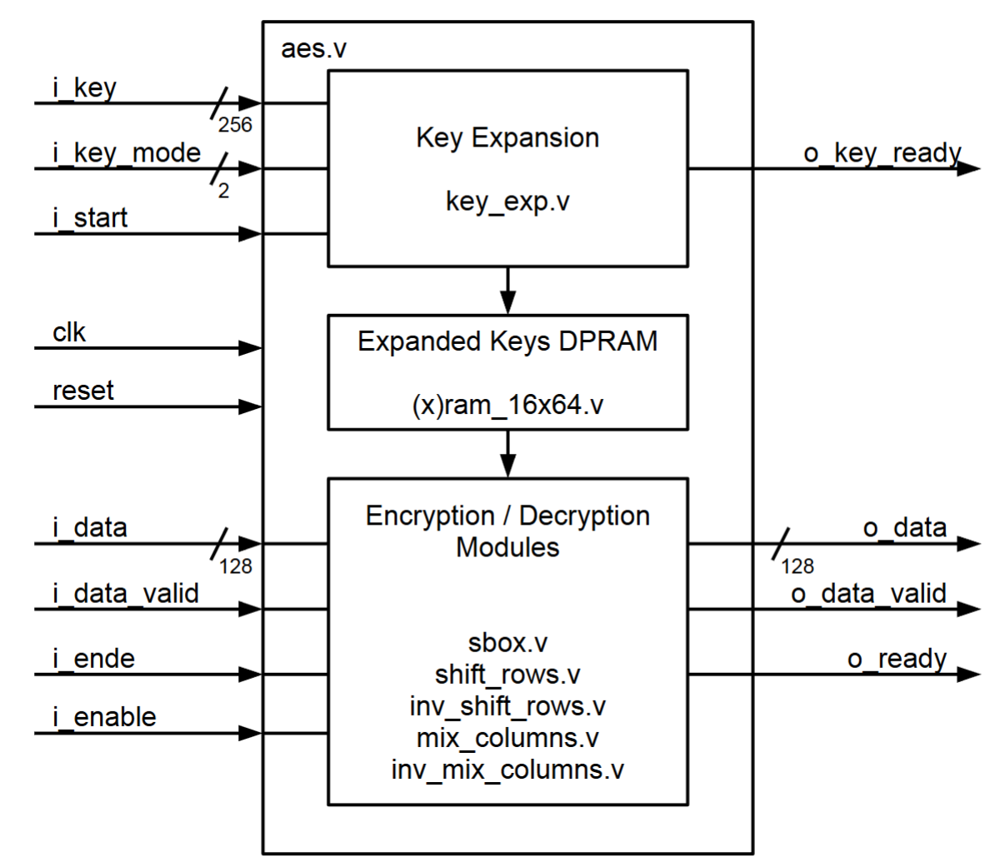

# aes Design Specification

## 1. Introduction

`aes` is a high-throughput, low-area AES core implementing Rijndael encryption and decryption for 128-bit data blocks. The core supports AES-128, AES-192, and AES-256 key lengths and integrates both key expansion and block processing.

The module operates as an ECB primitive with direct wide key/data interfaces and internal round-key storage. It supports overlapped processing through an internal pipeline-control scheme and explicit ready/valid signaling.

## 2. Module Diagram

## 3. Interface

| Signal | Direction | Width | Description |
| --- | --- | --- | --- |
| `clk` | Input | 1 | Global core clock. |
| `reset` | Input | 1 | Global asynchronous active-high reset. |
| `i_start` | Input | 1 | Key-expansion start pulse. Captures `i_key` and `i_key_mode` for a new key schedule generation. |
| `i_enable` | Input | 1 | Processing enable for encryption/decryption datapath stages. Deassertion stalls transform/control advancement. |
| `i_key_mode` | Input | 2 | Key-length selector: `2'b00` for 128-bit, `2'b01` for 192-bit, `2'b10` for 256-bit. |
| `i_key` | Input | 256 | Key input bus. For 128-bit mode, bits `[255:128]` carry the key. For 192-bit mode, bits `[255:64]` carry the key. For 256-bit mode, all bits are used. |
| `i_data` | Input | 128 | Plaintext/ciphertext block input. |
| `i_data_valid` | Input | 1 | Input-valid pulse for block launch. Block acceptance is controlled with `o_ready`. |
| `i_ende` | Input | 1 | Operation select: `0` encryption, `1` decryption. |
| `o_ready` | Output | 1 | Indicates ability to accept a new input block on the next clock cycle. |
| `o_data` | Output | 128 | Block output bus. Registered output of the final round transform. |
| `o_data_valid` | Output | 1 | Output-valid pulse indicating `o_data` holds a completed block result. |
| `o_key_ready` | Output | 1 | Key-expansion completion indicator. Remains asserted after key schedule generation until reset or a new `i_start`. |

### 3.1 Interface Semantics

- Key expansion is initiated by pulsing `i_start` with stable `i_key` and `i_key_mode`.
- `o_key_ready` indicates expanded keys are available for block processing.
- A data block transaction is initiated by `i_data_valid` when `o_ready` indicates acceptance availability.
- `o_ready` refers to acceptance for the next cycle, not immediate same-cycle acceptance.
- `o_data_valid` is a pulse aligned with completion of a final AES round for a launched block.
- `i_ende` selects encrypt/decrypt transform path and round-key traversal direction.

## 4. Function Description

### 4.1 Functional Scope

The core performs AES block encryption/decryption in ECB form with integrated key scheduling:

- key expansion for 128/192/256-bit keys,
- round-key storage in internal RAM,
- forward transform path for encryption,
- inverse transform path for decryption,
- per-block ready/valid handshake for pipelined operation.

### 4.2 Block Processing Flow

For each accepted input block:

1. Initial AddRoundKey is applied using the selected round key.
2. Byte substitution stage applies either encryption S-box or inverse S-box per `i_ende`.
3. Row shifting stage applies either ShiftRows or InvShiftRows per `i_ende`.
4. For non-final rounds:
   - encryption path applies MixColumns then AddRoundKey,
   - decryption path applies InvMixColumns and combines with inverse-mix-transformed round key.
5. For final round, the column-mix stage is bypassed and AddRoundKey is applied after row shifting.
6. Completed block is presented on `o_data`, and `o_data_valid` pulses.

### 4.3 Key-Length and Round Count Behavior

Round count depends on `i_key_mode`:

- AES-128 uses 10 rounds,
- AES-192 uses 12 rounds,
- AES-256 uses 14 rounds.

The datapath tracks final-round condition from the selected maximum round count and the internal round index.

### 4.4 Encryption and Decryption Selection

- Encryption mode (`i_ende=0`) uses forward S-box, ShiftRows, MixColumns, and forward round-key order.
- Decryption mode (`i_ende=1`) uses inverse S-box, inverse ShiftRows, inverse MixColumns, and reverse round-key addressing.

### 4.5 Pipeline and Throughput Behavior

The control path is structured to allow overlapping blocks in processing. `o_ready` reflects internal stage occupancy and indicates when a new block may be inserted for subsequent-cycle processing.

## 5. Implementation Details

### 5.1 Datapath Organization

Primary datapath stages:

- S-box stage bank (16 byte-wise instances),
- row-shift stage (`shift_rows` / `inv_shift_rows`),
- column-mix stage (`mix_columns` / `inv_mix_columns`),
- AddRoundKey logic with final-round bypass handling,
- output register path carrying per-round state and final block result.

Intermediate data paths include:

- `sb_data` for substituted bytes,
- `sr_data` for shifted rows,
- `mc_data` and `imc_data` for forward/inverse mix results,
- `ark_data` as selected AddRoundKey output for current cycle.

### 5.2 Round/Validity Control

Round and validity progression is controlled by staged validity and round counters:

- `i_data_valid_L` latches block-launch pulse,
- `round_valid` and `sb_valid[2:0]` track pipeline stage advancement,
- `round_cnt` and delayed round counters (`sb_round_cnt1/2/3`) track per-block round index,
- `final_round` is detected from delayed round count against `max_round`.

`o_data_valid` is asserted when a valid block reaches the final-round completion condition.

### 5.3 Round-Key Memory and Addressing

Expanded round keys are stored in two 16x64 RAM banks and combined to form a 128-bit round key.

- Write side is driven by `key_exp` through `wr`, `wr_addr`, and `wr_data`.
- Read address direction depends on mode:
  - encryption reads from early to later round keys,
  - decryption reads from later to earlier round keys.
- Build option `XILINX` selects `xram_16x64`; otherwise `ram_16x64` is used.

### 5.4 Key Expansion Behavior

`key_exp` performs key schedule generation for selected key size:

- captures input key on `i_start`,
- uses internal S-box transforms, rcon progression, and key-word recurrences,
- writes expanded key words into round-key RAM interface,
- asserts `o_key_ready` when required expanded rounds are available.

For AES-256, generation includes additional internal phase handling to produce the full schedule width.

### 5.5 Enable and Reset Behavior

- `reset` clears control and datapath state, validity pipeline, counters, and key-expansion state.
- `i_enable` gates active datapath/control progression; when deasserted, block-processing advancement is held.

## 6. Submodule List

### 6.1 `key_exp`

Role:

- Generates expanded round keys for AES-128/192/256 and provides write interface to round-key RAM.

Interface summary:

| Signal | Direction | Width | Description |
| --- | --- | --- | --- |
| `clk` | Input | 1 | Clock. |
| `reset` | Input | 1 | Asynchronous active-high reset. |
| `key_in` | Input | 256 | Input key bus. |
| `key_mode` | Input | 2 | Key-size mode selector. |
| `key_start` | Input | 1 | Expansion start pulse. |
| `wr` | Output | 1 | Round-key RAM write enable. |
| `wr_addr` | Output | 5 | Round-key RAM write address. |
| `wr_data` | Output | 64 | Round-key RAM write data. |
| `key_ready` | Output | 1 | Expansion-ready level indicator. |

### 6.2 `sbox`

Role:

- Byte substitution stage used by both encryption and key expansion paths.
- Provides separate encryption and decryption substitution outputs.

### 6.3 `shift_rows` / `inv_shift_rows`

Role:

- Perform forward and inverse AES row permutation transforms.

### 6.4 `mix_columns` / `inv_mix_columns`

Role:

- Perform forward and inverse AES column-mix transforms.
- Inverse mix is also used to transform decryption round keys in the top-level datapath.

### 6.5 `xram_16x64` / `ram_16x64`

Role:

- Store expanded round keys and supply 128-bit round-key words through two 64-bit banks.

## 7. Clock and Reset

- Single clock domain at `clk`.
- `reset` is asynchronous and active high.
- After reset, key expansion must be started before relying on `o_key_ready` for data processing.

## 8. Constraints

- Core block mode is ECB primitive operation.
- `i_key_mode` is expected to remain stable during active key expansion and data processing for a given key schedule.
- `i_start` should only be asserted when loading a new key schedule.
- `i_data_valid` should be driven in coordination with `o_ready` to avoid input overrun.
- `i_enable` should remain asserted during active processing windows to avoid stalling or extending latency.
