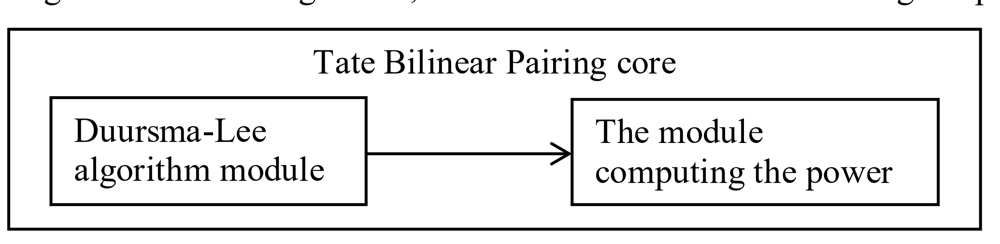

# tate_pairing Design Specification

## 1. Introduction
`tate_pairing` computes a Tate bilinear pairing value from two input elliptic-curve points.  
The top-level implementation is organized as two sequential stages:
1. `duursma_lee_algo`: Modified Duursma-Lee loop that computes the Miller-function-related intermediate value.
2. `second_part`: Final exponentiation stage that raises the stage-1 result to `3^(3*M)-1` in `GF(3^(6*M))`.

This specification describes the externally visible behavior and the internal control/datapath organization of the top-level module.

## 2. Module Diagram

## 3. Interface
| Signal | Direction | Width | Description |
| --- | --- | --- | --- |
| `clk` | Input | 1 | System clock. All sequential logic is triggered on the rising edge. |
| `reset` | Input | 1 | Active-high synchronous reset/start control for a pairing transaction. |
| `x1` | Input | ``[`WIDTH:0]`` (194 bits when `M=97`) | First coordinate input of the first point operand. |
| `y1` | Input | ``[`WIDTH:0]`` (194 bits when `M=97`) | Second coordinate input of the first point operand. |
| `x2` | Input | ``[`WIDTH:0]`` (194 bits when `M=97`) | First coordinate input of the second point operand. |
| `y2` | Input | ``[`WIDTH:0]`` (194 bits when `M=97`) | Second coordinate input of the second point operand. |
| `done` | Output | 1 | Completion flag. Deasserted by reset and asserted when `out` is valid. |
| `out` | Output | ``[`W6:0]`` (1164 bits when `M=97`) | Pairing result. Valid when `done=1`. |

Interface semantics:
- Inputs are synchronous to `clk`.
- `done` and `out` are registered outputs.
- Per the timing description, valid input data is expected to be present while `reset` is asserted and remain stable until computation completes (`done=1`).
- The module does not provide a separate `start` or `ready` signal; transaction launch is reset-driven.

## 4. Functional Description
### 4.1 Top-Level Operation Flow
1. A transaction is initialized by asserting `reset` with valid `x1/y1/x2/y2`.
2. Stage 1 (`duursma_lee_algo`) runs the Modified Duursma-Lee computation and produces intermediate result `out1` with completion `done1`.
3. A one-cycle pulse generated from the rising edge of `done1` (`func6`) resets/starts stage 2 (`second_part`).
4. Stage 2 performs the final exponentiation and produces `out2` with completion `done2`.
5. A top-level completion sequencer asserts `done` and latches `out <= out2`.

Only one operation is active at a time. A new operation requires reasserting `reset`.

### 4.2 Stage 1 Function (`duursma_lee_algo`)
`duursma_lee_algo` implements the Modified Duursma-Lee iterative structure. Internally it keeps the state registers `a`, `b`, `y`, `d`, `t`, and iteration register `i`.

On stage reset:
- `a <= x1`, `b <= y1`
- `y <= (y2)^3`
- `d <= 1`
- `t <= 1`
- `i <= 1 << M` (encoded as `{1'b1, {M{1'b0}}}`)

Per iteration (triggered by internal `change` pulse):
- Computes `a^9` and `b^9`.
- Computes `x2^3`.
- Forms `mu = a^9 + x2^3 + d`, then `-mu` and `-y`.
- Computes two multiplicative terms equivalent to `-mu^2` and `-(b^9)*y`.
- Builds the extension-field factor `g` from these terms.
- Updates the accumulation as `t <= t^3 * g`.
- Updates iterative state: `a <= a^9`, `b <= b^9`, `y <= -y`, `d <= d-1`, and shifts `i`.

When the termination condition derived from `i` is reached, stage 1 asserts `done1` and presents `out1`.

### 4.3 Stage 2 Function (`second_part`)
`second_part` computes `out2 = out1^(3^(3*M)-1)` in `GF(3^(6*M))`.

Main functional steps:
1. Split the stage-1 input into six `GF(3^M)` words (`d5..d0`), then perform a basis rearrangement into two `GF(3^(3*M))` words (`a1`, `a0`).
2. Compute `a0^2` and `a1^2` in parallel.
3. Form `a0^2 + a1^2` and compute its multiplicative inverse.
4. Compute `(a0+a1)^2`, then multiply by the inverse terms to form two transformed `GF(3^(3*M))` words.
5. Apply low-bit (`[1:0]`) `+1` adjustments as implemented by `f3_add1`.
6. Reassemble and map back to six `GF(3^M)` words to form final `GF(3^(6*M))` output.

Stage-internal pulse sequencing (`rst2`, `rst3`) is produced from rising-edge detection of intermediate done signals, and a 4-bit shift register controls final `done2` assertion timing.

### 4.4 Completion and Output Validity
- The top-level 3-bit shift register `K` advances on ordered stage events (`rst2`, `done2`) and then reaches the terminal state (`K[0]`).
- At `K[0]`, `done` is asserted and `out` is updated with `out2`.
- `done` remains asserted until the next reset.

## 5. Implementation Details
### 5.1 Control Path
- `rst1` is generated from `reset` through a two-register sequence (`delay1`, `rst1`) to control stage-1 reset timing.
- `func6` is used as an edge-to-pulse converter so level-style done flags from submodules can trigger one-cycle internal reset/start pulses.
- Two shift-register controllers are used:
  - `K[3:0]` in `second_part` for stage-2 internal sequencing.
  - `K[2:0]` in `tate_pairing` for top-level completion gating.

### 5.2 Datapath Organization
- Stage 1 builds an iterative Miller-function-related accumulation in `GF(3^(6*M))`.
- Stage 2 transforms this value through basis conversion, inversion/multiplication in `GF(3^(3*M))`, and remapping to `GF(3^(6*M))`.
- `out1` is the only stage interface datapath signal between stage 1 and stage 2.
- `out` is a registered capture of `out2` at top-level completion.

## 6. Submodule Details
### 6.1 `duursma_lee_algo`
Role:
- Executes the Modified Duursma-Lee stage and produces the intermediate pairing value used by final exponentiation.

Top-level connection:
- Instantiated once in `tate_pairing` as stage 1.

Interface:
| Signal | Direction | Width | Description |
| --- | --- | --- | --- |
| `clk` | Input | 1 | Clock. |
| `reset` | Input | 1 | Stage reset/start. |
| `xp` | Input | ``[`WIDTH:0]`` | Point input (mapped from top `x1`). |
| `yp` | Input | ``[`WIDTH:0]`` | Point input (mapped from top `y1`). |
| `xr` | Input | ``[`WIDTH:0]`` | Point input (mapped from top `x2`). |
| `yr` | Input | ``[`WIDTH:0]`` | Point input (mapped from top `y2`). |
| `done` | Output | 1 | Stage completion indicator (`done1` at top level). |
| `out` | Output | ``[`W6:0]`` | Stage-1 output (`out1` at top level). |

### 6.2 `second_part`
Role:
- Performs the final exponentiation (`3^(3*M)-1`) on the stage-1 result.

Top-level connection:
- Instantiated once in `tate_pairing` as stage 2, started by `rst2`.

Interface:
| Signal | Direction | Width | Description |
| --- | --- | --- | --- |
| `clk` | Input | 1 | Clock. |
| `reset` | Input | 1 | Stage reset/start pulse (`rst2`). |
| `a` | Input | ``[`W6:0]`` | Stage-1 intermediate input (`out1`). |
| `c` | Output | ``[`W6:0]`` | Final exponentiation output (`out2`). |
| `done` | Output | 1 | Stage-2 completion indicator (`done2`). |

### 6.3 `func6`
Role:
- Converts a rising edge on `in` into a one-cycle pulse on `out` using two internal flip-flops.

Top-level usage:
- Generates `rst2` from `done1` in `tate_pairing`.
- Also used inside computational stages for local sequencing.

Interface:
| Signal | Direction | Width | Description |
| --- | --- | --- | --- |
| `clk` | Input | 1 | Clock. |
| `reset` | Input | 1 | Synchronous clear of internal history registers. |
| `in` | Input | 1 | Source event signal. |
| `out` | Output | 1 | One-cycle pulse when `in` transitions low-to-high. |

## 7. Clock and Reset
- Clock domain: single domain driven by `clk`.
- Reset type: active-high synchronous reset.
- Reset behavior at top level:
  - Clears completion state (`done=0`).
  - Initializes stage-control registers.
  - Starts a new transaction using current input values.

## 8. Timing and Performance Notes
- Input timing requirement: apply valid `x1/y1/x2/y2` while `reset=1` and keep them stable until computation finishes.
- Output timing requirement: `out` is valid when `done=1`.

## 9. Constraints
- Width macros are defined by `inc.v` (`M=97`, `WIDTH=2*M-1`, `W6=12*M-1`).
- No explicit backpressure interface is provided; operation sequencing is reset-driven and completion-driven.
