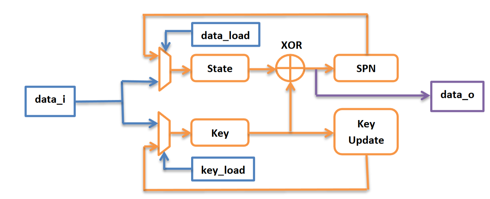

# present_encryptor_top Design Specification

## 1. Introduction

`present_encryptor_top` is an encryption-only implementation of the PRESENT lightweight block cipher using an 80-bit key and 64-bit data block.

The architecture is iterative and reuses one round datapath across all rounds. The core uses a substitution-permutation round function and a round-by-round key update function.

## 2. Module Diagram

## 3. Interface

| Signal | Direction | Width | Description |
| --- | --- | --- | --- |
| `data_o` | Output | 64 | Ciphertext output bus. |
| `data_i` | Input | 80 | Shared input bus for key and plaintext loading. |
| `clk_i` | Input | 1 | Rising-edge clock. |
| `key_load` | Input | 1 | Key load control. When asserted at rising edge, `data_i[79:0]` is loaded into key register. |
| `data_load` | Input | 1 | Plaintext load control. When asserted with `key_load=0` at rising edge, `data_i[63:0]` is loaded into state register and round counter is initialized. |

### 3.1 Interface Semantics

- `key_load` has priority over `data_load` in the sequential control logic.
- If `key_load=1`, plaintext load is not performed in that clock cycle.
- If `key_load=0` and `data_load=1`, a new encryption transaction is initialized.
- If `key_load=0` and `data_load=0`, one iterative round step is executed.
- The top module does not provide explicit `ready`, `valid`, `done`, or reset signals.

## 4. Function Description

### 4.1 Functional Scope

The module performs PRESENT-80 encryption for a single 64-bit plaintext block.

- Block size: 64 bits.
- Key size: 80 bits.
- Number of rounds: 31.
- Datapath style: iterative single-round reuse.

### 4.2 Encryption Dataflow

For each iterative round step, the following transformations are applied:

1. The current round key is taken as the leftmost 64 bits of the 80-bit key register.
2. Round-key addition is performed by XORing the current state with the round key.
3. The substitution-permutation network (`sub_per`) is applied to produce next-round state.
4. The key register is updated by the key-schedule function (`key_update`) using the current round counter.
5. The round counter is incremented.

The output bus `data_o` is continuously driven by the post-XOR round-key-addition value (`state XOR round_key`).

### 4.3 Round Function Structure

The round substitution-permutation network consists of:

- Substitution layer: 16 parallel 4-bit S-box operations over the 64-bit round input.
- Permutation layer: fixed PRESENT bit permutation over the 64-bit substituted value.

### 4.4 Key Update Structure

The key update function performs the PRESENT-80 schedule steps:

- Rotate the 80-bit key register.
- Apply the PRESENT 4-bit S-box to the most significant nibble of the rotated key.
- XOR the round counter into the designated key bits used by the schedule logic.

### 4.5 Operational Sequence

A normal transaction uses this control sequence:

1. Assert `key_load` for one clock to load key.
2. Deassert `key_load`, assert `data_load` for one clock to load plaintext and initialize round counter.
3. Deassert both controls and apply iterative round clocks.

Under this sequence, ciphertext becomes available after the full 31-round progression. Because there is no explicit completion signal, external logic must control and track cycle sequencing.

## 5. Implementation Details

### 5.1 State Elements

Top-level sequential state includes:

- `state[63:0]`: current cipher state.
- `key[79:0]`: current key schedule register.
- `round_counter[4:0]`: iterative round index.

### 5.2 Control Priority and Updates

At each rising clock edge:

- If `key_load=1`, key register loads from `data_i`.
- Else if `data_load=1`, state loads from `data_i[63:0]` and round counter is set to `5'b00001`.
- Else, iterative update is performed: round counter increments, state updates from `sub_per_output`, and key updates from `key_update_output`.

This priority ordering defines legal integration behavior when both control signals are driven.

### 5.3 Combinational Round Path

Combinational path elements:

- `round_key = key[79:16]`.
- `sub_per_input = state ^ round_key`.
- `sub_per_output = sub_per(sub_per_input)`.
- `data_o = sub_per_input`.

The output mapping to `sub_per_input` implements the final key-add stage visibility in the iterative schedule.

### 5.4 Reset and Initialization Considerations

No reset input is implemented in the top-level module. Deterministic operation requires explicit key load and plaintext load sequencing before iterative rounds are run.

## 6. Submodule List

### 6.1 `sub_per`

Role:

- Implements one PRESENT round transformation by cascading substitution and permutation layers.

Interface:

| Signal | Direction | Width | Description |
| --- | --- | --- | --- |
| `data_i` | Input | 64 | Round input after key XOR. |
| `data_o` | Output | 64 | Round output to next state. |

### 6.2 `key_update`

Role:

- Implements one PRESENT-80 key schedule update per round.

Interface:

| Signal | Direction | Width | Description |
| --- | --- | --- | --- |
| `data_i` | Input | 80 | Current key register value. |
| `round_counter` | Input | 5 | Current round counter value. |
| `data_o` | Output | 80 | Updated key register value. |

### 6.3 `substitution`

Role:

- Applies 16 parallel 4-bit S-box operations across a 64-bit word.

### 6.4 `permutation`

Role:

- Applies fixed PRESENT P-layer bit permutation across a 64-bit word.

### 6.5 `sbox`

Role:

- Implements the 4-bit PRESENT S-box mapping used in both state substitution and key update.

## 7. Clock and Reset

- Clock domain: single domain on `clk_i`, rising-edge triggered.
- Reset: not present at top-level.
- Initialization must be done through control-driven loading (`key_load`, `data_load`).

## 8. Constraints

- Encryption-only top-level function for PRESENT with 80-bit key.
- `data_i` serves both key and plaintext loading; external sequencing must avoid ambiguity.
- `key_load` and `data_load` should be controlled with one-cycle pulses using the required loading sequence.
- In the absence of explicit output-valid signaling, external control must determine when ciphertext is sampled.
