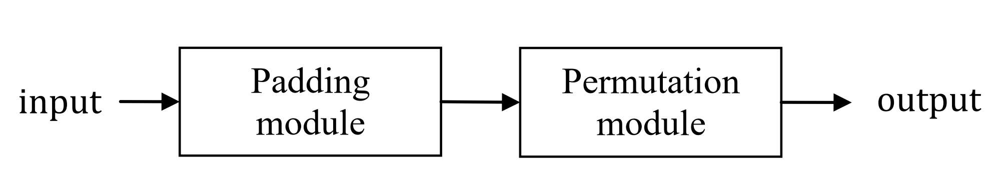
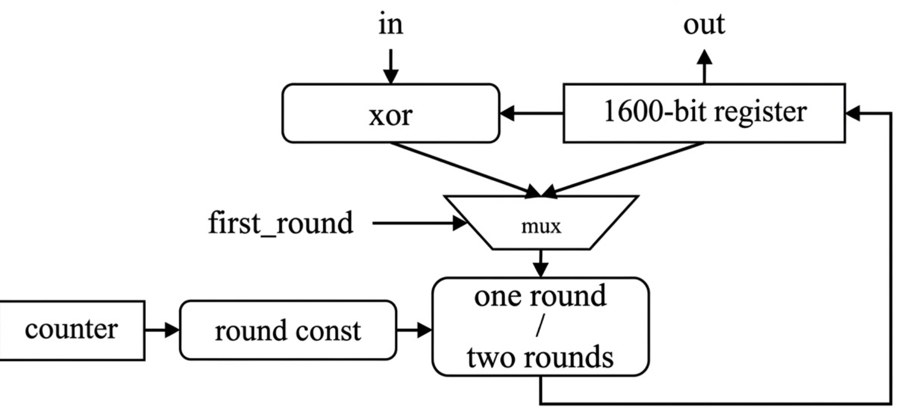

# keccak Design Specification

## 1. Introduction

`keccak` implements a SHA-3-512 hashing core using a sponge-style datapath composed of:
- an input padding/buffering stage (`padder`), and
- a Keccak-f permutation stage (`f_permutation`).

This specification describes the implemented top module (64-bit input interface). The low-throughput variant discussed in the reference PDF is not the top module covered by this file.

## 2. Module Diagram

## 3. Interface

| Direction | Width | Name | Description |
| --------- | ----- | ---- | ----------- |
| Input | 1 | `clk` | Clock input. |
| Input | 1 | `reset` | Active-high synchronous reset. |
| Input | 64 | `in` | Input data word. |
| Input | 1 | `in_ready` | Input-valid indication from user logic. |
| Input | 1 | `is_last` | Indicates current input phase has reached final message portion. |
| Input | 3 | `byte_num` | Valid-byte count selector for final-word padding behavior. |
| Output | 1 | `buffer_full` | Backpressure signal from `padder`; indicates a 576-bit block is ready for permutation. |
| Output | 512 | `out` | SHA-3-512 digest output bus. |
| Output | 1 | `out_ready` | Digest-ready indication. |

Interface sequencing semantics:
- Input words are accepted only under internal acceptance conditions (Section 4.1), not solely by `in_ready`.
- `byte_num` is relevant to final-word treatment; when `is_last=0`, the implementation treats input as a full 8-byte word.
- `out` should be sampled when `out_ready=1`.
- After `out_ready` is asserted, output remains stable until next reset in this implementation.

## 4. Functional Description

### 4.1 Input acceptance and padding flow

The padder assembles incoming 64-bit words into a 576-bit block buffer:
- `buffer_full` is asserted when the internal 576-bit buffer has accumulated one block.
- The effective input acceptance condition is:
  - `accept = (~state) & in_ready & (~buffer_full)`
- `state` in `padder` transitions high when `is_last` is observed, which stops further normal input acceptance and begins finalization behavior.

Padding behavior:
- For non-final words (`is_last=0`), incoming `in` is used directly.
- For final-word handling (`is_last=1`), `padder1` applies byte-count-dependent insertion of `8'h01` at the correct byte boundary.
- During finalization, zero words are inserted as needed and the final padding bit placement is completed by logic that updates `v1[7]` based on buffer-fill position.

### 4.2 Block handoff and permutation flow

`padder` and `f_permutation` interact through a ready/ack handshake:
- `padder.out_ready` (equal to `buffer_full`) indicates a 576-bit block is ready.
- `f_permutation.ack` indicates the permutation stage accepted that block.

In `f_permutation`:
- `accept = in_ready & (~calc)`
- On accept, the 576-bit block is absorbed into the 1600-bit state by XOR with the upper-rate slice:
  - `round_in = {in ^ out[1599:1599-575], out[1599-576:0]}`
- Internal control (`calc`, shift register `i`) advances round processing and round-constant selection.
- The permutation datapath (`round2in1` + `rconst2in1`) performs two rounds per update step in this high-throughput architecture.

### 4.3 Output generation and ready signaling

Digest generation path:
- The 512-bit digest source is `f_out[1599:1599-511]`.
- Top-level logic byte-reorders each 64-bit word segment for the external `out` bus.

`out_ready` behavior:
- `out_ready` is generated in top-level `keccak` via internal shift-history register `i` fed by `state & f_ack`.
- Once `i[10]` becomes high, `out_ready` is asserted and remains asserted until reset.

### 4.4 Reset and message sequencing

Reset behavior (synchronous to `clk`):
- Clears top-level `state`, ready-history registers, and `out_ready`.
- Clears padder/permutation internal state through submodule resets.

Usage constraint from reference and implementation intent:
- Before computing a new independent hash message, assert reset for one clock and then deassert reset.
- Inputs associated with one message should not be interleaved with a subsequent message without reset.

## 5. Implementation Details

### 5.1 Top-level `keccak` realization

Top-level composition:
- `padder` instance for 64-bit input assembly and padding.
- `f_permutation` instance for 1600-bit state absorption/permutation.
- Byte-reorder wiring on both padder output path (`padder_out_1` to `padder_out`) and digest output path (`out1` to `out`).

Control/state elements:
- `state`: latched high after `is_last` is observed; indicates no more normal input expected.
- Shift register `i[10:0]`: records `state & f_ack` history for final `out_ready` assertion.

### 5.2 `padder` internal control/data organization

Key registers/signals:
- `out[575:0]`: block buffer shifted by 64-bit words.
- `i[8:0]`: block fill tracking (`i[8]` drives `buffer_full`).
- `state`: finalization mode latch.
- `done`: prevents additional filling after final block emission condition.
- `v1`: selected word inserted into buffer each update.

Behavior notes:
- `update = (accept | (state & (~buffer_full))) & (~done)` governs buffer writes.
- On `f_ack`, fill tracking is cleared for next block transfer.

### 5.3 `f_permutation` internal scheduling
The figure below summarizes the architectural datapath of `f_permutation`.

Key registers/signals:
- `out[1599:0]`: permutation state register.
- `calc`: round-processing active status.
- `i[10:0]`: round-scheduling/constant-selection shift register.
- `accept`/`ack`: input block acceptance handshake.

Behavior notes:
- Accepting a new block clears `out_ready` in permutation stage.
- `f_permutation.out_ready` is asserted when internal round progression reaches terminal indicator (`i[10]`).
- Top-level readiness is derived independently from `f_ack` history as described above.

## 6. Submodules

### 6.1 `padder`

Role:
Assembles 64-bit input words into 576-bit blocks, applies final-block padding behavior, and handshakes block readiness to permutation.

| Signal | Direction | Width | Description |
| ------ | --------- | ----- | ----------- |
| `clk` | Input | 1 | Clock input. |
| `reset` | Input | 1 | Synchronous reset. |
| `in` | Input | 64 | Input data word. |
| `in_ready` | Input | 1 | Input-valid indicator. |
| `is_last` | Input | 1 | Final-input indicator. |
| `byte_num` | Input | 3 | Valid-byte selector for final-word handling. |
| `buffer_full` | Output | 1 | Buffer-full/backpressure indicator. |
| `out` | Output | 576 | Assembled block to permutation path. |
| `out_ready` | Output | 1 | Block-ready handshake output (`buffer_full`). |
| `f_ack` | Input | 1 | Block-accept acknowledgement from permutation. |

### 6.2 `f_permutation`

Role:
Absorbs 576-bit rate blocks into 1600-bit state and performs Keccak-f permutation scheduling.

| Signal | Direction | Width | Description |
| ------ | --------- | ----- | ----------- |
| `clk` | Input | 1 | Clock input. |
| `reset` | Input | 1 | Synchronous reset. |
| `in` | Input | 576 | Input block from padder. |
| `in_ready` | Input | 1 | Block-ready handshake input. |
| `ack` | Output | 1 | Block accepted indicator. |
| `out` | Output | 1600 | Permutation state output. |
| `out_ready` | Output | 1 | Permutation-stage output-ready indicator. |

### 6.3 `padder1` (helper module)

Role:
Generates final-word byte-mask/padding word from `in[63:0]` and `byte_num[2:0]` for `padder` finalization path.

## 7. Clock and Reset

- Clock domain: single `clk` domain.
- Reset is synchronous and active high in top-level and submodules.
- Reset is required between independent hash computations to reinitialize control/data state.

## 8. Constraints and Integration Notes

- This specification targets the implemented 64-bit input `keccak` top module.
- Low-throughput variant descriptions in the PDF are contextual and out of scope for this file.
- Recommended upstream usage:
  - assert `is_last` only for final input phase,
  - hold input data stable until accepted,
  - use `buffer_full`/accept behavior for pacing.
