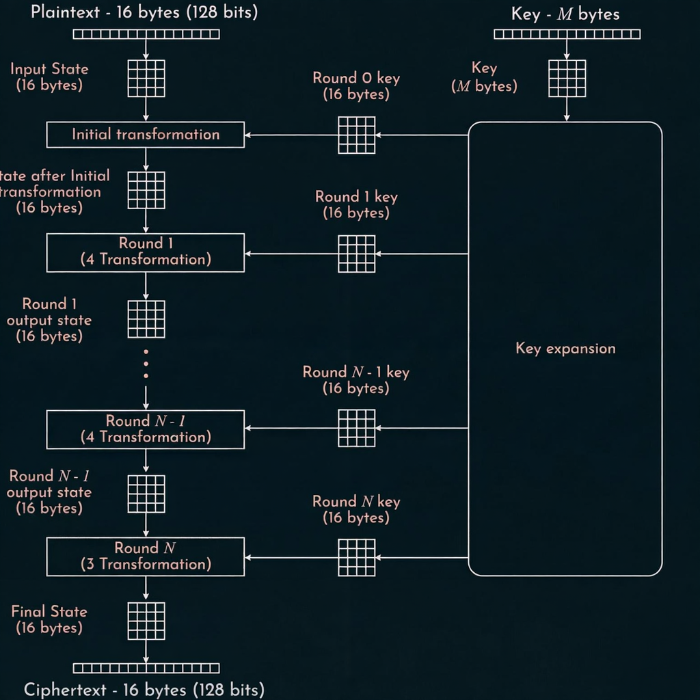

# aes_128 Design Specification

## 1. Introduction

`aes_128` is a synchronous AES-128 encryption core that transforms a 128-bit plaintext block (`state`) with a 128-bit cipher key (`key`) into a 128-bit ciphertext block (`out`).

The design implements AES encryption rounds in a pipelined architecture with a parallel pipelined key-expansion path. It is intended as a block-encryption primitive; handling of multi-block messages and block-cipher modes is external to this module.

## 2. Module Diagram

## 3. Interface

| Direction | Width | Name | Description |
| --------- | ----- | ---- | ----------- |
| Input | 1 | `clk` | Clock. All sequential state updates occur on the rising edge. |
| Input | 128 | `state` | Plaintext block input. |
| Input | 128 | `key` | AES-128 key input associated with `state`. |
| Output | 128 | `out` | Ciphertext output corresponding to a prior sampled `state`/`key` pair. Driven from sequential logic. |

Interface semantics:
- Inputs are sampled on each rising edge of `clk`.
- For bus notation, bits are ordered from most-significant to least-significant; the first byte of `state` is `state[127:120]` (same convention for `key` and `out`).
- The module has no `valid`, `ready`, `start`, or `done` signal.
- For AES-128, the ciphertext corresponding to values sampled at clock cycle `t` appears at `out` at cycle `t+21`, assuming the sampled input values at cycle `t` are meaningful system-level data.

## 4. Functional Description

### 4.1 AES-128 encryption flow

The core implements AES-128 encryption on a 128-bit input state using a 128-bit cipher key.

As illustrated above, AES-128 encryption proceeds as follows:
1. **Initial AddRoundKey**: the sampled plaintext state is XORed with the initial round key derived from the sampled key.
2. **Rounds 1 through 9**: each round applies the standard four AES round transformations in order:
   - `SubBytes`
   - `ShiftRows`
   - `MixColumns`
   - `AddRoundKey`
3. **Round 10 (final round)**: the final round applies:
   - `SubBytes`
   - `ShiftRows`
   - `AddRoundKey`  
   and omits `MixColumns`.

The round keys are generated by the key-expansion path and supplied in round order to the corresponding encryption stages. Thus, state transformation and round-key generation progress concurrently through the pipeline.

### 4.2 Streaming behavior and sequencing

Implementation-oriented pipeline behavior:
- The core can accept a new `state` / `key` input pair on every clock cycle.
- Multiple plaintext blocks may be in flight simultaneously in different pipeline stages.
- After the pipeline is filled, the core produces one ciphertext block per cycle.
- The output `out` corresponds to the input block sampled **21 cycles earlier**.
- No separate explicit output-valid signal is provided for the first emerging pipeline result, so external logic must track pipeline latency when correlating inputs and outputs.

### 4.3 Mode-of-operation context

This module implements the AES **encryption primitive only**. It does not itself define a message-level mode of operation.

For multi-block or variable-length message processing, external logic is expected to:
- supply block inputs in the required sequence, and
- apply any higher-level operation mode, such as `CTR`, `OFB`, or `CFB`.

Accordingly, this core should be interpreted as a pipelined AES-128 encryption engine rather than a complete protocol- or mode-level encryption subsystem.

## 5. Implementation Details

### 5.1 Top-level datapath organization

The top-level implementation is composed of:
- Input capture stage: registers the initial transformed state `s0 <= state ^ key` and captures `k0 <= key`.
- Nine regular round stages (`one_round` instances `r1` through `r9`) connected in series.
- One final round stage (`final_round` instance `rf`) producing `out`.
- A 10-stage key-expansion chain (`expand_key_128` instances `a1` through `a10`) that generates the round keys used by the state pipeline.

Round constants used by the expansion chain are, in order: `8'h01`, `8'h02`, `8'h04`, `8'h08`, `8'h10`, `8'h20`, `8'h40`, `8'h80`, `8'h1b`, `8'h36`.

### 5.2 Key expansion realization (`expand_key_128`)

For input key words `{k0, k1, k2, k3}`:
- Intermediate words are formed as:
  - `v0 = {k0[31:24] ^ rcon, k0[23:0]}`
  - `v1 = v0 ^ k1`
  - `v2 = v1 ^ k2`
  - `v3 = v2 ^ k3`
- In parallel, `k3` is rotated and byte-substituted (via `S4`) to produce a transformed word.
- The next-round key words are then formed by XORing that transformed word with each intermediate word.

The module provides two key outputs with the same 128-bit value form:
- `out_2`: used as round-key input to the corresponding state round stage.
- `out_1`: registered output forwarded to the next key-expansion stage.

This organization supports the pipelined alignment between state rounds and key generation.

### 5.3 Round-stage realization

`one_round`:
- Splits the 128-bit state into four 32-bit words.
- Uses four `table_lookup` paths to realize the merged SubBytes/ShiftRows/MixColumns transformation form.
- Forms four transformed output words by XOR-combining lookup results and the round-key words.
- Registers `state_out` on the rising edge.

`final_round`:
- Applies byte substitution through `S4` instances.
- Reorders substituted bytes consistent with final-round ShiftRows mapping.
- XORs with the final round key and registers `state_out`.
- Does not include MixColumns.

Both `one_round` and `final_round` are implemented as pipelined round stages consistent with two-cycle-per-round operation in this design family.

## 6. Submodules

### 6.1 `expand_key_128`

Role:
Generates AES-128 round keys in pipeline form and provides both a forwarding output to the next key stage and a round-key output for the state round stage at the same expansion level.

| Signal | Direction | Width | Description |
| ------ | --------- | ----- | ----------- |
| `clk` | Input | 1 | Rising-edge clock. |
| `in` | Input | 128 | Input round key from previous stage (`k0` for stage 1). |
| `rcon` | Input | 8 | Round constant for this expansion stage. |
| `out_1` | Output | 128 | Registered next-stage key output (feeds subsequent `expand_key_128`). |
| `out_2` | Output | 128 | Round-key output used by the matching round-transform stage. |

### 6.2 `one_round`

Role:
Implements one regular AES encryption round (SubBytes/ShiftRows/MixColumns/AddRoundKey) in a pipelined form.

| Signal | Direction | Width | Description |
| ------ | --------- | ----- | ----------- |
| `clk` | Input | 1 | Rising-edge clock. |
| `state_in` | Input | 128 | Input state for this regular round. |
| `key` | Input | 128 | Round key applied in this round. |
| `state_out` | Output | 128 | Registered round output state. |

### 6.3 `final_round`

Role:
Implements AES final encryption round (SubBytes/ShiftRows/AddRoundKey, without MixColumns) in pipelined form.

| Signal | Direction | Width | Description |
| ------ | --------- | ----- | ----------- |
| `clk` | Input | 1 | Rising-edge clock. |
| `state_in` | Input | 128 | Input state for final round processing. |
| `key_in` | Input | 128 | Final round key. |
| `state_out` | Output | 128 | Registered ciphertext output of the final round. |

## 7. Clock and Reset

- Single clock domain: `clk`.
- No top-level reset port is defined.
- As there is no reset and no explicit output-valid signal, output interpretation during initial pipeline fill is a system-level sequencing responsibility.

## 8. Constraints and Usage Notes

- The module implements AES encryption only.
- Under steady-state streaming, throughput is one 128-bit output block per clock cycle after pipeline fill.
- For message encryption/decryption workflows, this core is intended to be combined with external mode-of-operation control.
