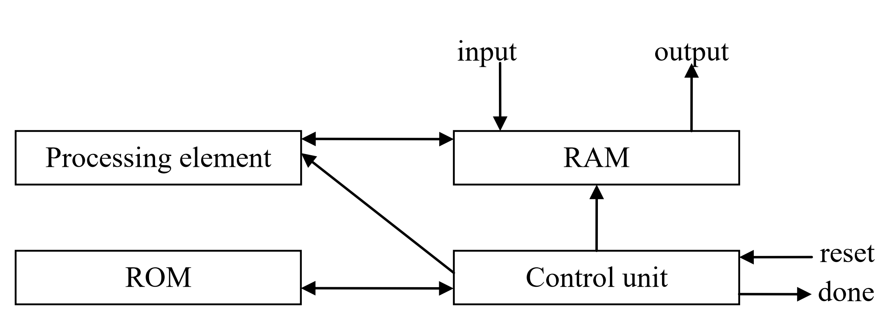

# pairing Design Specification

## 1. Introduction

`pairing` is the top-level wrapper for the Tiny Tate Bilinear Pairing computation core. The module combines:
- serial input/output buffering for 198-bit words,
- external host access control to the internal RAM address/write path, and
- run-completion status forwarding from the arithmetic control core.

The pairing algorithm execution is performed inside submodule `tiny`. The `pairing` top level is responsible for data movement between host-side serial interface and `tiny` data ports, and for exposing the `done` completion status.

## 2. Module Diagram

## 3. Interface

| Direction | Width | Name | Description |
| --------- | ----- | ---- | ----------- |
| Input | 1 | `clk` | System clock. All top-level sequential behavior is on the rising edge of `clk`. |
| Input | 1 | `reset` | Active-high synchronous reset input for the computation core. |
| Input | 1 | `sel` | RAM access source select. `1`: external host controls RAM port-A address/write intent. `0`: internal control-unit addressing is used. |
| Input | 6 | `addr` | External RAM address when `sel=1`. |
| Input | 1 | `w` | External RAM write intent when `sel=1` (`1`: write, `0`: read). |
| Input | 1 | `update` | I/O-buffer update control. Captures current computation output into output shift register and clears input shift register. |
| Input | 1 | `ready` | Shift-enable for serial I/O buffers when `update=0`. |
| Input | 1 | `i` | Serial input bit used to load the input shift register. |
| Output | 1 | `o` | Serial output bit (`reg_out[0]`) from output shift register. |
| Output | 1 | `done` | Computation completion indication forwarded from `tiny`. |

Interface semantics:
- `update` has priority over `ready` at the top level.
- On `update=1`: `reg_in` is cleared and `reg_out` captures current `tiny` output word.
- On `update=0` and `ready=1`: serial shift is enabled (`reg_in` shifts in `i`; `reg_out` shifts right).
- `o` is continuously driven by the LSB of `reg_out`.
- Per the interface guidance, `o` should be interpreted as valid result data after computation completion (`done=1`).

## 4. Functional Description

### 4.1 Overall operation flow

System-level usage follows three phases:
1. Load input words into RAM.
2. Run computation and wait until `done` becomes active.
3. Read output words from RAM.

The timing guidance specifies that RAM write initialization is performed with `reset` asserted; computation begins after reset release.

### 4.2 Serial I/O buffer behavior

Top-level serial buffering uses two 198-bit registers:
- `reg_in`: host-to-core input buffer, connected to `tiny.data`.
- `reg_out`: core-to-host output buffer, loaded from `tiny.out`.

Buffer update/shift behavior (on each rising edge of `clk`):
- If `update=1`:
  - `reg_in <= 0`
  - `reg_out <= out` (where `out` is from `tiny`)
- Else if `ready=1`:
  - `reg_in <= {i, reg_in[197:1]}`
  - `reg_out <= reg_out >> 1`

Bit-order behavior:
- Input serial loading inserts new bit `i` at MSB side of `reg_in` while existing bits shift toward LSB.
- Output serial reading is LSB-first through `o = reg_out[0]`.

### 4.3 RAM access selection and computation interaction

`tiny` arbitrates RAM port-A control between external host and internal control logic:
- `sel=1`: RAM port-A address comes from external `addr`; write-enable follows external `w`.
- `sel=0`: RAM port-A address comes from internal FSM source-address sequencing; external write is disabled.

The arithmetic/control path concurrently uses RAM port-B for internal read/write operations during computation.

### 4.4 Completion behavior

`done` is generated by the `tiny` control FSM and forwarded by `pairing`.
- `done` is inactive while reset is asserted.
- `done` becomes active when the FSM reaches terminal `DON` state and remains active until reset is asserted.

## 5. Implementation Details

### 5.1 Top-level structure (`pairing`)

`pairing` contains:
- one `tiny` instance,
- `reg_in[197:0]` input shift register,
- `reg_out[197:0]` output shift register,
- combinational output assignment `o = reg_out[0]`.

No additional top-level FSM is implemented.

### 5.2 `tiny` internal architecture summary

`tiny` integrates the following internal blocks:
- `select`: multiplexes RAM port-A address/write ownership between external host (`sel=1`) and FSM (`sel=0`).
- `ROM`: instruction memory (`26-bit` command words, `9-bit` address).
- `FSM`: decodes ROM fields (`DEST`, `SRC1`, `SRC2`, `OP`, `TIMES`), controls RAM addresses/write and PE control, and drives `done`.
- `RAM`: dual-port memory (`198-bit` word width, `64` words).
- `const` + `muxer` paths: optional constant injection for operand sources based on effective-address decode.
- `PE`: arithmetic processing element performing controlled add/sub/cubic/multiply-oriented field operations and producing internal write-back data.

`tiny` exports `out = ram_a_data_out`, so top-level `reg_out` snapshots RAM port-A read data when `update` is asserted.

### 5.3 FSM-oriented execution behavior (implementation-aware)

Control-unit state progression follows the documented sequence:
- `START -> READ_SRC1 -> READ_SRC2 -> CALC -> WAIT -> WRITE -> READ_SRC1`
- `READ_SRC2 -> DON` when decoded `TIMES == 0`

Operational notes:
- `rom_addr` advances in `WAIT` state, with loop-back regions implemented for repeated instruction ranges.
- `ram_b_w` is asserted in `WRITE` state for result write-back.
- `done` is asserted in terminal state and reflects computation completion condition.

## 6. Submodules

### 6.1 `tiny`

Role:
Implements the pairing computation control/datapath, RAM addressing arbitration, and completion signaling.

How `pairing` uses it:
- Drives `tiny.data` with `reg_in`.
- Receives `tiny.out` for capture into `reg_out`.
- Forwards `tiny.done` to top-level `done`.
- Passes external `reset/sel/addr/w` control signals into `tiny`.

| Signal | Direction | Width | Description |
| ------ | --------- | ----- | ----------- |
| `clk` | Input | 1 | Clock input. |
| `reset` | Input | 1 | Active-high synchronous reset for internal control/datapath logic. |
| `sel` | Input | 1 | External/internal RAM port-A control select. |
| `addr` | Input | 6 | External RAM address (used when `sel=1`). |
| `w` | Input | 1 | External RAM write intent (used when `sel=1`). |
| `data` | Input | 198 | Input data bus from top-level serial input buffer (`reg_in`). |
| `out` | Output | 198 | Output data bus to top-level serial output buffer capture path. |
| `done` | Output | 1 | Computation completion signal from FSM terminal state. |

### 6.2 Internal building blocks inside `tiny`

| Block | Functional role | Key interaction |
| ----- | --------------- | --------------- |
| `select` | RAM port-A address/write arbitration | Chooses external `addr/w` or FSM-driven address path. |
| `ROM` | Instruction storage | Provides command word to FSM by `rom_addr`. |
| `FSM` | Sequencing/control | Decodes instruction fields, controls RAM/PE signals, drives `done`. |
| `RAM` | Operand/result storage | Dual-port access for source reads and result write-back. |
| `const` + `muxer` | Constant operand insertion | Overrides RAM data with predefined constants at selected addresses. |
| `PE` | Arithmetic engine | Consumes control word and operands, produces write-back data. |

## 7. Clock and Reset

- Single clock domain: `clk`.
- `reset` is synchronous in the computation core path (`tiny` FSM/datapath).
- Top-level serial buffer registers (`reg_in`, `reg_out`) are controlled by `update/ready` logic and are not directly reset by `reset`.

## 8. Constraints and Integration Notes

- This specification is for top-level module `pairing` and its immediate architectural coupling to `tiny`.
- Host integration should follow sequencing guidance: initialize input words, execute computation until `done`, then read output words.
- RAM write initialization is performed while `reset` is asserted.
- Address mapping for input/output words follows the PDF-defined memory map.
