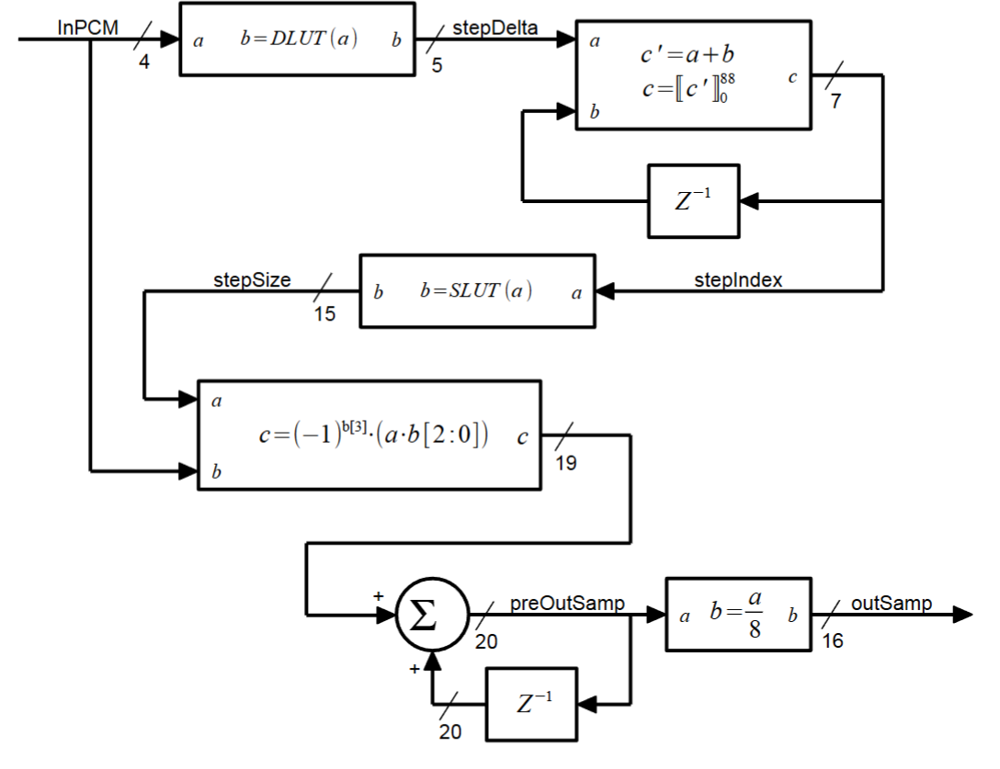

# ima_adpcm_dec Design Specification

## 1. Introduction

`ima_adpcm_dec` is a 4-bit IMA ADPCM decoder that reconstructs 16-bit linear PCM samples. The module includes optional state preload inputs for predictor sample and step index, enabling decoder state synchronization with an upstream logic.

The core is interface-oriented and protocol-agnostic at the stream level. It accepts one 4-bit ADPCM nibble per decode transaction and produces one reconstructed 16-bit output sample.

## 2. Module Diagram

## 3. Interface

| Signal | Direction | Width | Description |
| --- | --- | --- | --- |
| `reset` | Input | 1 | Global asynchronous active-high reset. |
| `clock` | Input | 1 | Global clock. |
| `inPCM` | Input | 4 | Input ADPCM nibble to decode. `inPCM[3]` is the sign bit. |
| `inValid` | Input | 1 | Input-valid indication for a decode step. Checked when input interface is ready. |
| `inReady` | Output | 1 | Input-ready indication. High when decoder can accept a new nibble. |
| `inPredictSamp` | Input | 16 | Predictor sample preload value. |
| `inStepIndex` | Input | 7 | Step index preload value. |
| `inStateLoad` | Input | 1 | State preload control for internal predictor and step-index registers. |
| `outSamp` | Output | 16 | Decoded output sample. |
| `outValid` | Output | 1 | Output-valid pulse for `outSamp`. |

### 3.1 Interface Semantics

- Decode processing is initiated by `inValid` when `inReady` is asserted.
- `inReady` is deasserted while the current decode update is propagating to output.
- `inStateLoad` loads internal predictor/step-index state and clears the pending output-valid condition.
- State preload is intended while input interface is ready.
- `outValid` pulses when decoded sample output is updated.

## 4. Function Description

### 4.1 Functional Scope

The decoder reconstructs linear PCM samples from ADPCM nibbles using adaptive predictor and step-size state:

- computes dequantized difference from nibble magnitude bits and current step size,
- applies sign bit to update predictor,
- adapts step index using nibble-dependent delta,
- maps step index to next step size via lookup table,
- outputs saturated 16-bit sample derived from internal predictor scale.

### 4.2 Decode Computation Flow

For each accepted input nibble:

1. Compute dequantized magnitude contribution from `inPCM[2:0]` and `stepSize`.
2. Apply sign from `inPCM[3]` to add or subtract the dequantized value from current predictor.
3. Saturate updated predictor to the implemented signed internal range.
4. Compute output sample from predictor internal scale and rounding term.
5. Saturate output sample to signed 16-bit range.
6. Assert `outValid` for the updated output sample.

### 4.3 Step Index Adaptation

- `stepDelta` is selected from nibble magnitude bits:
  - `inPCM[2:0]` values `0..3` map to decrement behavior,
  - values `4..7` map to positive increments.
- New step index is computed from current step index plus signed adaptation delta.
- Updated step index is saturated to valid table range `0..88`.

### 4.4 Step Size Table

`stepSize` is generated from `stepIndex` using the decoder lookup table. The implementation updates `stepSize` on clocked table lookup and uses it in dequantization.

### 4.5 State Preload Operation

When `inStateLoad` is asserted:

- predictor internal register is loaded from `inPredictSamp` with internal scale alignment,
- step index register is loaded from `inStepIndex`,
- pending valid output indication is cleared.

This mode supports periodic external state synchronization.

## 5. Implementation Details

### 5.1 Internal State and Signals

Primary registers:

- `predictorSamp[18:0]`: internal predictor sample in extended precision format.
- `stepIndex[6:0]`: adaptive quantizer index.
- `stepSize[14:0]`: quantizer step-size table output.
- `predValid`: internal delayed-valid indicator driving output timing.
- `outSamp`, `outValid`: registered outputs.

Combinational helper paths include:

- `dequantSamp`: dequantized difference magnitude,
- `prePredSamp`: pre-saturation predictor update,
- `preStepIndex`: pre-saturation step-index update,
- `preOutSamp`: pre-saturation output sample value.

### 5.2 Control Priority

Sequential priority in the predictor path is:

1. `reset`,
2. `inStateLoad`,
3. `inValid`,
4. idle path.

The step-index path follows analogous priority (`reset` > `inStateLoad` > `inValid`).

### 5.3 Input/Output Timing Behavior

- `inReady` is driven as inverse of `predValid`.
- A new accepted nibble sets `predValid`, then output update occurs on the following valid phase.
- `outValid` is asserted only during cycles where output sample register is updated from decoded predictor value.

This yields an effective two-cycle decode transaction cadence under continuous traffic.

### 5.4 Saturation Behavior

- Predictor update is saturated at internal extended limits before storage.
- Output conversion is saturated to 16-bit signed range before driving `outSamp`.
- Step-index update is saturated to `0..88` before table lookup.

### 5.5 Table-Based Adaptation

The implementation uses two table-driven mechanisms:

- nibble-to-delta mapping for step-index adaptation,
- step-index-to-step-size mapping for quantizer scaling.

These are implemented in synthesizable logic without external memory interfaces.

## 6. Submodule List

No external submodule instantiations are present in `ima_adpcm_dec.v`. The decoder is implemented as a single top-level module with internal combinational and sequential logic blocks.

## 7. Clock and Reset

- Single clock domain on `clock`.
- `reset` is asynchronous and active high.
- After reset, predictor and index state are cleared; decode operation resumes on valid accepted input or explicit state preload.

## 8. Constraints

- Input nibble should be presented with `inValid` only when `inReady` is asserted.
- State preload (`inStateLoad`) should be applied while the input interface is ready.
- Output sampling should be gated with `outValid`.
- Decoder state synchronization requires coherent pairing of `inPredictSamp` and `inStepIndex` at preload time.
