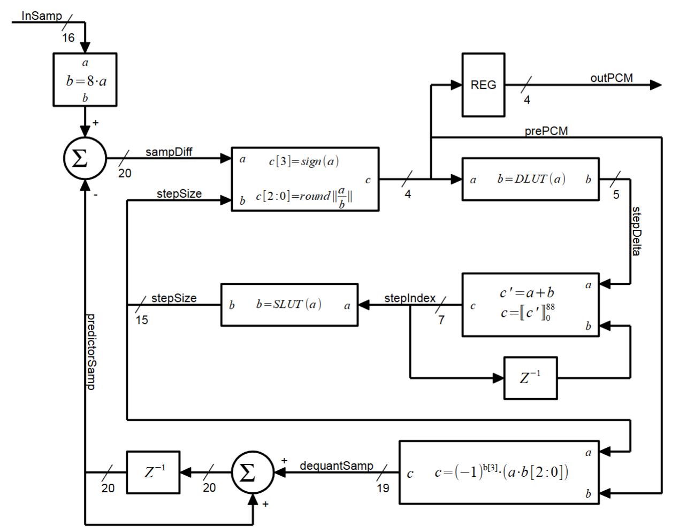

# ima_adpcm_enc Design Specification

## 1. Introduction

`ima_adpcm_enc` implements IMA ADPCM encoding for 16-bit input samples. For each accepted input sample, the core generates a 4-bit ADPCM code nibble and updates internal predictor and step-index state.

The design is iterative and uses a compact control/data path to perform sign detection, adaptive quantization, dequantization, predictor update, and step-index adaptation.

## 2. Module Diagram

[Placeholder: Insert module/block diagram manually.]

## 3. Interface

| Signal | Direction | Width | Description |
| --- | --- | --- | --- |
| `clock` | Input | 1 | Global core clock. |
| `reset` | Input | 1 | Global asynchronous active-high reset. |
| `inSamp` | Input | 16 | Input PCM sample to encode. |
| `inValid` | Input | 1 | Input-valid flag for `inSamp`. |
| `inReady` | Output | 1 | Input-ready flag. High when core can accept a new sample. |
| `outPCM` | Output | 4 | Encoded ADPCM nibble. MSB is sign bit, lower 3 bits are magnitude code. |
| `outValid` | Output | 1 | Output-valid pulse for `outPCM`. |
| `outPredictSamp` | Output | 16 | Current internal predictor sample value (scaled back to output domain). |
| `outStepIndex` | Output | 7 | Current internal quantizer step index. |

### 3.1 Interface Semantics

- A new encode transaction starts when `inValid` is asserted while `inReady` is high.
- `inReady` is deasserted while an input sample is being processed through the iterative encode sequence.
- `outValid` pulses when the corresponding `outPCM` nibble is produced.
- `outPredictSamp` and `outStepIndex` reflect internal state and are intended to be sampled in synchronization with `outValid` when external state transfer is required.

## 4. Function Description

### 4.1 Functional Scope

For each accepted input sample, the core performs:

- input-to-predictor difference computation in internal scaled precision,
- sign extraction and magnitude quantization into a 3-bit adaptive code,
- dequantized difference reconstruction,
- predictor update with saturation,
- step-index adaptation and saturation,
- output nibble emission.

### 4.2 ADPCM Nibble Generation

The generated nibble format is:

- `outPCM[3]`: sign bit of the sample difference,
- `outPCM[2:0]`: quantized magnitude bits computed adaptively from the current step size.

Magnitude bits are derived sequentially by comparing residual difference against step-size-scaled thresholds and updating residual/dequantized accumulators at each decision step.

### 4.3 Predictor and Step Adaptation

- The predictor state is updated from the reconstructed dequantized difference with sign applied.
- Predictor update is saturated to internal range before storage.
- Step-index delta is selected from a nibble-dependent adaptation lookup.
- Step index is saturated to valid range `0..88`.
- Step size is updated from the standard step-size lookup table indexed by `stepIndex`.

### 4.4 Transaction Timing Behavior

The encoder uses a six-state iterative sequence per accepted sample:

1. `PCM_IDLE`: wait for input acceptance.
2. `PCM_SIGN`: determine difference sign and initialize dequantized base term.
3. `PCM_BIT2`: resolve magnitude bit 2.
4. `PCM_BIT1`: resolve magnitude bit 1.
5. `PCM_BIT0`: resolve magnitude bit 0.
6. `PCM_DONE`: update predictor, emit output-valid pulse, return ready state.

Under continuous traffic, the core processes one input sample per six clock cycles.

## 5. Implementation Details

### 5.1 Main State and Datapath Registers

Primary internal registers:

- `pcmSq[2:0]`: encode state machine state.
- `sampDiff[19:0]`: scaled sample difference and residual.
- `predictorSamp[18:0]`: internal predictor state.
- `dequantSamp[18:0]`: reconstructed dequantized difference.
- `prePCM[3:0]`: in-progress output nibble assembly.
- `stepIndex[6:0]`: adaptive step-index state.
- `stepSize[14:0]`: current quantizer step size.
- `stepDelta[4:0]`: nibble-derived index adaptation value.

### 5.2 Control and Handshake Behavior

- `inReady` is asserted only when the core is available for new input and after completion of the current transaction.
- On accepted input, `inReady` is cleared and the FSM advances through quantization states.
- `outValid` is asserted in the completion state when `outPCM` is updated.

### 5.3 Quantization and Dequantization Path

- The input sample is scaled to the internal precision domain before differencing against predictor state.
- A sign-adjusted residual is quantized in three sequential decisions using current `stepSize`.
- Dequantized difference is accumulated in parallel with quantization decisions and reused for predictor update.

### 5.4 Saturation and Lookup Behavior

- Predictor update uses overflow/saturation checks before state commit.
- Step-index update uses signed adaptation and saturates to `0..88`.
- Step size is selected from the full IMA ADPCM step-size table using `stepIndex`.

### 5.5 State Outputs

- `outPredictSamp` is derived from internal predictor state with output-domain scaling and rounding.
- `outStepIndex` exposes the current step-index state directly.

## 6. Submodule List

No external submodule instantiations are present in `ima_adpcm_enc.v`. The encoder is implemented as a single top-level module with internal FSM, arithmetic datapath, and lookup logic.

## 7. Clock and Reset

- Single clock domain on `clock`.
- `reset` is asynchronous and active high.
- Reset initializes FSM, predictor, quantizer state, and output-valid signaling.

## 8. Constraints

- `inValid` should be asserted only when `inReady` is high.
- `inSamp` should be stable at the acceptance edge where `inValid` and `inReady` are both high.
- `outPCM` should be consumed only when `outValid` is asserted.
- State outputs intended for decoder synchronization should be sampled in the same transaction context as `outPCM`/`outValid`.
