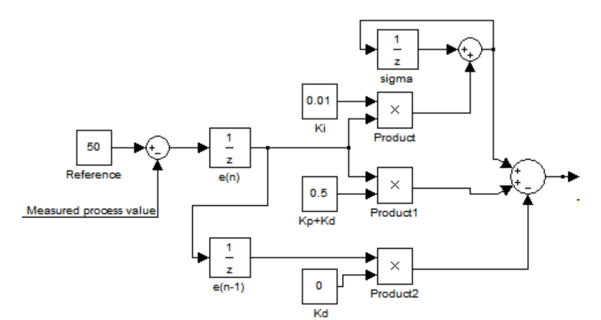
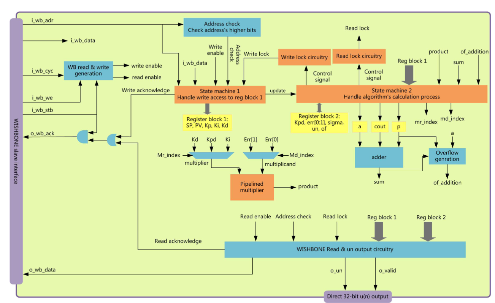

# PID Design Specification

## 1. Introduction

`PID` is a digital proportional-integral-derivative control core with a Wishbone B4 slave programming interface and a direct 32-bit control output interface.

The core stores signed 16-bit control coefficients (`Kp`, `Ki`, `Kd`), set point (`SP`), and process value (`PV`). It computes a signed 32-bit control result `u(n)` from the current error term, a running integral accumulation, and a derivative-related correction term. The design supports runtime coefficient/data updates and provides status visibility for intermediate terms and overflow conditions.

## 2. Module Diagram

[Placeholder: Insert module/block diagram manually.]

## 3. Interface

| Signal | Direction | Width | Description |
| --- | --- | --- | --- |
| `i_clk` | Input | 1 | Core clock. |
| `i_rst` | Input | 1 | Asynchronous active-high reset for the top-level core. |
| `i_wb_cyc` | Input | 1 | Wishbone cycle qualifier. |
| `i_wb_stb` | Input | 1 | Wishbone strobe for a valid transfer request. |
| `i_wb_we` | Input | 1 | Wishbone write enable (`1`: write, `0`: read). |
| `i_wb_adr` | Input | `[adr_wb_nb-1:0]` | Wishbone address input. |
| `i_wb_data` | Input | `[wb_nb-1:0]` | Wishbone write data input. |
| `o_wb_ack` | Output | 1 | Wishbone acknowledge for completed transfer. |
| `o_wb_data` | Output | `[wb_nb-1:0]` | Wishbone read data output. |
| `o_un` | Output | `[31:0]` | Current signed control output `u(n)`. |
| `o_valid` | Output | 1 | Output-valid/availability indicator for `o_un`. |

### 3.1 Wishbone Transaction Semantics

- A write request is identified by `i_wb_cyc=1`, `i_wb_stb=1`, and `i_wb_we=1`.
- A read request is identified by `i_wb_cyc=1`, `i_wb_stb=1`, and `i_wb_we=0`.
- `o_wb_ack` indicates request completion. For addresses that are implemented but temporarily locked during internal updates, acknowledge is delayed until the access is allowed.
- Out-of-range read accesses return zero data with acknowledge.
- Address decoding depends on compile-time Wishbone data width selection (`wb_16bit`, `wb_32bit`, or `wb_64bit`).

### 3.2 Register Map and Data Access Semantics

| Register | Access | Width | Offset (16-bit / 32-bit / 64-bit) | Description |
| --- | --- | --- | --- | --- |
| `Kp` | R/W | 16 | `0x00 / 0x00 / 0x00` | Proportional coefficient. |
| `Ki` | R/W | 16 | `0x02 / 0x04 / 0x08` | Integral coefficient. |
| `Kd` | R/W | 16 | `0x04 / 0x08 / 0x10` | Derivative coefficient. |
| `SP` | R/W | 16 | `0x06 / 0x0C / 0x18` | Set point input. |
| `PV` | R/W | 16 | `0x08 / 0x10 / 0x20` | Process value input. Writing `PV` triggers a control-update sequence. |
| `Kpd` | R | 16 | `0x0A / 0x14 / 0x28` | Derived sum term `Kp+Kd`. |
| `err[0]` | R | 16 | `0x0C / 0x18 / 0x30` | Current error term `e(n)`. |
| `err[1]` | R | 16 | `0x0E / 0x1C / 0x38` | Previous error term `e(n-1)`. |
| `un` | R | 32 | `0x10 / 0x20 / 0x40` | Computed control output `u(n)`. |
| `sigma` | R | 32 | `0x12 / 0x24 / 0x48` | Integral accumulation state. |
| `OF` | R | 5 | `0x14 / 0x28 / 0x50` | Overflow status bits. |
| `RS` | R/W (control) | control | `0x16 / 0x2C / 0x58` | Writing data value `0` starts a new sequence by clearing selected state (`err[0]`, `un`, `sigma`, `OF`). Readback returns zero in the current implementation. |

Additional read-format behavior:

- In 16-bit mode, reads of 32-bit registers return the lower 16 bits.
- In 32-bit and 64-bit modes, 16-bit signed registers are sign-extended.
- `OF` is zero-extended in wider bus modes.

## 4. Function Description

### 4.1 Control Function

The core implements a discrete-time PID update where the output is formed from three components:

- a term proportional to the current error,
- an accumulated integral term,
- a correction term derived from prior error history.

All coefficient and input registers are signed two's-complement 16-bit values. The output `u(n)` and integral accumulator `sigma` are signed two's-complement 32-bit values.

### 4.2 Operation Triggers

- Writing `Kp` or `Kd` starts an internal update of `Kpd`.
- Writing `PV` starts the main control-update sequence, which updates `err[0]`, `err[1]`, `sigma`, and `u(n)`.
- Writing zero to `RS` clears sequence-related state used for continuing `u(n)` evolution.

### 4.3 Control-Update Sequence

When `PV` is written and accepted:

1. The current error term is formed from `SP` and `PV`.
2. The previous error register is updated from the prior error state.
3. Multiplication terms required for proportional/derivative and integral contributions are generated using the shared multiplier datapath.
4. The integral accumulator `sigma` is updated.
5. The final control output `u(n)` is assembled by combining the arithmetic terms through the shared 32-bit adder path.

The implementation uses a fixed internal sequencing schedule for this update path. The documented end-to-end latency from `PV` update to `u(n)` update is 9 clock cycles.

### 4.4 Overflow Reporting

`OF` records arithmetic overflow events during internal updates:

- `OF[0]`: overflow during `Kpd` update.
- `OF[1]`: overflow for current error update (`err[0]`).
- `OF[2]`: overflow for previous error update (`err[1]`).
- `OF[3]`: overflow affecting `u(n)` path.
- `OF[4]`: overflow affecting `sigma` update.

If overflow bits are set, the reported control result may be outside the intended mathematical range.

### 4.5 Output Validity Behavior

`o_un` continuously reflects the current `un` register value.

`o_valid` is deasserted while a `PV`-triggered update sequence is in progress and asserted when that sequence is not active.

## 5. Implementation Details

### 5.1 Architectural Partitioning

The design is organized into three major functional parts:

- Wishbone request/control logic for register access and acknowledge generation.
- Arithmetic sequencing logic that schedules PID-term updates.
- Shared arithmetic datapath using one 16x16 pipelined multiplier and one 32-bit adder.

### 5.2 Control and Locking Behavior

Two internal control paths are used:

- A write-side control state machine accepts and decodes register writes and generates write acknowledgments.
- An arithmetic-sequencing state machine manages `Kpd` updates and full `PV`-triggered PID updates.

During arithmetic updates, lock signals prevent selected reads and writes to avoid partially updated observable state. Accesses to locked registers are held until the corresponding lock is released.

### 5.3 Datapath Scheduling

- Operand multiplexers select multiplier inputs among `Ki`, `Kpd`, `Kd` and among relevant error terms.
- The adder datapath is reused for subtraction-style and accumulation operations through carry-in and operand conditioning.
- Intermediate terms are staged through internal registers before committing to architectural registers (`err[]`, `sigma`, `un`, `Kpd`).

### 5.4 Wishbone Readback Formatting

The readback array is mapped to register indices and then adapted to the selected Wishbone data width by sign extension or truncation, depending on register width and bus mode.

## 6. Submodule List

### 6.1 `adder_32bit`

Functional role: shared combinational 32-bit adder used for error formation and accumulation stages in the PID datapath.

| Signal | Direction | Width | Description |
| --- | --- | --- | --- |
| `i_a` | Input | 32 | Adder operand A. |
| `i_b` | Input | 32 | Adder operand B. |
| `i_c` | Input | 1 | Carry-in; used to support add/subtract forms. |
| `o_s` | Output | 32 | Sum output. |
| `o_c` | Output | 1 | Carry-out. |

### 6.2 `multiplier_16x16bit_pipelined`

Functional role: pipelined signed multiplication engine used to generate PID product terms required during `PV` updates.

| Signal | Direction | Width | Description |
| --- | --- | --- | --- |
| `i_clk` | Input | 1 | Multiplier clock. |
| `i_rst` | Input | 1 | Active-low multiplier reset input. |
| `i_start` | Input | 1 | Starts a multiplication transaction. |
| `i_md` | Input | 16 | Multiplicand input. |
| `i_mr` | Input | 16 | Multiplier input. |
| `o_product` | Output | 32 | Product output. |
| `o_ready` | Output | 1 | Product-ready indication from multiplier pipeline. |

Top-level integration note: the top module drives submodule `i_rst` with inverted top reset (`~i_rst`).

## 7. Clock and Reset

- The core operates in a single clock domain driven by `i_clk`.
- `i_rst` is asynchronous and active high at top level.
- Reset initializes configuration/data registers and arithmetic state registers to zero, including `kp`, `ki`, `kd`, `sp`, `pv`, `kpd`, `err[]`, `sigma`, `un`, and `OF`.
- The RS control path provides a selective runtime state clear without resetting all coefficient/input registers.

## 8. Constraints

- Exactly one Wishbone width configuration (`wb_16bit`, `wb_32bit`, or `wb_64bit`) shall be selected at build time.
- Wishbone master logic shall hold transfer qualifiers until `o_wb_ack` is observed.
- Software should account for delayed acknowledge on accesses that target temporarily locked registers during active arithmetic update sequences.
- `o_un` should be sampled when `o_valid` is asserted.
- Writing `PV` at a rate faster than completion of the internal update sequence can stall bus completion on locked accesses; software integration should account for this behavior.
