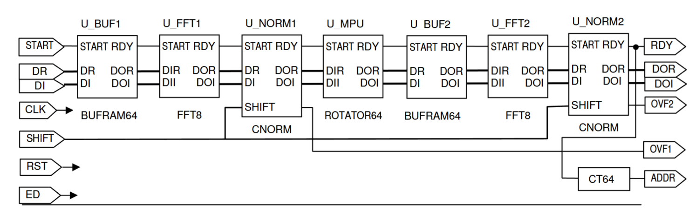

# USFFT64_2B Design Specification

## 1. Introduction

`USFFT64_2B` is a pipelined 64-point complex FFT/IFFT processor. The core accepts one complex input sample (`DR`,`DI`) per enabled clock and produces one complex output sample (`DOR`,`DOI`) per enabled clock after pipeline fill.

The architecture is radix-8 and is composed of two 8-point FFT stages separated by twiddle-factor rotation and normalization stages. It supports compile-time configuration of data/coefficient precision and buffering structure, with explicit overflow indication and output addressing support.

## 2. Module Diagram

[Placeholder: Insert module/block diagram manually.]

## 3. Interface

| Signal | Direction | Width | Description |
| --- | --- | --- | --- |
| `CLK` | Input | 1 | Global clock. |
| `RST` | Input | 1 | Synchronous active-high reset. |
| `ED` | Input | 1 | Operation/data enable. Internal counters and pipeline state advance only when enabled. |
| `START` | Input | 1 | Transform-start strobe for the input frame/control sequence. |
| `SHIFT` | Input | 4 | Normalization control. `SHIFT[1:0]` controls stage-1 normalization, `SHIFT[3:2]` controls stage-2 normalization. |
| `DR` | Input | `[nb-1:0]` | Input real sample, signed two's-complement. |
| `DI` | Input | `[nb-1:0]` | Input imaginary sample, signed two's-complement. |
| `RDY` | Output | 1 | Output-frame ready strobe associated with the start of result sequencing. |
| `OVF1` | Output | 1 | Overflow indicator from the first normalization stage. |
| `OVF2` | Output | 1 | Overflow indicator from the second normalization stage. |
| `ADDR` | Output | `[5:0]` | Output sample number/address associated with `DOR`/`DOI`. |
| `DOR` | Output | `[nb+2:0]` | Output real sample, signed two's-complement. |
| `DOI` | Output | `[nb+2:0]` | Output imaginary sample, signed two's-complement. |

### 3.1 Interface Semantics

- A frame is initiated by `START`; input samples are accepted while `ED=1`.
- The pipeline supports concurrent input loading and output unloading in steady-state operation.
- `RDY` marks availability of an output frame sequence; `ADDR` identifies each output sample index.
- `OVF1` and `OVF2` indicate normalization-stage overflow conditions under the applied shift control.

### 3.2 Precision and Configuration Semantics

- Input sample width is parameterized by `nb` (supported range: 8 to 16).
- Output width is `nb+3` bits (`[nb+2:0]`) to preserve dynamic range through internal computation.
- FFT/IFFT operation is build-time selectable.
- Two-buffer and three-buffer internal dataflow organizations are build-time selectable.

## 4. Function Description

### 4.1 Transform Function

The core performs a one-dimensional 64-point complex transform using radix-8 decomposition:

1. Input data are grouped and reordered by the first buffer.
2. First 8-point FFT stage computes base transforms.
3. First normalization stage applies programmable shift and overflow detection.
4. Rotator applies twiddle-factor complex multiplication for inter-stage combination.
5. Intermediate buffering performs ordering/scheduling for second-stage processing.
6. Second 8-point FFT stage completes radix-8 factorization.
7. Second normalization stage applies programmable shift and overflow detection.
8. Final buffering/output sequencing provides result stream and address tagging.

### 4.2 Streaming and Latency Behavior

- In enabled pipelined mode, one complex sample is processed per clock at input and output boundaries.
- The documented latency from first accepted input sample of a transform to first output sample is 163 clock cycles.
- `ED` can be deasserted to pause progression of internal counters/pipeline state; when reasserted, processing continues from held state.

### 4.3 Output Ordering and Addressing

- In three-buffer configuration, output sequence is in natural order, and `ADDR` increments in natural index order.
- In two-buffer configuration, output data stream is produced in 8-way shuffled order; `ADDR` provides corresponding sample numbering for downstream reordering/use.

### 4.4 FFT/IFFT Mode Behavior

- FFT and IFFT are selected at build time.
- Mode selection affects twiddle-factor sign convention and corresponding transform combination behavior in the arithmetic stages.

### 4.5 Normalization and Overflow Behavior

- Two normalization stages are provided, each controlled by a 2-bit shift field from `SHIFT`.
- Each normalization stage includes overflow detection logic and an overflow status output (`OVF1`, `OVF2`).
- Overflow status is reset at stage-start strobe boundaries and updated during enabled processing.

## 5. Implementation Details

### 5.1 Top-Level Datapath Organization

The top module instantiates and connects these functional blocks in a fixed pipeline chain:

- `BUFRAM64C1` (input buffer/reordering)
- `FFT8` (stage 1)
- `CNORM` (stage 1 normalization)
- `ROTATOR64` (twiddle multiplication)
- `BUFRAM64C1` (intermediate buffer)
- `FFT8` (stage 2)
- `CNORM` (stage 2 normalization)
- Optional `BUFRAM64C1` (final-order/output buffering in three-buffer mode)

The `RDY` signal exported by each stage is used as the `START` trigger for the following stage, creating a deterministic stage-to-stage control chain.

### 5.2 Buffering and Address Control

- Internal buffers are 64-sample complex buffers with address-generation logic for required ordering patterns.
- A top-level modulo-64 address counter generates `ADDR`.
- In two-buffer mode, `ADDR` is bit-permuted (`{low3,high3}`) to match output sequencing semantics.
- In three-buffer mode, `ADDR` is natural counter order.

### 5.3 Arithmetic Blocks

- `FFT8` computes the base 8-point transform in a pipelined structure.
- `ROTATOR64` multiplies by twiddle coefficients fetched from `WROM64`.
- `CNORM` stages perform programmable normalization shifts and overflow monitoring.

### 5.4 Control Gating

- `RST` synchronously initializes stage control counters/registers.
- `ED` gates progression across pipeline stages and counters.
- `START` initializes transform sequencing at the input side; stage-local start strobes are derived along the ready chain.

## 6. Submodule List

### 6.1 `BUFRAM64C1`

Role: 64-point complex data buffer with transform-oriented read/write ordering and stage-ready generation.

| Signal | Direction | Width | Description |
| --- | --- | --- | --- |
| `CLK` | Input | 1 | Clock. |
| `RST` | Input | 1 | Synchronous reset. |
| `ED` | Input | 1 | Enable for counter/state updates. |
| `START` | Input | 1 | Buffer sequence start/reset strobe. |
| `DR` | Input | `[nb-1:0]` | Input real sample. |
| `DI` | Input | `[nb-1:0]` | Input imaginary sample. |
| `RDY` | Output | 1 | Ready strobe for downstream stage start. |
| `DOR` | Output | `[nb-1:0]` | Output real sample. |
| `DOI` | Output | `[nb-1:0]` | Output imaginary sample. |

### 6.2 `FFT8`

Role: pipelined 8-point complex transform engine used in both FFT stages.

| Signal | Direction | Width | Description |
| --- | --- | --- | --- |
| `CLK` | Input | 1 | Clock. |
| `RST` | Input | 1 | Synchronous reset. |
| `ED` | Input | 1 | Enable for internal pipeline progression. |
| `START` | Input | 1 | Stage-start strobe. |
| `DIR` | Input | `[nb-1:0]` | Input real sample. |
| `DII` | Input | `[nb-1:0]` | Input imaginary sample. |
| `RDY` | Output | 1 | Output-stage ready strobe. |
| `DOR` | Output | `[nb+2:0]` | Output real sample. |
| `DOI` | Output | `[nb+2:0]` | Output imaginary sample. |

### 6.3 `CNORM`

Role: stage normalization and overflow detection unit.

| Signal | Direction | Width | Description |
| --- | --- | --- | --- |
| `CLK` | Input | 1 | Clock. |
| `ED` | Input | 1 | Enable. |
| `START` | Input | 1 | Overflow-detector reset/start strobe. |
| `DR` | Input | `[nb+2:0]` | Input real sample. |
| `DI` | Input | `[nb+2:0]` | Input imaginary sample. |
| `SHIFT` | Input | `[1:0]` | Shift control for normalization stage. |
| `OVF` | Output | 1 | Overflow indicator for the stage. |
| `RDY` | Output | 1 | Stage-ready strobe. |
| `DOR` | Output | `[nb+1:0]` | Normalized output real sample. |
| `DOI` | Output | `[nb+1:0]` | Normalized output imaginary sample. |

### 6.4 `ROTATOR64`

Role: twiddle-factor complex multiplier between the two FFT stages.

| Signal | Direction | Width | Description |
| --- | --- | --- | --- |
| `CLK` | Input | 1 | Clock. |
| `RST` | Input | 1 | Synchronous reset. |
| `ED` | Input | 1 | Enable. |
| `START` | Input | 1 | Rotator sequence start strobe. |
| `DR` | Input | `[nb+1:0]` | Input real sample. |
| `DI` | Input | `[nb+1:0]` | Input imaginary sample. |
| `RDY` | Output | 1 | Output-ready/start strobe for downstream buffer. |
| `DOR` | Output | `[nb+1:0]` | Rotated output real sample. |
| `DOI` | Output | `[nb+1:0]` | Rotated output imaginary sample. |

## 7. Clock and Reset

- Single clock domain: `CLK`.
- `RST` is synchronous and active high.
- Reset initializes stage control counters/registers and output-sequencing address pointer.
- Normalization stage overflow flags are cleared by stage-start control strobes during transform sequencing.

## 8. Constraints

- `START` shall be applied synchronous to `CLK`.
- For nominal continuous throughput, keep `ED=1` during active frame input/output intervals.
- `SHIFT` should be selected according to expected signal magnitude to balance dynamic range and overflow risk.
- In two-buffer configuration, use `ADDR` to interpret/reorder output sample sequence correctly.
- Build configuration must consistently select precision, buffer count, and transform mode (FFT or IFFT) before synthesis.
