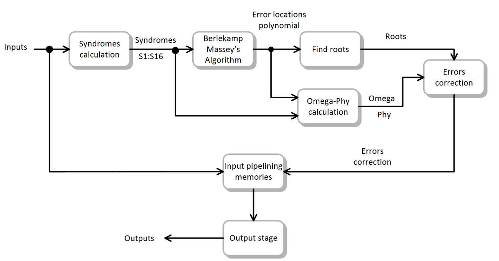

# Reed-Solomon Decoder (RS_dec) Specification

## 1. Introduction

`RS_dec` is a Reed-Solomon decoder core for RS(204,188) with error-correction capability up to 8 symbol errors per codeword (`t=8`).

The module accepts an 8-bit input byte stream for each 204-byte received codeword, computes decoder syndromes, determines error locations and error magnitudes over GF(2^8), applies corrections, and outputs a corrected 188-byte payload stream.

The decoder is organized as a staged pipeline including syndrome generation, Berlekamp-Massey Lambda computation, Lambda root search, Omega/Phy generation, error correction, and output staging.

## 2. Module Diagram

## 3. Interface

| Signal | Direction | Width | Description |
| --- | --- | --- | --- |
| `clk` | Input | 1 | System clock. |
| `reset` | Input | 1 | Asynchronous active-high reset. |
| `CE` | Input | 1 | Input-byte strobe. Assert for one cycle per valid `input_byte`. Required minimum spacing is 8 clock cycles between CE pulses. |
| `input_byte` | Input | 8 | Encoded input byte stream for the received RS codeword. |
| `Out_byte` | Output | 8 | Corrected output payload byte. |
| `CEO` | Output | 1 | Output-byte strobe to downstream logic. At top level, `CEO` is asserted only when `Valid_out` is high. |
| `Valid_out` | Output | 1 | Indicates that `Out_byte` is valid. One corrected payload byte is produced per output strobe interval. |

### 3.1 Interface Semantics

- A decode transaction starts from the incoming codeword bytes on `CE` and ends after corrected payload bytes are released with `Valid_out`/`CEO`.
- `Out_byte` shall be sampled only when `Valid_out` is asserted.
- `CEO` is gated by `Valid_out` at the top-level (`CEO = CEO_0 && Valid_out`), so downstream logic can treat `CEO` as an output-valid pulse.
- The decoder is designed for one output byte every 8 clocks during active output streaming.

## 4. Function Description

### 4.1 Decode Flow Overview

For each received RS(204,188) codeword, the module executes the following functional phases:

1. Input buffering and syndrome generation.
2. Error-locator polynomial (`Lambda`) computation.
3. Parallel root finding and Omega/Phy generation.
4. Error value evaluation and in-memory correction.
5. Corrected payload output streaming.

### 4.2 Input Buffering and Syndrome Generation

`input_syndromes` receives `input_byte` on `CE`, stores the received codeword into ping-pong input memories, and computes 16 syndromes (`s0` to `s15`).

When syndrome computation for a codeword is complete, the block asserts `S_ready` for one cycle. This pulse is the start condition for the decode-computation stages.

### 4.3 Error-Locator Polynomial Computation (Berlekamp-Massey)

`BM_lamda` consumes the 16 syndromes and computes Lambda coefficients `L1..L8` using Berlekamp-Massey iteration over GF(256). `erasure_cnt` and `erasure_ready` are tied to zero in `RS_dec`, so this integration performs errors-only decoding.

When coefficients are available, `BM_lamda` asserts `L_ready` for one cycle.

### 4.4 Root Search and Omega/Phy Generation

After `L_ready`:

- `lamda_roots` evaluates the Lambda polynomial over field candidates and reports up to 8 roots (`r1..r8`) with `root_cnt`; completion is indicated by `roots_ready`.
- `Omega_Phy` uses the same syndrome set and Lambda coefficients to compute:
  - Omega coefficients (`O1..O16`),
  - Phy derivative terms (`P1`, `P3`, `P5`, `P7`),
  and asserts `poly_ready` when complete.

These two blocks operate in parallel after Lambda is available.

### 4.5 Error Evaluation and Correction

`error_correction` uses roots and Omega/Phy data to compute correction values and target symbol locations.

Functional behavior:

- Root values are converted into correction locations.
- For each candidate error location, the block evaluates error magnitude from Omega and Phy terms.
- The original symbol value (`initial_value`) is read from output memory.
- Corrected symbol is formed as XOR of original symbol and computed correction value.
- Corrected symbol is written back to output memory.

The block asserts `DONE` when its correction pass finishes. Write-enable is qualified so correction writes are restricted to payload address range (`Address < 188`) and valid in-range correction operations.

### 4.6 Output Staging and Handshake

`out_stage` starts output release when correction completion is observed (`DONE` or extended completion flag `DONE_ext`). It reads corrected payload bytes from output memories and drives:

- `Out_byte` data,
- `Valid_out` during valid output cycles,
- `CEO_0` as the local output cadence pulse.

At top level, `CEO` is derived as `CEO_0 && Valid_out`. Output completes after the 188-byte payload window is emitted.

## 5. Implementation Details

### 5.1 Top-Level Sequencing

`RS_dec` uses an internal control FSM and flags to coordinate decode stages:

- `S_flag`: syndrome/Lambda phase active.
- `L_flag`: roots and Omega/Phy phase active.
- `R_flag`: error-correction phase active.
- `T_flag`: transport (input-to-output-memory copy) active.
- `out_flag`: output stage active.
- `DONE_ext`: completion extension when a new decode completes before prior output streaming finishes.

FSM progression is driven by stage-ready pulses:

- `state1` waits for `S_ready`.
- `state2` waits for `L_ready`.
- `state3` waits for `roots_ready`.
- `state4` waits for `DONE`, then returns to idle for next codeword.

### 5.2 GF Lookup Resource Sharing

The design shares four GF power ROM ports and four GF decimal ROM ports across BM, root/Omega, and correction stages.

A control selector (`{R_flag, L_flag, S_flag}`) steers address/data paths:

- `3'b001`: BM_lamda owns GF accesses.
- `3'b010`: lamda_roots and Omega_Phy share GF accesses.
- `3'b100`: error_correction owns GF accesses.

This arbitration defines which stage receives GF lookup results in each phase.

### 5.3 Memory Organization and Data Movement

The decoder uses ping-pong RAM organization to overlap buffering, correction, and output:

- Input buffering: two `DP_RAM` instances in `input_syndromes` (depth 205) store incoming codeword bytes while syndromes are generated.
- Output buffering: two `DP_RAM` instances in `RS_dec` (depth 188) hold payload bytes and corrected values.

Data movement sequence:

- `transport_in2out` copies selected input-memory data into one output-memory bank after `S_ready`.
- During `T_flag`, output-memory write path is sourced from transport data.
- After transport completes, write path switches to correction data (`correction_value`) from `error_correction`.
- Memory bank selection toggles per codeword via transport control signals, enabling overlap between ongoing decode and output streaming.

### 5.4 Output Overlap Handling

When correction (`DONE`) completes before the previous output stream (`out_done`) has finished, `DONE_ext` keeps output-start intent asserted until `out_stage` consumes it. This avoids dropping decode-complete events under overlapping operation.

### 5.5 Output Cadence Generation

`out_stage` includes an internal 3-bit cadence counter and emits one output transfer opportunity every 8 clocks. During active output state, bytes are emitted sequentially for payload addresses `0` through `187`, with `Valid_out` marking valid output cycles.

## 6. Submodule List

### 6.1 `input_syndromes`

Role: captures incoming codeword bytes, computes syndromes, and provides buffered read access for transport.

| Signal | Direction | Width | Description |
| --- | --- | --- | --- |
| `CE` | Input | 1 | Input-byte strobe. |
| `input_byte` | Input | 8 | Received codeword byte. |
| `R_Add`, `RE` | Input | 8, 1 | Read address/enable from transport path. |
| `Read_byte` | Output | 8 | Buffered byte read for transport to output memories. |
| `S_Ready` | Output | 1 | Syndrome set valid pulse. |
| `s0..s15` | Output | 16x8 | Syndrome vector for decode pipeline. |

### 6.2 `BM_lamda`

Role: computes Lambda coefficients from syndromes using Berlekamp-Massey.

| Signal | Direction | Width | Description |
| --- | --- | --- | --- |
| `Sm_ready`, `Sm1..Sm16` | Input | 1, 16x8 | Syndrome-valid pulse and syndrome inputs. |
| `add_pow1`, `add_pow2`, `add_dec1` | Output | 8, 8, 8 | GF lookup addresses for BM arithmetic. |
| `pow1`, `pow2`, `dec1` | Input | 8, 8, 8 | GF lookup return values. |
| `L_ready` | Output | 1 | Lambda coefficients valid pulse. |
| `L1..L8` | Output | 8x8 | Lambda coefficients. |

### 6.3 `lamda_roots`

Role: finds roots of the Lambda polynomial and reports root count/values.

| Signal | Direction | Width | Description |
| --- | --- | --- | --- |
| `CE` | Input | 1 | Start pulse (driven by `L_ready`). |
| `Lc0..Lc8` | Input | 9x8 | Lambda polynomial coefficients. |
| `add_GF_ascending`, `add_GF_dec0..2` | Output | 8, 3x8 | GF lookup addresses for root evaluation. |
| `power`, `decimal0..2` | Input | 8, 3x8 | GF lookup data. |
| `CEO` (`roots_ready`) | Output | 1 | Root-search completion pulse. |
| `root_cnt`, `r1..r8` | Output | 4, 8x8 | Number of roots and root values. |

### 6.4 `Omega_Phy`

Role: computes Omega polynomial terms and Phy derivative terms from syndromes and Lambda.

| Signal | Direction | Width | Description |
| --- | --- | --- | --- |
| `Sm_ready`, `Sm1..Sm16` | Input | 1, 16x8 | Syndrome-valid pulse and syndrome values. |
| `L_ready`, `L1..L8` | Input | 1, 8x8 | Lambda-valid pulse and coefficients. |
| `add_pow1..3`, `add_dec1` | Output | 3x8, 8 | GF lookup addresses. |
| `pow1..3`, `dec1` | Input | 3x8, 8 | GF lookup data. |
| `poly_ready` | Output | 1 | Omega/Phy completion pulse. |
| `O1..O16`, `P1`,`P3`,`P5`,`P7` | Output | 16x8, 4x8 | Omega and Phy terms for correction. |

### 6.5 `error_correction`

Role: evaluates error magnitudes/locations and updates corrected symbols in output memory space.

| Signal | Direction | Width | Description |
| --- | --- | --- | --- |
| `roots_ready`, `root_count`, `r1..r8` | Input | 1, 4, 8x8 | Root-search outputs. |
| `poly_ready`, `O1..O16`, `P1`,`P3`,`P5`,`P7` | Input | 1, 16x8, 4x8 | Omega/Phy inputs. |
| `add_pow1..4`, `add_dec1..4` | Output | 4x8, 4x8 | GF lookup addresses for correction arithmetic. |
| `pow1..4`, `dec1..4` | Input | 4x8, 4x8 | GF lookup return values. |
| `RE`, `WE`, `Address` | Output | 1, 1, 8 | Read/write control and address for correction data path. |
| `initial_value` | Input | 8 | Symbol read from output memory. |
| `correction_value` | Output | 8 | Corrected symbol value to write back. |
| `DONE` | Output | 1 | Correction pass completion pulse. |

### 6.6 `transport_in2out` and `out_stage`

Role: `transport_in2out` transfers buffered input bytes into output-memory banks; `out_stage` streams corrected payload bytes with output handshaking.

| Submodule | Key Control Signals | Key Data Signals | Completion |
| --- | --- | --- | --- |
| `transport_in2out` | `S_Ready`, `RE`, `WE`, `RdAdd`, `WrAdd` | Uses `Read_byte` path from input buffer and write path to output memories | `Wr_done` |
| `out_stage` | `DONE`, `RE`, `RdAdd`, `CEO`, `Valid_out` | `In_byte` in, `Out_byte` out | `out_done` |

## 7. Clock and Reset

- Single clock domain: `clk`.
- Reset is asynchronous active high.
- Reset returns all stage controls and handshakes to idle, including FSM state, stage flags, memory read/write controls, correction/output control flags, and output-valid indicators.

## 8. Constraints

- `CE` shall be asserted as a one-cycle pulse per input byte with minimum 8-cycle spacing.
- `input_byte` shall be stable in the cycle `CE` is asserted.
- Decoder capability is bounded to up to 8 symbol errors per RS(204,188) codeword.
- `Out_byte` is meaningful only when `Valid_out` is high.
- Downstream sampling should use `CEO` and/or `Valid_out`; top-level `CEO` is already qualified by `Valid_out`.
- The corrected output stream corresponds to 188 payload bytes per completed decode transaction.
