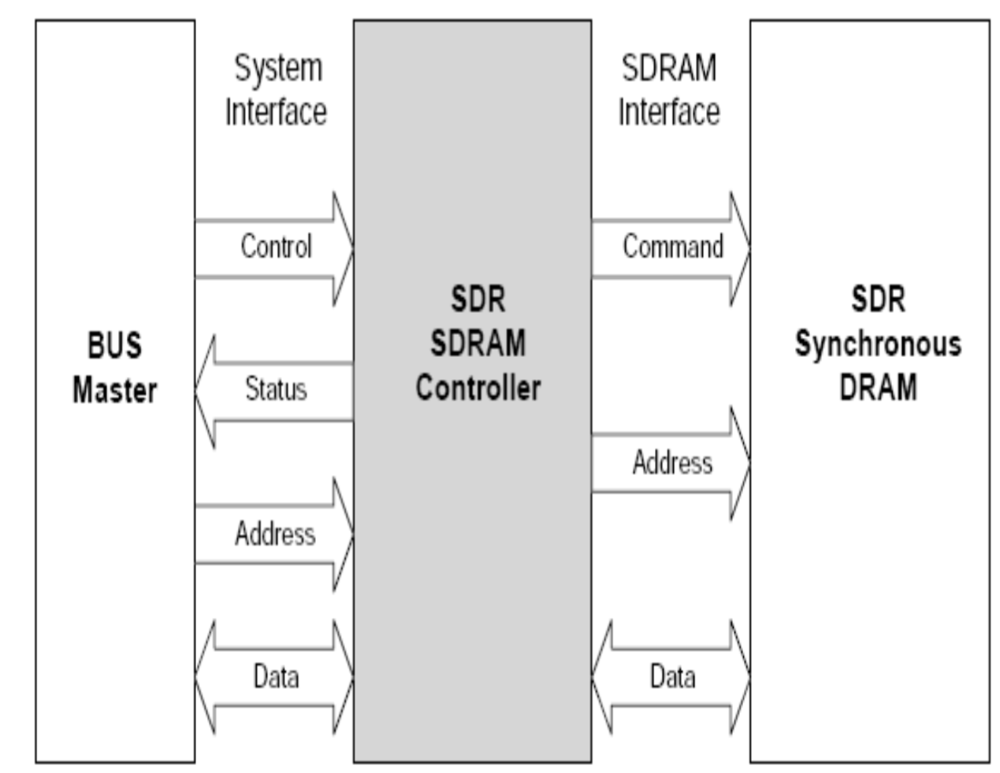
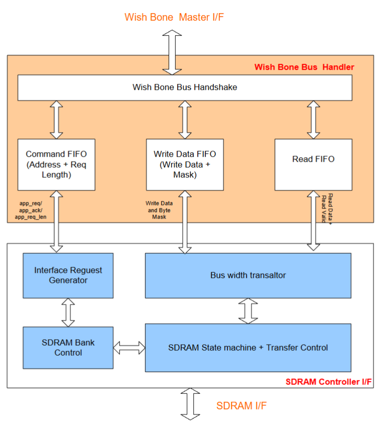
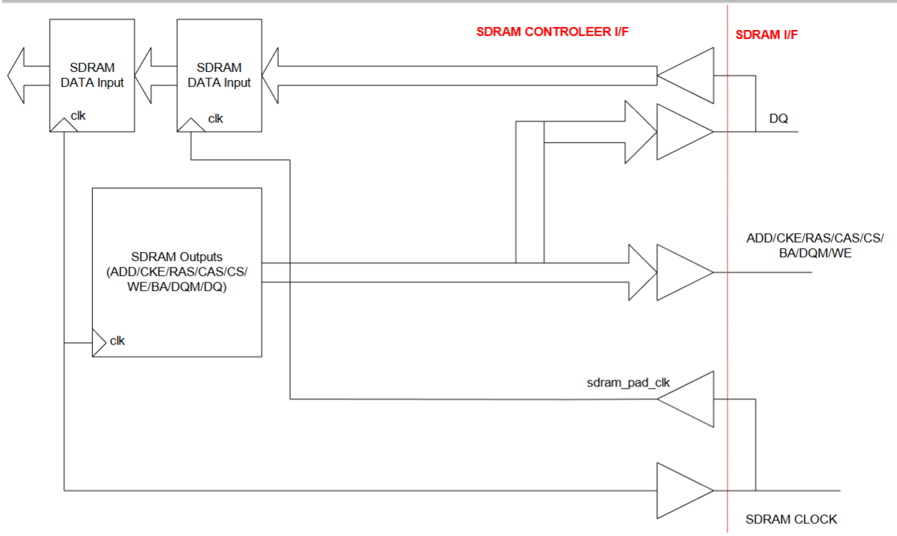

# sdrc_top Design Specification

## 1. Introduction

`sdrc_top` is the top-level SDRAM controller integration module that bridges a Wishbone host interface to SDR SDRAM command and data signals.

The design combines:
- a Wishbone-side protocol and clock-domain adapter (`wb2sdrc`), and
- an SDRAM control core (`sdrc_core`) that performs request generation, bank management, transfer sequencing, initialization, refresh, and data-width conversion.

The controller supports 8-bit, 16-bit, and 32-bit SDRAM access modes with a 32-bit application-side datapath.

## 2. Module Diagram

## 3. Interface

### 3.1 Parameters

| Parameter | Default | Description |
| --- | --- | --- |
| `APP_AW` | 26 | Application/Wishbone address width used by the top-level interface. |
| `APP_DW` | 32 | Application datapath width. |
| `APP_BW` | 4 | Application byte-enable width. |
| `APP_RW` | 9 | Application request-length width. |
| `SDR_DW` | 16 | SDRAM data width parameter used by the physical SDRAM side. |
| `SDR_BW` | 2 | SDRAM byte-mask width parameter. |
| `dw` | 32 | Wishbone data width. |
| `tw` | 8 | Request tag width parameter passed into `wb2sdrc`. |
| `bl` | 9 | Request-length field width passed into `wb2sdrc`. |

### 3.2 Top-Level Ports

| Signal | Direction | Width | Description |
| --- | --- | --- | --- |
| `sdram_clk` | Input | 1 | SDRAM-side controller clock. |
| `sdram_resetn` | Input | 1 | Active-low reset for SDRAM-side logic. |
| `cfg_sdr_width` | Input | 2 | SDRAM width mode (`00`: 32-bit, `01`: 16-bit, `1x`: 8-bit). |
| `cfg_colbits` | Input | 2 | Column decode mode (`00`: 8-bit, `01`: 9-bit, `10`: 10-bit, `11`: 11-bit column). |
| `wb_rst_i` | Input | 1 | Wishbone-side reset input (active high). |
| `wb_clk_i` | Input | 1 | Wishbone clock. |
| `wb_stb_i` | Input | 1 | Wishbone strobe/select. |
| `wb_ack_o` | Output | 1 | Wishbone acknowledge. |
| `wb_addr_i` | Input | `[APP_AW-1:0]` | Wishbone address. |
| `wb_we_i` | Input | 1 | Wishbone write enable (`1`: write, `0`: read). |
| `wb_dat_i` | Input | `[dw-1:0]` | Wishbone write data. |
| `wb_sel_i` | Input | `[dw/8-1:0]` | Wishbone byte enables. |
| `wb_dat_o` | Output | `[dw-1:0]` | Wishbone read data. |
| `wb_cyc_i` | Input | 1 | Wishbone cycle-valid input. |
| `wb_cti_i` | Input | `[2:0]` | Wishbone cycle type identifier. |
| `sdr_cke` | Output | 1 | SDRAM CKE. |
| `sdr_cs_n` | Output | 1 | SDRAM CS#. |
| `sdr_ras_n` | Output | 1 | SDRAM RAS#. |
| `sdr_cas_n` | Output | 1 | SDRAM CAS#. |
| `sdr_we_n` | Output | 1 | SDRAM WE#. |
| `sdr_dqm` | Output | `[SDR_BW-1:0]` | SDRAM byte-mask signals. |
| `sdr_ba` | Output | `[1:0]` | SDRAM bank address. |
| `sdr_addr` | Output | `[12:0]` | SDRAM address bus. |
| `sdr_dq` | Inout | `[SDR_DW-1:0]` | Bidirectional SDRAM data bus. |
| `sdr_init_done` | Output | 1 | Initialization complete status. |
| `cfg_req_depth` | Input | `[1:0]` | Maximum queued bank requests before arbitration backpressure. |
| `cfg_sdr_en` | Input | 1 | SDRAM controller enable. |
| `cfg_sdr_mode_reg` | Input | `[12:0]` | SDRAM mode-register programming value. |
| `cfg_sdr_tras_d` | Input | `[3:0]` | Active-to-precharge delay in SDRAM clocks. |
| `cfg_sdr_trp_d` | Input | `[3:0]` | Precharge timing delay in SDRAM clocks. |
| `cfg_sdr_trcd_d` | Input | `[3:0]` | Active-to-read/write delay in SDRAM clocks. |
| `cfg_sdr_cas` | Input | `[2:0]` | CAS latency setting. |
| `cfg_sdr_trcar_d` | Input | `[3:0]` | Refresh cycle timing delay. |
| `cfg_sdr_twr_d` | Input | `[3:0]` | Write recovery timing delay. |
| `cfg_sdr_rfsh` | Input | `[SDR_RFSH_TIMER_W-1:0]` | Refresh interval threshold. |
| `cfg_sdr_rfmax` | Input | `[SDR_RFSH_ROW_CNT_W-1:0]` | Refresh row-count threshold before refresh service. |

### 3.3 Interface Semantics

- `sdrc_top` operates across two clock domains (`wb_clk_i` and `sdram_clk`) with asynchronous FIFOs in `wb2sdrc` for command/write/read channels.
- `wb_ack_o` is write-accepted when command/write FIFOs can accept data, and read-accepted when read FIFO contains data.
- `sdr_dq` is actively driven only when write output-enable from the core is asserted; otherwise `sdr_dq` is high impedance.
- `wb_cti_i` is present at the top-level interface and passed into `wb2sdrc`; current bridge control logic does not use it for burst formation.

## 4. Function Description

### 4.1 End-to-End Transaction Flow

1. Wishbone writes and reads enter `wb2sdrc` in the Wishbone clock domain.
2. Requests and write data cross to the SDRAM domain through asynchronous FIFOs.
3. `sdrc_core` maps addresses, arbitrates per-bank command flow, and issues SDRAM commands/data.
4. SDRAM read data returns through `sdrc_core`, then crosses back via read FIFO to `wb_dat_o`/`wb_ack_o`.

### 4.2 Wishbone Bus Handler (`wb2sdrc`)

`wb2sdrc` contains three asynchronous FIFOs:
- command FIFO (`address + request metadata`),
- write-data FIFO (`write data + byte mask`), and
- read-data FIFO (`read data + end-of-read marker`).

Behavioral points:
- Write acknowledge requires both command FIFO and write-data FIFO not full.
- Read acknowledge requires read-data FIFO not empty.
- `pending_read` blocks acceptance of a second read command until the outstanding read response is returned to Wishbone.
- `sdr_req` is asserted whenever command FIFO is non-empty.
- Current command packing uses a fixed single-unit request length (`burst_length = 1`) in `wb2sdrc`.

### 4.3 Request Generation and Address Mapping (`sdrc_req_gen`)

`sdrc_req_gen` transforms incoming requests based on SDRAM width mode:
- 32-bit mode: internal address/length follow application request fields.
- 16-bit mode: internal address and length are left-shifted by one bit.
- 8-bit mode: internal address and length are left-shifted by two bits.

Column/bank/row decoding is derived from `cfg_colbits`:
- `cfg_colbits=00`: column `[7:0]`, bank `[9:8]`, row `[22:10]`
- `cfg_colbits=01`: column `[8:0]`, bank `[10:9]`, row `[23:11]`
- `cfg_colbits=10`: column `[9:0]`, bank `[11:10]`, row `[24:12]`
- `cfg_colbits=11`: column `[10:0]`, bank `[12:11]`, row `[25:13]`

If wrap is disabled and the request crosses a page boundary, the module splits the transfer into sequential chunks. In `sdrc_top`, wrap input to the core is tied low, so non-wrap split behavior is the active path.

### 4.4 Bank Control and Transfer Sequencing

`sdrc_bank_ctl` distributes requests to four `sdrc_bank_fsm` instances (one per bank), tracks queued bank order, and arbitrates command issuance to the transfer controller.

Per-bank FSM behavior includes:
- page-hit path: direct read/write command path,
- page-miss path: precharge then activate before transfer,
- optional precharge on DMA-last handling path,
- timing-gated transitions using `tras`, `trp`, and `trcd` constraints.

`sdrc_xfr_ctl` executes transfer commands and controls SDRAM command pins and data timing:
- drives ACTIVATE/READ/WRITE/PRECHARGE/REFRESH/MODE command sequences,
- tracks burst progress and boundary handling,
- generates app-facing read/write transfer control (`x2a_rdok`, `x2a_wrnext`, start/last indicators).

### 4.5 Initialization and Refresh Management

`sdrc_xfr_ctl` includes a management state machine that performs:
- power-up wait/enable gating,
- all-bank precharge,
- refresh cycles,
- mode-register programming,
- transition to active operation.

During active operation, refresh timing counters use `cfg_sdr_rfsh` and `cfg_sdr_rfmax` to trigger refresh service. `sdr_init_done` indicates the controller has completed initialization and entered active service mode while enabled.

### 4.6 Data Width Conversion and Pad Timing

`sdrc_bs_convert` handles 32-bit application data to SDR-width conversion:
- 32-bit mode: direct mapping.
- 16-bit mode: each app word is transferred as two 16-bit beats.
- 8-bit mode: each app word is transferred as four 8-bit beats.

Read data is reassembled into 32-bit words before `app_rd_valid` assertion.

In the read return path, `sdrc_core` captures incoming SDRAM data with `pad_clk` and re-registers to `clk` before transfer-control consumption.

## 5. Implementation Details

### 5.1 Top-Level Structural Composition

`sdrc_top` instantiates:
- `wb2sdrc` for Wishbone adaptation and CDC,
- `sdrc_core` for SDRAM-side control and datapath.

The top module also implements `sdr_dq` tri-state wiring:
- drive `sdr_dout` when any byte-lane enable indicates output drive,
- otherwise drive high impedance.

### 5.2 Control/Datapath Partitioning

Within `sdrc_core`:
- control path: `sdrc_req_gen`, `sdrc_bank_ctl`, `sdrc_bank_fsm`, `sdrc_xfr_ctl`,
- datapath conversion path: `sdrc_bs_convert`,
- SDRAM command path: registered command/address/control outputs generated in `sdrc_xfr_ctl`.

This partition isolates request chopping/arbitration from bus-width data packing and allows timing-parameter control through configuration signals.

### 5.3 Command and Timing Encodings

Command encodings are defined in `sdrc_define.v` (`SDR_ACTIVATE`, `SDR_READ`, `SDR_WRITE`, `SDR_PRECHARGE`, `SDR_REFRESH`, `SDR_MODE`, etc.), and bank-control operation selectors (`OP_PRE`, `OP_ACT`, `OP_RD`, `OP_WR`) coordinate bank FSM requests with transfer controller command generation.

### 5.4 Width and Request-Size Constraints in RTL

`REQ_BW` is macro-defined with an FPGA-oriented reduced width in this codebase configuration. This affects internal request-length field width in request-generation and transfer-control stages.

## 6. Submodule List

### 6.1 `wb2sdrc`

Role: Wishbone-to-controller protocol bridge and clock-domain crossing.

Key interface groups:
- Wishbone: `wb_*`
- SDRAM-domain request/data handshake: `sdr_req*`, `sdr_wr_*`, `sdr_rd_*`
- CDC channels: command FIFO, write-data FIFO, read-data FIFO

### 6.2 `sdrc_core`

Role: SDRAM command/data control integration block.

Key interface groups:
- Request/data from bridge: `app_req*`, `app_wr_*`, `app_rd_*`
- SDRAM external controls: `sdr_cs_n`, `sdr_ras_n`, `sdr_cas_n`, `sdr_we_n`, `sdr_ba`, `sdr_addr`, `sdr_dqm`, `sdr_dout`, `sdr_den_n`, `pad_sdr_din`
- Configuration/timing: `cfg_sdr_*`, `cfg_req_depth`

### 6.3 `sdrc_req_gen`

Role: Width-aware request normalization, page-boundary split logic, and bank/row/column decode.

### 6.4 `sdrc_bank_ctl`

Role: Four-bank request buffering/arbitration and dispatch to transfer controller.

### 6.5 `sdrc_bank_fsm`

Role: Per-bank page-hit/page-miss handling and precharge/activate/read/write sequencing state machine.

### 6.6 `sdrc_xfr_ctl`

Role: SDRAM command execution, transfer progression, initialization sequencing, and refresh scheduling.

### 6.7 `sdrc_bs_convert`

Role: 32-bit application data to 8/16/32-bit SDRAM transfer-width conversion and reverse read repacking.

### 6.8 `async_fifo`

Role: Clock-domain crossing buffer used by `wb2sdrc` for command, write-data, and read-data channels.

## 7. Clock and Reset

- Wishbone domain clock/reset: `wb_clk_i`, `wb_rst_i`.
- SDRAM domain clock/reset: `sdram_clk`, `sdram_resetn`.
- `wb2sdrc` uses asynchronous FIFOs with domain-specific reset polarity adaptation (`wb_rst_i` active high converted to active-low FIFO reset; `sdram_resetn` used directly).
- SDRAM read input path uses `pad_clk` inside `sdrc_core` for capture before synchronization to `sdram_clk`.

## 8. Constraints

- Configuration inputs (`cfg_sdr_width`, `cfg_colbits`, `cfg_sdr_*`, `cfg_req_depth`) should be stable during normal enabled operation.
- External SDRAM wiring must preserve tri-state behavior on `sdr_dq` as controlled by output-enable lanes.
- SDRAM timing parameters are specified in SDRAM clock cycles and must match the attached memory device timing requirements.
- Bank request buffering depth is limited by `cfg_req_depth` and internal arbitration logic.
- Current `wb2sdrc` request formatter uses fixed request length and does not implement Wishbone burst assembly from `wb_cti_i`.
