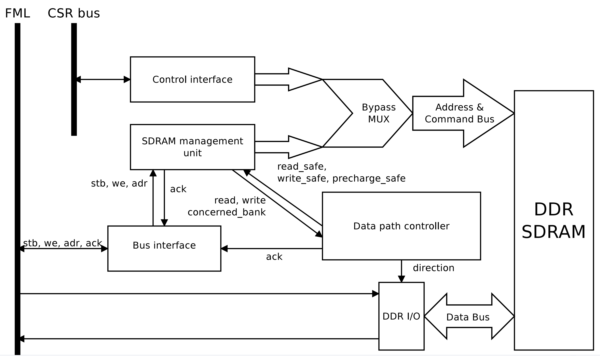

# hpdmc Design Specification

## 1. Introduction
`hpdmc` is a high-performance DDR SDRAM controller that bridges a 64-bit FML memory interface to a 32-bit DDR SDRAM device interface. The controller separates low-speed control/programming from high-bandwidth data transfer by using a CSR control path and a dedicated request/data path.

The design supports two operating modes:
- Bypass mode, where software directly drives SDRAM command/address pins for initialization and low-level control.
- Managed mode, where internal scheduling logic performs activate/read/write/precharge/refresh sequencing.

## 2. Module Diagram

## 3. Top-Level Interface

| Signal | Direction | Width | Description |
| --- | --- | --- | --- |
| `sys_clk` | Input | 1 | Primary controller clock for CSR, scheduler, and data-path control. |
| `sys_clk_n` | Input | 1 | Complementary clock used by DDR I/O primitives. |
| `dqs_clk` | Input | 1 | Clock used to generate DQS output strobe pattern. |
| `dqs_clk_n` | Input | 1 | Complementary clock for DQS DDR output generation. |
| `sys_rst` | Input | 1 | System reset for CSR/control-register block. |
| `csr_a` | Input | 14 | CSR address bus. Upper bits select this core; lower bits select register offset. |
| `csr_we` | Input | 1 | CSR write enable. |
| `csr_di` | Input | 32 | CSR write data. |
| `csr_do` | Output | 32 | CSR read data (registered). |
| `fml_adr` | Input | `[sdram_depth-1:0]` | FML byte address. Lower bits are dropped internally to build burst-aligned SDRAM requests. |
| `fml_stb` | Input | 1 | FML request strobe; held until `fml_ack` for a transaction. |
| `fml_we` | Input | 1 | FML write/read qualifier (`1`: write, `0`: read). |
| `fml_ack` | Output | 1 | FML transaction acknowledge from data-path completion timing. |
| `fml_sel` | Input | 8 | FML byte-lane select (mapped to SDRAM data mask with inverted polarity). |
| `fml_di` | Input | 64 | FML write data payload. |
| `fml_do` | Output | 64 | FML read data payload. |
| `sdram_cke` | Output | 1 | SDRAM CKE signal (registered output). |
| `sdram_cs_n` | Output | 1 | SDRAM CS# command pin (registered output, active low). |
| `sdram_we_n` | Output | 1 | SDRAM WE# command pin (registered output, active low). |
| `sdram_cas_n` | Output | 1 | SDRAM CAS# command pin (registered output, active low). |
| `sdram_ras_n` | Output | 1 | SDRAM RAS# command pin (registered output, active low). |
| `sdram_adr` | Output | 13 | SDRAM address pins (registered output). |
| `sdram_ba` | Output | 2 | SDRAM bank address pins (registered output). |
| `sdram_dm` | Output | 4 | SDRAM data mask outputs for DDR write bursts. |
| `sdram_dq` | Inout | 32 | SDRAM bidirectional data bus. |
| `sdram_dqs` | Inout | 4 | SDRAM bidirectional data strobe bus. |
| `dqs_psen` | Output | 1 | DQS phase-shift control pulse (to external clock-management block). |
| `dqs_psincdec` | Output | 1 | DQS phase-shift increment/decrement select. |
| `dqs_psdone` | Input | 1 | DQS phase-shift done indication. |
| `pll_stat` | Input | 2 | External PLL/DCM status inputs (double-latched before CSR readback). |

### 3.1 Interface Semantics

- SDRAM control/address outputs are registered on `sys_clk` before reaching top-level pins.
- `fml_ack` is generated from data-path completion timing (`data_ack`), not from command acceptance into the scheduler.
- `fml_sel` polarity is inverted before driving `sdram_dm` (`sdram_dm` gets `~fml_sel` split across DDR edges).
- CSR accesses are selected when `csr_a[13:10] == csr_addr`; non-selected accesses return zero on `csr_do`.

## 4. CSR Register Model

### 4.1 Register Map

| Offset | Name | Access | Purpose |
| --- | --- | --- | --- |
| `0x00` | System | RW | Mode and reset control (`bypass`, `sdram_rst`, `sdram_cke`). |
| `0x04` | Bypass | W/R | One-cycle SDRAM command/address drive in bypass mode; address/bank readback. |
| `0x08` | Timing | RW | Scheduler timing parameters (`tRP`, `tRCD`, `CL`, `tREFI`, `tRFC`, `tWR`). |
| `0x0C` | Delay | W/R | Delay/phase-shift pulse controls and status (`psready`, `pll_stat`). |

### 4.2 System Register (`0x00`)

| Bit | Name | Access | Reset | Description |
| --- | --- | --- | --- | --- |
| 0 | `bypass` | RW | 1 | `1`: CSR bypass commands drive SDRAM pins. `0`: management unit drives SDRAM pins. |
| 1 | `sdram_rst` | RW | 1 | Internal controller reset for scheduler/busif/datactl path. |
| 2 | `sdram_cke` | RW | 0 | Direct CKE control output. |
| 31:3 | Reserved | - | 0 | Read as zero. |

Readback format: `{29'd0, sdram_cke, sdram_rst, bypass}`.

### 4.3 Bypass Register (`0x04`)

| Bit | Name | Access | Reset | Description |
| --- | --- | --- | --- | --- |
| 0 | `CS` | W | 0 | Active-high internal control mapped to SDRAM CS# active-low output for one command cycle. |
| 1 | `WE` | W | 0 | Same pulse semantics for WE#. |
| 2 | `CAS` | W | 0 | Same pulse semantics for CAS#. |
| 3 | `RAS` | W | 0 | Same pulse semantics for RAS#. |
| 16:4 | `ADR` | RW | 0 | Direct SDRAM address value for bypass command cycle. |
| 18:17 | `BA` | RW | 0 | Direct SDRAM bank address value for bypass command cycle. |
| 31:19 | Reserved | - | 0 | Read as zero. |

Behavior:
- Writing this register produces a one-cycle command pulse in bypass mode.
- Command lines return to inactive state on following cycles unless rewritten.
- Address and bank fields are updated synchronously with command fields.

Readback format: `{13'd0, sdram_ba, sdram_adr, 4'h0}`.

### 4.4 Timing Register (`0x08`)

| Bit | Name | Access | Reset | Description |
| --- | --- | --- | --- | --- |
| 2:0 | `tim_rp` | RW | 2 | Wait cycles after PRECHARGE command (`tRP` programming field). |
| 5:3 | `tim_rcd` | RW | 2 | Wait cycles after ACTIVATE command (`tRCD` programming field). |
| 6 | `tim_cas` | RW | 0 | CAS latency selector (`0`: CL2, `1`: CL3). |
| 17:7 | `tim_refi` | RW | 740 | Refresh interval counter reload value (`tREFI` field). |
| 21:18 | `tim_rfc` | RW | 8 | Wait cycles after AUTO REFRESH (`tRFC` field). |
| 23:22 | `tim_wr` | RW | 2 | Post-write wait field (`tWR` related). |
| 31:24 | Reserved | - | 0 | Read as zero. |

Readback format: `{8'd0, tim_wr, tim_rfc, tim_refi, tim_cas, tim_rcd, tim_rp}`.

### 4.5 Delay Register (`0x0C`)

| Bit | Name | Access | Reset | Description |
| --- | --- | --- | --- | --- |
| 0 | `idelay_rst` | W (pulse) | 0 | Pulse to reset input-delay setting. |
| 1 | `idelay_ce` | W (pulse) | 0 | Pulse to increment/decrement input-delay tap. |
| 2 | `idelay_inc` | W | 0 | Increment/decrement select for input-delay update pulse. |
| 3 | `dqs_psen` | W (pulse) | 0 | Pulse to request DQS clock phase shift update. |
| 4 | `dqs_psincdec` | W | 0 | Increment/decrement select for DQS phase shift. |
| 5 | `psready` | R | 0 | DQS phase-shift ready state (`1`: ready for next phase-shift command). |
| 7:6 | `pll_stat` | R | 0 | Double-latched copy of asynchronous `pll_stat` inputs. |
| 31:8 | Reserved | - | 0 | Read as zero. |

Behavior:
- Control bits in this register are pulse-style in the CSR block: they are driven for one `sys_clk` cycle on write and then return to `0`.
- `psready` is set by `dqs_psdone` and cleared when `dqs_psen` is asserted.

Readback format: bits `[7:6]` return double-latched `pll_stat`, bit `[5]` returns `psready`, and bits `[4:0]` read as zero.

## 5. Functional Description

### 5.1 Operating Modes

- Bypass mode (`bypass=1`) routes SDRAM command/address control from the CSR bypass register, allowing software-driven SDRAM initialization and low-level command issuance.
- Managed mode (`bypass=0`) routes SDRAM command/address control from `hpdmc_mgmt`, which schedules memory operations and refresh.
- `sdram_cke` is always sourced from the control interface, independent of bypass selection.

### 5.2 Software Bring-Up Sequence

A typical sequence derived from the reference specification is:
1. Keep controller in reset (`sdram_rst=1`) and enable bypass (`bypass=1`).
2. Use bypass register writes to perform SDRAM initialization commands.
3. Program timing register fields to match the target memory/clock setup.
4. Release reset and disable bypass (`sdram_rst=0`, `bypass=0`) to start managed operation.
5. Optionally tune delay/phase-shift controls using delay-register pulse writes.

### 5.3 FML Transaction Flow

1. FML master asserts `fml_stb` with stable `fml_adr` and `fml_we`.
2. `hpdmc_busif` forwards request to management interface (`mgmt_stb`, `mgmt_we`, `mgmt_address`) while an internal strobe-enable flag is set.
3. `hpdmc_mgmt` accepts and schedules SDRAM command sequence based on row/bank state and timing constraints.
4. `hpdmc_datactl` emits delayed completion (`data_ack`) aligned with data-path timing.
5. `fml_ack` mirrors `data_ack`, completing the FML transaction.

`mgmt_ack` indicates scheduler command acceptance, while `fml_ack` indicates transfer completion timing visible to the FML master.

### 5.4 SDRAM Command Scheduling

`hpdmc_mgmt` performs:
- Address split into row/bank/column fields from word address representation.
- Open-row tracking per bank with page-hit detection.
- Page-hit fast path: issue READ/WRITE directly when corresponding safety signal (`read_safe`/`write_safe`) is asserted.
- Page-miss path: PRECHARGE (if bank open and safe), then ACTIVATE, then READ/WRITE when activation delay and safety constraints are satisfied.
- Periodic refresh path: PRECHARGE-ALL when safe, then AUTO REFRESH, then refresh wait.

Scheduler timing enforcement is driven by programmable counters reloaded from `tim_rp`, `tim_rcd`, `tim_refi`, and `tim_rfc`.

### 5.5 Data Path and Burst Control

- `hpdmc_datactl` controls write/read conflict avoidance using `read_safe` and `write_safe` counters.
- Per-bank `precharge_safe` comes from four `hpdmc_banktimer` instances and blocks precharge while a bank is still timing-constrained by recent read/write activity.
- Write-direction control uses glitch-free registered signals: `direction` for sustained write window control and `direction_r` for pre/post write-direction shaping around the burst.
- `hpdmc_ddrio` uses DDR primitives to serialize/deserialize 64-bit FML data over 32-bit DDR DQ and generate DQS strobes.

## 6. Implementation Details

### 6.1 Top-Level Integration

- SDRAM control signals from either bypass or management path are muxed, then registered on `sys_clk` to top-level outputs.
- Control path (`hpdmc_ctlif`) distributes mode/reset controls (`bypass`, `sdram_rst`, `sdram_cke`), scheduler timing parameters, and delay/phase-shift pulse signals.
- Data path (`hpdmc_busif` + `hpdmc_datactl` + `hpdmc_ddrio`) is decoupled from command acceptance so `fml_ack` aligns with data return/write completion timing.

### 6.2 Management FSM and Addressing

`hpdmc_mgmt` state set:
- `IDLE`
- `ACTIVATE`
- `READ`
- `WRITE`
- `PRECHARGEALL`
- `AUTOREFRESH`
- `AUTOREFRESH_WAIT`

Key internal behaviors:
- `has_openrow[3:0]` and `openrows[0:3]` track active row per bank.
- Bank selection is converted to one-hot `concerned_bank` for downstream safety logic.
- `ack` is asserted when a read/write command is actually issued into SDRAM command pins.
- Refresh countdown starts from `tim_refi`; when expired, refresh sequence is prioritized.

### 6.3 Data-Control Timing Logic

`hpdmc_datactl` generates:
- `read_safe`: blocked after read and write events, re-enabled by countdown.
- `write_safe`: blocked after read/write events with CL-dependent wait.
- `ack`: pipelined completion pulse delayed relative to scheduler read/write issue timing.
- `direction`/`direction_r`: write data bus drive window control for DQ/DQS tri-state timing.

`hpdmc_banktimer` per bank:
- Starts precharge block counter on read/write commands.
- Releases `precharge_safe` when bank-specific timing holdoff has elapsed.

### 6.4 DDR I/O Mapping

`hpdmc_ddrio` behavior in this RTL variant:
- DQ path uses IOBUF + ODDR + IDDR wrappers.
- DM path uses ODDR on `~fml_sel`-derived mask data.
- DQS output uses OBUFT + ODDR pattern generation and write-direction tri-state control.
- Delay-control ports are carried to `hpdmc_ddrio`; platform-specific primitive wiring determines final delay implementation.

## 7. Submodules

### 7.1 `hpdmc_ctlif`

Role:
- Implements CSR register bank.
- Generates mode/reset/timing controls and bypass SDRAM command/address outputs.

Top-level interaction:
- Consumes `csr_*`, `sys_clk`, `sys_rst`, `dqs_psdone`, `pll_stat`.
- Produces `csr_do`, control/timing outputs, and delay/phase-shift control outputs.

### 7.2 `hpdmc_mgmt`

Role:
- Schedules SDRAM commands and refresh while enforcing programmable timing constraints.

Top-level interaction:
- Consumes request channel (`mgmt_stb`, `mgmt_we`, `mgmt_address`) and safety/timing inputs.
- Produces scheduler acknowledgement, SDRAM command/address outputs, and read/write event indications.

### 7.3 `hpdmc_busif`

Role:
- Bridges FML request handshake to management request handshake.

Top-level interaction:
- Converts `fml_adr` to burst-aligned management address (`fml_adr[sdram_depth-1:3]`).
- Holds off repeated management strobes between scheduler acceptance and data completion.
- Drives `fml_ack` from `data_ack`.

### 7.4 `hpdmc_datactl`

Role:
- Computes safe windows for read/write/precharge and produces data-path acknowledgement timing and direction control.

Top-level interaction:
- Consumes scheduler read/write events and timing fields.
- Produces `read_safe`, `write_safe`, `precharge_safe`, `data_ack`, `direction`, and `direction_r`.

### 7.5 `hpdmc_ddrio`

Role:
- Implements DDR physical data path between FML payload and SDRAM DQ/DQS/DM pins.

Top-level interaction:
- Consumes clocks, direction controls, write mask/data, and delay-control signals.
- Produces read data to FML and drives SDRAM data interface pins.

## 8. Clock and Reset

| Signal | Type | Effect |
| --- | --- | --- |
| `sys_clk` | Clock | Main sequential clock for control/scheduler/data-control logic and SDRAM control output registers. |
| `sys_clk_n` | Clock | Complementary clock for DDR data primitives. |
| `dqs_clk` | Clock | DQS DDR output clock. |
| `dqs_clk_n` | Clock | Complementary DQS DDR output clock. |
| `sys_rst` | Reset | Resets CSR/control register state in `hpdmc_ctlif`. |
| `sdram_rst` | Internal reset control | Generated by CSR system register; resets management, bus interface, and data-control blocks. |

Reset defaults from CSR block:
- `bypass=1`
- `sdram_rst=1`
- `sdram_cke=0`
- Timing fields initialized to example defaults (`tim_rp=2`, `tim_rcd=2`, `tim_cas=0`, `tim_refi=740`, `tim_rfc=8`, `tim_wr=2`).

## 9. Constraints and Integration Notes

- SDRAM initialization is software-managed through bypass mode; the core does not implement a dedicated hardware initialization sequence.
- Timing register updates should be performed while `sdram_rst` is asserted.
- Supported CAS latency settings are CL2 (`tim_cas=0`) and CL3 (`tim_cas=1`).
- For normal operation, clear both `bypass` and `sdram_rst` in the system register after initialization/timing setup.
- `fml_ack` reflects data-path completion timing; software/hardware masters must hold request information stable until acknowledge.
- Use dedicated clocking resources for SDRAM clock generation and DQS phase control; ensure required delay-control support is present in the platform integration.
- Delay-register control bits are pulse-driven; repeated adjustments require repeated writes.
