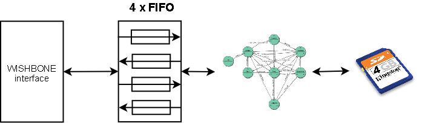
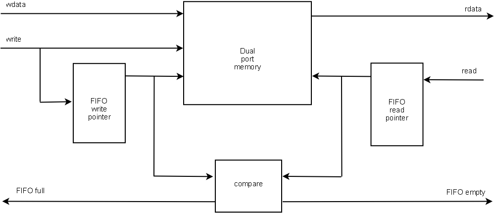
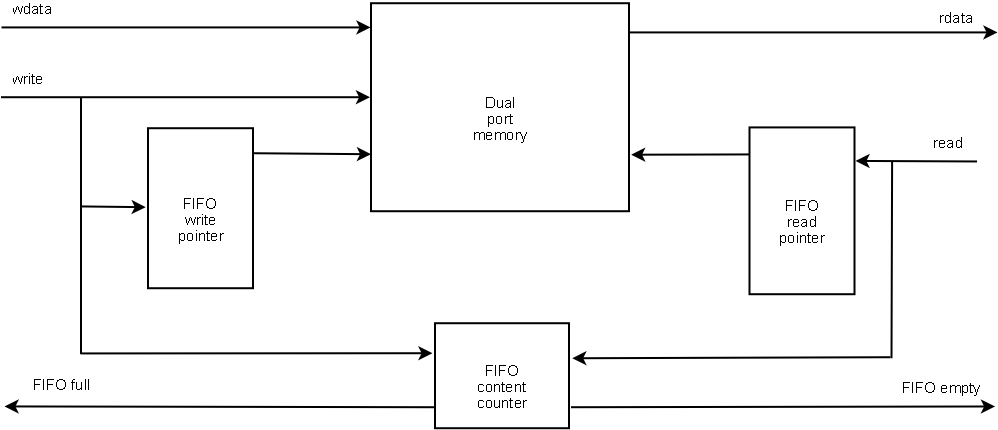

# sd_fifo Design Specification

## 1. Introduction

`sd_fifo` is a multi-channel asynchronous FIFO integration block that connects a Wishbone-side interface to an SD-side interface using shared dual-port memory.

The design implements four independent FIFO channels over two clock domains:
- Wishbone domain (`wb_clk`)
- SD domain (`sd_clk`)

The FIFO structure is intended for command/data exchanges between a system bus and an SD-side controller while sharing one memory resource across channels.

## 2. Module Diagram

## 3. Interface

### 3.1 Top-Level Ports

| Signal | Direction | Width | Description |
| --- | --- | --- | --- |
| `wb_adr_i` | Input | `[1:0]` | Wishbone-side channel select (queue index). |
| `wb_dat_i` | Input | `[7:0]` | Wishbone-side write data. |
| `wb_dat_o` | Output | `[7:0]` | Wishbone-side RAM read data. FIFO pop data is meaningful for queues consumed by Wishbone (queues 2 and 4). |
| `wb_we_i` | Input | 1 | Wishbone-side write request. |
| `wb_re_i` | Input | 1 | Wishbone-side read request. |
| `wb_clk` | Input | 1 | Wishbone-side clock. |
| `sd_adr_i` | Input | `[1:0]` | SD-side channel select (queue index). |
| `sd_dat_i` | Input | `[7:0]` | SD-side write data. |
| `sd_dat_o` | Output | `[7:0]` | SD-side RAM read data. FIFO pop data is meaningful for queues consumed by SD side (queues 1 and 3). |
| `sd_we_i` | Input | 1 | SD-side write request. |
| `sd_re_i` | Input | 1 | SD-side read request. |
| `sd_clk` | Input | 1 | SD-side clock. |
| `fifo_full` | Output | `[1:4]` | Per-channel FIFO full flags (active high). |
| `fifo_empty` | Output | `[1:4]` | Per-channel FIFO empty flags (active high). |
| `rst` | Input | 1 | Reset input for pointer/flag logic. |

### 3.2 Channel Mapping

`sd_fifo` provides four logical queues selected by the two-bit address on each side.

| Queue | Write Side | Read Side |
| --- | --- | --- |
| `fifo[1]` | Wishbone (`wb_adr_i==0`, `wb_we_i`) | SD (`sd_adr_i==0`, `sd_re_i`) |
| `fifo[2]` | SD (`sd_adr_i==1`, `sd_we_i`) | Wishbone (`wb_adr_i==1`, `wb_re_i`) |
| `fifo[3]` | Wishbone (`wb_adr_i==2`, `wb_we_i`) | SD (`sd_adr_i==2`, `sd_re_i`) |
| `fifo[4]` | SD (`sd_adr_i==3`, `sd_we_i`) | Wishbone (`wb_adr_i==3`, `wb_re_i`) |

### 3.3 Interface Semantics

- A write pointer advances only when the corresponding write enable is asserted and the selected FIFO is not full.
- A read pointer advances only when the corresponding read enable is asserted and the selected FIFO is not empty.
- Full/empty flags are generated per queue and are used directly as write/read guards.
- `wb_dat_o` and `sd_dat_o` are sourced from synchronous dual-port RAM read ports.
- For queue selections where a side is the producer (not the consumer), the corresponding data output is a RAM readback value and is not the FIFO-pop path for that queue.

## 4. Function Description

### 4.1 Overall Operation

The module implements four asynchronous FIFO channels using:
- two pointers per channel (write and read),
- one asynchronous full/empty comparator per channel, and
- a shared dual-port RAM for storage.

Each channel is direction-specific (Wishbone-to-SD or SD-to-Wishbone), while all channels share the same memory macro through address multiplexing.

### 4.2 Pointer and Flag Behavior

For each queue:
- write pointer increments in the write-side clock domain,
- read pointer increments in the read-side clock domain,
- the asynchronous comparator receives Gray-coded pointers and generates `fifo_full`/`fifo_empty`.

The comparator distinguishes full and empty when pointers are equal by tracking direction state across quadrants.

### 4.3 Shared Memory Organization

A single dual-port RAM services both sides:
- Port A is connected to Wishbone-side accesses.
- Port B is connected to SD-side accesses.

For each access, RAM address is formed by concatenating channel index (`adr_i[1:0]`) with the queue-local binary pointer.

This creates disjoint address regions per queue inside a shared memory array, so channel data does not overlap when pointers are correctly maintained.

### 4.4 Data Transfer Conditions

- Wishbone write data (`wb_dat_i`) is committed only for channels 1 and 3 when `fifo_full` is deasserted.
- SD write data (`sd_dat_i`) is committed only for channels 2 and 4 when `fifo_full` is deasserted.
- Wishbone reads consume channels 2 and 4 only when `fifo_empty` is deasserted.
- SD reads consume channels 1 and 3 only when `fifo_empty` is deasserted.

### 4.5 Synchronous FIFO Context

The versatile FIFO architecture also supports a synchronous-flag generation style using content counters for single-clock operation.

The `sd_fifo` implementation itself uses asynchronous compare-based full/empty generation across two clock domains.

## 5. Implementation Details

### 5.1 Top-Level Structural Composition

`sd_fifo` instantiates:
- 8 pointer counters (`sd_counter`): one write and one read pointer per queue,
- 4 asynchronous comparators (`versatile_fifo_async_cmp`): one per queue,
- 1 dual-port RAM (`vfifo_dual_port_ram_dc_dw`) shared by all queues.

### 5.2 Control Path

The control path is implemented as combinational request qualification:
- write enables are masked by selected queue full flags,
- read enables are masked by selected queue empty flags,
- queue selection determines which pointer values feed RAM addressing on each side.

### 5.3 Datapath

The datapath uses two RAM ports with independent clocks:
- Wishbone port: read or write according to selected queue direction.
- SD port: read or write according to selected queue direction.

RAM outputs are registered on their respective clock edges, so read data is clocked (not purely combinational).

### 5.4 Queue Capacity Intent

The documented example architecture targets four FIFO queues of 512 bytes each within a shared 2K x 8 memory resource (4 x 512 bytes).

This mapping requires queue-select plus per-queue pointer addressing consistent with the selected memory configuration.

## 6. Submodule List

### 6.1 `versatile_fifo_async_cmp`

Role: Asynchronous full/empty flag generation from Gray-coded read/write pointers in separate clock domains.

| Signal | Direction | Description |
| --- | --- | --- |
| `wptr` | Input | Write pointer (Gray domain input). |
| `rptr` | Input | Read pointer (Gray domain input). |
| `fifo_full` | Output | Full indication synchronized for write-side usage. |
| `fifo_empty` | Output | Empty indication synchronized for read-side usage. |
| `wclk` | Input | Write-side clock. |
| `rclk` | Input | Read-side clock. |
| `rst` | Input | Reset for flag-direction and synchronization logic. |

### 6.2 `vfifo_dual_port_ram_dc_dw`

Role: Dual-clock dual-port RAM used as shared storage for all four queues.

| Signal Group | Description |
| --- | --- |
| Port A: `d_a/q_a/adr_a/we_a/clk_a` | Wishbone-side RAM access path. |
| Port B: `d_b/q_b/adr_b/we_b/clk_b` | SD-side RAM access path. |

### 6.3 `sd_counter`

Role: Queue pointer generator (write/read pointers), typically providing both Gray pointer output and binary address output for each queue side.

| Signal Group | Description |
| --- | --- |
| `q` | Gray pointer output for asynchronous compare. |
| `q_bin` | Binary pointer output for RAM addressing. |
| `cke` | Pointer increment enable. |
| `clk`, `rst` | Domain clock and reset. |

## 7. Clock and Reset

- Two asynchronous clock domains are used:
  - `wb_clk` for Wishbone-side pointers and RAM port A operations.
  - `sd_clk` for SD-side pointers and RAM port B operations.
- `rst` initializes pointer/comparator state so full/empty flags start in a known condition.
- Flag generation crosses domains through asynchronous compare logic with synchronized outputs per side.

## 8. Constraints

- Queue read/write requests must be qualified by corresponding `fifo_empty`/`fifo_full` to avoid overflow/underflow.
- Pointer modules used with asynchronous comparator must provide Gray-coded behavior suitable for cross-domain comparison.
- Shared-memory address partitioning assumes queue-select and per-queue pointer concatenation remain consistent between producer and consumer sides.
- Memory instance parameters must match intended queue depth and data width for the selected integration target.
