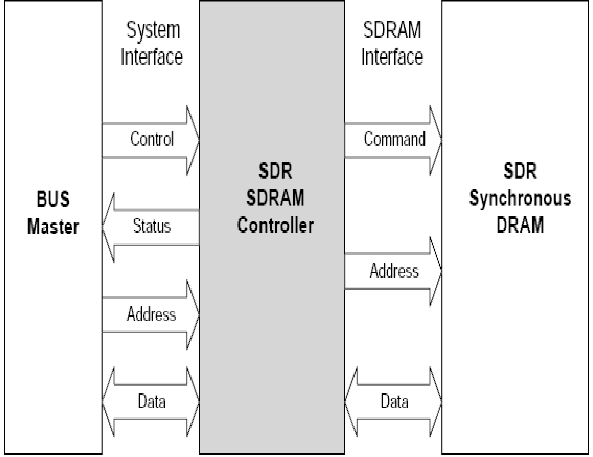
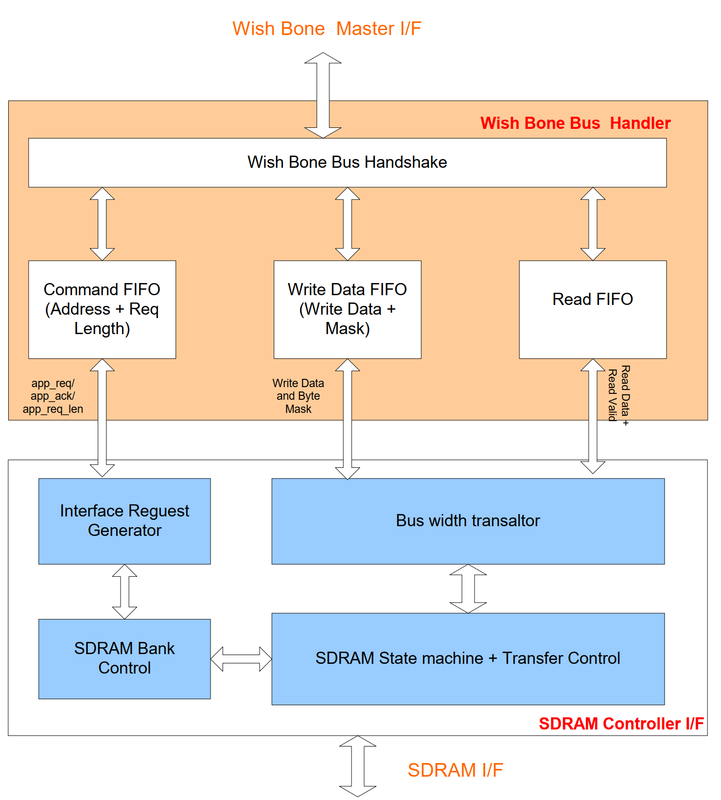
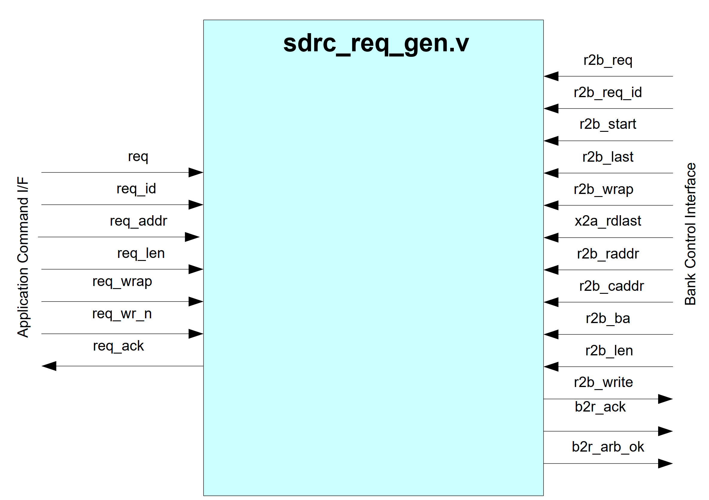
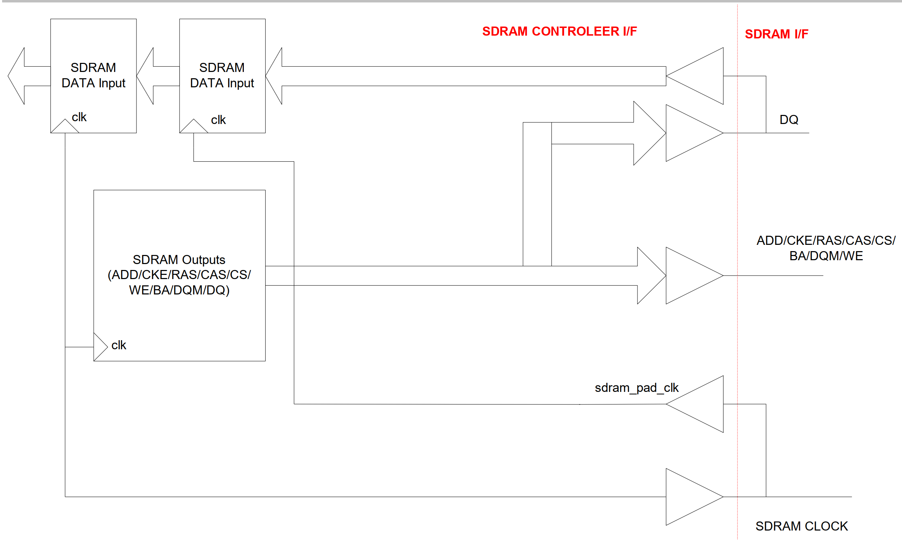
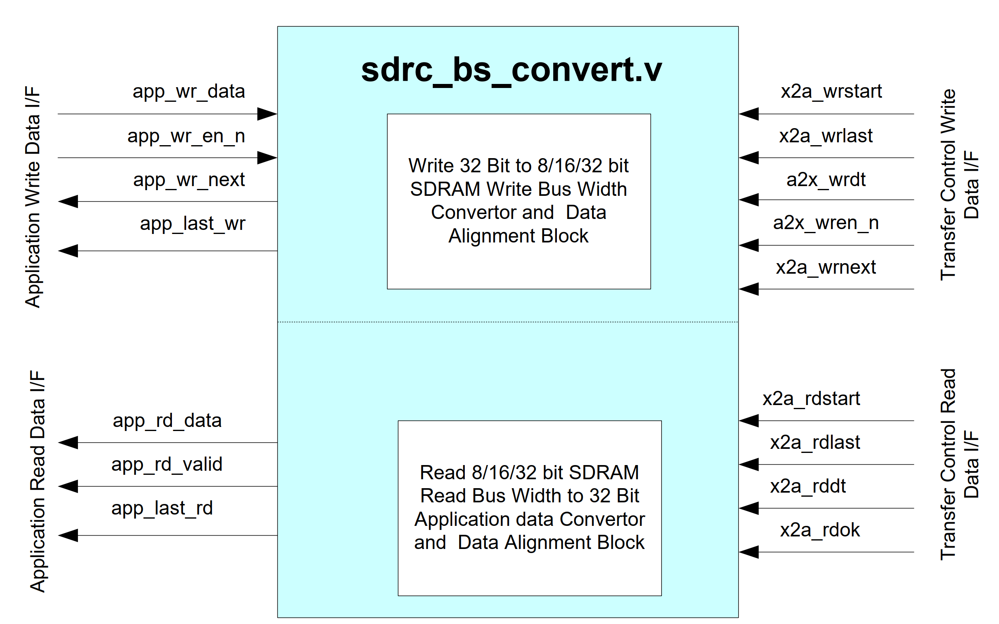

# sdrc_top Design Specification

## 1. Introduction

`sdrc_top` is the top-level SDRAM controller wrapper that bridges a Wishbone host interface to SDRAM command/data control logic and external SDRAM pads.

The module integrates two major blocks:
- `wb2sdrc`: Wishbone protocol adaptation and clock-domain crossing into/out of the SDRAM domain.
- `sdrc_core`: request generation, bank management, transfer execution, refresh handling, initialization sequencing, and SDRAM command/data signal generation.

The design intent from the original specification is preserved: configurable SDRAM data-width operation (8/16/32-bit modes), programmable column-address interpretation, four-bank SDRAM management, and automatic refresh with programmable timing parameters.

## 2. Module Diagram

## 3. Interface

| Direction | Width | Name | Description |
| --------- | ----- | ---- | ----------- |
| Input | 1 | `sdram_clk` | SDRAM/controller clock domain. |
| Input | 1 | `sdram_resetn` | Active-low reset for SDRAM-domain logic. |
| Input | 2 | `cfg_sdr_width` | SDRAM width mode selection (`00`: 32-bit, `01`: 16-bit, `1x`: 8-bit mode). |
| Input | 2 | `cfg_colbits` | Column-address decode mode (`00`: 8-bit, `01`: 9-bit, `10`: 10-bit, `11`: 11-bit column). |
| Input | 1 | `wb_rst_i` | Wishbone-side reset input (active high). |
| Input | 1 | `wb_clk_i` | Wishbone clock domain. |
| Input | 1 | `wb_stb_i` | Wishbone strobe. |
| Output | 1 | `wb_ack_o` | Wishbone acknowledge. |
| Input | `[APP_AW-1:0]` | `wb_addr_i` | Wishbone address input. |
| Input | 1 | `wb_we_i` | Wishbone write-enable (`1`: write, `0`: read). |
| Input | `[dw-1:0]` | `wb_dat_i` | Wishbone write data. |
| Input | `[dw/8-1:0]` | `wb_sel_i` | Wishbone byte enables for writes. |
| Output | `[dw-1:0]` | `wb_dat_o` | Wishbone read data. |
| Input | 1 | `wb_cyc_i` | Wishbone valid-cycle input. |
| Input | 3 | `wb_cti_i` | Wishbone cycle type indicator (present at interface; not decoded in current `wb2sdrc` logic). |
| Output | 1 | `sdr_cke` | SDRAM CKE output. |
| Output | 1 | `sdr_cs_n` | SDRAM CS# command output. |
| Output | 1 | `sdr_ras_n` | SDRAM RAS# command output. |
| Output | 1 | `sdr_cas_n` | SDRAM CAS# command output. |
| Output | 1 | `sdr_we_n` | SDRAM WE# command output. |
| Output | `[SDR_BW-1:0]` | `sdr_dqm` | SDRAM data-mask outputs. |
| Output | 2 | `sdr_ba` | SDRAM bank address outputs. |
| Output | 13 | `sdr_addr` | SDRAM address output bus. |
| Inout | `[SDR_DW-1:0]` | `sdr_dq` | SDRAM bidirectional data bus. |
| Output | 1 | `sdr_init_done` | SDRAM initialization-complete status. |
| Input | 4 | `cfg_sdr_tras_d` | Active-to-precharge timing parameter (clock cycles). |
| Input | 4 | `cfg_sdr_trp_d` | Precharge timing parameter (clock cycles). |
| Input | 4 | `cfg_sdr_trcd_d` | Active-to-read/write timing parameter (clock cycles). |
| Input | 1 | `cfg_sdr_en` | SDRAM-controller enable. |
| Input | 2 | `cfg_req_depth` | Request-depth control toward bank-control path. |
| Input | 13 | `cfg_sdr_mode_reg` | SDRAM mode-register programming value. |
| Input | 3 | `cfg_sdr_cas` | SDRAM CAS latency setting (clock cycles). |
| Input | 4 | `cfg_sdr_trcar_d` | Active/refresh timing parameter (clock cycles). |
| Input | 4 | `cfg_sdr_twr_d` | Write-recovery timing parameter (clock cycles). |
| Input | 12 | `cfg_sdr_rfsh` | Refresh period control. |
| Input | 3 | `cfg_sdr_rfmax` | Maximum rows refreshed per refresh scheduling window. |

Interface semantics:
- Wishbone and SDRAM sides operate in different clock domains (`wb_clk_i` and `sdram_clk`).
- `sdr_dq` is driven by controller data only when output-enable bits indicate active drive; otherwise it is high-impedance.
- Configuration inputs are consumed by `sdrc_core` timing/command logic and are not regenerated in `sdrc_top`.

## 4. Functional Description

### 4.1 Top-level transaction flow

`sdrc_top` translates Wishbone transactions into SDRAM operations through a staged flow:
1. Wishbone command and write data are accepted by `wb2sdrc` under FIFO-availability gating.
2. `wb2sdrc` transfers commands/write data into the SDRAM clock domain through asynchronous FIFOs.
3. `sdrc_core` decomposes/schedules requests and issues SDRAM commands (activate/read/write/precharge/refresh/mode programming/initialization).
4. SDRAM read data returns through `sdrc_core` and crosses back to Wishbone through `wb2sdrc` read-data FIFO.

### 4.2 Wishbone-side behavior (`wb2sdrc` visible effects)

Acknowledge behavior is implemented directly from FIFO status:
- Write cycle (`wb_stb_i && wb_cyc_i && wb_we_i`): `wb_ack_o` asserts only when command FIFO and write-data FIFO are both not full.
- Read cycle (`wb_stb_i && wb_cyc_i && !wb_we_i`): `wb_ack_o` asserts only when read-data FIFO is not empty.

Read-request throttling:
- `pending_read` prevents accepting a second read request before read data for the first accepted read is returned/acked on Wishbone.

Data and byte-enable handling:
- Write payload forwarded to SDRAM side is `{~wb_sel_i, wb_dat_i}`.
- Byte-enable polarity is converted to active-low on `sdr_wr_en_n`.

Bridge request format:
- Internal bridge request length is currently fixed to a single unit (`burst_length = 1` in `wb2sdrc`).
- `wb_cti_i` is exposed at top level but not used in current bridge control decisions.

### 4.3 SDRAM-core behavior (`sdrc_core` visible effects)

Core decomposition:
- `sdrc_req_gen`: width-aware address/length remap, page-boundary split for non-wrap requests, and bank/row/column decode.
- `sdrc_bank_ctl`: bank-state tracking and command eligibility generation.
- `sdrc_xfr_ctl`: SDRAM command sequencing, transfer execution, initialization, and refresh.
- `sdrc_bs_convert`: conversion between application 32-bit side and SDR-width transfer side.

Address/width adaptation:
- Request address/length are remapped by `sdr_width` (32/16/8 mode).
- Column/bank/row extraction follows `cfg_colbits` selection.

Request splitting behavior:
- For `wrap=0`, requests crossing the current page boundary are split into sequential chunks with adjusted address/length.
- In this top integration, `app_req_wrap` is tied low (`1'b0`), so non-wrap split behavior is the active path.

Initialization and refresh:
- `sdrc_xfr_ctl` runs SDRAM initialization and periodic refresh using `cfg_sdr_*` timing/refresh controls.
- `sdr_init_done` indicates initialization completion.

### 4.4 SDRAM pad/data-bus behavior

Top-level pad adaptation includes:
- Bidirectional data-bus control:
  - `sdr_dq` is driven with `sdr_dout` when any `sdr_den_n` lane is active low.
  - Otherwise `sdr_dq` is high-impedance.
- Read-data capture alignment:
  - `sdram_pad_clk` is modeled as delayed `sdram_clk` at top level.
  - SDR input data is captured in two steps inside `sdrc_core` (`pad_clk` then `clk`) for timing alignment.

## 5. Implementation Details

### 5.1 `sdrc_top` structural implementation

`sdrc_top` is a wrapper that:
- instantiates exactly one `wb2sdrc` and one `sdrc_core`,
- wires request/data handshakes between them,
- implements SDRAM data-bus tri-state adaptation,
- forwards configuration/timing controls to `sdrc_core`.

No extra top-level arbitration/state machine is added in `sdrc_top` beyond interconnect and pad adaptation.

### 5.2 Wishbone-to-SDRAM bridge internals (`wb2sdrc`)

Internal channels use asynchronous FIFOs:
- Command FIFO: request address/length/read-write metadata to SDRAM domain.
- Write-data FIFO: write data plus byte-enable mask to SDRAM domain.
- Read-data FIFO: read data plus end-of-read marker back to Wishbone domain.

Bridge control logic implements:
- command enqueue/dequeue generation,
- write-data and read-data FIFO flow control,
- pending-read tracking to enforce read response ordering at Wishbone interface,
- Wishbone ack gating from FIFO status.

### 5.3 SDRAM core internals (`sdrc_core`)

Internal control/datapath interaction:
- Request generator emits bank/row/column-addressed chunks with split handling.
- Bank controller handles page-hit/page-miss decisions and precharge/activate eligibility.
- Transfer controller sequences SDRAM command pins and transfer timing, including refresh and initialization windows.
- Bus-width converter packs/unpacks between application-side 32-bit data and SDR interface width.

Timing and mode controls (`cfg_*`) determine command spacing, CAS/read timing, refresh cadence, and mode-register programming.

## 6. Submodules

### 6.1 `wb2sdrc`

Role:
Bridges Wishbone protocol to internal SDRAM-controller handshake and performs clock-domain crossing for command/write/read channels.

| Signal | Direction (from `sdrc_top` view) | Width | Description |
| ------ | ------------------------------- | ----- | ----------- |
| `wb_rst_i` | Input | 1 | Wishbone-side reset input. |
| `wb_clk_i` | Input | 1 | Wishbone clock domain. |
| `wb_stb_i` | Input | 1 | Wishbone strobe. |
| `wb_ack_o` | Output | 1 | Wishbone acknowledge. |
| `wb_addr_i` | Input | `APP_AW` | Wishbone address. |
| `wb_we_i` | Input | 1 | Write/read select. |
| `wb_dat_i` | Input | `dw` | Wishbone write data. |
| `wb_sel_i` | Input | `dw/8` | Wishbone byte enables. |
| `wb_dat_o` | Output | `dw` | Wishbone read data. |
| `wb_cyc_i` | Input | 1 | Wishbone cycle valid. |
| `wb_cti_i` | Input | 3 | Wishbone cycle type indicator (currently not used by bridge control). |
| `sdr_req` | Output | 1 | Request into SDRAM core. |
| `sdr_req_addr` | Output | `APP_AW` | Request address into SDRAM core. |
| `sdr_req_len` | Output | `bl` | Request length into SDRAM core. |
| `sdr_req_wr_n` | Output | 1 | Request read/write qualifier into SDRAM core. |
| `sdr_req_ack` | Input | 1 | Request accepted by SDRAM core. |
| `sdr_wr_data` | Output | `dw` | Write data into SDRAM core. |
| `sdr_wr_en_n` | Output | `dw/8` | Active-low write byte enables into SDRAM core. |
| `sdr_wr_next` | Input | 1 | Next-write-data request from SDRAM core. |
| `sdr_rd_valid` | Input | 1 | Read data valid from SDRAM core. |
| `sdr_rd_data` | Input | `dw` | Read data from SDRAM core. |
| `sdr_last_rd` | Input | 1 | Last-read marker from SDRAM core. |

### 6.2 `sdrc_core`

Role:
Implements SDRAM initialization, refresh, command sequencing, bank management, transfer control, and data-width conversion.

| Signal | Direction (from `sdrc_top` view) | Width | Description |
| ------ | ------------------------------- | ----- | ----------- |
| `clk` | Input | 1 | SDRAM controller clock (`sdram_clk`). |
| `pad_clk` | Input | 1 | Delayed pad clock used for read-data capture alignment. |
| `reset_n` | Input | 1 | Active-low reset in SDRAM domain. |
| `sdr_width` | Input | 2 | SDRAM width mode. |
| `cfg_colbits` | Input | 2 | Column-width decode mode. |
| `app_req` | Input | 1 | Request from bridge. |
| `app_req_addr` | Input | `APP_AW` | Request address from bridge. |
| `app_req_len` | Input | `APP_RW` | Request length from bridge. |
| `app_req_wrap` | Input | 1 | Wrap control (tied low in this top integration). |
| `app_req_wr_n` | Input | 1 | Request read/write qualifier. |
| `app_req_ack` | Output | 1 | Request accepted. |
| `app_wr_data` | Input | `APP_DW` | Write data input. |
| `app_wr_en_n` | Input | `APP_BW` | Active-low write-byte enables. |
| `app_wr_next_req` | Output | 1 | Request for next write data beat. |
| `app_rd_data` | Output | `APP_DW` | Read data output. |
| `app_rd_valid` | Output | 1 | Read valid indication. |
| `sdr_cs_n/sdr_cke/sdr_ras_n/sdr_cas_n/sdr_we_n` | Output | 1 each | SDRAM command/control outputs. |
| `sdr_dqm` | Output | `SDR_BW` | SDRAM data-mask outputs. |
| `sdr_ba` | Output | 2 | SDRAM bank address. |
| `sdr_addr` | Output | 13 | SDRAM row/column address. |
| `pad_sdr_din` | Input | `SDR_DW` | SDRAM data input from pads. |
| `sdr_dout` | Output | `SDR_DW` | SDRAM data output toward pads. |
| `sdr_den_n` | Output | `SDR_BW` | Active-low SDRAM output-enable mask toward pads. |
| `sdr_init_done` | Output | 1 | Initialization complete indication. |
| `cfg_sdr_en` | Input | 1 | Controller enable. |
| `cfg_sdr_mode_reg` | Input | 13 | SDRAM mode register value. |
| `cfg_sdr_tras_d/cfg_sdr_trp_d/cfg_sdr_trcd_d/cfg_sdr_trcar_d/cfg_sdr_twr_d` | Input | 4 each | SDRAM timing controls in clocks. |
| `cfg_sdr_cas` | Input | 3 | CAS latency configuration. |
| `cfg_sdr_rfsh` | Input | `` `SDR_RFSH_TIMER_W `` | Refresh timing control. |
| `cfg_sdr_rfmax` | Input | `` `SDR_RFSH_ROW_CNT_W `` | Refresh-row batch limit. |

## 7. Clock and Reset

- Clock domains:
  - Wishbone domain: `wb_clk_i`
  - SDRAM/controller domain: `sdram_clk`
- Reset inputs:
  - `wb_rst_i`: active-high Wishbone-side reset input.
  - `sdram_resetn`: active-low SDRAM-domain reset input.
- Clock-domain crossing between domains is implemented in `wb2sdrc` asynchronous FIFOs.

## 8. Constraints and Notes

- This specification describes top-level `sdrc_top` and its direct submodule integration behavior.
- Application-interface signal names shown in the original SDR controller document correspond to standalone/core-facing interfaces; `sdrc_top` external host interface is Wishbone.
- SDRAM tri-state buffer insertion is implemented in `sdrc_top` (`sdr_dq` drive/high-Z control) and is required for correct pad integration.
- Macro-defined widths in `sdrc_define.v` are used for refresh/request-related configuration signal sizing.
- `wb_cti_i` and `sdr_busy_n` are present in bridge interfaces but are not used in current `wb2sdrc` control decisions.
