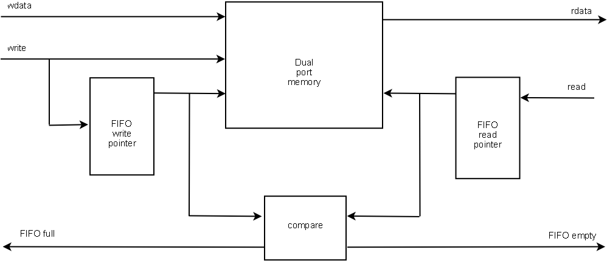

# async_fifo_dw_simplex_top Design Specification

## 1. Introduction

`async_fifo_dw_simplex_top` is a dual-clock, dual-direction asynchronous FIFO top module built from Gray-pointer address generators, asynchronous full/empty comparators, and a shared dual-port RAM.

The module supports two independent data flows:
- A-to-B path: data written on side A and read on side B.
- B-to-A path: data written on side B and read on side A.

Both paths operate across separate clock domains and share one physical memory instance through address-space partitioning.

## 2. Module Diagram

## 3. Interface

### 3.1 Top-Level Ports

| Signal | Direction | Width | Description |
| --- | --- | --- | --- |
| `a_d` | Input | `[data_width-1:0]` | Write data from side A. |
| `a_wr` | Input | 1 | Side-A write request. |
| `a_fifo_full` | Output | 1 | Full indication for A-to-B FIFO direction (write-side status for side A). |
| `a_q` | Output | `[data_width-1:0]` | Side-A RAM output bus (used for B-to-A read data path on side A). |
| `a_rd` | Input | 1 | Side-A read request (consumes B-to-A data). |
| `a_fifo_empty` | Output | 1 | Empty indication for B-to-A FIFO direction (read-side status for side A). |
| `a_clk` | Input | 1 | Side-A clock domain. |
| `a_rst` | Input | 1 | Side-A reset input. |
| `b_d` | Input | `[data_width-1:0]` | Write data from side B. |
| `b_wr` | Input | 1 | Side-B write request. |
| `b_fifo_full` | Output | 1 | Full indication for B-to-A FIFO direction (write-side status for side B). |
| `b_q` | Output | `[data_width-1:0]` | Side-B RAM output bus (used for A-to-B read data path on side B). |
| `b_rd` | Input | 1 | Side-B read request (consumes A-to-B data). |
| `b_fifo_empty` | Output | 1 | Empty indication for A-to-B FIFO direction (read-side status for side B). |
| `b_clk` | Input | 1 | Side-B clock domain. |
| `b_rst` | Input | 1 | Side-B reset input. |

### 3.2 Parameters

| Parameter | Default | Description |
| --- | --- | --- |
| `data_width` | 18 | Data width for both transfer directions. |
| `addr_width` | 4 | Per-direction pointer width; each logical FIFO direction has `2^addr_width` addressable entries. |

### 3.3 Interface Semantics

- `a_wr` writes to the A-to-B FIFO direction and should be qualified externally with `a_fifo_full`.
- `b_rd` reads from the A-to-B FIFO direction and should be qualified externally with `b_fifo_empty`.
- `b_wr` writes to the B-to-A FIFO direction and should be qualified externally with `b_fifo_full`.
- `a_rd` reads from the B-to-A FIFO direction and should be qualified externally with `a_fifo_empty`.
- `a_q` and `b_q` are synchronous RAM port outputs clocked by `a_clk` and `b_clk`, respectively.

## 4. Function Description

### 4.1 Overall Operation

The module realizes two asynchronous FIFO channels in opposite directions using one dual-port RAM:
- channel 0 region: A writes, B reads,
- channel 1 region: B writes, A reads.

Each side has independent write/read pointers and independent request controls, while full/empty status is generated per direction by asynchronous pointer comparison.

### 4.2 Pointer Generation

Four pointer generators (`adr_gen`) are instantiated:
- `fifo_a_wr_adr`: side-A write pointer,
- `fifo_a_rd_adr`: side-A read pointer,
- `fifo_b_wr_adr`: side-B write pointer,
- `fifo_b_rd_adr`: side-B read pointer.

Each generator provides:
- Gray pointer output (`q`) for asynchronous compare,
- binary pointer output (`q_bin`) for RAM addressing.

Write/read requests (`a_wr`, `a_rd`, `b_wr`, `b_rd`) independently drive pointer increments in their local clock domains.

### 4.3 Memory Address Mapping and Data Paths

The shared RAM address on each side is selected between local write and read pointers:
- `a_dpram_adr = (a_wr) ? {1'b0, a_wadr_bin} : {1'b1, a_radr_bin}`
- `b_dpram_adr = (b_wr) ? {1'b1, b_wadr_bin} : {1'b0, b_radr_bin}`

This mapping partitions memory into two halves:
- high-bit `0`: A-to-B storage region,
- high-bit `1`: B-to-A storage region.

As a result, both directions can operate concurrently without address overlap when request qualification is correct.

### 4.4 Full and Empty Flag Generation

Two asynchronous comparator instances (`versatile_fifo_async_cmp`) generate direction-specific status:
- `cmp1`: compares `a_wadr` (write side A) with `b_radr` (read side B) and outputs `a_fifo_full` / `b_fifo_empty`.
- `cmp2`: compares `b_wadr` (write side B) with `a_radr` (read side A) and outputs `b_fifo_full` / `a_fifo_empty`.

The comparator uses Gray-pointer equality with direction tracking to distinguish full from empty at equal-pointer states.

### 4.5 Request Interaction on One Side

On each side, the RAM address mux gives priority to write addressing when `*_wr=1`. If `*_wr` and `*_rd` are asserted together on the same side, both corresponding pointers can still advance, but the RAM port address/enable selection follows the write path for that cycle.

## 5. Implementation Details

### 5.1 Structural Composition

`async_fifo_dw_simplex_top` instantiates:
- 4 x `adr_gen` (Gray/binary pointer generation),
- 1 x `vfifo_dual_port_ram_dc_dw` (dual-clock dual-port memory),
- 2 x `versatile_fifo_async_cmp` (one per transfer direction).

### 5.2 Control and Datapath Coupling

- Pointer control is purely request-driven (`*_wr`, `*_rd`).
- RAM write enables are directly tied to `a_wr` and `b_wr`.
- Direction status flags are not used internally to gate write/read requests; they are exported for integration-level flow control.

### 5.3 Clock-Domain Crossing Method

Cross-domain safety for full/empty evaluation is achieved by:
- Gray-coded pointers at comparator inputs,
- asynchronous full/empty detection logic with direction state,
- synchronized flag staging to write/read domains inside comparator logic.

### 5.4 Memory Capacity Per Direction

The RAM instance is configured with address width `addr_width+1`. The MSB partitions storage by direction, yielding per-direction depth of `2^addr_width` words.

## 6. Submodule List

### 6.1 `adr_gen`

Role: Gray-pointer counter used for write/read address generation per domain.

| Signal | Direction | Description |
| --- | --- | --- |
| `cke` | Input | Increment enable (request-qualified). |
| `q` | Output | Gray pointer output for asynchronous comparison. |
| `q_bin` | Output | Binary pointer output for RAM addressing. |
| `clk` | Input | Local pointer clock domain. |
| `rst` | Input | Local pointer reset. |

### 6.2 `versatile_fifo_async_cmp`

Role: Asynchronous full/empty generator from write/read Gray pointers.

| Signal | Direction | Description |
| --- | --- | --- |
| `wptr` | Input | Write-side Gray pointer. |
| `rptr` | Input | Read-side Gray pointer. |
| `fifo_full` | Output | Full status for write side of that direction. |
| `fifo_empty` | Output | Empty status for read side of that direction. |
| `wclk` | Input | Write-side clock for full-flag synchronization. |
| `rclk` | Input | Read-side clock for empty-flag synchronization. |
| `rst` | Input | Reset for direction/flag control path. |

### 6.3 `vfifo_dual_port_ram_dc_dw`

Role: Shared dual-clock true dual-port RAM for both transfer directions.

| Signal Group | Description |
| --- | --- |
| Port A: `d_a`, `q_a`, `adr_a`, `we_a`, `clk_a` | Side-A data/address/write/read port. |
| Port B: `d_b`, `q_b`, `adr_b`, `we_b`, `clk_b` | Side-B data/address/write/read port. |

## 7. Clock and Reset

- Two independent clock domains are used: `a_clk` and `b_clk`.
- `a_rst` resets side-A pointer generators and the comparator instance that drives `a_fifo_full`/`b_fifo_empty`.
- `b_rst` resets side-B pointer generators and the comparator instance that drives `b_fifo_full`/`a_fifo_empty`.
- No single global reset is provided at this top level; each side reset affects its associated direction control.

## 8. Constraints

- External integration logic must prevent writes when the corresponding full flag is asserted.
- External integration logic must prevent reads when the corresponding empty flag is asserted.
- Do not assume internal request arbitration between read and write on one side; write-address selection has RAM-port priority when `*_wr=1`.
- `addr_width` and `data_width` parameters must be selected consistently with required FIFO depth and payload width.
- Cross-domain correctness relies on Gray-pointer behavior from `adr_gen` and intended comparator usage.
