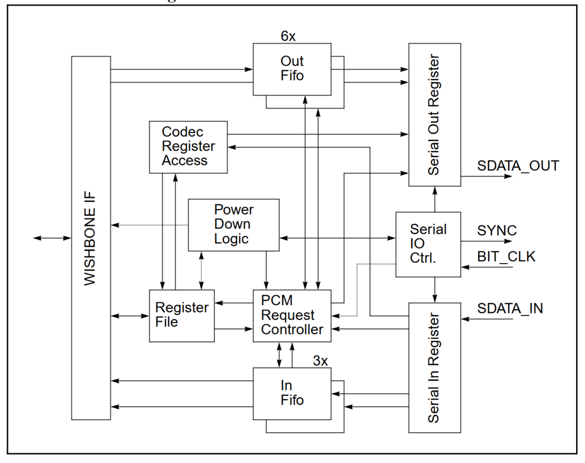
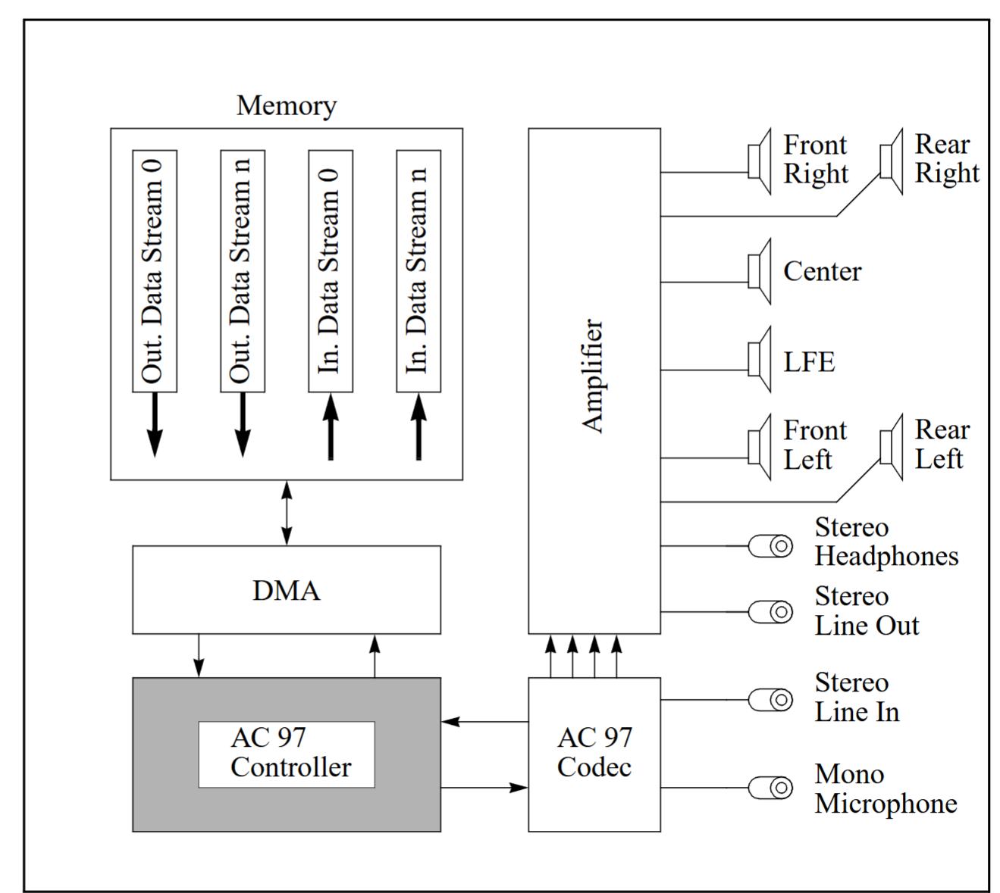

# ac97_top Design Specification

## 1. Introduction

`ac97_top` is a WISHBONE-connected AC97 audio controller that interfaces one AC97 audio codec to system software and optional DMA logic. The core supports playback and capture data movement, codec register transactions, interrupt generation, and suspend/resume control.

The design supports up to six output audio channels and three input audio channels, with per-channel configuration for enable, sample size, sample-rate mode, FIFO threshold policy, and DMA enable.

## 2. Module Diagram

[Placeholder: Insert module/block diagram manually.]

## 3. Interface

### 3.1 Top-Level Ports

| Signal | Direction | Width | Description |
| --- | --- | --- | --- |
| `clk_i` | Input | 1 | System/WISHBONE clock for register file, FIFOs, DMA, interrupt, and control logic. |
| `rst_i` | Input | 1 | Global asynchronous reset input (active low in internal logic). |
| `wb_data_i` | Input | `[31:0]` | WISHBONE write data bus. |
| `wb_data_o` | Output | `[31:0]` | WISHBONE read data bus (register file or input FIFO data). |
| `wb_addr_i` | Input | `[31:0]` | WISHBONE address bus; word-address bits select registers/FIFO windows. |
| `wb_sel_i` | Input | `[3:0]` | WISHBONE byte-lane select input (present at top level; byte-lane masking is not applied by the current interface logic). |
| `wb_we_i` | Input | 1 | WISHBONE write qualifier. |
| `wb_cyc_i` | Input | 1 | WISHBONE cycle qualifier. |
| `wb_stb_i` | Input | 1 | WISHBONE strobe qualifier. |
| `wb_ack_o` | Output | 1 | WISHBONE acknowledge response. |
| `wb_err_o` | Output | 1 | WISHBONE error response; driven low in this implementation. |
| `int_o` | Output | 1 | Interrupt request output after mask application. |
| `dma_req_o` | Output | `[8:0]` | Per-channel DMA request outputs. |
| `dma_ack_i` | Input | `[8:0]` | Per-channel DMA acknowledge inputs. |
| `suspended_o` | Output | 1 | Indicates detected AC97 suspend condition (bit clock inactivity). |
| `bit_clk_pad_i` | Input | 1 | AC97 bit clock input from codec. |
| `sync_pad_o` | Output | 1 | AC97 frame sync output. |
| `sdata_pad_o` | Output | 1 | AC97 serial data output to codec. |
| `sdata_pad_i` | Input | 1 | AC97 serial data input from codec. |
| `ac97_reset_pad_o_` | Output | 1 | AC97 codec reset output, active low. |

### 3.2 WISHBONE Transaction Semantics

- The host interface is 32-bit WISHBONE slave logic.
- Accesses are accepted when `wb_cyc_i` and `wb_stb_i` are asserted and the core address-select condition is true.
- `wb_ack_o` is generated by the interface logic for accepted read/write operations.
- `wb_err_o` is tied low.
- Register and FIFO access selection is address-based:
  - control/status register region
  - output channel FIFO write windows
  - input channel FIFO read windows

### 3.3 Register and FIFO Address Map

Word offsets are shown relative to the selected AC97 register window.

| Offset | Name | Access | Function |
| --- | --- | --- | --- |
| `0x00` | `CSR` | RW/WO fields | Core status and control (`SUSP` status, `CRST` control). |
| `0x04` | `OCC0` | RW | Output channel configuration for channels 0-3. |
| `0x08` | `OCC1` | RW | Output channel configuration for channels 4-5. |
| `0x0C` | `ICC` | RW | Input channel configuration for channels 0-2. |
| `0x10` | `CRAC` | RW | Codec register access command/data. |
| `0x14` | `INTM` | RW | Interrupt mask register. |
| `0x18` | `INTS` | ROC | Interrupt status register; cleared on read. |
| `0x20` | `OCH0` | RW | Output channel 0 FIFO write port. |
| `0x24` | `OCH1` | RW | Output channel 1 FIFO write port. |
| `0x28` | `OCH2` | RW | Output channel 2 FIFO write port. |
| `0x2C` | `OCH3` | RW | Output channel 3 FIFO write port. |
| `0x30` | `OCH4` | RW | Output channel 4 FIFO write port. |
| `0x34` | `OCH5` | RW | Output channel 5 FIFO write port. |
| `0x38` | `ICH0` | RW | Input channel 0 FIFO read port. |
| `0x3C` | `ICH1` | RW | Input channel 1 FIFO read port. |
| `0x40` | `ICH2` | RW | Input channel 2 FIFO read port. |

### 3.4 Channel Configuration Sub-Field (`OCCx`/`ICC`)

Each channel uses one 8-bit configuration field:

| Bits | Name | Description |
| --- | --- | --- |
| `[0]` | `EN` | Channel enable. |
| `[1]` | `SR` | Sample-rate mode select: variable-rate (codec request-driven) or fixed-rate behavior. |
| `[3:2]` | `SS` | Sample size select: 16-bit, 18-bit, or 20-bit samples. |
| `[5:4]` | `FS` | FIFO threshold policy used for interrupt and DMA request generation. |
| `[6]` | `DE` | DMA enable for the channel. |
| `[7]` | Reserved | Reserved. |

## 4. Function Description

### 4.1 Functional Overview

The core connects software-visible FIFOs and control registers on the WISHBONE side to AC97 serial frame traffic on the codec side.

Major functional paths are:
- playback path: WISHBONE writes -> output FIFOs -> AC97 output slots
- capture path: AC97 input slots -> input FIFOs -> WISHBONE reads
- codec register access path: host command -> AC97 control/data slots -> completion/status return

In addition, the core provides:
- per-channel DMA request signaling
- per-channel interrupt event generation with mask/status registers
- codec reset stretching and suspend/resume signaling support

### 4.2 AC97 Frame and Serial Data Operation

`ac97_soc` generates frame control in the AC97 bit-clock domain, including:
- `sync_pad_o` frame synchronization
- slot latch-enable timing (`out_le`)
- frame load strobe (`ld`) for serial output shift registers
- validity strobes used by channel control logic

`ac97_sout` serializes tag/control/data slots (`slot0`, `slot1`, `slot2`, and audio data slots) onto `sdata_pad_o`.

`ac97_sin` captures incoming serial data from `sdata_pad_i` into slot registers used by PCM control and codec-register readback paths.

### 4.3 Playback (Output Channel) Flow

- Host software or DMA writes 32-bit words to `OCH0..OCH5`.
- Each output channel has an `ac97_out_fifo` instance.
- Sample-size mode controls FIFO unpacking when data is consumed:
  - 16-bit mode: two samples are sourced from one 32-bit FIFO word
  - 18/20-bit modes: one sample is sourced per FIFO word
- `ac97_prc` and `ac97_fifo_ctrl` generate per-channel read enables (`o*_re`) based on:
  - channel enable
  - FIFO availability (not empty)
  - codec-ready condition
  - sample-rate mode (`SR`) and codec request bits (for variable-rate operation)
- The selected channel sample is inserted into the matching AC97 output slot.

### 4.4 Capture (Input Channel) Flow

- Incoming slot data is captured by `ac97_sin`.
- `ac97_prc`/`ac97_fifo_ctrl` generate per-channel input FIFO write enables (`i*_we`) using channel enable, FIFO-full guard, validity strobes, and request/ready conditions.
- `ac97_in_fifo` packs captured sample data into 32-bit words for host reads:
  - 16-bit mode packs two samples per word
  - 18/20-bit modes pack one sample per word with alignment/padding logic
- Host software or DMA reads from `ICH0..ICH2` to drain capture data.

### 4.5 Codec Register Access Flow

Codec register access is driven through `CRAC` and `ac97_cra`:
- Write command: control/address and write data are emitted in AC97 control/data slots; write completion sets the corresponding status event.
- Read command: read request is emitted, returned codec register data is captured from input slot data, and read completion sets the corresponding status event.
- Completion events are reflected into interrupt status logic and can be routed to `int_o` through `INTM`.

### 4.6 DMA and Interrupt Behavior

DMA behavior:
- `ac97_dma_if` instantiates one request generator per active channel.
- Request assertion requires channel enable and DMA enable (`DE`) plus threshold condition selected by `FS`.
- Requests are deasserted after the corresponding `dma_ack_i` bit is observed.

Interrupt behavior:
- Per-channel interrupt sources include FIFO threshold event, underrun, and overrun.
- Codec register read-done and write-done are additional interrupt sources.
- `INTS` latches active sources; `INTM` masks which sources contribute to `int_o`.
- Reading `INTS` clears latched interrupt-source bits.

### 4.7 Suspend, Resume, and Codec Reset

Suspend/resume behavior:
- `ac97_soc` monitors activity of `bit_clk_pad_i` in the system-clock domain and asserts `suspended_o` when inactivity persists for the configured detection interval.
- Writing resume control in `CSR` triggers resume signaling; `sync_pad_o` is asserted according to the configured resume pulse timing.

Codec reset behavior:
- `ac97_rst` drives `ac97_reset_pad_o_` low during reset sequencing and releases it after the configured minimum reset interval.
- Software can request a codec cold reset via CSR control.

## 5. Implementation Details

### 5.1 Architectural Composition

Top-level behavior is composed from the following functional blocks:
- bus/register path: `ac97_wb_if`, `ac97_rf`
- serial/frame path: `ac97_soc`, `ac97_sout`, `ac97_sin`
- audio data path: `ac97_out_fifo`, `ac97_in_fifo`, `ac97_prc`, `ac97_fifo_ctrl`
- codec register path: `ac97_cra`
- service signaling: `ac97_dma_if`, `ac97_dma_req`, `ac97_int`
- reset/timing support: `ac97_rst`

### 5.2 Control/Data Partition by Clock Domain

- `bit_clk_pad_i` domain:
  - serial shifting (`ac97_sout`, `ac97_sin`)
  - AC97 frame timing signals (`ac97_soc`)
- `clk_i` domain:
  - WISHBONE interface and register file
  - FIFOs, PCM request control, DMA/interrupt logic, reset controller

Frame-valid indicators generated in the AC97 bit-clock domain are synchronized into the system clock domain before consumption by PCM and codec-register-access control blocks.

### 5.3 FIFO Structure and Status

- Output and input FIFOs are per-channel and use parameterized depth variants selected by compile-time defines.
- Default macro selection uses 4-entry depth variants.
- FIFO `status`, `full`, and `empty` signals feed both interrupt and DMA threshold logic.
- FIFO read/write guards prevent normal consume/produce operations when empty/full, while separate event logic captures underrun/overrun attempts for interrupt reporting.

### 5.4 Compile-Time Feature Selection

Compile-time defines control channel availability:
- optional output channels: surround, center, LFE
- optional input channels: stereo input and microphone

When a channel feature is not enabled at compile time, associated data/control outputs are tied to inactive values and corresponding DMA/interrupt contributors are disabled.

## 6. Submodule List

### 6.1 `ac97_wb_if`

Role: WISHBONE slave adaptation and address-based steering between register-file accesses and channel FIFO windows.

| Signal Group | Description |
| --- | --- |
| `wb_*` | WISHBONE transaction interface. |
| `adr`, `dout`, `rf_we`, `rf_re` | Register-file address/data/control outputs. |
| `o*_we`, `i*_re` | Output FIFO write strobes and input FIFO read strobes by channel window. |

### 6.2 `ac97_rf`

Role: Control/status register storage, channel configuration distribution, interrupt mask/status accumulation, and control pulse generation (`resume`, codec reset force, CRAC command start).

| Signal Group | Description |
| --- | --- |
| `adr`, `rf_din`, `rf_dout`, `rf_we`, `rf_re` | Register access interface from WISHBONE side. |
| `oc*_cfg`, `ic*_cfg` | Per-channel configuration outputs used by FIFOs/PCM/DMA/interrupt logic. |
| `int`, `crac_*`, `resume_req`, `ac97_rst_force` | Service/control outputs to other blocks. |

### 6.3 `ac97_soc`, `ac97_sout`, `ac97_sin`

Role: AC97 frame timing and serial data conversion.

| Submodule | Key Function |
| --- | --- |
| `ac97_soc` | Generates `sync`, slot latch enables, frame-valid indicators, and suspend/resume signaling support. |
| `ac97_sout` | Serializes slot/tag/data fields toward codec (`sdata_pad_o`). |
| `ac97_sin` | Captures incoming serial stream into slot registers for control and PCM paths. |

### 6.4 `ac97_prc` and `ac97_fifo_ctrl`

Role: Per-channel request arbitration and FIFO enable generation for playback/capture under fixed-rate or codec-request-driven operation.

| Signal Group | Description |
| --- | --- |
| `oc*_cfg`, `ic*_cfg` | Channel enable/rate/size policy inputs. |
| FIFO status/full-empty | Guards consume/produce enables. |
| `o*_re`, `i*_we` | Channel FIFO action strobes aligned to frame validity conditions. |

### 6.5 `ac97_out_fifo` and `ac97_in_fifo`

Role: Per-channel audio buffering between WISHBONE-side 32-bit words and AC97 sample slots.

| Submodule | Data Direction | Key Behavior |
| --- | --- | --- |
| `ac97_out_fifo` | Host -> Codec | Unpacks 32-bit words into 16/18/20-bit sample format for output slots. |
| `ac97_in_fifo` | Codec -> Host | Packs incoming 16/18/20-bit sample format into 32-bit host words. |

### 6.6 `ac97_cra`

Role: Codec register transaction engine; drives slot-based command/data and detects read/write completion.

| Signal Group | Description |
| --- | --- |
| `crac_we`, `crac_out`, `crac_din` | Command/data interface with register file. |
| `out_slt1`, `out_slt2`, `in_slt2` | AC97 slot-level command/write/readback path. |
| `crac_valid`, `crac_wr_done`, `crac_rd_done` | Transaction activity and completion indications. |

### 6.7 `ac97_dma_if`, `ac97_dma_req`, and `ac97_int`

Role: Per-channel service request generation.

| Submodule | Function |
| --- | --- |
| `ac97_dma_req` | Generates and holds per-channel DMA request until acknowledged. |
| `ac97_dma_if` | Aggregates channel DMA request generators to `dma_req_o[8:0]`. |
| `ac97_int` | Generates per-channel interrupt source bits (threshold/underrun/overrun). |

### 6.8 `ac97_rst`

Role: Codec reset timing generation using a prescaler and minimum reset-duration counter.

| Signal Group | Description |
| --- | --- |
| `rst`, `rst_force` | Global reset and software-forced codec reset trigger. |
| `ps_ce` | Prescaler pulse output used by reset/resume timing logic. |
| `ac97_rst_` | Active-low codec reset output. |

## 7. Clock and Reset

- `clk_i` is the primary system clock for host-visible state and service logic.
- `bit_clk_pad_i` clocks AC97 serial frame generation and serial data shifting.
- `rst_i` is treated as an asynchronous active-low reset in core submodules.
- `ac97_reset_pad_o_` is an active-low reset output to the codec and is stretched to satisfy minimum reset timing requirements.

## 8. Constraints

- Address decoding for core selection is controlled by compile-time macro `AC97_REG_SEL`; integration must align system address map with this decode.
- Register and FIFO accesses are 32-bit word-oriented.
- `wb_sel_i` is not used for partial-word write masking in the current implementation.
- DMA handshake requires `dma_ack_i[n]` to clear asserted `dma_req_o[n]`.
- Compile-time channel and FIFO-depth macros must be selected consistently with system channel requirements and service-latency assumptions.
