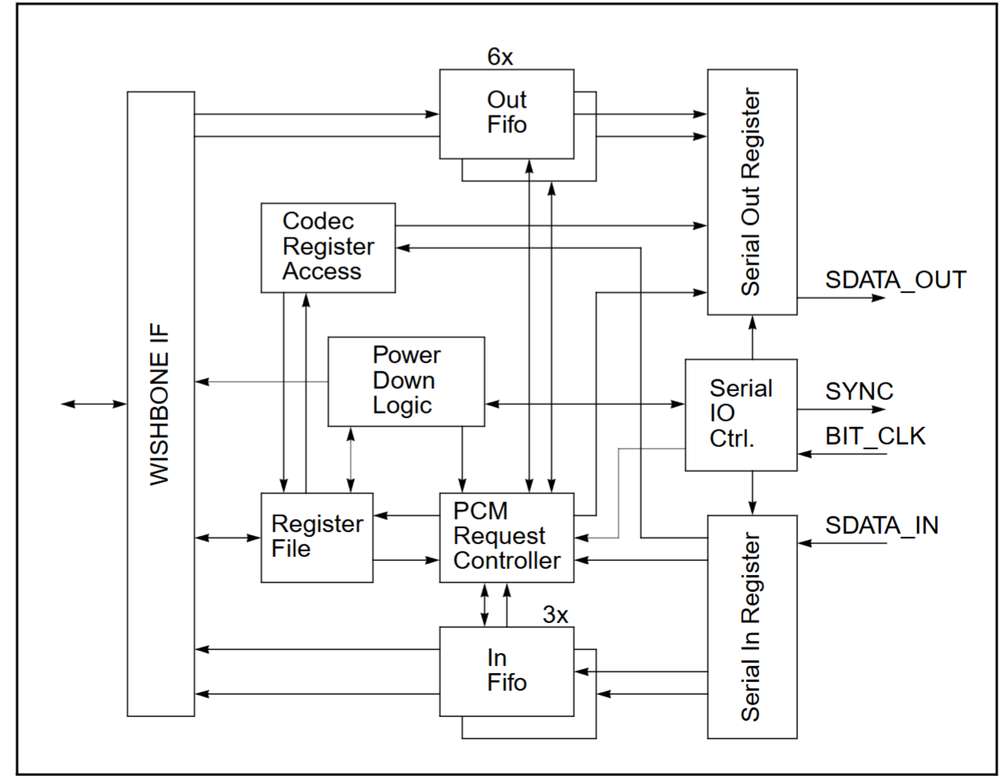
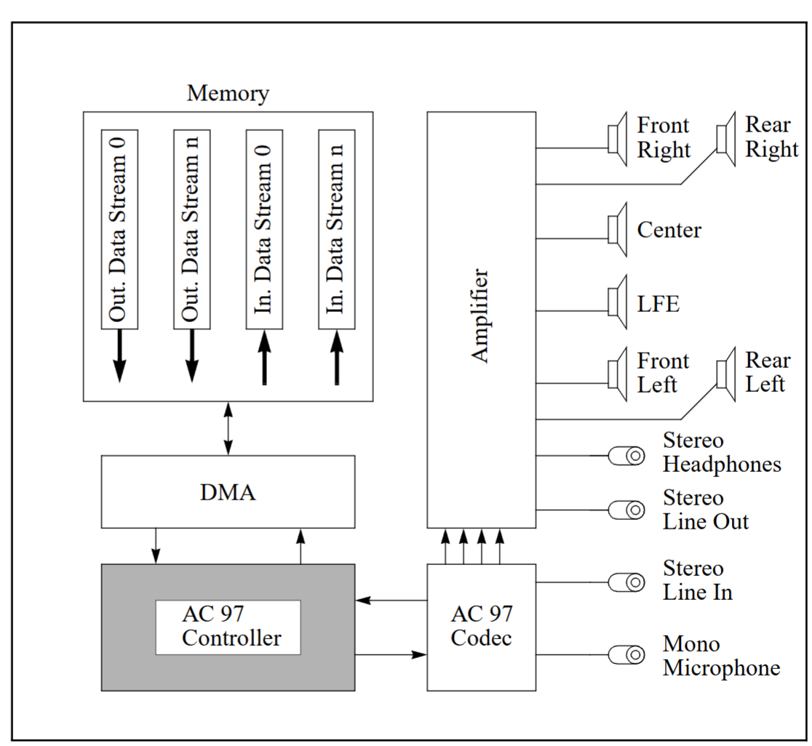

# ac97_top Design Specification

## 1. Introduction

`ac97_top` is a WISHBONE-compatible AC97 controller for one AC97 audio codec. It provides:

- Up to 6 output audio channels.
- Up to 3 input audio channels.
- Codec register read/write access.
- Per-channel FIFO buffering.
- DMA request signaling.
- Interrupt generation.
- Suspend/resume and codec reset control.

The design is organized around a host control path on the WISHBONE clock and an AC97 serial path on the codec bit clock.

## 2. Module Diagram

## 3. Interface

| Signal | Direction | Width | Description |
| --- | --- | --- | --- |
| `clk_i` | Input | `1` | WISHBONE/host clock. |
| `rst_n` | Input | `1` | Top-level reset input. |
| `wb_data_i` | Input | `[31:0]` | WISHBONE write data from host. |
| `wb_data_o` | Output | `[31:0]` | WISHBONE read data to host. |
| `wb_addr_i` | Input | `[31:0]` | WISHBONE address input. |
| `wb_sel_i` | Input | `[3:0]` | WISHBONE byte-lane select. |
| `wb_we_i` | Input | `1` | WISHBONE write enable. |
| `wb_cyc_i` | Input | `1` | WISHBONE cycle qualifier. |
| `wb_stb_i` | Input | `1` | WISHBONE strobe qualifier. |
| `wb_ack_o` | Output | `1` | WISHBONE acknowledge output. |
| `wb_err_o` | Output | `1` | WISHBONE error output. |
| `int_o` | Output | `1` | Interrupt request output to host. |
| `dma_req_o` | Output | `[8:0]` | Per-channel DMA request outputs. |
| `dma_ack_i` | Input | `[8:0]` | Per-channel DMA acknowledge inputs. |
| `suspended_o` | Output | `1` | Suspend-state indication. |
| `bit_clk_pad_i` | Input | `1` | AC97 bit clock from codec. |
| `sync_pad_o` | Output | `1` | AC97 sync/frame output. |
| `sdata_pad_o` | Output | `1` | AC97 serial data output to codec. |
| `sdata_pad_i` | Input | `1` | AC97 serial data input from codec. |
| `ac97_reset_pad_o_` | Output | `1` | Active-low AC97 codec reset output. |

### 3.1 Host Interface Semantics

- The host interface is a 32-bit WISHBONE slave.
- `wb_ack_o` is asserted for accepted read or write transfers addressed to this core.
- `wb_err_o` is tied low (`0`) in this implementation.
- Register selection uses `wb_addr_i[5:2]` for local register index; higher address bits are used by base-address decode logic.
- `wb_sel_i` is present at top level but is not used by the current `ac97_wb_if` logic.

### 3.2 DMA and Interrupt Semantics

- `dma_req_o[n]` is asserted per channel when channel-enable and DMA-enable conditions are met and FIFO level reaches the configured threshold condition.
- A DMA request remains asserted until the corresponding `dma_ack_i[n]` is observed.
- `int_o` asserts when any unmasked interrupt source is active.
- Interrupt source bits are cleared by reading the interrupt status register.

### 3.3 AC97 Serial Interface Semantics

- `sync_pad_o` and serial slot timing are generated from `bit_clk_pad_i`.
- `sdata_pad_o` transmits assembled output slots and codec register access data.
- `sdata_pad_i` is de-serialized into input slots and codec register response fields.
- `ac97_reset_pad_o_` is driven by dedicated reset-control logic and supports forced cold reset behavior.

## 4. Function Description

### 4.1 Channel and Data Model

The controller supports the following logical channels:

- Output channels: Front Left/Right, Surround Left/Right, Center, LFE.
- Input channels: Stereo Left/Right input, Mono microphone input.

Each channel has an associated configuration byte with enable, sample-rate mode, sample-size, FIFO threshold, and DMA enable controls.

Sample payload organization:

- 16-bit mode: two 16-bit samples can be packed per 32-bit word.
- 18-bit and 20-bit modes: one sample per 32-bit word, LSB aligned.

### 4.2 Frame-Level Operation

The serial control path generates AC97 frame timing and strobes that coordinate:

- Loading transmit slot registers.
- Capturing receive slot registers.
- Asserting valid indications for slot processing.

Transmit and receive slot movement is controlled by channel enable/status and codec request/valid fields.

### 4.3 Sample-Rate Behavior

Per-channel sample-rate mode is selected by the `SR` bit:

- Fixed-rate mode: transfer activity is performed at the fixed AC97 frame rate.
- Variable-rate mode: transfer activity is conditioned by codec request/valid signaling for that channel.

### 4.4 FIFO and Channel Control

Each active channel uses FIFO control logic that evaluates:

- Channel enable.
- FIFO full/empty and level status.
- Codec-ready and request indicators.
- Sample-rate mode.

From these conditions, the controller generates FIFO read enables for output channels and FIFO write enables for input channels.

### 4.5 Codec Register Access Flow

Codec register access is initiated through the Codec Register Access Command register (`CRAC`).

- Write: command/address/data fields are sent to codec access logic.
- Read: command/address fields are sent, and returned data is latched for host retrieval.
- Completion conditions produce dedicated interrupt-status bits (`codec read done`, `codec write done`).

### 4.6 DMA Behavior

Per-channel DMA request generation is controlled by:

- Channel enable (`EN`).
- DMA enable (`DE`).
- Configured FIFO threshold mode (`FS`).
- Current FIFO status/full-empty condition.

Request polarity and threshold interpretation follow channel direction (output-empty side vs input-full side), and requests clear on per-channel DMA acknowledge.

### 4.7 Interrupt Behavior

Interrupt logic exists per channel and for codec-register-access completion. Sources include:

- FIFO threshold event.
- FIFO underrun.
- FIFO overrun.
- Codec register read done.
- Codec register write done.

Interrupt output `int_o` is maskable through `INTM` and reflects masked `INTS` status aggregation.

### 4.8 Suspend/Resume and Reset Behavior

Suspend/resume sequencing is integrated with bit-clock monitoring:

- `suspended_o` is asserted when bit-clock inactivity reaches the configured suspend detection window.
- Resume is initiated through CSR control and produces resume signaling on `sync_pad_o` for a defined duration.

Codec reset behavior:

- Power-up/system reset and software-forced cold reset drive `ac97_reset_pad_o_` active for at least the configured reset interval.
- Reset timing is generated using an internal prescaler-based timing reference.

## 5. Implementation Details

### 5.1 Top-Level Partitioning

`ac97_top` composes these major functional blocks:

- Serial datapath and serial timing: `ac97_sout`, `ac97_sin`, `ac97_soc`.
- Host/register path: `ac97_wb_if`, `ac97_rf`.
- Streaming control: `ac97_prc`, `ac97_fifo_ctrl`.
- Codec command path: `ac97_cra`.
- FIFO storage: `ac97_out_fifo` and `ac97_in_fifo` instances.
- DMA path: `ac97_dma_if` and `ac97_dma_req` per channel.
- Interrupt path: `ac97_int` instances per channel.
- Reset/timing path: `ac97_rst`.

### 5.2 Clock Domains and Synchronization

The design uses two clocks:

- `clk_i`: host/WISHBONE, register file, FIFO management, DMA, interrupts.
- `bit_clk_pad_i`: AC97 serial frame and bit timing.

`valid` and `in_valid` generated in the serial-clock path are synchronized into the host-clock domain before use by request/control logic.

### 5.3 Host/Register and Data-Port Mapping

`ac97_wb_if` decodes host accesses into:

- Register-file read/write operations.
- Output channel FIFO writes.
- Input channel FIFO reads.

`ac97_rf` implements CSR/OCC/ICC/CRAC/INTM/INTS behavior and drives channel configuration, codec command controls, and interrupt aggregation.

### 5.4 DMA and Interrupt Aggregation

`ac97_dma_if` instantiates one DMA-request controller per logical channel (up to 9 total). Channel request outputs are disabled for channels not compiled into the build.

`ac97_int` instances generate per-channel interrupt-set vectors. `ac97_rf` collects these vectors plus codec-access completion flags into `INTS`, applies `INTM`, and drives `int_o`.

### 5.5 Build-Time Configuration

Compile-time defines control:

- Optional channels (`AC97_SURROUND`, `AC97_CENTER`, `AC97_LFE`, `AC97_SIN`, `AC97_MICIN`).
- Register-base decode (`AC97_REG_SEL`).
- Prescaler and timing constants (`AC97_250_PS`, `AC97_RST_DEL`, `AC97_RES_SIG`, `AC97_SUSP_DET`).
- FIFO depth for input/output FIFOs (`AC97_*_FIFO_DEPTH_*`).

## 6. Submodule List

### 6.1 `ac97_wb_if`

Role: WISHBONE slave transaction interface and internal access steering.

| Signal | Direction | Width | Description |
| --- | --- | --- | --- |
| `wb_data_i` | Input | `[31:0]` | Host write data. |
| `wb_data_o` | Output | `[31:0]` | Host read data muxed from register/FIFO inputs. |
| `wb_addr_i` | Input | `[31:0]` | Host address decode source. |
| `wb_we_i` | Input | `1` | Read/write direction control. |
| `wb_cyc_i`, `wb_stb_i` | Input | `1`, `1` | Transfer qualification. |
| `wb_ack_o` | Output | `1` | Transfer acknowledge pulse. |
| `rf_we`, `rf_re` | Output | `1`, `1` | Register file access strobes. |

### 6.2 `ac97_rf`

Role: Control/status register bank and interrupt aggregation.

| Signal | Direction | Width | Description |
| --- | --- | --- | --- |
| `adr` | Input | `[3:0]` | Register index from host interface. |
| `rf_din`, `rf_dout` | Input/Output | `[31:0]` | Register data paths. |
| `rf_we`, `rf_re` | Input | `1`, `1` | Register write/read strobes. |
| `rf_irq` | Output | `1` | Aggregated masked interrupt output (`int_o`). |
| `ac97_rst_force` | Output | `1` | Forced codec reset command. |
| `resume_req` | Output | `1` | Resume request command. |

### 6.3 `ac97_prc`

Role: PCM request control and per-channel FIFO read/write enable generation.

| Signal | Direction | Width | Description |
| --- | --- | --- | --- |
| `valid` | Input | `1` | Frame-valid qualifier in host clock domain. |
| `in_valid` | Input | `[2:0]` | Per-input-slot valid qualifiers. |
| `in_slt0`, `in_slt1` | Input | `[15:0]`, `[19:0]` | Codec status/request slot inputs. |
| `out_slt0` | Output | `[15:0]` | Output slot-0 control/tag assembly. |
| `o*_re` | Output | `1` | Output FIFO read enables. |
| `i*_we` | Output | `1` | Input FIFO write enables. |

### 6.4 `ac97_dma_if`

Role: Per-channel DMA request generation and handshake management.

| Signal | Direction | Width | Description |
| --- | --- | --- | --- |
| `oc*_cfg`, `ic*_cfg` | Input | `[7:0]` | Channel configuration inputs. |
| `o*_status`, `i*_status` | Input | `[1:0]` | FIFO level status. |
| `o*_empty`, `i*_full` | Input | `1` | FIFO empty/full indicators. |
| `dma_req` | Output | `[8:0]` | Channel DMA request vector. |
| `dma_ack` | Input | `[8:0]` | Channel DMA acknowledge vector. |

### 6.5 `ac97_soc`

Role: AC97 serial timing/controller, sync generation, valid strobes, suspend detect, and resume signaling.

| Signal | Direction | Width | Description |
| --- | --- | --- | --- |
| `clk` | Input | `1` | AC97 bit clock domain input. |
| `wclk` | Input | `1` | Host clock for suspend-detect counters. |
| `sync` | Output | `1` | AC97 sync output. |
| `out_le` | Output | `[5:0]` | Output slot latch-enable strobes. |
| `in_valid` | Output | `[2:0]` | Input slot-valid strobes. |
| `suspended` | Output | `1` | Suspend-state indicator. |

### 6.6 `ac97_rst`

Role: Codec reset pulse generation and prescaler pulse generation.

| Signal | Direction | Width | Description |
| --- | --- | --- | --- |
| `rst_force` | Input | `1` | Software-forced reset trigger. |
| `ps_ce` | Output | `1` | Prescaler interval pulse. |
| `ac97_rst_` | Output | `1` | Active-low codec reset output. |

## 7. Clock and Reset

- `clk_i` is the host/WISHBONE clock.
- `bit_clk_pad_i` is the AC97 serial bit clock.
- `ac97_reset_pad_o_` is active low and is driven by reset-control timing logic.
- Reset and suspend/resume behavior is coordinated by prescaler-based timing constants.

## 8. Constraints

- The core targets AC97 audio codecs and AC97 revision-compliant signaling.
- WISHBONE host bus width is fixed at 32 bits in this implementation.
- Optional channels are compile-time selectable; disabled channels drive inactive default behavior.
- FIFO depth is compile-time selectable (input and output independently).
- Register decode is controlled by compile-time base-select logic (`AC97_REG_SEL`); integration must align system address mapping accordingly.
