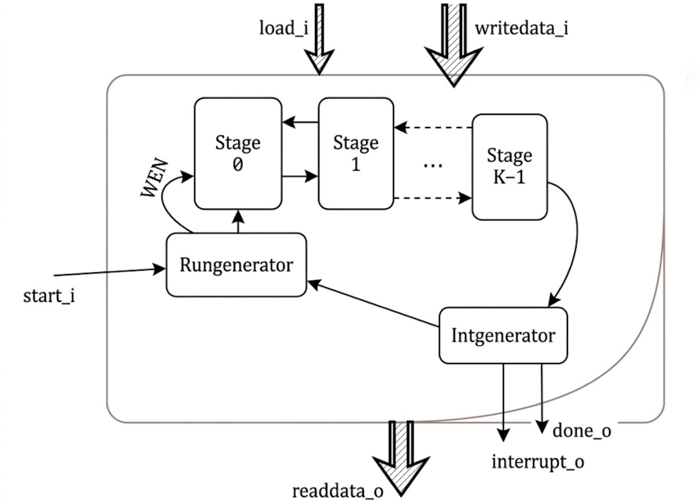

# bublesort Design Specification

## 1. Introduction

`bublesort` is a parameterized, bus-independent hardware sorting module that implements a bubble-sort style compare-exchange process for unsigned words.

The design stores `K_NUMBERS` values of width `N_BITS`, sorts them in ascending order, and exposes completion using `done_o` and `interrupt_o`. Default parameters are `N_BITS=8` and `K_NUMBERS=49`.

## 2. Module Diagram

## 3. Interface

### 3.1 Top-Level Ports

| Signal | Direction | Width | Description |
| --- | --- | --- | --- |
| `clk` | Input | 1 | Design clock. |
| `rst` | Input | 1 | Active-high reset for control blocks. |
| `load_i` | Input | `[K_NUMBERS-1:0]` | Per-stage load strobes. `load_i[i]` loads stage `i` from `writedata_i`. |
| `writedata_i` | Input | `[K_NUMBERS*N_BITS-1:0]` | Input array bus, packed as `K_NUMBERS` words of `N_BITS`. |
| `readdata_o` | Output | `[K_NUMBERS*N_BITS-1:0]` | Output array bus, packed as `K_NUMBERS` words of `N_BITS`. |
| `start_i` | Input | 1 | Start pulse for a sorting run. |
| `done_o` | Output | 1 | Early completion pulse indicating no swap detected at run termination. |
| `interrupt_o` | Output | 1 | Output-valid completion indication after internal flush/count qualification. |
| `abort_i` | Input | 1 | Present at interface but not used by the current implementation. |

### 3.2 Data Packing

For stage index `i` in `[0, K_NUMBERS-1]`:
- input element `i` is `writedata_i[(i+1)*N_BITS-1 : i*N_BITS]`
- output element `i` is `readdata_o[(i+1)*N_BITS-1 : i*N_BITS]`

### 3.3 External Handshake Semantics

- `start_i` is intended as a pulse-based trigger.
- `readdata_o` reflects internal stage-register contents and is not guaranteed to represent a fully sorted array while sorting is active.
- `done_o` can be used as an early indication; `interrupt_o` indicates the sorted output array is ready for readout.

## 4. Function Description

### 4.1 Operational Sequence

A standard operation sequence is:
1. Drive unsorted input array on `writedata_i`.
2. Assert appropriate `load_i` bits to load stage registers.
3. Pulse `start_i` to begin sorting.
4. Monitor `done_o`/`interrupt_o`.
5. Read sorted data from `readdata_o` when `interrupt_o` indicates completion.

### 4.2 Run Control

`rungenerator` creates the run wave (`run_o`) that activates compare-exchange activity across the stage chain:
- `start_i` initializes a run pattern.
- `all_sorted_i` (connected to `done_o`) requests run termination.
- run propagation continues through the chain, including delayed tail propagation, so data movement can continue after early completion detection.

### 4.3 Stage-Chain Compare-Exchange Behavior

`K_NUMBERS` instances of `stageen` are connected in a chain. Each stage contains:
- an `N_BITS` local shift register (`r_data`)
- compare/swap bit logic (`bitsplit`)
- run and swap propagation

During active run:
- the stage compares the incoming bit stream (`bit_i`) against its local value stream (MSB path from `r_data`),
- the larger bit is propagated forward (`bit_o`) toward later stages,
- the smaller bit is returned through the backward value path (`value_o`) and shifted back into local storage.

This bit-serial compare-exchange mechanism realizes bubble-sort ordering across stages.

### 4.4 Swap Tracking and Completion Detection

A swap-propagation chain (`swap_i`/`swap_o`) tracks whether any compare-exchange occurred in a run pass.

`intgenerator` monitors run termination edges and swap history:
- if a run fall occurs with no swap activity, `done_o` is pulsed,
- additional internal pulse counting is used before asserting `interrupt_o`, allowing chain propagation/flush so all output words are valid together.

### 4.5 Done vs Interrupt Interpretation

- `done_o`: early end-of-sorting indicator (no-swap condition detected at run-end observation).
- `interrupt_o`: final output-valid indicator intended for data collection or interrupt service.

`interrupt_o` should be treated as the completion point for reading the full sorted array.

### 4.6 Data Type and Ordering

The module sorts unsigned `N_BITS` words in ascending order.

## 5. Implementation Details

### 5.1 Top-Level Block Composition

The top module integrates:
- `rungenerator`: generates and stops run waveforms,
- `intgenerator`: derives `done_o` and `interrupt_o` from run/swap behavior,
- `stageen` generate-array (`K_NUMBERS` stages): stores elements and performs serial compare-exchange,
- `bitsplit` inside each stage: bit-level compare/select with swap/run propagation.

### 5.2 Datapath and Control Paths

Datapath paths:
- forward bit path (`w_bit_up`) carries dominant bits toward later stages,
- backward value path (`w_value_down`) returns selected bits for recirculation/storage,
- stage registers form the visible output bus (`readdata_o`).

Control paths:
- run propagation (`w_run_up`) controls active shifting/comparison windows,
- swap propagation (`w_swap_up`) indicates whether exchanges occurred in a pass,
- delayed tail registers at top level extend propagation so late-stage activity is observed before final interrupt assertion.

### 5.3 Load and Shift Priority in Each Stage

Within each `stageen` instance:
- `load` has priority and writes `data_i` into the local register,
- otherwise, when run is active (`run_i` or delayed `run_late_i`), the register shifts and ingests the backward value bit.

This priority means loading during an active sort overwrites local stage state.

### 5.4 Parameter Effects

- `N_BITS` changes per-word precision and the bit-serial compare/shift depth.
- `K_NUMBERS` changes number of stage instances and array width.
- sorting latency is data dependent and also scales with parameter settings.

## 6. Submodule List

### 6.1 `rungenerator`

Role: Generates the run activation waveform and terminates it when sorting-complete feedback is received.

| Signal | Direction | Description |
| --- | --- | --- |
| `clk`, `rst` | Input | Clock and active-high reset. |
| `start_i` | Input | Starts a sort operation. |
| `all_sorted_i` | Input | Completion feedback (`done_o`). |
| `run_o` | Output | Run control waveform for stage chain. |

### 6.2 `intgenerator`

Role: Produces completion indications from run-falling-edge and swap activity observations.

| Signal | Direction | Description |
| --- | --- | --- |
| `clk`, `rst` | Input | Clock and active-high reset. |
| `run_i` | Input | Return run signal from stage chain. |
| `swap_i` | Input | Return swap-activity signal from stage chain. |
| `done_o` | Output | Early completion pulse (no-swap observed on run fall). |
| `interrupt_o` | Output | Final completion/valid-output pulse after internal qualification count. |

### 6.3 `stageen`

Role: Holds one sortable word and performs local bit-serial compare-exchange with propagated neighbor value stream.

| Signal | Direction | Description |
| --- | --- | --- |
| `load`, `data_i`, `data_o` | In/Out | Local data load and observable stage data. |
| `run_i`, `run_late_i`, `run_o` | In/Out | Run control ingress/delayed ingress/egress. |
| `swap_i`, `swap_o` | In/Out | Swap activity propagation. |
| `bit_i`, `bit_o` | In/Out | Forward bit-compare path. |
| `value_i`, `value_o` | In/Out | Backward value-return path. |

### 6.4 `bitsplit`

Role: Bit-level comparator/selector used by each stage to choose large/small bit streams and propagate run/swap state.

| Signal | Direction | Description |
| --- | --- | --- |
| `bit1_i`, `bit2_i` | Input | Candidate bits for compare/select. |
| `largebit_o`, `smallbit_o` | Output | Selected larger/smaller bit outputs. |
| `swap_i`, `swap_o` | In/Out | Swap indication propagation with local contribution. |
| `run_i`, `run_o` | In/Out | Run propagation through the bit compare block. |

## 7. Clock and Reset

- The design is single-clock (`clk`) at the top level.
- `rst` is active high and resets control logic in `rungenerator` and `intgenerator`.
- Data-path stage registers are load/shift controlled; reset does not provide a full-array initialization mechanism for stage contents.

## 8. Constraints

- Sorting is defined for unsigned words only.
- `abort_i` is not implemented in current RTL and does not terminate an active operation.
- Do not issue additional `start_i` pulses while a sort is in progress.
- Avoid asserting `load_i` during sorting unless intentional overwrite of stage contents is required.
- Treat `interrupt_o` as the safe point for reading the full sorted array from `readdata_o`.
- Sorting duration is data dependent and parameter dependent; fixed-cycle completion should not be assumed.

