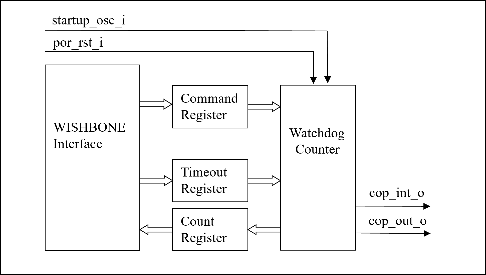

# cop_top Design Specification

## 1. Introduction

`cop_top` implements a Computer Operating Properly (COP) watchdog timer with a WISHBONE slave interface for configuration and servicing.

The module provides:
- programmable timeout period,
- optional pre-timeout interrupt,
- watchdog reset output on timeout,
- mode-aware counter hold controls for debug, wait, and stop system states,
- register protection features for runtime hardening.

The architecture is composed of three functional blocks:
- `cop_wb_bus` (WISHBONE adaptation),
- `cop_regs` (control/timeout/service registers),
- `cop_count` (watchdog counter, event, reset, and interrupt generation).

## 2. Module Diagram

## 3. Interface

### 3.1 Top-Level Ports

| Signal | Direction | Width | Description |
| --- | --- | --- | --- |
| `wb_dat_o` | Output | `[DWIDTH-1:0]` | WISHBONE read-data output. |
| `wb_ack_o` | Output | 1 | WISHBONE cycle acknowledge. |
| `wb_clk_i` | Input | 1 | WISHBONE/control clock domain. |
| `wb_rst_i` | Input | 1 | Synchronous active-high reset in the `wb_clk_i` domain. |
| `arst_i` | Input | 1 | Asynchronous reset input; active level is selected by `ARST_LVL`. |
| `wb_adr_i` | Input | `[2:0]` | WISHBONE local register address bits. |
| `wb_dat_i` | Input | `[DWIDTH-1:0]` | WISHBONE write-data input. |
| `wb_we_i` | Input | 1 | WISHBONE write-enable qualifier. |
| `wb_stb_i` | Input | 1 | WISHBONE strobe/core-select qualifier. |
| `wb_cyc_i` | Input | 1 | WISHBONE valid-cycle qualifier. |
| `wb_sel_i` | Input | `[1:0]` | WISHBONE byte-lane select input (present for interface compatibility). |
| `cop_rst_o` | Output | 1 | COP timeout reset output pulse indicator. |
| `cop_irq_o` | Output | 1 | COP pre-timeout interrupt output. |
| `por_reset_i` | Input | 1 | Power-on reset input (active low) for timeout/reset-event state elements. |
| `startup_osc_i` | Input | 1 | COP watchdog countdown clock input. |
| `stop_mode_i` | Input | 1 | System STOP mode indication. |
| `wait_mode_i` | Input | 1 | System WAIT mode indication. |
| `debug_mode_i` | Input | 1 | System DEBUG mode indication. |
| `scantestmode` | Input | 1 | Scan-test mode enable; selects `wb_clk_i` as COP counter clock source. |

### 3.2 Clock and Reset Domains

The design uses two operating clocks:
- `wb_clk_i`: bus/register/control domain.
- `startup_osc_i`: watchdog countdown domain.

`cop_count` can switch its counter clock to `wb_clk_i` when `scantestmode` is asserted.

Reset inputs are used with different intent:
- `arst_i` and `wb_rst_i` reset WISHBONE and control-register state.
- `por_reset_i` resets watchdog reset/event behavior associated with system POR semantics.

### 3.3 WISHBONE Access Semantics

- Module select condition is `wb_cyc_i && wb_stb_i`.
- Write access requires module selected and `wb_we_i=1`.
- Read access requires module selected and `wb_we_i=0`.
- `wb_ack_o` behavior:
  - default (`SINGLE_CYCLE=0`): one inserted wait state, acknowledged on second bus clock,
  - optional (`SINGLE_CYCLE=1`): acknowledge in a single cycle.
- `wb_dat_o` returns multiplexed register content (`CNTRL`, `TOUT`, `CNT`) according to `DWIDTH` and `wb_adr_i`.

## 4. Register Interface

### 4.1 Register Groups

The core exposes three logical register groups:
- `CNTRL`: control/status and protection settings,
- `TOUT`: timeout preload value,
- `CNT`: watchdog count readback and service-word write port.

### 4.2 Addressing by `DWIDTH`

For `DWIDTH=16`:
- address `0`: `CNTRL`
- address `1`: `TOUT`
- address `2`: `CNT`

For `DWIDTH=8`:
- address `0`: `CNTRL_0` (low byte)
- address `1`: `CNTRL_1` (high/status byte)
- address `2`: `TOUT[7:0]`
- address `3`: `TOUT[15:8]`
- address `4`: `CNT[7:0]` (service-write/read byte)
- address `5`: `CNT[15:8]` (read byte)

### 4.3 CNTRL Functional Fields

`CNTRL` controls watchdog mode and protection:
- `COP_IRQ[1:0]`: pre-timeout interrupt threshold selection,
- `DEBUG_ENA`, `STOP_ENA`, `WAIT_ENA`: allow watchdog operation in corresponding system modes,
- `COP_ENA`: watchdog enable,
- `CWP`: write protect for `COP_ENA`,
- `CLCK`: lock bit for `CWP` state,
- `COP_EVENT`: timeout-event status indicator with clear control.

Protection hierarchy behavior:
- `COP_ENA` restricts runtime edits to selected controls and timeout programming,
- `CWP` restricts `COP_ENA` updates,
- `CLCK` locks `CWP` until reset.

### 4.4 TOUT and CNT Behavior

- `TOUT` defines the value loaded into the watchdog counter at initialization/service reload.
- `TOUT` updates are blocked while watchdog enabled (`COP_ENA=1`) in this implementation.
- `CNT` read returns captured watchdog count in the bus domain.
- `CNT` write is interpreted as service-word input rather than direct counter write.

Service protocol:
- write first service word (`SERV_WD_0`), then second service word (`SERV_WD_1`) to the service port,
- on correct sequence, `reload_count` is asserted and watchdog counter reload is requested.

## 5. Function Description

### 5.1 Overall Operation

The COP watchdog counter decrements from a programmed timeout value. If software does not service the watchdog in time, timeout behavior is generated.

At timeout:
- watchdog reset output is asserted (`cop_rst_o` timeout pulse behavior),
- event status (`cop_event`) is latched,
- optional pre-timeout interrupt (`cop_irq_o`) can be generated before timeout based on programmed threshold.

### 5.2 Initialization and Service Flow

Recommended behavior flow:
1. Hold watchdog disabled if reconfiguration is required.
2. Program timeout and mode controls.
3. Enable watchdog.
4. Periodically service watchdog using required two-word sequence.
5. Monitor/handle optional interrupt and event status as needed.

### 5.3 Counter Enable/Hold Conditions

Counter decrementing is gated by system mode and enable controls:
- if corresponding mode input is active and its enable bit is deasserted, counter hold is applied,
- otherwise counter decrements on selected COP counter clock (`startup_osc_i` or `wb_clk_i` in scan mode).

### 5.4 Pre-Timeout Interrupt Behavior

`cop_irq_o` is derived from threshold comparison between current counter value and configured interrupt setting:
- no interrupt,
- interrupt at or below 16 counts,
- interrupt at or below 32 counts,
- interrupt at or below 64 counts.

This output is generated in the bus clock domain using synchronized status logic.

### 5.5 Timeout Reset and Event Status

Watchdog timeout asserts `cop_rst_o` based on terminal count detection.

`cop_event` records occurrence of watchdog timeout behavior and remains set until explicitly cleared by control action (`clear_event`) or cleared as part of valid service/reload path.

### 5.6 Clock-Domain Crossing Behavior

The design crosses signals between watchdog and bus domains:
- counter value is sampled into `cop_capture` in the bus domain,
- service/reload command is stretched/resynchronized from bus domain into counter domain.

These mechanisms ensure control and status consistency across asynchronous clock relationships.

## 6. Implementation Details

### 6.1 `cop_wb_bus` (Bus Adaptation)

Role:
- Decodes WISHBONE accesses,
- generates register write strobes (`write_regs`),
- generates bus-domain reset signals (`async_rst_b`, `sync_reset`),
- provides read-data multiplexing for 8-bit or 16-bit data width modes,
- controls acknowledge timing (single-cycle or wait-state mode).

Key implementation-relevant behavior:
- outputs are registered in default wait-state mode,
- read data is grouped from internal register bundles,
- write strobes are one-hot/two-hot depending on bus width configuration.

### 6.2 `cop_regs` (Control and Service Registers)

Role:
- Stores/controls `CNTRL` and `TOUT` fields,
- enforces programming restrictions from protection bits,
- checks two-word service sequence,
- emits `reload_count` and `clear_event` control pulses.

Key implementation-relevant behavior:
- service-word order is required for reload pulse generation,
- timeout register update is blocked while watchdog enabled,
- lock/protect fields limit later reconfiguration.

### 6.3 `cop_count` (Watchdog Counter and Outputs)

Role:
- Performs watchdog countdown,
- reloads on service/reset conditions,
- generates timeout reset output and interrupt output,
- maintains timeout event status,
- performs counter capture/synchronization to bus clock domain.

Key implementation-relevant behavior:
- counter clock source switches to bus clock in scan-test mode,
- timeout/reset behavior is tied to terminal-count detection,
- interrupt threshold logic is configurable through `cop_irq_en`.

## 7. Submodule List

### 7.1 `cop_wb_bus`

| Signal Group | Function |
| --- | --- |
| `wb_*` | WISHBONE slave handshake and data/address interface. |
| `write_regs` | Decoded register write strobes into control block. |
| `read_regs` | Packed status/data input used by read mux. |
| `async_rst_b`, `sync_reset` | Internal reset outputs to COP blocks. |

### 7.2 `cop_regs`

| Signal Group | Function |
| --- | --- |
| `write_bus`, `write_regs` | Bus write data and decoded write enables. |
| `timeout_value`, `cop_irq_en` | Programmed control outputs to counter block. |
| `cop_ena`, `debug_ena`, `wait_ena`, `stop_ena` | Mode and enable controls. |
| `reload_count`, `clear_event` | Event/control pulses for counter/event logic. |

### 7.3 `cop_count`

| Signal Group | Function |
| --- | --- |
| `startup_osc_i`, `bus_clk`, `scantestmode` | Counter clock source selection and domains. |
| `timeout_value`, `reload_count`, `cop_ena` | Counter preload/control interface. |
| `cop_capture` | Counter value synchronized for bus readback. |
| `cop_irq_o`, `cop_rst_o`, `cop_event` | External watchdog status/response outputs. |

## 8. Constraints

- The watchdog service mechanism requires correct service words in the required sequence.
- `TOUT` and selected control fields are not freely writable while watchdog protection/enable conditions are active.
- Integration should treat `startup_osc_i` and `wb_clk_i` as asynchronous unless explicitly constrained otherwise.
- For 16-bit operation, addressing should match the 3-word register map; for 8-bit operation, byte addressing of the split map must be used.
- `wb_sel_i` is present for interface compatibility; current RTL does not use it for byte-lane write masking.
- `cop_rst_o` and `cop_irq_o` are status/control outputs and should be connected according to system reset/interrupt architecture assumptions.
