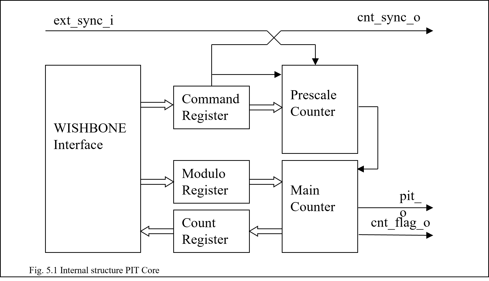
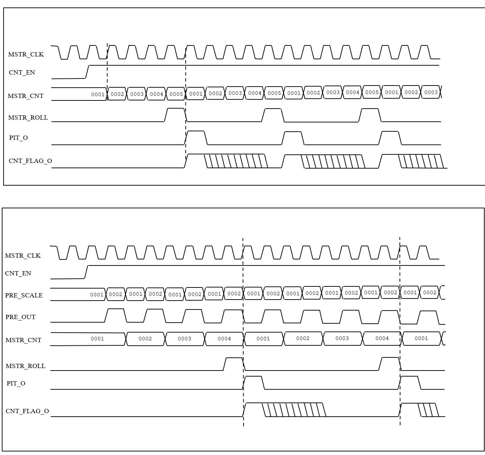

# Programmable Interval Timer (PIT) Design Specification

## 1. Introduction

`pit_top` is a WISHBONE slave programmable interval timer that generates periodic timing events from `wb_clk_i`. The core provides a programmable main modulo counter, an optional programmable prescaler, and master/slave synchronization signals for coordinated multi-timer start.

The module supports interrupt-driven or polled usage through:
- `pit_o`: periodic pulse output,
- `cnt_flag_o`: sticky rollover status,
- `pit_irq_o`: interrupt-qualified status.

## 2. Module Diagram

## 3. Interface

### 3.1 Parameters

| Parameter | Default | Description |
| --- | --- | --- |
| `ARST_LVL` | `1'b0` | Active level of asynchronous reset input `arst_i`. |
| `PRE_COUNT_SIZE` | `15` | Prescaler counter width. |
| `COUNT_SIZE` | `16` | Main counter width and modulo width. |
| `DECADE_CNTR` | `1'b1` | Prescaler decode mode: decade-style decode when set, binary decode when clear. |
| `NO_PRESCALE` | `1'b0` | Prescaler bypass mode. |
| `SINGLE_CYCLE` | `1'b0` | WISHBONE acknowledge mode: single-cycle acknowledge when set. |
| `DWIDTH` | `16` | WISHBONE data width (`8` or `16`). |

### 3.2 Top-Level Ports

| Signal | Direction | Width | Description |
| --- | --- | --- | --- |
| `wb_dat_o` | Output | `[DWIDTH-1:0]` | WISHBONE read data. |
| `wb_ack_o` | Output | `1` | WISHBONE access acknowledge. |
| `wb_clk_i` | Input | `1` | Core clock and timer reference clock. |
| `wb_rst_i` | Input | `1` | Synchronous reset input. |
| `arst_i` | Input | `1` | Asynchronous reset input; active level is set by `ARST_LVL`. |
| `wb_adr_i` | Input | `[2:0]` | Register address select. |
| `wb_dat_i` | Input | `[DWIDTH-1:0]` | WISHBONE write data. |
| `wb_we_i` | Input | `1` | Write enable (`1` write, `0` read). |
| `wb_stb_i` | Input | `1` | Strobe/select qualifier. |
| `wb_cyc_i` | Input | `1` | Cycle valid qualifier. |
| `wb_sel_i` | Input | `[1:0]` | Byte-lane select input. |
| `pit_o` | Output | `1` | Periodic pulse output; asserted for one `wb_clk_i` cycle on each qualified rollover. |
| `pit_irq_o` | Output | `1` | Interrupt output: rollover flag gated by interrupt enable. |
| `cnt_flag_o` | Output | `1` | Sticky rollover status output. |
| `cnt_sync_o` | Output | `1` | Master synchronization output; driven by control register enable bit. |
| `ext_sync_i` | Input | `1` | Slave synchronization input from an external/master PIT instance. |

### 3.3 Register Map

`DWIDTH=16` mode:

| Name | Address (`wb_adr_i`) | Access | Description |
| --- | --- | --- | --- |
| `CNTRL` | `0x0` | RW | Control bits: mode, prescale setting, flag clear, interrupt enable, counter enable. |
| `MOD` | `0x1` | RW | Main counter modulo value (`MOD_VAL`). |
| `CNT` | `0x2` | R | Current main counter value (`COUNT_VAL`). |

`DWIDTH=8` mode:

| Name | Address (`wb_adr_i`) | Access | Description |
| --- | --- | --- | --- |
| `CNTRL_0` | `0x0` | RW | Control low byte (`FLAG`, `ENA_INT`, `CNT_EN`). |
| `CNTRL_1` | `0x1` | RW | Control high byte (`SLAVE`, `PRE_SCALR`). |
| `MOD_0` | `0x2` | RW | Modulo low byte. |
| `MOD_1` | `0x3` | RW | Modulo high byte. |
| `CNT_0` | `0x4` | R | Counter low byte. |
| `CNT_1` | `0x5` | R | Counter high byte. |

### 3.4 `CNTRL` Register Semantics

| Bit(s) | Name | Access | Meaning |
| --- | --- | --- | --- |
| `15` (`CNTRL_1[7]`) | `SLAVE` | RW | `1`: counter enable is sourced from `ext_sync_i`; `0`: counter enable is sourced from `CNT_EN`. |
| `14` (`CNTRL_1[6]`) | `DECADE_CNTR` | R | Readback of prescaler decode mode parameter. |
| `13` (`CNTRL_1[5]`) | `NO_PRESCALE` | R | Readback of prescaler bypass parameter. |
| `11:8` (`CNTRL_1[3:0]`) | `PRE_SCALR` | RW | Prescaler select code. |
| `2` (`CNTRL_0[2]`) | `FLAG` | RW | Read: rollover flag status. Write `1`: clear rollover flag. Write `0`: no clear request. |
| `1` (`CNTRL_0[1]`) | `ENA_INT` | RW | Interrupt output enable. |
| `0` (`CNTRL_0[0]`) | `CNT_EN` | RW | Local counter enable output (`cnt_sync_o`) in master mode. |

### 3.5 WISHBONE Access Semantics

- Module selection is `wb_cyc_i && wb_stb_i`.
- In default mode (`SINGLE_CYCLE=0`), acknowledge is returned after one internal wait-state.
- In single-cycle mode (`SINGLE_CYCLE=1`), acknowledge follows the selected access without wait-state insertion.
- Read data is selected from an internal 48-bit packed read vector containing control/status, modulo value, and current count value.
- Write strobes are generated per address granularity:
  - `DWIDTH=16`: control and modulo writes update both bytes per access.
  - `DWIDTH=8`: low/high byte strobes update partial fields.

## 4. Function Description

### 4.1 Functional Overview

The PIT generates periodic timing events by incrementing a main counter until a programmed modulo value is reached. The main counter increment rate is controlled by a prescaler. Each qualified rollover:
- generates a one-cycle `pit_o` pulse,
- sets `cnt_flag_o`,
- drives `pit_irq_o` when `ENA_INT` is set.

### 4.2 Operating Modes

Master mode (`SLAVE=0`):
- Counter activity is controlled by `CNT_EN`.
- `cnt_sync_o` reflects `CNT_EN` and can be exported to slave PIT instances.

Slave mode (`SLAVE=1`):
- Counter activity is controlled by `ext_sync_i`.
- Local `CNT_EN` writes still update `cnt_sync_o` output but do not directly gate local counting.

### 4.3 Programming and Operation Flow

A standard sequencing model is:
1. Program slave instance(s): `MOD_VAL`, mode/prescale/interrupt bits.
2. Program master instance: `MOD_VAL`, mode/prescale/interrupt bits.
3. Start synchronized operation by asserting master `CNT_EN`.

During operation:
- Prescaler produces count-enable events (`prescale_out`) based on `PRE_SCALR` and decode mode.
- Main counter increments on `prescale_out` while enabled.
- On rollover, outputs/status are updated as defined in Section 4.5.

### 4.4 Prescaler Decode Behavior

The `PRE_SCALR` code selects divider behavior as follows:

| `PRE_SCALR` | Decode (`DECADE_CNTR=0`) | Decode (`DECADE_CNTR=1`) |
| --- | --- | --- |
| `0` | `1` | `1` |
| `1` | `2` | `2` |
| `2` | `4` | `4` |
| `3` | `8` | `8` |
| `4` | `16` | `10` |
| `5` | `32` | `100` |
| `6` | `64` | `1000` |
| `7` | `128` | `10000` |
| `8` | `256` | `20000` |
| `9` | `512` | `20000` |
| `10` | `1024` | `20000` |
| `11` | `2048` | `20000` |
| `12` | `4096` | `20000` |
| `13` | `8192` | `20000` |
| `14` | `16384` | `20000` |
| `15` | `32768` | `20000` |

When `NO_PRESCALE=1`, prescaler division is bypassed and rollover qualification is not delayed by prescaler counting.

### 4.5 Rollover, Flag, and Interrupt Behavior

- Main counter rollover occurs when the running count reaches `MOD_VAL` on a qualified prescale event.
- `MOD_VAL` values `0` or `1` result in minimum-period operation (`no_div` behavior).
- `pit_o` is asserted for one `wb_clk_i` cycle on each qualified rollover while counting is enabled and synchronous reset is inactive.
- `cnt_flag_o` is set by rollover and remains set until cleared.
- Writing `FLAG=1` issues a clear request (`pit_flg_clr`) to clear `cnt_flag_o`.
- Disabling counting also clears `cnt_flag_o`.
- `pit_irq_o` tracks `cnt_flag_o && ENA_INT`.

## 5. Implementation Details

### 5.1 Block-Level Organization

`pit_top` composes four functional blocks:
- `pit_wb_bus`: WISHBONE protocol adaptation, register read multiplexing, and write strobe generation.
- `pit_regs`: control and modulo storage, synchronization enable output, and interrupt gating.
- `pit_prescale`: divider decode/counter and master/slave enable source selection.
- `pit_count`: main modulo counter, rollover detection, sticky flag generation, and pulse output.

### 5.2 Control Path and Data Path Interaction

- Bus writes are decoded into `write_regs` strobes.
- `pit_regs` consumes `write_regs` and `wb_dat_i` to update `SLAVE`, `PRE_SCALR`, `ENA_INT`, `CNT_EN`, and `MOD_VAL`.
- `pit_prescale` converts `PRE_SCALR` and mode parameters into `prescale_out`; it selects `cnt_sync_o` or `ext_sync_i` as `counter_sync` based on `SLAVE`.
- `pit_count` uses `counter_sync`, `prescale_out`, and `MOD_VAL` to update `cnt_n`, generate rollover, and drive `pit_o`/`cnt_flag_o`.
- `pit_wb_bus` returns packed status through `wb_dat_o`, including counter value, modulo value, and control/status bits.

### 5.3 Reset and State Initialization

- Asynchronous reset path is distributed as `async_rst_b`.
- Synchronous reset path is distributed as `sync_reset`.
- After reset:
  - control bits (`SLAVE`, `PRE_SCALR`, `ENA_INT`, `CNT_EN`) are cleared,
  - modulo register is cleared,
  - main counter initializes to `1`,
  - flag and interrupt outputs are deasserted.

## 6. Submodule List

### 6.1 `pit_wb_bus`

Role: WISHBONE slave adapter and register access decode.

| Signal | Direction | Width | Description |
| --- | --- | --- | --- |
| `wb_clk_i` | Input | `1` | Bus clock. |
| `wb_rst_i` | Input | `1` | Synchronous reset input. |
| `arst_i` | Input | `1` | Asynchronous reset input. |
| `wb_cyc_i`/`wb_stb_i` | Input | `1`/`1` | Access qualification. |
| `wb_we_i` | Input | `1` | Read/write direction. |
| `wb_adr_i` | Input | `[2:0]` | Register address. |
| `wb_dat_i` | Input | `[DWIDTH-1:0]` | Write data. |
| `wb_dat_o` | Output | `[DWIDTH-1:0]` | Read data. |
| `wb_ack_o` | Output | `1` | Access acknowledge. |
| `write_regs` | Output | `[3:0]` | Internal register write strobes. |
| `read_regs` | Input | `[47:0]` | Packed readback vector from core state. |
| `sync_reset` | Output | `1` | Distributed synchronous reset. |
| `async_rst_b` | Output | `1` | Distributed asynchronous reset (active-low internal form). |

### 6.2 `pit_regs`

Role: control register bank, modulo register, and interrupt qualification.

| Signal | Direction | Width | Description |
| --- | --- | --- | --- |
| `write_bus` | Input | `[DWIDTH-1:0]` | Register write payload. |
| `write_regs` | Input | `[3:0]` | Register write strobes from bus adapter. |
| `mod_value` | Output | `[COUNT_SIZE-1:0]` | Main counter modulo value. |
| `pit_pre_scl` | Output | `[3:0]` | Prescaler select code. |
| `pit_slave` | Output | `1` | Master/slave mode control. |
| `pit_flg_clr` | Output | `1` | Rollover flag clear request. |
| `pit_ien` | Output | `1` | Interrupt enable state. |
| `cnt_sync_o` | Output | `1` | Master synchronization enable output. |
| `pit_irq_o` | Output | `1` | Interrupt output. |
| `cnt_flag_o` | Input | `1` | Rollover flag input from counter block. |

### 6.3 `pit_prescale`

Role: prescaler decode/counter and count-enable source selection.

| Signal | Direction | Width | Description |
| --- | --- | --- | --- |
| `divisor` | Input | `[3:0]` | Prescaler select code (`PRE_SCALR`). |
| `pit_slave` | Input | `1` | Selects external or local synchronization source. |
| `cnt_sync_o` | Input | `1` | Local/master enable source. |
| `ext_sync_i` | Input | `1` | External/slave enable source. |
| `counter_sync` | Output | `1` | Effective enable to main counter block. |
| `prescale_out` | Output | `1` | Prescaler rollover pulse to main counter. |

### 6.4 `pit_count`

Role: main modulo counter and event/status generation.

| Signal | Direction | Width | Description |
| --- | --- | --- | --- |
| `counter_sync` | Input | `1` | Counter enable from mode-selected source. |
| `prescale_out` | Input | `1` | Counter increment qualification. |
| `mod_value` | Input | `[COUNT_SIZE-1:0]` | Modulo compare value. |
| `pit_flg_clr` | Input | `1` | Flag clear request. |
| `cnt_n` | Output | `[COUNT_SIZE-1:0]` | Current main counter value. |
| `cnt_flag_o` | Output | `1` | Sticky rollover flag. |
| `pit_o` | Output | `1` | One-cycle periodic pulse output. |

## 7. Clock and Reset

- `wb_clk_i` is the only functional clock.
- `arst_i` provides asynchronous reset; active level is set by `ARST_LVL`.
- `wb_rst_i` provides synchronous reset distributed as `sync_reset`.
- Both reset paths clear control state, modulo state, status outputs, and reinitialize the main counter.

## 8. Constraints

- `wb_sel_i` is present at the interface but is not used by the current bus decode logic.
- In `DWIDTH=16` integration, use aligned register addressing (`wb_adr_i[2]` not used for register selection).
- In `DWIDTH=8` integration, `CNT_0` and `CNT_1` reads are not atomic; software may observe an intermediate count transition between byte reads.
- For deterministic period updates, modify `PRE_SCALR` and `MOD_VAL` while counting is disabled.
- If a PIT instance is not used as a slave, `ext_sync_i` should be driven to a defined value consistent with the intended enable behavior.
