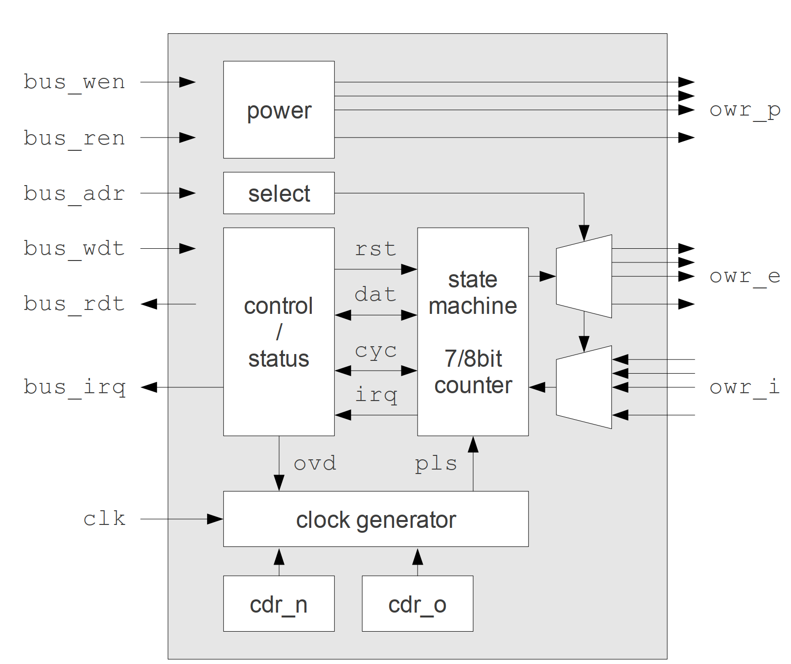

# sockit_owm Design Specification

## 1. Introduction

`sockit_owm` is a parameterized 1-Wire master with a memory-mapped CPU interface. The module implements physical-layer 1-Wire cycles (reset/presence, write/read bit slots, and timed idle), optional overdrive operation, optional programmable clock-divider registers, optional multi-line selection, and interrupt or polling driven software control.

The design targets bit-level 1-Wire transactions. Higher protocol layers (byte/ROM/function-command sequencing) are expected to be handled by software or external logic.

## 2. Module Diagram

## 3. Interface

| Direction | Width | Name | Description |
| --------- | ----- | ---- | ----------- |
| Input | 1 | `clk` | System clock. |
| Input | 1 | `rst` | Active-high asynchronous reset. |
| Input | 1 | `bus_ren` | Bus read enable. |
| Input | 1 | `bus_wen` | Bus write enable. |
| Input | `[BAW-1:0]` | `bus_adr` | Bus address. `BAW` depends on bus width configuration. |
| Input | `[BDW-1:0]` | `bus_wdt` | Bus write data (`BDW=32` or `BDW=8`). |
| Output | `[BDW-1:0]` | `bus_rdt` | Bus read data. |
| Output | 1 | `bus_irq` | Interrupt request (`irq_ena & irq_sts`). |
| Output | `[OWN-1:0]` | `owr_p` | Per-line strong pull-up (power enable). |
| Output | `[OWN-1:0]` | `owr_e` | Per-line pull-down enable for open-drain drive control. |
| Input | `[OWN-1:0]` | `owr_i` | Per-line sampled input from 1-Wire lines. |

Interface semantics:
- Read and write transfers are single-cycle control operations.
- Control/status read can clear interrupt status, so `bus_rdt` content can differ between consecutive cycles due to `irq_sts` side effects.
- Only one selected 1-Wire line is actively driven per cycle (`owr_e` is one-hot by selection logic), while `owr_p` can be independently set per line.

## 4. Functional Description

### 4.1 CPU-visible register model

#### 4.1.1 Address map (`BDW=32`)

| Address (`bus_adr[0]`) | Read content | Write effect |
| ---------------------- | ------------ | ------------ |
| `0` | `{power/select segment, control/status}` | Writes control/status and power/select fields |
| `1` | `{cdr_o[15:0], cdr_n[15:0]}` | Writes both divider registers (when `CDR_E=1`) |

#### 4.1.2 Address map (`BDW=8`)

| Address (`bus_adr[1:0]`) | Read content | Write effect |
| ------------------------ | ------------ | ------------ |
| `00` | control/status | control/status write |
| `01` | power/select | power/select write |
| `10` | `cdr_n` | normal-mode divider write (when `CDR_E=1`) |
| `11` | `cdr_o` | overdrive divider write (when `CDR_E=1`) |

#### 4.1.3 Control/status bits (`bus_rdt_ctl_sts`)

`{7:0} = {ien, irq, reserved, pwr, cyc, ovd, rst, dat}`

- `dat` (bit 0): write request data bit; after cycle completion updated with sampled line value (`owr_smp`).
- `rst` (bit 1): selects reset/presence style cycle when set, data-slot style cycle when clear.
- `ovd` (bit 2): overdrive mode request (effective only when `OVD_E=1`).
- `cyc` (bit 3): cycle status/control. Writing control/status with `cyc=1` requests a new cycle.
- `pwr` (bit 4): single-line (`OWN=1`) power control path.
- `irq` (bit 6): interrupt status (set at cycle completion, cleared by control/status read or write).
- `ien` (bit 7): interrupt enable.

### 4.2 1-Wire cycle selection and completion

Cycle type is configured by control bits `ovd/rst/dat` and initiated through a control/status write.

Functional classes:
- Reset/presence cycle (`rst=1, dat=0`): drives reset pulse timing and samples presence.
- Data slot (`rst=0`): `dat=0` drives write-0 slot timing; `dat=1` drives write-1/read slot timing and samples read data.
- Timed idle (`rst=1, dat=1`): uses idle timing path.

Completion behavior:
- Internal counter `cnt` is initialized from selected timing (`t_rst`, `t_bit`, or `t_idl`) and decremented on divider pulse `pls`.
- End-of-cycle condition is `pls && (cnt == t_zero)`.
- At completion, `irq_sts` is set and `owr_dat` is updated with sampled value `owr_smp`.

Implementation-aware note:
- `owr_cyc` is set from `bus_wdt[3] & ~&bus_wdt[2:0]`; therefore `ovd=rst=dat=1` does not assert cycle-in-progress status in the same way as other cycle requests.

### 4.3 Timing control points within a cycle

The design uses programmable timing thresholds (normal/overdrive dependent) for:
- release points (`t_rsth`, `t_dat1`, `t_dat0`) controlling `owr_oen` deassertion,
- sample points (`t_rstp` for presence, `t_bits` for read-bit sampling),
- cycle-length boundaries (`t_rst`, `t_bit`, `t_idl`).

These timing constants derive from module parameters and optional divider registers; they are not fixed absolute times unless the clock/divider configuration is fixed.

### 4.4 Multi-line selection and power behavior

- Selected line index is `owr_sel`.
- Pull-down drive is one-line active at a time: `owr_e = owr_oen << owr_sel`.
- Input sample source is selected line: `owr_iln = owr_i[owr_sel]`.
- Power outputs are direct register image: `owr_p = owr_pwr`.

`OWN` dependent behavior:
- `OWN > 1`: dedicated power/select register fields control `owr_pwr` and `owr_sel`.
- `OWN = 1`: `owr_sel` is fixed; power control is taken from control/status `pwr` bit.

### 4.5 Interrupt behavior

- Interrupt request output: `bus_irq = irq_ena & irq_sts`.
- `irq_ena` is written from control/status bit 7.
- `irq_sts` is set at cycle completion and cleared by control/status write or control/status read.

## 5. Implementation Details

### 5.1 Top-level realization

No lower-level module instances are instantiated in `sockit_owm`; the functionality is implemented directly with internal registers, combinational decode logic, and generate blocks.

Main internal functional blocks:
- bus decode and register map muxing,
- divider and pulse generation (`cdr_n`, `cdr_o`, `div`, `pls`),
- control/status and interrupt registers,
- cycle counter and timing comparator logic,
- line select/power registers and I/O muxing.

### 5.2 Divider and overdrive path

- When `CDR_E=1`, `cdr_n` and `cdr_o` are writable and reset to parameters `CDR_N`, `CDR_O`.
- When `CDR_E=0`, divider values are constant (non-writable) from parameters.
- Divider counter `div` resets on any bus write; while active operation is in progress, `div` advances until `pls` condition, then resets.
- `req_ovd` applies only if `OVD_E=1`; otherwise overdrive requests are suppressed.

### 5.3 Cycle control and data path

- Control write updates `owr_ovd`, `owr_rst`, requested `owr_dat`, and cycle initiation state.
- `owr_oen` is asserted for active cycle drive and released at timing-specific thresholds.
- Sampling stores line state into `owr_smp` at reset-presence or read-data sample points.
- End-of-cycle copies `owr_smp` into `owr_dat` for software-visible status.

## 6. Submodules

No explicit subordinate module instantiation exists at this top level.

For review and verification purposes, `sockit_owm` should be treated as a single-module implementation partitioned into internal functional blocks (decode/register/timer/line-control) described in Section 5.

## 7. Clock and Reset

- Clock domain: `clk`.
- Reset: `rst`, active high, used asynchronously in sequential processes (`posedge clk or posedge rst`).
- Reset initializes control/status, divider, select/power, interrupt, and cycle-state registers to defined defaults.

## 8. Constraints and Notes

- Parameterization controls major behavior dimensions: bus width (`BDW`), wire count (`OWN`), overdrive enable (`OVD_E`), divider-register enable (`CDR_E`), base timing presets, and divider defaults.
- The module provides physical-layer 1-Wire timing/control only; byte-level protocol sequencing is external.
- Writing control/status during an active cycle can restart cycle control state and should be managed carefully by software.
