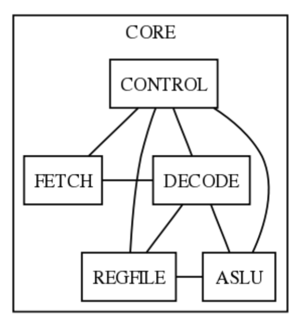

# aeMB_core Design Specification

## 1. Introduction

`aeMB_core` is a 32-bit processor core with separate instruction and data memory paths and a separate FSL channel for GET/PUT-style data transfers. The core is software-compatible with the EDK3.2 programming model for supported instructions and is intended for SoC integration using WISHBONE-classic style bus handshakes.

The top-level core (`aeMB_core`) is a wrapper around the `aeMB_edk32` processor implementation and exposes:
- instruction bus interface,
- data bus interface,
- FSL sideband data interface,
- system clock, reset, and external interrupt input.

## 2. Module Diagram

## 3. Interface

### 3.1 Core Parameters

| Parameter | Default | Description |
| --- | --- | --- |
| `ISIZ` | `32` | Instruction address-space width used for `iwb_adr_o[ISIZ-1:2]`. |
| `DSIZ` | `32` | Data address-space width used for `dwb_adr_o[DSIZ-1:2]`. |
| `MUL` | `1` | Enables hardware multiplier support in execution logic when set. |
| `BSF` | `1` | Enables barrel-shifter support in execution logic when set. |

### 3.2 Top-Level Ports

| Signal | Direction | Width | Description |
| --- | --- | --- | --- |
| `iwb_adr_o` | Output | `[ISIZ-1:2]` | Instruction bus word-aligned address. |
| `iwb_stb_o` | Output | `1` | Instruction fetch request/strobe. |
| `iwb_dat_i` | Input | `[31:0]` | Instruction bus read data. |
| `iwb_ack_i` | Input | `1` | Instruction bus acknowledge. |
| `dwb_adr_o` | Output | `[DSIZ-1:2]` | Data bus word-aligned address. |
| `dwb_dat_o` | Output | `[31:0]` | Data bus write data. |
| `dwb_sel_o` | Output | `[3:0]` | Data bus byte-lane select. |
| `dwb_stb_o` | Output | `1` | Data bus transfer request/strobe. |
| `dwb_wre_o` | Output | `1` | Data bus transfer direction control (write/read select). |
| `dwb_dat_i` | Input | `[31:0]` | Data bus read data. |
| `dwb_ack_i` | Input | `1` | Data bus acknowledge. |
| `fsl_adr_o` | Output | `[6:2]` | FSL transaction address field. |
| `fsl_dat_o` | Output | `[31:0]` | FSL write data. |
| `fsl_tag_o` | Output | `[1:0]` | FSL transfer tag. |
| `fsl_stb_o` | Output | `1` | FSL transfer request/strobe. |
| `fsl_wre_o` | Output | `1` | FSL transfer direction control (write/read select). |
| `fsl_dat_i` | Input | `[31:0]` | FSL read data. |
| `fsl_ack_i` | Input | `1` | FSL acknowledge. |
| `sys_clk_i` | Input | `1` | Master processor clock. |
| `sys_rst_i` | Input | `1` | Master reset input for processor state. |
| `sys_int_i` | Input | `1` | External interrupt input. |

### 3.3 Bus and Handshake Semantics

- The instruction and data paths use separate WISHBONE-style request/acknowledge handshakes.
- The instruction path is read-only at the interface level (`iwb_stb_o`, `iwb_adr_o`, `iwb_dat_i`, `iwb_ack_i`).
- The data path supports load/store transactions with byte-lane qualification through `dwb_sel_o`.
- FSL transfer requests are initiated with `fsl_stb_o`; transfer direction is indicated by `fsl_wre_o` and completion by `fsl_ack_i`.
- Processor forward progress depends on completion of outstanding instruction/data/FSL handshakes.

## 4. Function Description

### 4.1 Execution Model

The core is a single-issue, in-order 3-stage integer pipeline. The operational stages are:
1. Fetch/Decode
2. Load/Execute
3. Branch/Store

Under complete handshake conditions, the pipeline advances one instruction per clock.

### 4.2 Reset Operation

`sys_rst_i` resets internal processor state. During reset:
- pipeline/control state is initialized,
- interrupt-enable state is cleared,
- execution resumes from the reset fetch address after reset release.

### 4.3 Pipeline Progression and Stall Conditions

The pipeline advances only when global enable conditions are satisfied. Progress is blocked by:
- incomplete instruction fetch acknowledge,
- incomplete data-bus transaction acknowledge,
- incomplete FSL transaction acknowledge,
- local decode/execute stall conditions.

In addition, the instruction-side logic can assert internal stall for multi-cycle arithmetic operations associated with multiplier/barrel-shifter instruction classes.

### 4.4 Branch and Delay-Slot Behavior

The branch path supports delayed control transfer behavior. During branch handling, instruction sequencing includes delay-slot semantics before the redirected path fully takes effect.

### 4.5 Memory and Data-Path Access

- Instruction fetches use the instruction bus only.
- Data loads/stores use the data bus only.
- Data byte granularity for stores is conveyed by `dwb_sel_o`.
- The Harvard separation allows simultaneous structural separation of instruction and data access paths, while completion still gates pipeline advancement.

### 4.6 FSL GET/PUT Transfer Path

GET/PUT instruction classes are realized through the FSL interface:
- address/tag/control are generated by execution/control logic,
- data write/read uses `fsl_dat_o`/`fsl_dat_i`,
- request completion is controlled by `fsl_ack_i`.

### 4.7 Interrupt Operation

`sys_int_i` is synchronized and qualified internally, then gated by processor interrupt-enable state. Accepted interrupts are serviced through the core’s interrupt control path with documented multi-cycle interrupt latency behavior.

Interrupt handling does not preempt pipeline progression arbitrarily; it is integrated into the instruction/control sequencing logic.

## 5. Implementation Details

### 5.1 Top-Level Composition

`aeMB_core` instantiates a single processor submodule, `aeMB_edk32`, and parameterizes it with `ISIZ`, `DSIZ`, `MUL`, and `BSF`. The top-level ports are direct interface projections of this instantiated core.

### 5.2 Internal Architectural Blocks (`aeMB_edk32`)

`aeMB_edk32` integrates five major functional blocks:
- `aeMB_ibuf`: instruction buffering, decode field extraction, instruction stream control, and interrupt capture/synchronization.
- `aeMB_ctrl`: opcode/control decode and generation of pipeline/bus/FSL control enables.
- `aeMB_bpcu`: program-counter/branch control and link/branch path management.
- `aeMB_regf`: general register-file storage and operand/result data routing.
- `aeMB_xecu`: execution unit (ALU and optional arithmetic features), status/interrupt-enable state updates, and address/data-side execution outputs.

### 5.3 Control/Data Coupling

Pipeline enable (`gena`) and outstanding-operation status are coupled to instruction/data/FSL acknowledgment state. This establishes a deterministic relationship between bus completion and pipeline advancement.

Internal operation-stall indication from instruction/execute logic is also part of pipeline gating, preventing advancement through instructions that require extra execution cycles.

### 5.4 Interrupt and Status State Coupling

Interrupt acceptance is qualified by both synchronized interrupt detection and interrupt-enable state in execution/status logic. Interrupt-related state updates and normal execution updates share the same clocked control path, ensuring ordered behavior.

## 6. Submodule List

### 6.1 `aeMB_edk32`

Role: primary processor implementation instantiated by `aeMB_core`; contains pipeline, control, register file, branch path, execution path, and external bus/FSL interfaces.

| Signal Group | Direction | Width | Purpose |
| --- | --- | --- | --- |
| Instruction bus | Out/In | `iwb_adr_o[IW-1:2]`, `iwb_stb_o`, `iwb_dat_i[31:0]`, `iwb_ack_i` | Instruction fetch addressing and handshake. |
| Data bus | Out/In | `dwb_adr_o[DW-1:2]`, `dwb_dat_o[31:0]`, `dwb_sel_o[3:0]`, `dwb_stb_o`, `dwb_wre_o`, `dwb_dat_i[31:0]`, `dwb_ack_i` | Data load/store transactions. |
| FSL bus | Out/In | `fsl_adr_o[6:2]`, `fsl_dat_o[31:0]`, `fsl_tag_o[1:0]`, `fsl_stb_o`, `fsl_wre_o`, `fsl_dat_i[31:0]`, `fsl_ack_i` | GET/PUT-style transfer path. |
| System | In | `sys_clk_i`, `sys_rst_i`, `sys_int_i` | Clock/reset/interrupt control. |

### 6.2 Internal Blocks in `aeMB_edk32`

| Block | Functional Role | Key Interaction |
| --- | --- | --- |
| `aeMB_ibuf` | Fetch/decode staging, instruction expansion, interrupt capture, local stall generation | Drives decode fields and instruction-side strobe behavior. |
| `aeMB_ctrl` | Decode-to-control mapping for data/FSL/bypass/register-write controls | Governs bus request/control outputs and pipeline destination selection. |
| `aeMB_bpcu` | PC update, branch decision path, link handling | Drives instruction address output and branch control flags. |
| `aeMB_regf` | Register operand read and destination writeback path | Supplies execution operands and produces data/FSL write payloads. |
| `aeMB_xecu` | Execution datapath, optional MUL/BSF support, status/interrupt-enable updates | Produces result/address/select outputs and status bits used by control/interrupt flow. |

## 7. Clock and Reset

- Clock domain: all core logic is synchronous to the positive edge of `sys_clk_i`.
- Reset control: `sys_rst_i` is the master reset input for processor state in this implementation.
- Reset effects include pipeline/state initialization, interrupt-disable state initialization, and restart of instruction fetch sequence.

## 8. Constraints

- The external memory/bus system must provide valid acknowledge behavior for instruction/data/FSL requests; otherwise the processor can remain stalled waiting for completion.
- `iwb_adr_o` and `dwb_adr_o` are word-aligned address outputs (`[...:2]`); system address mapping should preserve this alignment convention.
- Parameter choices (`MUL`, `BSF`) should be consistent with software build options so instruction generation matches implemented hardware features.
- `sys_int_i` should satisfy system-level synchronization/timing requirements relative to `sys_clk_i` for reliable interrupt capture.
