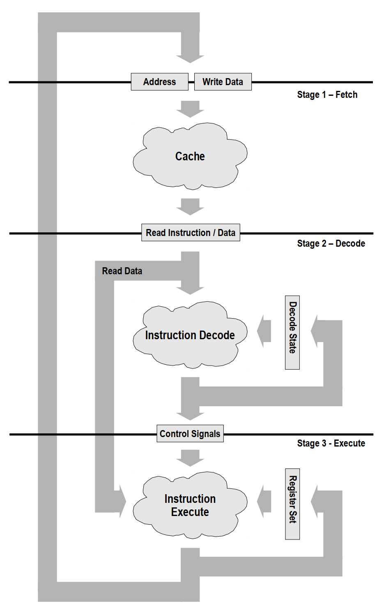
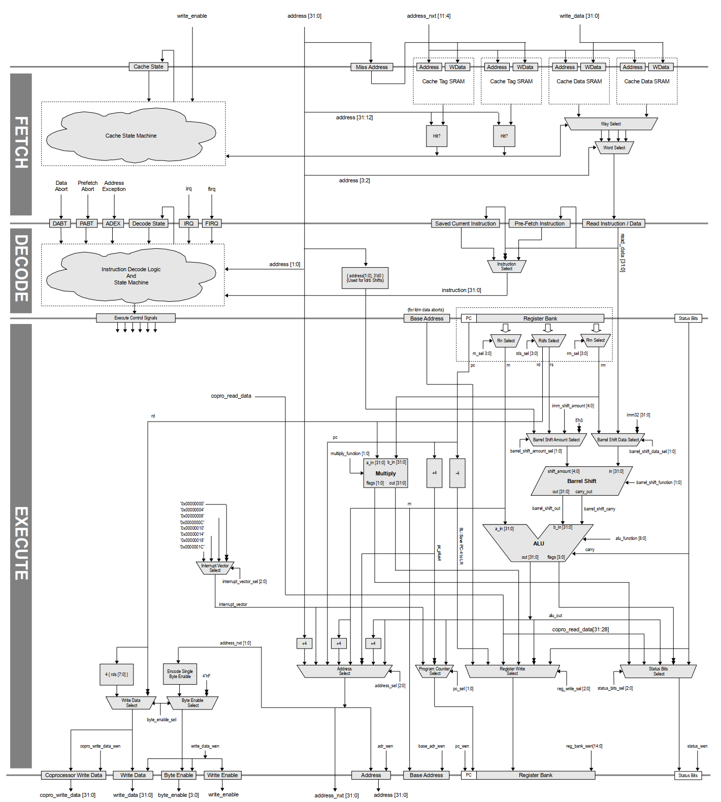

# a23_core Design Specification

## 1. Introduction
`a23_core` is the top-level Amber A23 processor core integration. It combines a 3-stage pipeline (Fetch, Decode, Execute), a Coprocessor 15 control block, and a 32-bit Wishbone master interface for instruction/data memory access.

This specification describes the A23 top-level architectural behavior and integration contract. It is intentionally focused on externally relevant behavior and architecture-level stage responsibilities.

## 2. Module Diagram

## 3. Top-Level Interface

| Signal | Direction | Width | Description |
| --- | --- | --- | --- |
| `i_clk` | Input | 1 | Core clock. The A23 pipeline and Wishbone master interface operate on this clock. |
| `i_irq` | Input | 1 | Interrupt request (IRQ), active high. Serviced after completion of the current instruction sequence. |
| `i_firq` | Input | 1 | Fast interrupt request (FIRQ), active high. Serviced after completion of the current instruction sequence. |
| `i_system_rdy` | Input | 1 | System-ready stall control. Low freezes core progress; high allows pipeline movement. |
| `o_wb_adr` | Output | 32 | Wishbone byte address. |
| `o_wb_sel` | Output | 4 | Wishbone byte enables for write accesses (`bit0` corresponds to `o_wb_dat[7:0]`). |
| `o_wb_we` | Output | 1 | Wishbone write enable, active high. |
| `i_wb_dat` | Input | 32 | Wishbone read data returned by memory system. |
| `o_wb_dat` | Output | 32 | Wishbone write data driven during write cycles. |
| `o_wb_cyc` | Output | 1 | Wishbone cycle indicator; remains asserted across multi-cycle accesses. |
| `o_wb_stb` | Output | 1 | Wishbone strobe for transfer qualification. |
| `i_wb_ack` | Input | 1 | Wishbone transfer acknowledge/termination input. |
| `i_wb_err` | Input | 1 | Wishbone error indication input (present at interface; PDF notes not currently used by Amber core control flow). |

### 3.1 Interface Semantics

- The top-level exposes a single Wishbone master port; memory traffic for both instruction fetch and data access uses this interface.
- `i_system_rdy` participates in global pipeline stalling through fetch-stage stall propagation.
- Interrupt inputs (`i_irq`, `i_firq`) are consumed by decode/control logic and are taken at architecturally valid instruction boundaries.
- There is no explicit reset port on `a23_core`.

## 4. Functional Description

### 4.1 Architectural Pipeline Model

The A23 core is a 3-stage pipeline with registered stage boundaries:
1. **Fetch**: obtains instruction/data words through cache and Wishbone path, and issues stall when data is not yet available.
2. **Decode**: decodes instructions, manages multi-cycle sequencing, and generates control signals for execute.
3. **Execute**: performs datapath operations (register read/shift/ALU/multiply/writeback) and generates next fetch address/control outputs.

Pipeline operation is circular: execute-stage address/control outputs drive subsequent fetch activity, and fetched/returned data is fed into decode/execute in later cycles.

### 4.2 Memory Access and Stall Behavior

- Fetch stage handles arbitration between cache-served accesses and direct Wishbone accesses.
- Cache misses and external bus wait conditions can stall the pipeline via `fetch_stall` propagation.
- `i_system_rdy=0` also contributes to stalling, allowing system-level freeze (for example, during external memory initialization).
- PDF pipeline examples show load/store instructions introducing additional stall cycles relative to simple register operations.

### 4.3 Interrupt and Exception Behavior

- IRQ/FIRQ requests are recognized by decode control logic and cause mode/vector transitions once the current instruction sequence completes.
- The top-level combines abort sources before forwarding fault information to coprocessor logic.
- At top-level fault selection, **data abort has priority over instruction abort** for reported fault status/address.

### 4.4 Resulting External Transactions

- Instruction fetch and data transactions appear on the same Wishbone master interface.
- Execute-stage address generation and decode-stage control determine whether accesses are instruction fetches, data reads, or data writes.
- Multi-cycle and memory-dependent operations can hold bus ownership and stall instruction progression until completion criteria are met.

## 5. Architecture-Level Implementation Notes

### 5.1 Top-Level Partitioning

`a23_core` instantiates and wires four architectural blocks:
- `a23_fetch`
- `a23_decode`
- `a23_execute`
- `a23_coprocessor`

This partition aligns with the PDF architectural description: fetch/decode/execute pipeline plus coprocessor/system-control support.

### 5.2 Inter-Block Responsibilities

- `a23_execute` provides next address and memory access intent to `a23_fetch`.
- `a23_fetch` returns read data and stall indication to `a23_decode`/`a23_execute`.
- `a23_decode` generates execution control, register/control write enables, interrupt vector selection, and coprocessor operations.
- `a23_coprocessor` supplies cache-control outputs (`cache_enable`, `cache_flush`, `cacheable_area`) and captures fault metadata for readback.

### 5.3 Fault Selection at Top Level

The top-level performs architectural fault source selection before coprocessor handoff:
- `decode_fault = dabt_trigger | iabt_trigger`
- fault status/address select data-abort values when both are present.

This behavior is externally relevant through exception state reporting and coprocessor-visible fault registers.

## 6. Submodules

### 6.1 `a23_fetch`

Role:
- Fetch-stage integration block containing cache and Wishbone-interface path.
- Produces pipeline stall and read-data return for downstream stages.

Key top-level interaction interface:

| Signal | Direction | Width | Description |
| --- | --- | --- | --- |
| `i_clk` | Input | 1 | Stage clock. |
| `i_address` | Input | 32 | Address from execute stage for instruction/data access. |
| `i_address_valid` | Input | 1 | Qualifies `i_address` as a valid access request. |
| `i_address_nxt` | Input | 32 | Next-address form used by cache path. |
| `i_write_data` | Input | 32 | Store data from execute stage. |
| `i_write_enable` | Input | 1 | Store enable for data writes. |
| `i_byte_enable` | Input | 4 | Byte-lane select for write transactions. |
| `i_data_access` | Input | 1 | Distinguishes data access from instruction fetch. |
| `i_exclusive` | Input | 1 | Exclusive/swap access qualifier. |
| `i_cache_enable` | Input | 1 | Cache enable from coprocessor control. |
| `i_cache_flush` | Input | 1 | Cache flush request from coprocessor control. |
| `i_cacheable_area` | Input | 32 | Region map controlling cacheability. |
| `i_system_rdy` | Input | 1 | System-level ready/stall contribution. |
| `o_read_data` | Output | 32 | Read data returned to decode path. |
| `o_fetch_stall` | Output | 1 | Global fetch-generated pipeline stall indication. |
| `o_wb_adr` | Output | 32 | Wishbone address output. |
| `o_wb_sel` | Output | 4 | Wishbone byte select output. |
| `o_wb_we` | Output | 1 | Wishbone write enable output. |
| `i_wb_dat` | Input | 32 | Wishbone read data input. |
| `o_wb_dat` | Output | 32 | Wishbone write data output. |
| `o_wb_cyc` | Output | 1 | Wishbone cycle output. |
| `o_wb_stb` | Output | 1 | Wishbone strobe output. |
| `i_wb_ack` | Input | 1 | Wishbone acknowledge input. |
| `i_wb_err` | Input | 1 | Wishbone error input. |

### 6.2 `a23_decode`

Role:
- Instruction decode and sequencing stage.
- Generates control signals for execute stage and handles interrupt/exception sequencing decisions.

Key top-level interaction interface:

| Signal | Direction | Width | Description |
| --- | --- | --- | --- |
| `i_clk` | Input | 1 | Stage clock. |
| `i_read_data` | Input | 32 | Instruction/data word from fetch stage. |
| `i_execute_address` | Input | 32 | Current execute-stage address context. |
| `i_fetch_stall` | Input | 1 | Stall qualifier from fetch stage. |
| `i_irq` | Input | 1 | IRQ request input. |
| `i_firq` | Input | 1 | FIRQ request input. |
| `i_execute_status_bits` | Input | 32 | Current status bits from execute stage. |
| `i_multiply_done` | Input | 1 | Multiply completion feedback. |
| `o_imm32` | Output | 32 | Immediate/control datapath value to execute. |
| `o_condition` | Output | 4 | Instruction condition field forwarded to execute. |
| `o_alu_function` | Output | 9 | ALU control encoding. |
| `o_address_sel` | Output | 4 | Address generation control to execute. |
| `o_pc_sel` | Output | 2 | PC selection control to execute. |
| `o_reg_bank_wen` | Output | 15 | Register-bank write enable controls. |
| `o_iabt_trigger`, `o_iabt_address`, `o_iabt_status` | Output | 1/32/8 | Instruction-abort reporting outputs. |
| `o_dabt_trigger`, `o_dabt_address`, `o_dabt_status` | Output | 1/32/8 | Data-abort reporting outputs. |
| `o_copro_opcode1`, `o_copro_opcode2` | Output | 3/3 | Coprocessor opcode fields. |
| `o_copro_crn`, `o_copro_crm`, `o_copro_num` | Output | 4/4/4 | Coprocessor register and coprocessor select fields. |
| `o_copro_operation` | Output | 2 | Coprocessor operation type control. |
| `o_copro_write_data_wen` | Output | 1 | Coprocessor write-data qualify signal. |

### 6.3 `a23_execute`

Role:
- Executes decoded operations and updates architectural state.
- Generates memory access parameters and next-address outputs for fetch.

Key top-level interaction interface:

| Signal | Direction | Width | Description |
| --- | --- | --- | --- |
| `i_clk` | Input | 1 | Stage clock. |
| `i_read_data` | Input | 32 | Read data from fetch/decode path. |
| `i_read_data_alignment` | Input | 5 | Alignment/rotation context for load-byte class operations. |
| `i_copro_read_data` | Input | 32 | Coprocessor readback data. |
| `i_data_access_exec` | Input | 1 | Decode-selected access type qualifier. |
| `i_alu_function` | Input | 9 | ALU operation control from decode. |
| `i_address_sel` | Input | 4 | Address generation control from decode. |
| `i_pc_sel` | Input | 2 | PC update control from decode. |
| `i_reg_bank_wen` | Input | 15 | Register-bank write enables from decode. |
| `o_address` | Output | 32 | Generated memory/fetch address. |
| `o_address_valid` | Output | 1 | Address valid qualifier toward fetch stage. |
| `o_address_nxt` | Output | 32 | Next-address form for cache path. |
| `o_write_data` | Output | 32 | Store write data to fetch/memory path. |
| `o_write_enable` | Output | 1 | Store enable to fetch/memory path. |
| `o_byte_enable` | Output | 4 | Write byte-lane select to fetch/memory path. |
| `o_data_access` | Output | 1 | Distinguishes data access from instruction fetch. |
| `o_exclusive` | Output | 1 | Exclusive/swap access qualifier. |
| `o_priviledged` | Output | 1 | Privileged access qualifier. |
| `o_status_bits` | Output | 32 | Status/mode value feedback to decode stage. |
| `o_multiply_done` | Output | 1 | Multiply unit completion feedback. |
| `o_copro_write_data` | Output | 32 | Coprocessor write data from execute stage. |

### 6.4 `a23_coprocessor`

Role:
- Coprocessor 15 register/control block for cache policy/control and fault metadata readback.

Key top-level interaction interface:

| Signal | Direction | Width | Description |
| --- | --- | --- | --- |
| `i_clk` | Input | 1 | Coprocessor clock. |
| `i_fetch_stall` | Input | 1 | Stall gating for coprocessor register update sequencing. |
| `i_copro_opcode1`, `i_copro_opcode2` | Input | 3/3 | Coprocessor opcode fields from decode. |
| `i_copro_crn`, `i_copro_crm`, `i_copro_num` | Input | 4/4/4 | Coprocessor register and coprocessor select fields. |
| `i_copro_operation` | Input | 2 | Coprocessor operation qualifier. |
| `i_copro_write_data` | Input | 32 | Coprocessor write data from execute path. |
| `i_fault` | Input | 1 | Fault latch request. |
| `i_fault_status` | Input | 8 | Fault status code input. |
| `i_fault_address` | Input | 32 | Fault address input. |
| `o_copro_read_data` | Output | 32 | Coprocessor readback data to execute stage. |
| `o_cache_enable` | Output | 1 | Cache enable control output. |
| `o_cache_flush` | Output | 1 | Cache flush pulse output. |
| `o_cacheable_area` | Output | 32 | Cacheable-region control map output. |

## 7. Clock and Reset

| Signal | Type | Description |
| --- | --- | --- |
| `i_clk` | Clock | Single core clock for pipeline stages and top-level Wishbone interface timing. |

Reset notes:
- `a23_core` does not expose a dedicated reset input.
- The reference Amber documentation notes system/reset behavior is handled at system integration level (for example FPGA initialization strategy in the reference platform).

## 8. Constraints and Integration Notes

- This specification targets the **A23** top-level core (`a23_core`) and its 3-stage architecture.
- `i_system_rdy` should be driven by system-level readiness logic to avoid unintended pipeline freeze.
- External memory/interconnect must provide correct Wishbone handshake behavior (`i_wb_ack`, optional `i_wb_err` signaling).
- Compile-time configuration macros in Amber sources can alter cache organization/debug instrumentation, but do not change the top-level port list documented here.
- Instruction-set level details are defined by the Amber reference document; this file focuses on top-level architectural integration behavior.
