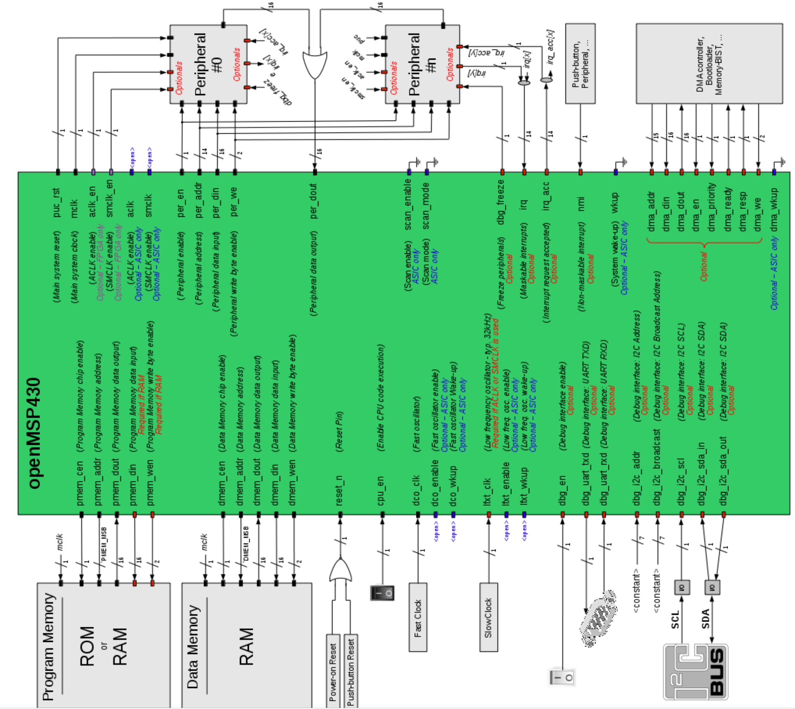
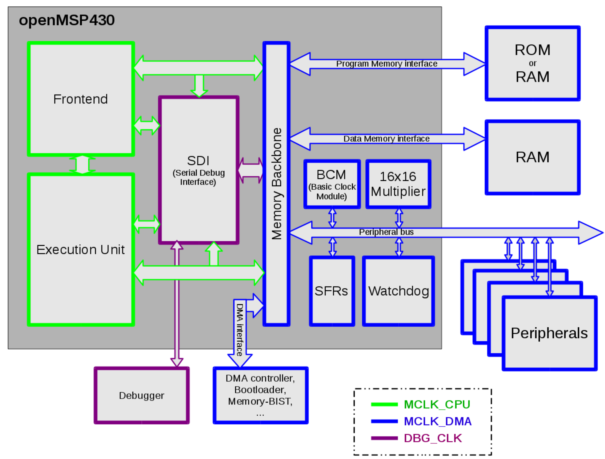
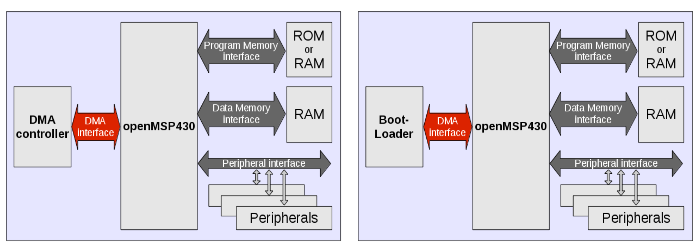
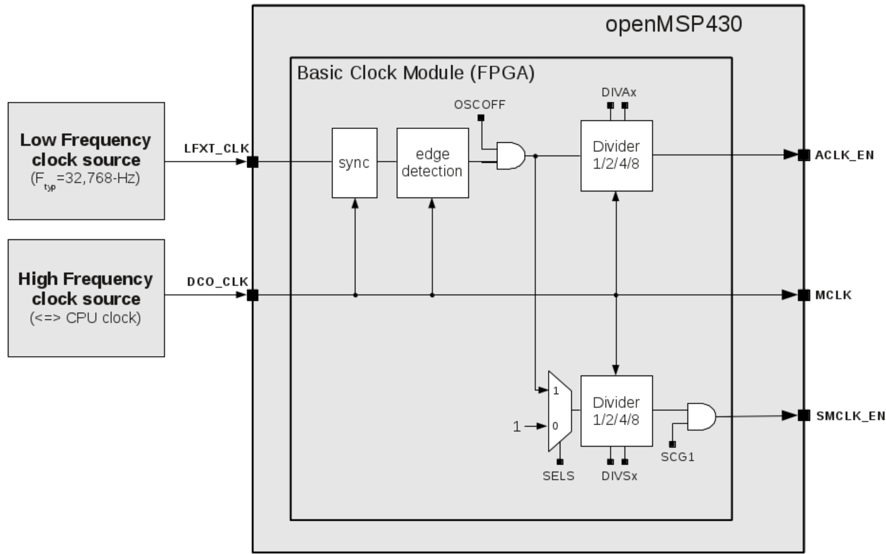
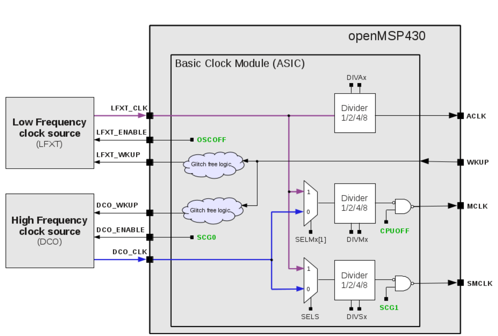

# openMSP430 Design Specification

## 1. Introduction
`openMSP430` is the top-level integration module of a synthesizable 16-bit MSP430-compatible microcontroller core.  
At top level, it combines:
- clock/reset and low-power clock management,
- instruction fetch/decode frontend,
- execution unit,
- memory/peripheral/DMA backbone,
- special function registers,
- optional serial debug, watchdog, and hardware multiplier blocks.

The module does not contain program/data memory macros internally. It exposes external program memory (`pmem_*`), data memory (`dmem_*`), peripheral (`per_*`), DMA, interrupt, debug, and clock/reset interfaces for SoC integration.

## 2. Module Diagram

*Figure: openMSP430 top-level architecture overview.*

## 3. Interface
### 3.1 Top-Level Signals
| Category | Signal | Direction | Width | Description |
| --- | --- | --- | --- | --- |
| Clock/Power | `cpu_en` | Input | 1 | CPU execution enable control (asynchronous input, synchronized internally). |
| Clock/Power | `dbg_en` | Input | 1 | Debug interface enable control (asynchronous input, synchronized internally). |
| Clock/Power | `dco_clk` | Input | 1 | Fast oscillator input clock. |
| Clock/Power | `lfxt_clk` | Input | 1 | Low-frequency oscillator input clock. |
| Clock/Power | `wkup` | Input | 1 | System wake-up request input (asynchronous, ASIC-oriented). |
| Clock/Power | `dma_wkup` | Input | 1 | DMA wake-up input (asynchronous, ASIC-oriented). |
| Clock/Power | `mclk` | Output | 1 | Main system clock output. |
| Clock/Power | `aclk` | Output | 1 | ACLK output (ASIC-oriented clock output). |
| Clock/Power | `smclk` | Output | 1 | SMCLK output (ASIC-oriented clock output). |
| Clock/Power | `aclk_en` | Output | 1 | ACLK enable (FPGA-oriented clock-enable output). |
| Clock/Power | `smclk_en` | Output | 1 | SMCLK enable (FPGA-oriented clock-enable output). |
| Clock/Power | `dco_enable` | Output | 1 | Fast oscillator enable control (ASIC-oriented). |
| Clock/Power | `dco_wkup` | Output | 1 | Fast oscillator wake-up request (asynchronous output). |
| Clock/Power | `lfxt_enable` | Output | 1 | Low-frequency oscillator enable control (ASIC-oriented). |
| Clock/Power | `lfxt_wkup` | Output | 1 | Low-frequency oscillator wake-up request (asynchronous output). |
| Reset | `reset_n` | Input | 1 | External reset pin, active low, asynchronous input. |
| Reset | `puc_rst` | Output | 1 | Main system reset (Power-Up Clear) distributed internally and exported. |
| Interrupt | `irq` | Input | ``[`IRQ_NR-3:0]`` | Maskable interrupt requests (one-hot domain, width depends on IRQ configuration). |
| Interrupt | `irq_acc` | Output | ``[`IRQ_NR-3:0]`` | Interrupt accepted indication (one-hot). |
| Interrupt | `nmi` | Input | 1 | Non-maskable interrupt input (asynchronous input). |
| Program Memory | `pmem_addr` | Output | ``[`PMEM_MSB:0]`` | Program memory word address bus. |
| Program Memory | `pmem_cen` | Output | 1 | Program memory chip enable, active low. |
| Program Memory | `pmem_din` | Output | 16 | Program memory write data bus (optional write path). |
| Program Memory | `pmem_dout` | Input | 16 | Program memory read data bus. |
| Program Memory | `pmem_wen` | Output | 2 | Program memory byte write enable, active low (optional write path). |
| Data Memory | `dmem_addr` | Output | ``[`DMEM_MSB:0]`` | Data memory word address bus. |
| Data Memory | `dmem_cen` | Output | 1 | Data memory chip enable, active low. |
| Data Memory | `dmem_din` | Output | 16 | Data memory write data bus. |
| Data Memory | `dmem_dout` | Input | 16 | Data memory read data bus. |
| Data Memory | `dmem_wen` | Output | 2 | Data memory byte write enable, active low. |
| Peripheral Bus | `per_addr` | Output | 14 | Peripheral word address bus. |
| Peripheral Bus | `per_din` | Output | 16 | Peripheral write data bus. |
| Peripheral Bus | `per_dout` | Input | 16 | External peripheral read data bus. |
| Peripheral Bus | `per_en` | Output | 1 | Peripheral access enable, active high. |
| Peripheral Bus | `per_we` | Output | 2 | Peripheral byte write enable, active high. |
| DMA | `dma_addr` | Input | 15 (`[15:1]`) | DMA word address bus. |
| DMA | `dma_din` | Input | 16 | DMA write data bus toward openMSP430 memory space. |
| DMA | `dma_dout` | Output | 16 | DMA read data bus returned from openMSP430 memory space. |
| DMA | `dma_en` | Input | 1 | DMA transfer active indicator, high active. |
| DMA | `dma_we` | Input | 2 | DMA transfer write strobes; all zero indicates read transfer. |
| DMA | `dma_priority` | Input | 1 | DMA priority control (`0` low priority, `1` high priority). |
| DMA | `dma_ready` | Output | 1 | DMA transfer completion/ready indication. |
| DMA | `dma_resp` | Output | 1 | DMA transfer response (`0` OKAY, `1` ERROR). |
| Debug | `dbg_uart_rxd` | Input | 1 | Debug UART RX input (asynchronous). |
| Debug | `dbg_uart_txd` | Output | 1 | Debug UART TX output. |
| Debug | `dbg_i2c_addr` | Input | 7 | Debug I2C target address. |
| Debug | `dbg_i2c_broadcast` | Input | 7 | Debug I2C broadcast address for multicore systems. |
| Debug | `dbg_i2c_scl` | Input | 1 | Debug I2C SCL input (asynchronous). |
| Debug | `dbg_i2c_sda_in` | Input | 1 | Debug I2C SDA input (asynchronous). |
| Debug | `dbg_i2c_sda_out` | Output | 1 | Debug I2C SDA output. |
| Debug | `dbg_freeze` | Output | 1 | Freeze indication/control toward peripherals during debug halt conditions. |
| Scan | `scan_enable` | Input | 1 | Scan enable input (ASIC-oriented). |
| Scan | `scan_mode` | Input | 1 | Scan mode input (ASIC-oriented). |

### 3.2 Interface Semantics
- `mclk` is the top-level main clock and is driven from the internal DMA/system clock domain (`dma_mclk`).
- `reset_n` is a low-active asynchronous reset input.  
  - `puc_rst` is asynchronously asserted by reset/watchdog sources and synchronously released through the internal main clock/reset sequencing.
- Program/data memory chip-enable and write-enable outputs are active low (`pmem_cen`, `pmem_wen`, `dmem_cen`, `dmem_wen`).
- Program-memory write path (`pmem_din`, `pmem_wen`) is optional and is used when program memory is implemented as writable RAM (for example, debug-assisted code loading and software breakpoints).
- Peripheral enable/write controls are active high (`per_en`, `per_we`).
- `irq` and `irq_acc` are one-hot interrupt vectors whose width is set by IRQ configuration macros.
- `dma_ready` is the DMA completion/ready indicator and can remain low to insert wait states.
- `dma_resp` reports transfer status (`0` for successful mapped access, `1` for error/unmapped access).
- `dbg_en` can be used to hold only the debug interface in reset (and clock-gated in ASIC mode) without resetting CPU execution.
- Top-level parameters `INST_NR` and `TOTAL_NR` provide multicore instance identification information used by SFR/debug-visible CPU identification registers.

## 4. Functional Description

### 4.1 Top-Level Operation Flow
1. `omsp_clock_module` derives internal clocks/resets and synchronizes asynchronous control inputs.
2. `omsp_frontend` fetches and decodes instructions, tracks program counter progression, and manages interrupt acceptance sequencing.
3. `omsp_execution_unit` performs ALU and register operations and generates memory access requests plus low-power control signals (`cpuoff`, `oscoff`, `scg0`, `scg1`).
4. `omsp_mem_backbone` arbitrates between frontend, execution, debug, and DMA accesses and drives external `pmem_*`, `dmem_*`, and `per_*` interfaces.
5. `omsp_sfr` implements core special-function registers, CPU identity reporting, and NMI/watchdog-related control/status glue.
6. Optional `omsp_watchdog`, `omsp_multiplier`, and `omsp_dbg` contribute peripheral data paths and control side effects when enabled.
7. Top-level combines peripheral readback data as:
   `per_dout_or = per_dout | per_dout_clk | per_dout_sfr | per_dout_wdog | per_dout_mpy`.

### 4.2 Clock, Reset, and Low-Power Control
- `omsp_clock_module` is the single top-level source of `cpu_mclk`, `dma_mclk`, debug clocks, and exported clock outputs/enables.
- `mclk` is assigned from `dma_mclk`, so external memory/peripheral buses are timed by this domain.
- Execution-unit low-power outputs (`cpuoff`, `oscoff`, `scg0`, `scg1`) feed clock-module gating/mux logic.
- Wake-up sources (`wkup`, `dma_wkup`, internal wake-ups from watchdog/NMI/frontend) restore required clocks per selected configuration.
- In ASIC low-power mode, CPU and DMA/system clock behavior can diverge (`MCLK_CPU` vs `MCLK_DMA`):  
  - `MCLK_CPU` clocks frontend/execution logic and remains off while the CPU is in LPMx.  
  - `MCLK_DMA` clocks memory/peripheral system logic and can be restored for DMA access using `dma_wkup`.
- DMA wake-up restoration behavior is controlled by Basic Clock Module register fields (`BCSCTL1.DMA_CPUOFF`, `BCSCTL1.DMA_OSCOFF`, `BCSCTL1.DMA_SCG0`, `BCSCTL1.DMA_SCG1`); if all are cleared, DMA wake-up restoration is disabled.

*Figure: ASIC clock-domain behavior and DMA wake-up interaction.*

### 4.3 Frontend and Execution Coupling

- Frontend outputs decoded instruction fields (`inst_*`), execution state (`e_state`), and completion strobes (`exec_done`) to execution unit.
- Execution unit consumes frontend decode/control and returns software PC update controls (`pc_sw`, `pc_sw_wr`) and memory requests (`eu_mab`, `eu_mb_en`, `eu_mb_wr`, `eu_mdb_out`).
- Frontend receives memory read data and wait indication (`fe_mdb_in`, `fe_pmem_wait`) from memory backbone.
- Interrupt processing uses `irq`, `nmi`, watchdog flags, and `gie`, producing `irq_acc` and control sequencing through frontend state machines.

### 4.4 Memory and Peripheral Access Routing
- `omsp_mem_backbone` generates all external memory/peripheral command buses from internal access sources.
- Frontend accesses program memory path for instruction fetch; execution accesses memory/peripheral paths for data operations.
- Data-memory execution from frontend is not supported (limitation: instructions are not executed from data memory).
- External peripheral accesses are merged with internal peripheral blocks through `per_dout_or`.

### 4.5 DMA Interface Behavior
- DMA accesses use `dma_addr[15:1]` into the unified 64kB word-address space.
- `dma_en` + `dma_we` define active transfer and direction; `dma_priority` controls arbitration mode.
- `dma_priority=0` selects low-priority DMA: transfers wait when CPU accesses conflict on the targeted mapped resource.
- `dma_priority=1` selects high-priority DMA: CPU execution is halted by the backbone (`cpu_halt_cmd`) so DMA has fixed priority over CPU accesses.
- `dma_ready` indicates transfer completion; low levels represent wait-state insertion.
- During wait states, the DMA master shall hold address, control, and write data stable until completion (`dma_ready=1`).
- `dma_resp=1` indicates an ERROR response for unmapped address accesses (for example, address ranges outside peripheral/data/program mapped spaces).
- ERROR responses complete without inserted wait states.
- If `DMA_IF_EN` is not compiled in, top-level DMA outputs are tied to constant fallback behavior in backbone (`dma_ready=1`, `dma_resp=1`, `dma_dout=0`).

*Figure: DMA master interface behavior and transfer sequencing.*

### 4.6 Debug, Watchdog, and Multiplier Integration

- `omsp_dbg` provides serial-debug control (halt/run/step/reset semantics, register/memory access path) and can assert CPU control actions.
- `omsp_watchdog` provides watchdog interval/reset/interrupt behavior and wake-up integration through clock and interrupt paths.
- `omsp_multiplier` contributes 16x16 multiplier peripheral register map/data path.
- When optional modules are excluded at compile time, top-level uses explicit constant tie-offs for related outputs/sideband signals.

### 4.7 Output/Validity Notes
- `dma_dout` is generated from backbone read data and is masked by a delayed ready condition; `dma_ready` should be used as transfer completion/validity qualifier.
- `irq_acc` is a one-hot accepted-interrupt indicator.
- `puc_rst` is the top-level reset signal for the main system domain and should be treated as authoritative reset for `mclk`-domain logic.

## 5. Implementation Details
### 5.1 Top-Level Datapath and Control Partition
- Datapath-heavy blocks: `omsp_frontend`, `omsp_execution_unit`, `omsp_mem_backbone`.
- Control/clock-reset blocks: `omsp_clock_module`, `omsp_sfr`, optional `omsp_dbg`.
- Optional peripheral datapaths: `omsp_watchdog`, `omsp_multiplier`.

### 5.2 Key Internal Interconnects
- Clock/reset chain:
  - external: `dco_clk`, `lfxt_clk`, `reset_n`, `cpu_en`, `dbg_en`, wake-up inputs.
  - generated: `cpu_mclk`, `dma_mclk`, `dbg_clk`, `dbg_rst`, `puc_rst`.
- CPU pipeline control:
  - frontend-to-execution: instruction decode bundles and execution state.
  - execution-to-frontend: program-counter software override.
- Memory backbone routing:
  - request sources: frontend, execution, debug interface, DMA.
  - targets: program memory, data memory, peripheral bus.
- Multicore identification path:
  - top-level parameters `INST_NR`/`TOTAL_NR` drive `cpu_nr_inst`/`cpu_nr_total` into `omsp_sfr` and `omsp_dbg`.
- External master arbitration detail:
  - Debug memory access and DMA share the same external master path; debug access takes precedence when active.

### 5.3 Compile-Time Conditional Behavior

- `WATCHDOG`: controls watchdog block inclusion; if excluded, watchdog outputs and related flags are tied low, and peripheral read contribution is `16'h0000`.
- `MULTIPLIER`: controls hardware multiplier inclusion; if excluded, multiplier peripheral read contribution is `16'h0000`.
- `DBG_EN`: controls debug block inclusion; if excluded, debug outputs are tied to fixed-safe values (for example serial lines idle high, debug writes disabled).
- `DMA_IF_EN`: controls DMA master interface support inside memory backbone.

### 5.4 Baseline Configuration in Provided Sources
From the provided `openMSP430_defines.v`:
- Memory sizing macros:
  - `PMEM_SIZE_4_KB` (`PMEM_AWIDTH=11`)
  - `DMEM_SIZE_1_KB` (`DMEM_AWIDTH=10`)
  - `PER_SIZE_512_B` (`PER_AWIDTH=8`)
- Interrupt count: `IRQ_16` (`IRQ_NR=16`, top `irq`/`irq_acc` width = 14 bits).
- Enabled features: `MULTIPLIER`, `DBG_EN`, `WATCHDOG`, `DMA_IF_EN`, `NMI`.
- Enabled ASIC/clocking options: `ASIC`, `CLOCK_GATING`, `ASIC_CLOCKING`, `LFXT_DOMAIN`, `MCLK_DIVIDER`, `SMCLK_DIVIDER`, `ACLK_DIVIDER`, `CPUOFF_EN`, `SCG0_EN`, `SCG1_EN`, `OSCOFF_EN`.
- Debug transport selection: `DBG_UART` enabled in provided config.
- Reset/debug default behavior macros: `DBG_RST_BRK_EN` enabled.
- Synchronizer defaults: `SYNC_NMI` enabled; `SYNC_CPU_EN` and `SYNC_DBG_EN` disabled.

## 6. Submodule Details

### 6.1 `omsp_clock_module`
Role:
- Generates synchronized enables, system/debug clocks, oscillator control signals, and system reset outputs.

Top-level usage:
- Instantiated once; drives all exported clock/reset signals and internal clock/reset fabric.
- Implements Basic Clock Module register handling on the peripheral bus (`BCSCTL1`/`BCSCTL2`) for clock divider/selection control and DMA wake-up restoration control bits (configuration dependent).

*Figure: Basic Clock Module (FPGA-oriented configuration).*

*Figure: Basic Clock Module (ASIC-oriented configuration).*

Key interface (as connected at top):
| Signal | Direction | Width | Description |
| --- | --- | --- | --- |
| `dco_clk`, `lfxt_clk` | Input | 1 each | Clock sources for fast and low-frequency domains. |
| `reset_n` | Input | 1 | Asynchronous active-low reset input. |
| `cpu_en`, `dbg_en` | Input | 1 each | Asynchronous enable controls, internally synchronized. |
| `cpuoff`, `oscoff`, `scg0`, `scg1` | Input | 1 each | Low-power control from execution unit. |
| `mclk_enable`, `mclk_wkup` | Input | 1 each | Main clock enable/wake-up controls from frontend. |
| `mclk_dma_enable`, `mclk_dma_wkup` | Input | 1 each | DMA/system clock enable/wake-up controls from frontend. |
| `wdt_reset` | Input | 1 | Watchdog reset request. |
| `cpu_mclk`, `dma_mclk` | Output | 1 each | Internal CPU and DMA/system clocks. |
| `puc_rst`, `por`, `puc_pnd_set` | Output | 1 each | System reset/status outputs. |
| `aclk`, `smclk`, `aclk_en`, `smclk_en` | Output | 1 each | Exported clocks or clock-enable signals (config dependent). |
| `dco_enable`, `dco_wkup`, `lfxt_enable`, `lfxt_wkup` | Output | 1 each | Oscillator control/wakeup outputs. |
| `dbg_clk`, `dbg_rst`, `dbg_en_s`, `cpu_en_s` | Output | 1 each | Synchronized debug/CPU control clocks and enables. |

### 6.2 `omsp_frontend`

Role:
- Implements instruction fetch/decode sequencing, interrupt accept logic, and program-counter progression.

Top-level usage:
- Instantiated once; interfaces between clock/reset control, memory backbone, execution unit, and interrupt sources.

Key interface (as connected at top):
| Signal | Direction | Width | Description |
| --- | --- | --- | --- |
| `mclk`, `puc_rst` | Input | 1 each | Frontend clock and reset. |
| `mdb_in`, `fe_pmem_wait` | Input | 16 / 1 | Program-memory read data and wait indication. |
| `irq`, `nmi_pnd`, `wdt_irq` | Input | ``[`IRQ_NR-3:0]`` / 1 / 1 | Interrupt sources into frontend control. |
| `cpu_en_s`, `cpu_halt_cmd`, `cpuoff` | Input | 1 each | Execution/debug/clock control inputs. |
| `dma_en`, `dma_wkup`, `wkup` | Input | 1 each | DMA and wake-up controls affecting frontend sequencing. |
| `inst_*`, `e_state`, `exec_done` | Output | mixed | Decoded instruction/control outputs toward execution unit. |
| `mab`, `mb_en` | Output | 16 / 1 | Frontend memory request bus. |
| `pc`, `pc_nxt` | Output | 16 each | Current and next program counter values. |
| `irq_acc`, `nmi_acc` | Output | ``[`IRQ_NR-3:0]`` / 1 | Interrupt acceptance indications. |
| `mclk_enable`, `mclk_wkup`, `mclk_dma_enable`, `mclk_dma_wkup` | Output | 1 each | Clock enable/wake-up controls to clock module. |

### 6.3 `omsp_execution_unit`
Role:
- Performs instruction execution, ALU/register-file operations, and data-memory/peripheral access generation.

Top-level usage:
- Instantiated once; consumes frontend decode/control and emits memory requests plus low-power control outputs.

Key interface (as connected at top):
| Signal | Direction | Width | Description |
| --- | --- | --- | --- |
| `mclk`, `puc_rst` | Input | 1 each | Execution clock and reset. |
| `inst_*`, `e_state`, `exec_done` | Input | mixed | Decoded instruction/control bundle from frontend. |
| `mdb_in` | Input | 16 | Memory read data from backbone. |
| `pc`, `pc_nxt` | Input | 16 each | Program-counter values from frontend. |
| `dbg_mem_dout`, `dbg_reg_wr`, `dbg_halt_st` | Input | 16 / 1 / 1 | Debug write/control sideband into execution path. |
| `mab`, `mb_en`, `mb_wr`, `mdb_out` | Output | 16 / 1 / 2 / 16 | Execution memory request/address/write buses. |
| `pc_sw`, `pc_sw_wr` | Output | 16 / 1 | Software PC override outputs to frontend. |
| `cpuoff`, `oscoff`, `scg0`, `scg1` | Output | 1 each | Low-power clock-control outputs to clock module. |
| `gie` | Output | 1 | Global interrupt enable state toward frontend. |
| `dbg_reg_din` | Output | 16 | Register readback data to debug block. |

### 6.4 `omsp_mem_backbone`
Role:
- Arbitrates memory accesses among frontend, execution unit, debug interface, and DMA master; drives all external memory/peripheral buses.

Top-level usage:
- Instantiated once; central bus interconnect between CPU/debug/DMA and PMEM/DMEM/peripheral resources.

Key interface (as connected at top):
| Signal | Direction | Width | Description |
| --- | --- | --- | --- |
| `mclk`, `puc_rst` | Input | 1 each | Backbone clock and reset. |
| `fe_mab`, `fe_mb_en` | Input | 15 / 1 | Frontend memory-request interface. |
| `eu_mab`, `eu_mb_en`, `eu_mb_wr`, `eu_mdb_out` | Input | 15 / 1 / 2 / 16 | Execution memory-request/write interface. |
| `dbg_mem_*`, `dbg_halt_cmd`, `cpu_halt_st` | Input | mixed | Debug memory path and halt control. |
| `dma_addr`, `dma_din`, `dma_en`, `dma_we`, `dma_priority` | Input | 15 / 16 / 1 / 2 / 1 | DMA request interface. |
| `pmem_dout`, `dmem_dout`, `per_dout` | Input | 16 each | External memory/peripheral read data buses. |
| `pmem_addr`, `pmem_cen`, `pmem_din`, `pmem_wen` | Output | mixed | Program memory command/data interface. |
| `dmem_addr`, `dmem_cen`, `dmem_din`, `dmem_wen` | Output | mixed | Data memory command/data interface. |
| `per_addr`, `per_en`, `per_we`, `per_din` | Output | mixed | Peripheral command/data interface. |
| `fe_mdb_in`, `eu_mdb_in`, `fe_pmem_wait` | Output | 16 / 16 / 1 | Read-data and wait feedback to frontend/execution. |
| `dma_dout`, `dma_ready`, `dma_resp` | Output | 16 / 1 / 1 | DMA response/data outputs. |
| `cpu_halt_cmd` | Output | 1 | Combined halt request toward frontend. |

### 6.5 `omsp_sfr`
Role:
- Implements special-function registers (CPU ID, interrupt flags/enables, CPU numbering) and NMI/watchdog glue control.

Top-level usage:
- Instantiated once; participates on peripheral bus and provides NMI/watchdog related sideband signals.

Key interface (as connected at top):
| Signal | Direction | Width | Description |
| --- | --- | --- | --- |
| `mclk`, `puc_rst` | Input | 1 each | SFR clock and reset. |
| `per_addr`, `per_en`, `per_we`, `per_din` | Input | 14 / 1 / 2 / 16 | Peripheral-bus access into SFR map. |
| `nmi`, `nmi_acc` | Input | 1 each | NMI request/accept handshake inputs. |
| `wdtifg`, `wdtnmies` | Input | 1 each | Watchdog/NMI edge-related status inputs. |
| `cpu_nr_inst`, `cpu_nr_total` | Input | 8 each | Multicore numbering parameters. |
| `per_dout` | Output | 16 | SFR readback onto internal peripheral OR bus. |
| `cpu_id` | Output | 32 | CPU identification register value to debug. |
| `nmi_pnd`, `nmi_wkup` | Output | 1 each | NMI pending and wake-up controls to frontend. |
| `wdtie`, `wdtifg_sw_clr`, `wdtifg_sw_set` | Output | 1 each | Watchdog control and software flag update signals. |

### 6.6 `omsp_watchdog` (conditional: `WATCHDOG`)
Role:
- Implements watchdog/interval timer register map, interrupt generation, reset generation, and wake-up behavior.

Top-level usage:
- Instantiated when `WATCHDOG` is enabled; contributes peripheral readback and reset/interrupt/wakeup side effects.

Key interface (as connected at top):
| Signal | Direction | Width | Description |
| --- | --- | --- | --- |
| `mclk`, `puc_rst`, `por` | Input | 1 each | Watchdog reset/clock context. |
| `aclk`, `smclk`, `aclk_en`, `smclk_en` | Input | 1 each | Watchdog clock source inputs/enables. |
| `per_addr`, `per_en`, `per_we`, `per_din` | Input | 14 / 1 / 2 / 16 | Peripheral register bus inputs. |
| `dbg_freeze` | Input | 1 | Freeze control during debug halt. |
| `wdtie`, `wdtifg_irq_clr`, `wdtifg_sw_clr`, `wdtifg_sw_set` | Input | 1 each | Watchdog flag/control sideband from SFR/frontend. |
| `per_dout` | Output | 16 | Watchdog register readback contribution. |
| `wdt_irq`, `wdt_reset`, `wdt_wkup` | Output | 1 each | Interrupt/reset/wakeup outputs. |
| `wdtifg`, `wdtnmies` | Output | 1 each | Watchdog flag and NMI-edge selection outputs. |

### 6.7 `omsp_multiplier` (conditional: `MULTIPLIER`)
Role:
- Implements 16x16 hardware multiplier peripheral register block.

Top-level usage:
- Instantiated when `MULTIPLIER` is enabled; contributes peripheral read data through internal OR bus.

Key interface (as connected at top):
| Signal | Direction | Width | Description |
| --- | --- | --- | --- |
| `mclk`, `puc_rst` | Input | 1 each | Multiplier clock/reset. |
| `per_addr`, `per_en`, `per_we`, `per_din` | Input | 14 / 1 / 2 / 16 | Peripheral register interface. |
| `scan_enable` | Input | 1 | Scan support input. |
| `per_dout` | Output | 16 | Multiplier peripheral readback contribution. |

### 6.8 `omsp_dbg` (conditional: `DBG_EN`)
Role:
- Provides serial debug transport and debug-unit register/memory/CPU control functionality.

Top-level usage:
- Instantiated when `DBG_EN` is enabled; interfaces with serial pins, CPU status/data paths, and memory backbone.

Key interface (as connected at top):
| Signal | Direction | Width | Description |
| --- | --- | --- | --- |
| `dbg_clk`, `dbg_rst`, `dbg_en_s` | Input | 1 each | Debug clock/reset/enable from clock module. |
| `dbg_uart_rxd`, `dbg_i2c_*` | Input | 1 / 7 / 7 / 1 / 1 | Serial debug ingress signals (protocol depends on config). |
| `cpu_en_s`, `dbg_halt_st`, `decode_noirq` | Input | 1 each | CPU/control status into debug unit. |
| `cpu_id`, `cpu_nr_inst`, `cpu_nr_total` | Input | 32 / 8 / 8 | CPU identification fields. |
| `dbg_mem_din`, `dbg_reg_din` | Input | 16 each | Memory/register readback toward debugger. |
| `pc`, `eu_mab`, `eu_mb_en`, `eu_mb_wr`, `fe_mdb_in` | Input | mixed | Execution/memory context for debug features. |
| `dbg_halt_cmd`, `dbg_cpu_reset`, `dbg_freeze` | Output | 1 each | CPU halt/reset/freeze controls. |
| `dbg_mem_addr`, `dbg_mem_en`, `dbg_mem_wr`, `dbg_mem_dout` | Output | 16 / 1 / 2 / 16 | Debug memory-access command path to backbone. |
| `dbg_reg_wr` | Output | 1 | Debug register write control into execution unit. |
| `dbg_uart_txd`, `dbg_i2c_sda_out` | Output | 1 each | Serial debug egress outputs. |

## 7. Clock and Reset
- `reset_n` is the external asynchronous reset input (active low).
- `puc_rst` is the system reset used for `mclk`-domain logic and is exported at top level.
- Reset release sequencing follows clock-module reset logic: after `reset_n` deasserts, reset release proceeds in order `POR` then `DBG_RST` (when debug is enabled) then `PUC`.
- `puc_rst` assertion sources include asynchronous `POR`/watchdog reset and debug-commanded CPU reset; release is synchronized by the internal reset synchronizer.
- In top-level integration, `mclk` is sourced from `dma_mclk` (`assign mclk = dma_mclk`).
- `cpu_en` and `dbg_en` are asynchronous control inputs and are synchronized internally before use.
- `dbg_en=0` holds the debug block in reset (and clock-gated in ASIC mode) while normal CPU operation can continue.
- Guidance for integration:
  - In FPGA-oriented configurations, ASIC-only ports are tied low (inputs) or left unconnected (outputs).
  - In ASIC-oriented configurations, clock muxing/gating options and wake-up controls may be enabled to realize low-power behavior.

## 8. Constraints and Integration Notes
- The module uses compile-time macro configuration extensively; feature set and some interface behavior depend on `openMSP430_defines.v`.
- Instruction execution from data memory is not supported.
- DMA interface exposes access to the unified logical memory map and may return `ERROR` for unmapped accesses.
- Top-level multicore-identification parameters (`INST_NR`, `TOTAL_NR`) should be set coherently across cores in multicore integrations.
- Program-memory write ports (`pmem_din`, `pmem_wen`) are optional and should only be connected when writable program memory is implemented.
- Debug, watchdog, and multiplier behavior must be interpreted together with their compile-time enable macros.
