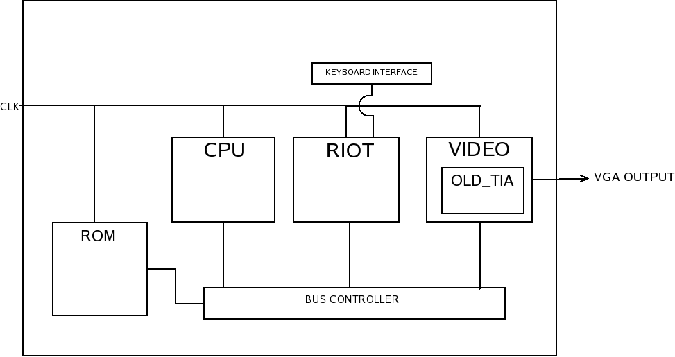
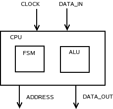

# t6507lp Design Specification

## 1. Introduction

`t6507lp` is a 6507-compatible CPU core module for Atari-style 8-bit systems. It exposes a simple memory-style interface for instruction fetches, operand accesses, and data writes, and internally composes a control FSM (`t6507lp_fsm`) with an arithmetic/logic unit (`t6507lp_alu`).

The core implements a cycle-sequenced fetch/decode/execute flow with support for major 6507 addressing-mode classes, stack operations, branch/jump control flow, and status-flag management.

## 2. Module Diagram

## 3. Top-Level Interface

### 3.1 Parameters

| Parameter | Default | Description |
| --- | --- | --- |
| `DATA_SIZE` | `8` | Data-path width in bits. |
| `ADDR_SIZE` | `13` | Address-bus width in bits. |

### 3.2 Port Interface

| Signal | Direction | Width | Description |
| --- | --- | --- | --- |
| `clk` | Input | 1 | Core clock. |
| `reset_n` | Input | 1 | Active-low reset. |
| `data_in` | Input | `[DATA_SIZE-1:0]` | Read data from memory/bus side for opcode, operand, and stack/vector fetches. |
| `rw_mem` | Output | 1 | Memory operation type: `0` = read, `1` = write. |
| `data_out` | Output | `[DATA_SIZE-1:0]` | Write data driven for store, stack push, and read-modify-write sequences. |
| `address` | Output | `[ADDR_SIZE-1:0]` | Address generated by fetch/decode/execute sequencing. |

### 3.3 Interface Semantics

- The top-level memory interface is non-handshaked: no explicit ready/acknowledge input is present.
- `address` and `rw_mem` are driven by instruction-state sequencing in the FSM.
- During read phases (`rw_mem=0`), `data_in` is consumed by the current micro-sequence stage.
- During write phases (`rw_mem=1`), `data_out` carries the value written to the addressed destination.

## 4. Function Description

### 4.1 Architectural Behavior

The core executes instructions using a staged control flow:

1. Reset/startup hold.
2. Opcode fetch.
3. Addressing-mode-dependent operand/address acquisition.
4. ALU operation and/or memory data movement.
5. Register/flag updates and transition to the next instruction.

This behavior is implemented as a finite-state sequence rather than a pipelined superscalar architecture.

### 4.2 Instruction and Addressing-Mode Handling

The control path classifies instructions into addressing-mode and operation-type groups. Supported addressing classes include:

- implied/accumulator
- immediate
- zero-page and zero-page indexed
- absolute and absolute indexed
- indexed-indirect and indirect-indexed
- relative branch
- absolute and indirect jump

Operation classes include read, write, and read-modify-write sequences. Read-modify-write operations use an explicit read stage, ALU transform stage, and write-back stage.

### 4.3 Program Flow, Branching, and Stack Operations

The FSM includes dedicated sequences for branch, jump, and stack-related control flow:

- Relative branch decisions are made from status flags and may invoke additional address-fix sequencing when page transitions occur.
- Subroutine and return paths use push/pull sequences around the stack pointer.
- Break/return paths include explicit vector-read style sequencing and status handling.

Stack addressing is managed through an internal stack-pointer register and increment/decrement helper paths in the control FSM.

### 4.4 ALU and Status-Flag Semantics

The ALU manages accumulator/X/Y data-path operations and processor status bits. Behavior includes:

- arithmetic and logical instructions
- shifts and rotates
- compare operations
- load/store transfer paths
- flag-set and flag-clear class operations

Status register bit roles follow the conventional C, Z, I, D, B, V, and N semantics (with bit 5 held high in ALU status handling). Decimal-mode arithmetic paths are present for ADC/SBC behavior when decimal mode is enabled.

### 4.5 Invalid/Unsupported Opcode Behavior

Instruction decode includes invalid-opcode detection logic. When an opcode is treated as invalid by the implemented decode set, control is redirected back to fetch sequencing rather than entering an explicit trap interface.

## 5. Implementation Details

### 5.1 Top-Level Composition

`t6507lp` instantiates:

- `t6507lp_fsm`: control path and external memory-interface sequencer.
- `t6507lp_alu`: arithmetic/logic/status and A/X/Y datapath state.

The top-level module itself performs wiring/integration and does not add extra protocol layers.

### 5.2 FSM Control Path

`t6507lp_fsm` contains:

- instruction register and state register
- program counter and temporary address/data registers
- stack pointer management logic
- addressing-mode decode and instruction-class decode
- branch/page-crossing adjustment logic
- next-state logic driving fetch/read/write/push/pull/jump/branch sequences

It also generates ALU control (`alu_opcode`, `alu_a`, `alu_enable`) and consumes ALU outputs (`alu_result`, `alu_status`, `alu_x`, `alu_y`) to complete operation sequencing.

### 5.3 ALU Datapath

`t6507lp_alu` contains:

- accumulator (`A`) and X/Y registers
- status register update logic
- combinational operation evaluation for grouped opcode classes
- sequential commit of result and flag updates when `alu_enable` is asserted

Arithmetic behavior includes carry/overflow/zero/negative flag generation and decimal-mode adjustment logic for ADC/SBC paths.

### 5.4 Control-to-Datapath Coupling

The FSM and ALU interact cycle-by-cycle:

- FSM selects operation class and operand source.
- ALU computes result/flags and updates architectural register state when enabled.
- FSM uses resulting status/data for subsequent control decisions and memory actions.

This partition keeps memory sequencing in FSM and arithmetic semantics in ALU.

## 6. Submodule List

### 6.1 `t6507lp_fsm`

Functional role: instruction-control sequencer and memory bus control.

| Port | Direction | Width | Description |
| --- | --- | --- | --- |
| `clk` | Input | 1 | Control clock. |
| `reset_n` | Input | 1 | Active-low reset for FSM state and core control registers. |
| `alu_result` | Input | `[DATA_SIZE-1:0]` | ALU operation result feedback. |
| `alu_status` | Input | `[DATA_SIZE-1:0]` | ALU status register feedback. |
| `data_in` | Input | `[DATA_SIZE-1:0]` | Memory read data into control sequence. |
| `alu_x` | Input | `[DATA_SIZE-1:0]` | ALU X-register value feedback. |
| `alu_y` | Input | `[DATA_SIZE-1:0]` | ALU Y-register value feedback. |
| `address` | Output | `[ADDR_SIZE-1:0]` | Generated bus address. |
| `rw_mem` | Output | 1 | Read/write control (`0` read, `1` write). |
| `data_out` | Output | `[DATA_SIZE-1:0]` | Write data to memory. |
| `alu_opcode` | Output | `[DATA_SIZE-1:0]` | Operation code sent to ALU. |
| `alu_a` | Output | `[DATA_SIZE-1:0]` | ALU operand input. |
| `alu_enable` | Output | 1 | ALU execution enable. |

### 6.2 `t6507lp_alu`

Functional role: arithmetic/logic execution and architectural register/flag updates.

| Port | Direction | Width | Description |
| --- | --- | --- | --- |
| `clk` | Input | 1 | ALU clock. |
| `reset_n` | Input | 1 | Active-low reset for ALU architectural state. |
| `alu_enable` | Input | 1 | Enables ALU operation/update for current control step. |
| `alu_opcode` | Input | 8 | Encoded instruction operation class. |
| `alu_a` | Input | 8 | Operand value from FSM/data path. |
| `alu_result` | Output | 8 | Result value returned to FSM/memory-write paths. |
| `alu_status` | Output | 8 | Updated processor status register value. |
| `alu_x` | Output | 8 | X-register architectural value. |
| `alu_y` | Output | 8 | Y-register architectural value. |

## 7. Clock and Reset

- Clock: `clk` is the single core clock domain.
- Reset: `reset_n` is active-low.
- Both FSM and ALU use sequential blocks sensitive to `posedge clk` and `negedge reset_n`, so reset assertion is asynchronous to the clock edge.
- After reset release, FSM startup sequencing holds the core in an initialization state for a bounded number of cycles before normal fetch flow.

## 8. Constraints

- The top-level interface has no explicit memory wait/ready handshake; external integration must match the core’s cycle-based read/write sequencing assumptions.
- No external interrupt pins are exposed at this module boundary.
- Implemented behavior is limited to the decode set present in the opcode package and associated FSM/ALU logic.
- Relative-branch sign behavior and reset-vector compatibility require confirmation for strict cycle-accurate equivalence targets.
