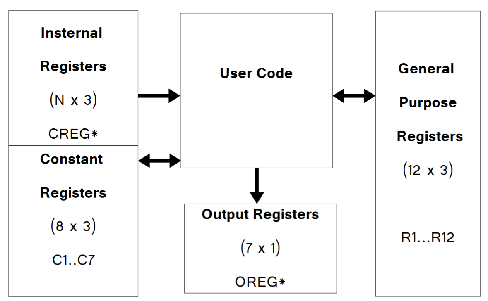

# THEIA Design Specification

## 1. Introduction

`THEIA` is a multi-core ray-cast graphics processing unit with a programmable shader-style execution model.  
The design combines per-core execution pipelines with shared-bus and shared-texture-memory arbitration, and provides external control/data interfaces for initialization, rendering control, texture memory loading, and output retrieval.

The programming model is register-based and instruction-based. Instructions operate on vector-style register rows, and execution is organized around repeated per-iteration processing rather than a stack-based call model.

## 2. Module Diagram

## 3. Interface

| Signal | Direction | Width | Description |
| --- | --- | --- | --- |
| `CLK_I` | Input | `1` | System clock for all top-level sequencing. |
| `RST_I` | Input | `1` | Active-high reset for top-level/core control and internal state elements. |
| `MST_I` | Input | `1` | Mode control. Asserted during host-driven configuration/program loading; deasserted for render/execution operation. |
| `DAT_I` | Input | ``[`WB_WIDTH-1:0]`` | Host data input used by selected core interfaces and internal IO paths. |
| `ACK_I` | Input | `1` | Acknowledge input used by internal bus transactions. |
| `ACK_O` | Output | `1` | Acknowledge returned by selected core path (configuration mode) or current granted core path (runtime arbitration mode). |
| `ADR_I` | Input | ``[`WB_WIDTH-1:0]`` | Host address input for configuration/program/data transactions. |
| `WE_I` | Input | `1` | Host write-enable input. |
| `STB_I` | Input | `1` | Host strobe qualifier for interface transfers. |
| `CYC_I` | Input | `1` | Host cycle qualifier for interface transfers. |
| `TGA_I` | Input | `[1:0]` | Address/type tag used by core-side IO logic to distinguish transfer interpretation. |
| `SEL_I` | Input | ``[`MAX_CORES-1:0]`` | Core-selection mask for host-facing configuration/control broadcast or unicast behavior. |
| `RENDREN_I` | Input | ``[`MAX_CORES-1:0]`` | Per-core render enable inputs. |
| `OMBSEL_I` | Input | ``[`MAX_CORE_BITS-1:0]`` | Selects which core output-memory view is driven onto `OMEM_O`. |
| `OMADR_I` | Input | ``[`WB_WIDTH-1:0]`` | Read address for selected core output-memory view. |
| `OMEM_O` | Output | ``[`WB_WIDTH-1:0]`` | Output-memory read data from the core selected by `OMBSEL_I`. |
| `TMDAT_I` | Input | ``[`WB_WIDTH-1:0]`` | External texture-memory write data. |
| `TMADR_I` | Input | ``[`WB_WIDTH-1:0]`` | External texture-memory write address (bank-relative). |
| `TMWE_I` | Input | `1` | Texture-memory write enable qualifier. |
| `TMSEL_I` | Input | ``[`MAX_TMEM_BANKS-1:0]`` | Texture-memory bank selection input for external writes. |
| `CREG_I` | Input | `[15:0]` | Control register input distributed to each core control path. |
| `HDL_O` | Output | `1` | Aggregate host-data-latched indication across cores. |
| `STDONE_I` | Input | `1` | Scene-traversal-done indicator consumed by core control sequencing. |
| `HDA_I` | Input | `1` | Host-data-available indication for core execution start conditions. |
| `HDLACK_I` | Input | `1` | Host acknowledge for latched-data/commit tracking reset. |
| `RCOMMIT_O` | Output | `1` | Aggregate result-commit indication across cores. |
| `DONE_O` | Output | `1` | Aggregate done indication across cores. |

### 3.1 Interface Semantics

- `SEL_I` gates host-side control signals (`MST_I`, `STB_I`, `CYC_I`, `TGA_I`) into selected core instances.
- `ACK_O` is mode-dependent: in configuration mode (`MST_I=1`) it reflects acknowledge activity from selected core(s); outside configuration mode it reflects the acknowledge of the currently bus-granted core.
- `OMEM_O` is sourced from per-core output-memory blocks implemented as clocked single-read-port RAMs; output data is therefore register-based with respect to `CLK_I`.
- Texture external writes are bank-targeted by `TMSEL_I`; internal core texture reads use separate request/grant logic and do not reuse the external write strobe path.
- `HDL_O`, `RCOMMIT_O`, and `DONE_O` are aggregate status indicators formed from per-core status signals and are intended for global synchronization.

### 3.2 `CREG_I` Control Bits

- `CREG_I[0]`: lights-enable control (`CR_EN_LIGHTS`).
- `CREG_I[1]`: texture-enable control (`CR_EN_TEXTURE`).
- `CREG_I[2]`: user-AABBIU control (`CR_USER_AABBIU`).
- Remaining bits are not defined by this top-level interface specification.

## 4. Function Description

### 4.1 Programming and Register Model

`THEIA` executes a register-based instruction stream for pixel/ray processing. The design uses instruction formats with register-register and register-immediate forms:

- Type I: operation + destination register + two source registers.
- Type II: operation + destination register + immediate value.

Register categories include:

- Configuration registers used to hold scene and projection parameters such as camera position, projection window bounds, resolution, texture size, and core-specific pixel start/end regions.
- Swap registers used as double-buffered iteration data between IO and execution paths.
- Constant registers that retain values across execution until overwritten or reset.
- User registers used as general-purpose per-iteration storage.
- Internal registers and output registers used by internal routines and output staging.

The model is iteration-oriented: user and internal computations are evaluated across repeated rendering iterations, with output-register content used to feed output-memory and texture-related processing.

### 4.2 Operational Phases

Top-level behavior is organized into two primary phases:

- Configuration/programming phase (`MST_I=1`): host-side transactions configure core state, control registers, and instruction/data content for selected core(s).
- Render/execution phase (`MST_I=0` with `RENDREN_I` active per core): each core advances through control-driven execution for geometry/ray-related routines, user-constant/user-pixel-shader stages, and output commit progression.

During execution, per-core control waits for required host/scene conditions (`HDA_I`, `STDONE_I`, and related control conditions), triggers microcode/user-code execution segments, and advances result commit and completion signaling.

### 4.3 Multi-Core Coordination and Shared Resources

The top module instantiates multiple `THEIACORE` instances (reference configuration uses four cores). Shared-resource coordination includes:

- A core-level bus arbiter that grants one core at a time for shared bus-master activity.
- Per-bank texture-memory arbiters that resolve simultaneous core read requests to the same bank.
- Crossbar-style routing that maps a core’s virtual texture address to a selected bank and corresponding bank-relative read address.

This organization allows cores to execute concurrently while serializing only the conflicting shared-resource accesses.

### 4.4 Output, Commit, and Completion Behavior

Each core writes output values into its output-memory path; the top-level `OMEM_O` port returns data from the core selected by `OMBSEL_I` at address `OMADR_I`.

Per-core status signals are accumulated into global indicators:

- `RCOMMIT_O` indicates that per-core result-commit events have been observed for all cores in the aggregate group.
- `HDL_O` indicates aggregate host-data-latched state across cores.
- `DONE_O` indicates all cores have entered done state.

Aggregate latch/commit tracking is reset by `RST_I` and host-latch acknowledge (`HDLACK_I`) to support repeated processing windows.

## 5. Implementation Details

### 5.1 Top-Level Structural Organization

`THEIA` integrates:

- An array of `THEIACORE` processing engines.
- A shared core bus arbiter (`Module_BusArbitrer`) for grant/select of shared transactions.
- Per-core output-memory (`RAM_SINGLE_READ_PORT`) instances.
- Banked texture memory blocks with per-bank arbiters and crossbar routing.
- Utility selection/counter/flip-flop modules for one-hot decode, grant retiming, and event accumulation.

### 5.2 Core Internal Architecture

Each `THEIACORE` composes major units with clear control/datapath roles:

- `ControlUnit`: central FSM sequencing configuration wait, task start, code trigger/ack phases, host-data wait/ack handling, commit signaling, and done state control.
- `ExecutionUnit`: instruction entry-point selection, instruction fetch/decode, execution FSM, and vector ALU operation including branch/return-driven instruction-flow effects.
- `IO_Unit`: bridges memory-side data structures to Wishbone-style master/slave behavior, output-memory writes, and texture-memory read/write interfaces.
- `MemoryUnit`: organizes data/instruction/control-register storage, including swap-memory behavior and dual-read data paths for execution.

Control-path decisions (trigger signals, wait conditions, done/commit flags) govern when datapath operations execute and when memory/bus side effects are issued.

### 5.3 Memory and Data Movement Organization

Internal data memory is partitioned by address-bank regions for IO-visible inputs, swap memory, general/constant registers, and internal/configuration space.  
Swap memory supports alternating producer/consumer roles between IO and execution logic, with flip control generated by the control path.

Instruction fetch uses dual-read behavior and selects between programmable instruction memory and default ROM code based on instruction-address conventions. This allows a mix of preloaded routines and host-provided user shader code.

### 5.4 Arbitration and Selection Behavior

- Core bus arbitration is round-robin style and advances when the current requester relinquishes its request.
- Texture-bank arbitration is performed independently per bank; only one core is granted per bank at a time.
- Bank select for texture reads is derived from the requested texture address, while bank-relative address bits are routed to the selected bank read port.

## 6. Submodule List

### 6.1 `THEIACORE`

Role: Per-core processing engine that combines control sequencing, instruction execution, IO/bus interaction, and memory/register management.

Top-level interaction highlights:

- Receives per-core gated mode/control and global data/control inputs.
- Produces bus request/ack behavior, output-memory writes, texture-memory read requests, and per-core status (`HDL`, `RCOMMIT`, `DONE`).

### 6.2 `Module_BusArbitrer`

Role: Shared-resource arbiter used for both core-level bus arbitration and texture-bank arbitration.

| Signal | Direction | Width | Description |
| --- | --- | --- | --- |
| `Clock` | Input | `1` | Arbitration update clock. |
| `Reset` | Input | `1` | Arbitration reset. |
| `iRequest` | Input | ``[`MAX_CORES-1:0]`` | Request vector from contenders. |
| `oGrant` | Output | ``[`MAX_CORES-1:0]`` | One-hot grant vector. |
| `oBusSelect` | Output | ``[`MAX_CORE_BITS-1:0]`` | Encoded granted requester index. |

### 6.3 `RAM_SINGLE_READ_PORT`

Role: Per-core output-memory storage and per-bank texture-memory storage primitive with synchronous write and synchronous read-out register.

| Signal | Direction | Width | Description |
| --- | --- | --- | --- |
| `Clock` | Input | `1` | Memory clock. |
| `iWriteEnable` | Input | `1` | Write enable. |
| `iReadAddress0` | Input | `[ADDR_WIDTH-1:0]` | Read address. |
| `iWriteAddress` | Input | `[ADDR_WIDTH-1:0]` | Write address. |
| `iDataIn` | Input | `[DATA_WIDTH-1:0]` | Write data. |
| `oDataOut0` | Output | `[DATA_WIDTH-1:0]` | Registered read data output. |

### 6.4 `SELECT_1_TO_N`

Role: One-hot decode helper used to convert encoded select values into request/write-enable vectors (for example texture bank selection).

| Signal | Direction | Width | Description |
| --- | --- | --- | --- |
| `Sel` | Input | `[SEL_WIDTH-1:0]` | Encoded selection index. |
| `En` | Input | `1` | Decode enable. |
| `O` | Output | `[OUTPUT_WIDTH-1:0]` | One-hot output vector. |

## 7. Clock and Reset

- Primary clock domain: `CLK_I`.
- Reset: `RST_I` is active high and resets top-level arbitration/status logic and per-core state machines/registers.
- External control/status signaling is synchronous to `CLK_I` through the internal registered datapath/control structure.

## 8. Constraints

- Texture-size configuration is constrained to square textures and power-of-two dimensions.
- In single-core operation, pixel start/end configuration has special behavior: initial position is zero and final position corresponds to configured resolution bounds.
- For deterministic host transaction targeting, `SEL_I` should select the intended core set before asserting host transaction qualifiers.
- This specification does not define a fixed-cycle latency for configuration, texture fetch, shader execution, commit, or done signaling; completion is condition-driven by control-state progression and handshake inputs.
