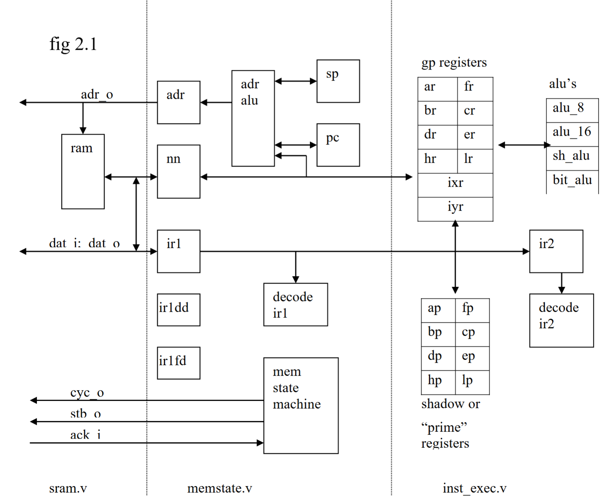

# z80_core_top Design Specification

## 1. Introduction

`z80_core_top` is a Wishbone-interfaced Z80-compatible processor core intended for SoC integration with low- to mid-range peripheral sets. The core presents a Wishbone master interface for instruction fetch, data memory access, I/O cycles, and interrupt-acknowledge cycles.

The architecture combines a memory/control sequencer with a separate instruction execution engine and supports a two-stage instruction pipeline. The top-level integration also includes an internal SRAM path and an optional built-in self-test (BIST) and test-peripheral path.

## 2. Module Diagram

[Placeholder: Insert module/block diagram manually.]

## 3. Interface

| Signal | Direction | Width | Description |
| --- | --- | --- | --- |
| `wb_clk_i` | Input | `1` | Wishbone/system clock. |
| `wb_rst_i` | Input | `1` | Active-high reset input. |
| `wb_ack_i` | Input | `1` | External Wishbone acknowledge input. |
| `wb_dat_i` | Input | `[7:0]` | External Wishbone read data input. |
| `int_req_i` | Input | `1` | External interrupt request input. |
| `wb_dat_o` | Output | `[7:0]` | Wishbone write data output. |
| `wb_stb_o` | Output | `1` | Wishbone strobe output. |
| `wb_cyc_o` | Output | `1` | Wishbone cycle-valid output. |
| `wb_we_o` | Output | `1` | Wishbone write-enable output. |
| `wb_adr_o` | Output | `[15:0]` | Wishbone address output. |
| `wb_tga_o` | Output | `[1:0]` | Wishbone tag output identifying access class. |
| `bist_req_i` | Input | `1` | BIST request input (`COMPILE_BIST` build option). |
| `bist_ack_o` | Output | `1` | BIST completion output (`COMPILE_BIST` build option). |
| `bist_err_o` | Output | `1` | BIST error output (`COMPILE_BIST` build option). |

### 3.1 Wishbone Tag Semantics

- `wb_tga_o = 2'b00`: memory-access cycle.
- `wb_tga_o = 2'b01`: I/O-access cycle.
- `wb_tga_o = 2'b10`: interrupt-acknowledge cycle.
- `wb_tga_o = 2'b11`: reserved/undefined by this core.

### 3.2 Interface Behavior

- The core is a Wishbone master and drives `wb_adr_o`, `wb_dat_o`, `wb_we_o`, `wb_stb_o`, `wb_cyc_o`, and `wb_tga_o` from the memory-state controller.
- Read data returned to the sequencer is selected from one of three sources: internal SRAM path, optional BIST/test I/O path, or external `wb_dat_i`.
- Internal acknowledge presented to the sequencer is formed from local SRAM select, optional BIST acknowledge, and external `wb_ack_i`.
- Optional BIST ports are present only when compiled with `COMPILE_BIST`.

## 4. Function Description

### 4.1 Execution Model

The core implements a Z80-compatible execution model using a split architecture:

- A memory/state sequencer manages instruction fetch, operand memory cycles, address sequencing, pipeline control, and Wishbone bus signaling.
- An execution engine updates general-purpose and shadow registers and performs ALU/shift/bit operations for the active instruction stage.

A two-stage instruction pipeline is used, with instruction information represented by `ir1` and `ir2` stages. In steady-state operation, fetch and execute activity overlap. The sequencer coordinates pipeline progress and stalls when dependencies require ordering.

### 4.2 Pipeline and Hazard Handling

The control path detects and handles at least two hazard classes:

- Memory hazard: upcoming instruction bytes overlap with a memory write target, requiring pipeline restart/reload behavior.
- Register hazard: current instruction depends on a register value being modified by the execution stage, requiring temporary sequencing delay.

This behavior preserves execution correctness while retaining fetch/execute overlap when hazards are absent.

### 4.3 Memory and I/O Access Behavior

The core supports Wishbone memory and I/O transactions under sequencer control. A local SRAM decode path is integrated at top level:

- Memory-tagged accesses in the low address region are routed to internal SRAM.
- Other accesses are forwarded to external Wishbone, with optional interception/support from BIST test logic when enabled.

The data path and acknowledge path are merged so that the sequencer sees a single effective read-data and acknowledge interface independent of source.

### 4.4 Interrupt Behavior

The core accepts a single interrupt request input (`int_req_i`) and emits interrupt-acknowledge Wishbone cycles through the tag interface.

The interrupt model does not include a separate non-maskable interrupt port at top level. Interrupt handling is constrained to the implemented mode behavior of this core, and interrupt-mode selection is not provided as a top-level control interface.

The implemented behavior uses a single interrupt-request input and a single interrupt-enable control model at core level.

## 5. Implementation Details

### 5.1 Top-Level Composition

`z80_core_top` instantiates and connects four principal blocks:

- `z80_memstate2`: memory/state and bus-sequencing controller.
- `z80_inst_exec`: register-update and ALU execution engine.
- `z80_sram`: internal synchronous single-port SRAM used for on-core memory space.
- `z80_bist_logic` (optional): BIST sequencer plus simple test I/O and interrupt generation logic.

Top-level glue logic selects internal/external/BIST data and acknowledge sources for the sequencer and decodes whether a cycle targets local SRAM.

### 5.2 Memory-State Controller Role

`z80_memstate2` is the primary control-path block. It drives Wishbone outputs, tracks instruction pipeline state, sequences memory operations, and coordinates execution-stage activation signals.

It also maintains and updates key addressing/program-flow registers (including program counter and stack pointer behavior), handles immediate/operand transfer sequencing, and controls instruction decode-state progression.

### 5.3 Execution Engine Role

`z80_inst_exec` contains the arithmetic/logical datapath and register update logic for Z80-visible register sets, including shadow-register support. It receives instruction-stage control from the memory-state controller and produces arithmetic results and register-compare status used for conditional behavior.

Separate datapath elements are used for 8-bit arithmetic/logical operations, 16-bit arithmetic/address operations, shift operations, and bit operations.

### 5.4 Local SRAM and Optional BIST Path

The internal SRAM (`z80_sram`) is a synchronous write, single-port memory structure with combinational read output from the selected address.

When `COMPILE_BIST` is enabled, `z80_bist_logic` can:

- Provide a memory-mapped BIST control/status path.
- Provide simple test I/O behavior for instruction-test support.
- OR additional interrupt stimulus into the interrupt-request path used by the sequencer.

## 6. Submodule List

### 6.1 `z80_memstate2`

Role: Core memory/control sequencer and Wishbone master control block.

| Signal | Direction | Width | Description |
| --- | --- | --- | --- |
| `wb_adr_o` | Output | `[15:0]` | Wishbone address driven by sequencer. |
| `wb_we_o` | Output | `1` | Wishbone write control. |
| `wb_cyc_o` | Output | `1` | Wishbone cycle-valid control. |
| `wb_stb_o` | Output | `1` | Wishbone strobe control. |
| `wb_tga_o` | Output | `[1:0]` | Cycle class tag. |
| `wb_dat_o` | Output | `[7:0]` | Wishbone write data. |
| `wb_dat_i` | Input | `[7:0]` | Effective read data from top-level mux path. |
| `wb_ack_i` | Input | `1` | Effective acknowledge from top-level ack merge. |

### 6.2 `z80_inst_exec`

Role: Instruction execution datapath and register update engine.

| Signal | Direction | Width | Description |
| --- | --- | --- | --- |
| `exec_ir2` | Input | `1` | Execute control for pipeline stage instruction. |
| `ir2` | Input | `[9:0]` | Decoded/encoded stage-2 instruction control field. |
| `nn` | Input | `[15:0]` | Operand/immediate transfer register input. |
| `sp` | Input | `[15:0]` | Stack pointer input for execution updates. |
| `add16` | Output | `[15:0]` | 16-bit arithmetic result to sequencer path. |
| `alu8_out` | Output | `[7:0]` | 8-bit ALU result. |
| `br_eq0` | Output | `1` | Zero-compare status used by sequencer conditions. |
| `cr_eq0` | Output | `1` | Zero-compare status used by sequencer conditions. |

### 6.3 `z80_sram`

Role: Internal SRAM macro/model used for local memory-tagged cycles.

| Signal | Direction | Width | Description |
| --- | --- | --- | --- |
| `clk` | Input | `1` | SRAM clock. |
| `ce` | Input | `1` | Chip enable. |
| `we` | Input | `1` | Write enable. |
| `addr` | Input | `[aw-1:0]` | SRAM address. |
| `di` | Input | `[dw-1:0]` | Write data. |
| `dout` | Output | `[dw-1:0]` | Read data output. |

### 6.4 `z80_bist_logic` (Conditional)

Role: Optional BIST/test-peripheral block enabled by `COMPILE_BIST`.

| Signal | Direction | Width | Description |
| --- | --- | --- | --- |
| `bist_ack_o` | Output | `1` | BIST completion indication. |
| `bist_err_o` | Output | `1` | BIST error indication. |
| `wb_ack_o` | Output | `1` | BIST-side acknowledge for test-mapped cycles. |
| `wb_dat_o` | Output | `[7:0]` | BIST/test read data. |
| `int_req_o` | Output | `1` | BIST-generated interrupt request contribution. |
| `int_req_i` | Input | `1` | External interrupt request input into BIST combiner. |

## 7. Clock and Reset

- Clock: `wb_clk_i` is the single required clock input.
- Reset: `wb_rst_i` is active high and initializes sequencer, execution, and optional BIST state.
- All top-level functional sequencing is synchronous to `wb_clk_i`.

## 8. Constraints

- The integrated local SRAM implementation uses a reduced on-core address space relative to full 16-bit external addressability; system integration may map additional memory externally.
- Optional BIST/test behavior is build-dependent (`COMPILE_BIST`) and is intended for initialization/test support rather than mandatory runtime functionality.
- The core’s externally visible timing behavior is defined by Wishbone handshaking and selected data/ack source paths; fixed-cycle completion is not assumed for all transaction classes.
