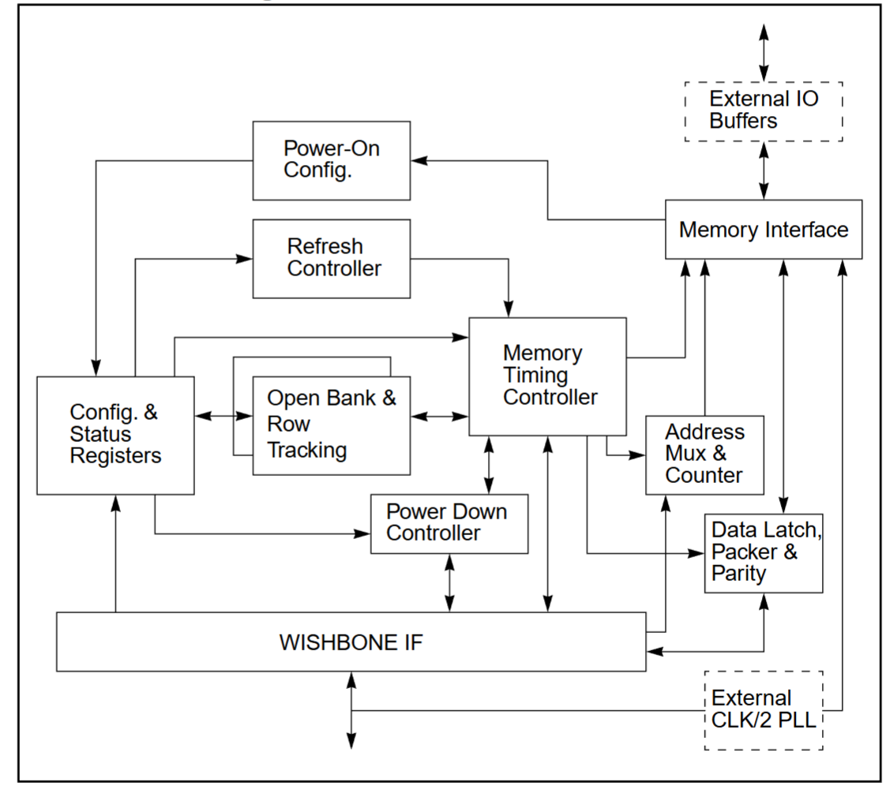
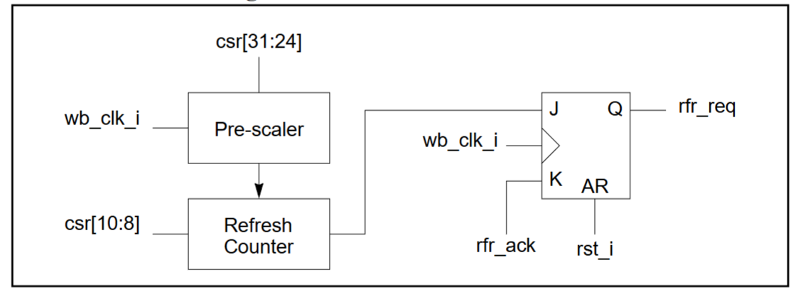

# mc_top Design Specification

## 1. Introduction

`mc_top` is a configurable memory controller that bridges a 32-bit WISHBONE host interface to external memory devices through up to eight programmable chip-select regions. The controller supports SDRAM, synchronous static memory devices, asynchronous devices (for example Flash/ROM), and mixed-memory configurations under a single host interface.

The design combines programmable timing/control registers, address mapping and burst sequencing, refresh management for SDRAM targets, optional byte-parity generation/checking, and suspend/resume support. It also provides an external memory-bus request/grant interface for an external bus master.

## 2. Module Diagram

## 3. Interface

### 3.1 Host Interface (WISHBONE)

| Signal | Direction | Width | Description |
| --- | --- | --- | --- |
| `clk_i` | Input | 1 | WISHBONE clock for host-side control and register logic. |
| `rst_i` | Input | 1 | Global asynchronous reset, active high. |
| `wb_addr_i` | Input | 32 | Host address bus for memory space and internal register-file accesses. |
| `wb_data_i` | Input | 32 | Host write data. |
| `wb_data_o` | Output | 32 | Host read data from memory path or internal registers. Registered to `clk_i`. |
| `wb_sel_i` | Input | 4 | Byte-lane select from host; also used for data-mask/parity checking context. |
| `wb_we_i` | Input | 1 | Write-enable qualifier (`1` = write, `0` = read). |
| `wb_cyc_i` | Input | 1 | WISHBONE cycle qualifier. |
| `wb_stb_i` | Input | 1 | WISHBONE transfer strobe. |
| `wb_ack_o` | Output | 1 | Normal cycle termination. For memory accesses this is generated from memory completion; for register accesses it is generated by register-file path. |
| `wb_err_o` | Output | 1 | Abnormal cycle termination for memory accesses (parity error, write-protect violation, or synchronous-device timeout). |

### 3.2 Power-Management and Boot Interface

| Signal | Direction | Width | Description |
| --- | --- | --- | --- |
| `susp_req_i` | Input | 1 | Request entry into suspend mode. Must remain asserted until `suspended_o` is asserted. |
| `resume_req_i` | Input | 1 | Request exit from suspend mode. Sampled by the controller after suspended state is reached. |
| `suspended_o` | Output | 1 | Indicates controller/memory interface is in suspended mode. |
| `poc_o` | Output | 32 | Latched power-on configuration value captured from memory data inputs during reset sequence. |

### 3.3 Memory Interface

| Signal | Direction | Width | Description |
| --- | --- | --- | --- |
| `mc_clk_i` | Input | 1 | Memory clock used for memory-side registered I/O. |
| `mc_br_pad_i` | Input | 1 | External master bus request. |
| `mc_bg_pad_o` | Output | 1 | External master bus grant. |
| `mc_ack_pad_i` | Input | 1 | Memory-side acknowledge input to controller. |
| `mc_addr_pad_o` | Output | 24 | Memory address output (includes SDRAM bank-address bits). Registered to `mc_clk_i`. |
| `mc_data_pad_i` | Input | 32 | Memory data input bus. |
| `mc_data_pad_o` | Output | 32 | Memory data output bus. Registered to `mc_clk_i`. |
| `mc_dp_pad_i` | Input | 4 | Memory byte-parity input bus. |
| `mc_dp_pad_o` | Output | 4 | Memory byte-parity output bus. Registered to `mc_clk_i`. |
| `mc_doe_pad_doe_o` | Output | 1 | Memory data output-enable control. |
| `mc_dqm_pad_o` | Output | 4 | Memory byte mask/enable outputs. |
| `mc_oe_pad_o_` | Output | 1 | Memory output-enable control. |
| `mc_we_pad_o_` | Output | 1 | Memory write-enable control. |
| `mc_cas_pad_o_` | Output | 1 | Memory CAS control. |
| `mc_ras_pad_o_` | Output | 1 | Memory RAS control. |
| `mc_cke_pad_o_` | Output | 1 | Memory clock-enable control. |
| `mc_cs_pad_o_` | Output | 8 | Active-low memory chip-select outputs. |
| `mc_sts_pad_i` | Input | 1 | Memory status input (for example Flash ready/busy). |
| `mc_rp_pad_o_` | Output | 1 | Flash reset/power-down control output. |
| `mc_vpen_pad_o` | Output | 1 | Flash erase/program enable output. |
| `mc_adsc_pad_o_` | Output | 1 | SSRAM address status/control output. |
| `mc_adv_pad_o_` | Output | 1 | SSRAM address-advance output. |
| `mc_zz_pad_o` | Output | 1 | SSRAM snooze/sleep output used during suspend. |
| `mc_coe_pad_coe_o` | Output | 1 | Memory address/control output-enable. |

### 3.4 Address-Decode Semantics

- Memory-space transactions are selected when `wb_addr_i[31:29] == 3'b000`.
- Internal register-file transactions are selected when `wb_addr_i[31:29] == 3'b011`.
- Transactions outside these decoded regions are not serviced by the controller datapath and must be handled at system integration level.

## 4. Function Description

### 4.1 Transaction Flow

The controller accepts WISHBONE cycles from the host and classifies them as memory-space or register-space operations. For memory-space cycles, the WISHBONE interface block generates qualified internal requests (`wb_read_go`, `wb_write_go`), detects the first beat of a transfer (`wb_first`), and derives wait-state context (`wb_wait`) for burst progression.

Register-space cycles access configuration/state registers through the register-file path and return data/acknowledge without invoking external memory timing sequences.

### 4.2 Memory Access Operation

For memory accesses, operation proceeds through four coordinated functions:

1. **Chip-select and mode selection**: Address decode plus chip-select configuration determine target region, memory type, bus width, and timing profile.
2. **Address generation**: Address-select logic forms the memory address according to target type and burst state.
3. **Timing/control sequencing**: The timing controller drives command/control outputs (`RAS/CAS/WE/CS/OE`, cycle type, and data-valid strobes) based on memory type and programmed timing.
4. **Data-path handling**: Write data is forwarded to memory with optional parity generation; read data is captured, optionally packed for narrow async reads, and returned to host.

`wb_ack_o` is issued on successful completion. If an error condition is detected, `wb_err_o` is asserted and `wb_ack_o` is suppressed for that transfer.

### 4.3 Burst and RMW Behavior

The controller supports burst transfers and burst termination behavior for target memory types that use burst-capable operation. During a burst, internal address progression and command sequencing are tied to both host-side request continuity and memory-side timing constraints.

Read-modify-write (RMW) cycles are supported. The controller tracks read-to-write direction changes in an RMW sequence and forces address fetch/update semantics at the direction transition so the write phase uses a newly resolved address context.

### 4.4 Configuration and Chip-Select Programming

The register-file block contains global and per-chip-select programming state, including:

- Main control/status register (`CSR`)
- Power-on configuration register (`POC`)
- Bank/address-mask register (`BA_MASK`)
- Per-chip-select configuration/timing registers (`CSCn`, `TMSn`)

Each chip select can be independently enabled and configured for memory type, data width, timing behavior, and protection/status-related options. The selected chip-select configuration feeds address, timing, and datapath decisions for the active transfer.

### 4.5 SDRAM-Oriented Functions

For SDRAM targets, the controller provides:

- **Refresh request generation** using programmable prescale/interval control.
- **Open bank/row tracking** to reuse active rows and reduce unnecessary precharge/activate overhead when permitted by configuration.
- **Initialization/load-mode sequencing** driven by per-chip-select requests, serviced one target at a time.

Refresh requests remain active until acknowledged by the timing/controller path. When multiple SDRAM targets are present, refresh servicing is coordinated through the shared SDRAM-select indication.

### 4.6 Address Formation

Address formation is memory-type dependent:

- SDRAM accesses are composed from row, bank, and column fields, with ordering influenced by programmed organization mode.
- Asynchronous accesses use a latched/counted address path supporting dynamic bus sizing for narrow devices.
- Synchronous static-memory accesses use the synchronous command/address path.

The address path supports burst increment behavior and the controller’s burst sequencing policy for the active memory type.

### 4.7 Data Path, Packing, and Parity

Write path behavior:

- Host write data is transferred to memory data outputs.
- Byte parity is generated per byte lane when parity support is enabled for the target configuration.

Read path behavior:

- Read data is captured from memory interface inputs.
- For narrow async configurations, read-data bytes are packed into 32-bit host words according to bus width and sequencing controls.
- For SDRAM/synchronous paths, read data is buffered and returned with timing-aligned acknowledge behavior.

Parity check behavior:

- On read completions, received parity can be checked per enabled byte lane.
- A parity mismatch contributes to WISHBONE error signaling.

### 4.8 Error Signaling

`wb_err_o` may be asserted on memory transactions when one of the following occurs:

- Read-data parity error is detected.
- A write is attempted to a write-protected chip-select region.
- A synchronous chip-select access exceeds the controller’s completion/timeout criteria.

When `wb_err_o` is asserted for a cycle, normal acknowledge is not returned for that failing transfer.

### 4.9 Power-On Configuration

During reset, the controller captures memory data bus input into the internal POC register and exposes it on `poc_o`. The low-order POC bits are used by the controller for default boot/memory configuration interpretation; upper bits remain available as system-visible boot-strap information.

### 4.10 Suspend/Resume and External Master Interaction

Suspend/resume behavior is controlled by `susp_req_i`, `resume_req_i`, and `suspended_o`:

- To enter suspend, `susp_req_i` is asserted until `suspended_o` is observed asserted.
- Before fully entering suspended mode, the controller places managed SDRAM targets into self-refresh operation.
- To resume, clocks must be running and stable, then `resume_req_i` is asserted; normal operation resumes after `suspended_o` deasserts.

External memory bus-master operation uses `mc_br_pad_i`/`mc_bg_pad_o`. An external master requests ownership with `mc_br_pad_i` and holds request for the duration of bus ownership.

## 5. Implementation Details

### 5.1 Architectural Partitioning

`mc_top` integrates eight primary functional blocks:

- **`mc_wb_if`**: WISHBONE request qualification, first-beat/wait tracking, response multiplexing, and host error generation.
- **`mc_rf`**: Configuration/status register file, chip-select decode context, POC latch, refresh/timing control fields, and special request generation.
- **`mc_timing`**: Main control sequencer for command timing, memory-cycle acknowledge/error generation, refresh/init/LMR execution, and suspend/resume control.
- **`mc_adr_sel`**: Memory-type dependent address formation, row/bank/column extraction, and burst-related address updates.
- **`mc_dp`**: Write-data/parity generation and read-data capture/packing/parity-check functions.
- **`mc_refresh`**: Refresh prescaler/counter and refresh-request generation.
- **`mc_obct_top`**: Open-bank/open-row tracking and row-hit indications for SDRAM optimization.
- **`mc_mem_if`**: Memory-clock-domain I/O registers, chip-select/control output driving, and memory-side handshake sampling.

### 5.2 Control-Path Coordination

The top-level integrates normal, refresh/suspend, and special-initialization chip-select contexts:

- During normal accesses, active chip-select decode drives target selection.
- During refresh or suspend servicing, SDRAM-eligible chip-selects are selected through refresh-qualified paths.
- During SDRAM initialization/load-mode operations, a single selected special-request chip select is driven.

This coordination allows one timing/control engine to service normal traffic, periodic maintenance, and initialization sequences without exposing internal arbitration details at the host interface.

### 5.3 Data and Address Path Realization

Address and data functions are separated but synchronized by timing control:

- Address path (`mc_adr_sel`) resolves target-dependent address mapping and burst updates.
- Data path (`mc_dp`) aligns write data and read return data with command/data-valid controls from `mc_timing`.
- Memory interface (`mc_mem_if`) registers address/data/control to `mc_clk_i`, applies data-mask behavior from host byte selects, and captures incoming data/parity/status.

### 5.4 Clock-Domain Behavior

Host-side control runs on `clk_i`; memory-side outputs and sampled inputs are registered on `mc_clk_i`. The design assumes a phase-related multi-clock integration strategy between these two clocks rather than fully asynchronous CDC protocols.

## 6. Submodule List

### 6.1 `mc_wb_if` (WISHBONE Interface Controller)

Role: Qualifies host transactions, generates internal read/write request strobes, tracks first-beat/wait context, and produces host-side acknowledge/error responses.

| Signal | Direction | Width | Description |
| --- | --- | --- | --- |
| `wb_addr_i` | Input | 32 | Address used for memory/register decode. |
| `wb_cyc_i`, `wb_stb_i`, `wb_we_i` | Input | 1 each | Host cycle/strobe/write qualifiers. |
| `wb_read_go`, `wb_write_go` | Output | 1 each | Qualified internal read/write request strobes. |
| `wb_first`, `wb_wait` | Output | 1 each | Burst first-beat and wait-state context. |
| `mem_ack` | Input | 1 | Memory transaction completion indication. |
| `wb_ack_o`, `wb_err` | Output | 1 each | Normal/error cycle termination outputs. |

### 6.2 `mc_rf` (Configuration and Status Register File)

Role: Stores programmable control/timing registers, resolves chip-select context, captures POC value, and provides refresh/init/load-mode request information.

| Signal | Direction | Width | Description |
| --- | --- | --- | --- |
| `wb_data_i` | Input | 32 | Register write-data input. |
| `wb_addr_i` | Input | 32 | Register address input. |
| `wb_we_i`, `wb_cyc_i`, `wb_stb_i` | Input | 1 each | Register write/cycle/strobe qualifiers. |
| `rf_dout` | Output | 32 | Register read data to WISHBONE path. |
| `csc`, `tms` | Output | 32 each | Active chip-select configuration/timing context. |
| `sp_csc`, `sp_tms` | Output | 32 each | Special-request configuration/timing context. |
| `cs`, `cs_need_rfr`, `spec_req_cs` | Output | 8 each | Active CS, SDRAM-refresh CS mask, special-request CS select. |
| `init_req`, `lmr_req` | Output | 1 each | Special SDRAM sequencing requests. |

### 6.3 `mc_timing` (Main Timing and Command Sequencer)

Role: Implements command/timing state sequencing for memory cycles, refresh/init/LMR operations, and suspend/resume transitions; generates memory-cycle acknowledge/error outcomes.

| Signal | Direction | Width | Description |
| --- | --- | --- | --- |
| `wb_read_go`, `wb_write_go`, `wb_first`, `wb_wait` | Input | 1 each | Host-side transfer context. |
| `mem_ack`, `err` | Output | 1 each | Memory completion and timeout/error indication. |
| `data_oe`, `oe_`, `we_`, `cas_`, `ras_`, `cke_`, `cs_en` | Output | 1 each | Memory command/output controls. |
| `rfr_req` / `rfr_ack` | Input / Output | 1 | Refresh request/ack handshake. |
| `init_req` / `init_ack`, `lmr_req` / `lmr_ack` | Input / Output | 1 | SDRAM special-sequence handshakes. |
| `susp_req`, `resume_req`, `suspended`, `susp_sel` | Input/Output | 1 | Suspend/resume state control and indication. |

### 6.4 `mc_adr_sel` (Address Mux and Counter)

Role: Produces memory address outputs for SDRAM/synchronous/asynchronous targets and advances addresses across bursts according to selected mode.

| Signal | Direction | Width | Description |
| --- | --- | --- | --- |
| `csc`, `tms` | Input | 32 each | Active configuration/timing context. |
| `wb_addr_i` | Input | 32 | Host base address input. |
| `next_adr`, `wr_cycle` | Input | 1 each | Burst/address progression controls. |
| `mc_addr` | Output | 24 | Memory-side address output. |
| `row_adr`, `bank_adr` | Output | 13 / 2 | SDRAM row and bank address context. |
| `page_size` | Output | 11 | Derived page-size information for timing/burst control. |

### 6.5 `mc_dp` (Data Path, Packing, and Parity)

Role: Handles memory write data/parity creation, read data capture/packing, and read parity checking.

| Signal | Direction | Width | Description |
| --- | --- | --- | --- |
| `wb_data_i` | Input | 32 | Host write data source. |
| `wb_data_o` | Output | 32 | Host read data return. |
| `mc_data_o`, `mc_dp_o` | Output | 32 / 4 | Memory write data and parity outputs. |
| `mc_data_del` | Input | 36 | Captured memory read data plus parity. |
| `pack_le0`, `pack_le1`, `pack_le2`, `dv` | Input | 1 each | Read-data capture and pack controls. |
| `par_err` | Output | 1 | Read parity error indication for error handling. |

### 6.6 `mc_refresh` (Refresh Request Generator)

Role: Generates periodic refresh requests for SDRAM chip-select targets based on programmable prescaler and interval settings.

| Signal | Direction | Width | Description |
| --- | --- | --- | --- |
| `cs_need_rfr` | Input | 8 | Mask of chip selects requiring refresh. |
| `ref_int` | Input | 3 | Refresh-interval selector. |
| `rfr_ps_val` | Input | 8 | Refresh prescaler value. |
| `rfr_req` | Output | 1 | Refresh request (held until acknowledged). |
| `rfr_ack` | Input | 1 | Refresh completion acknowledge. |

### 6.7 `mc_obct_top` (Open Bank and Row Tracking)

Role: Tracks open SDRAM bank/row status and supplies row-hit/open-bank indications used by the timing controller.

| Signal | Direction | Width | Description |
| --- | --- | --- | --- |
| `cs` | Input | 8 | Active chip-select context for tracking. |
| `row_adr`, `bank_adr` | Input | 13 / 2 | Current SDRAM row/bank context. |
| `bank_set`, `bank_clr`, `bank_clr_all` | Input | 1 each | State update controls from timing sequencer. |
| `bank_open`, `row_same`, `any_bank_open` | Output | 1 each | Row/bank status indicators to timing logic. |

### 6.8 `mc_mem_if` (Memory-Side Registered Interface)

Role: Registers memory-side outputs, captures memory-side inputs, and applies suspend/refresh/control gating in the memory clock domain.

| Signal | Direction | Width | Description |
| --- | --- | --- | --- |
| `mc_clk` | Input | 1 | Memory clock for output/input registers. |
| `mc_addr`, `mc_data_o`, `mc_dp_o` | Output | 24 / 32 / 4 | Registered memory address/data/parity outputs. |
| `mc_oe_`, `mc_we_`, `mc_cas_`, `mc_ras_` | Output | 1 each | Registered command outputs. |
| `mc_cs_` | Output | 8 | Registered chip-select outputs. |
| `mc_data_ir`, `mc_sts_ir`, `mc_ack_r` | Output | 36 / 1 / 1 | Captured memory input data/status/ack signals. |
| `data_oe`, `susp_sel`, `cs_en` | Input | 1 each | Control gating for output-enable and CS drive behavior. |
| `mc_zz_o`, `mc_rp`, `mc_c_oe` | Output | 1 each | Suspend/power and control-output-enable signals. |

## 7. Clock and Reset

- `rst_i` is a global asynchronous reset input, active high.
- The design uses `clk_i` for host-side WISHBONE/control/register logic.
- The design uses `mc_clk_i` for memory interface I/O registering.
- Integration is expected to provide phase-consistent clocks suitable for this two-clock architecture.
- During reset, memory chip-select outputs are deasserted and normal transactions are not serviced.
- System integration should avoid asserting reset while the controller is in or transitioning through suspend if memory-content retention is required.

## 8. Constraints

- Program chip-select configuration (`CSCn`) and timing (`TMSn`) coherently with attached memory type and width before high-throughput operation.
- Ensure address regions are mapped so intended memory and register accesses hit decoded controller spaces.
- For suspend entry, keep `susp_req_i` asserted until `suspended_o` is asserted.
- For suspend exit, restore stable clocks before asserting `resume_req_i`.
- If external bus-master mode is used, external masters must not block memory bus access long enough to violate SDRAM refresh requirements.
