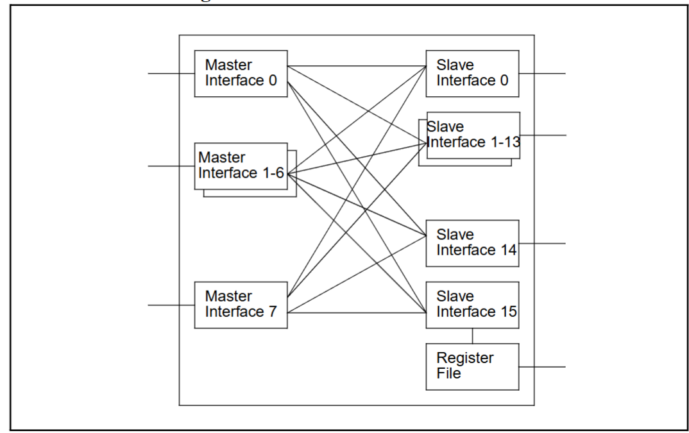
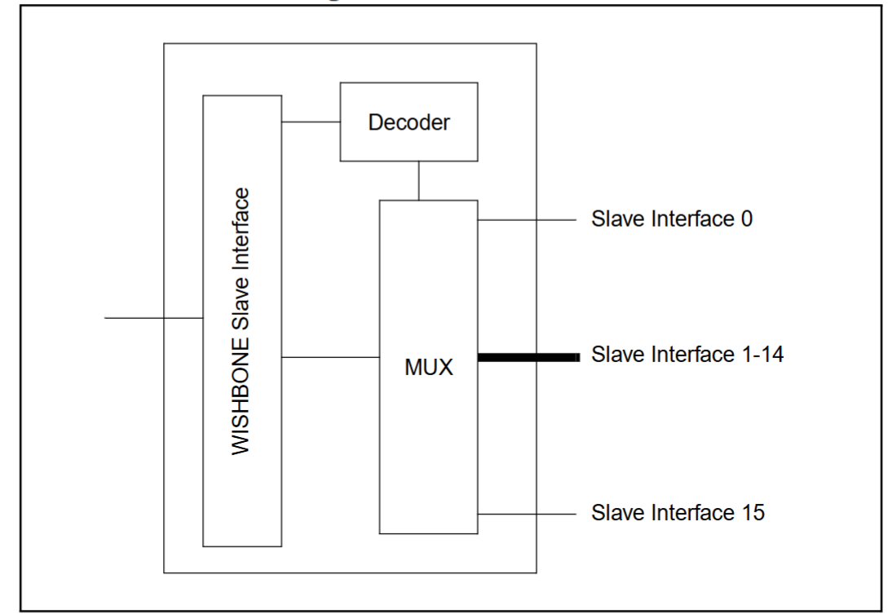
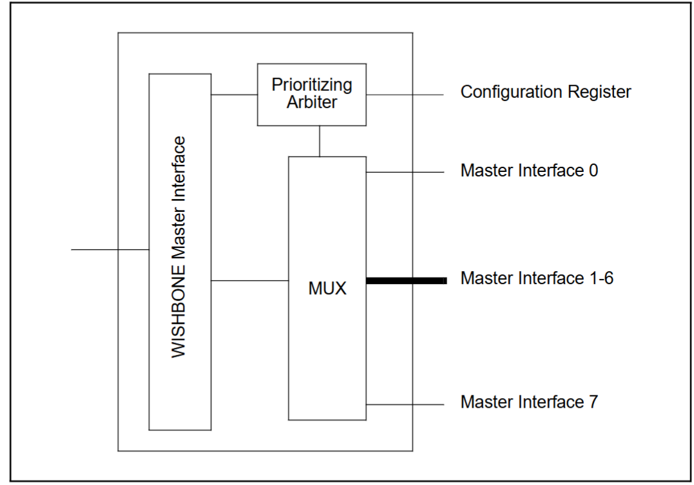

# wb_conmax_top Design Specification

## 1. Introduction

`wb_conmax_top` is a configurable WISHBONE interconnect matrix that connects up to 8 WISHBONE masters to up to 16 WISHBONE slaves. The design routes each master transaction to one slave interface based on address decoding, arbitrates competing requests per slave interface, and returns completion/data responses to the originating master.

The interconnect supports concurrent traffic across different slave interfaces. Each slave interface has an independent arbitration configuration, allowing 1-level, 2-level, or 4-level priority-based request selection.

Slave interface 15 also provides access to an internal configuration register file used to program arbitration priorities.

## 2. Module Diagram

## 3. Interface

### 3.1 Parameters

| Parameter | Width | Default | Description |
| --- | --- | --- | --- |
| `dw` | integer | `32` | Data bus width. |
| `aw` | integer | `32` | Address bus width. |
| `sw` | integer | `dw/8` | Byte-select width (derived). |
| `rf_addr` | 4 | `4'hf` | Register-file select value compared against address bits `[aw-5:aw-8]` when slave 15 is targeted. |
| `pri_sel0` ... `pri_sel15` | 2 each | `2'd2` | Arbitration priority-depth configuration per slave interface. `0`: 1 level, `1`: 2 levels, `2`: 4 levels. |

### 3.2 Global Signals

| Signal | Direction | Width | Description |
| --- | --- | --- | --- |
| `clk_i` | Input | 1 | System clock for all interfaces and internal control/state updates. |
| `rst_i` | Input | 1 | Asynchronous active-high reset. Clears internal cycle-tracking state and register-file configuration contents. |

### 3.3 Master-Side Port Group (`m0` ... `m7`)

Each `mN_*` group is a WISHBONE slave-facing interface toward an external bus master.

| Signal Pattern | Direction | Width | Description |
| --- | --- | --- | --- |
| `mN_data_i` | Input | `[dw-1:0]` | Write data from master `N` into the interconnect. |
| `mN_data_o` | Output | `[dw-1:0]` | Read data returned to master `N` from the selected target path. |
| `mN_addr_i` | Input | `[aw-1:0]` | Address from master `N`. Upper nibble selects slave interface. |
| `mN_sel_i` | Input | `[sw-1:0]` | Byte-lane select from master `N`. |
| `mN_we_i` | Input | 1 | Write/read qualifier for master `N` request. |
| `mN_cyc_i` | Input | 1 | Cycle-valid qualifier for master `N`. |
| `mN_stb_i` | Input | 1 | Transfer strobe for master `N` request. |
| `mN_ack_o` | Output | 1 | Acknowledge response routed to master `N`. |
| `mN_err_o` | Output | 1 | Error response routed to master `N`. |
| `mN_rty_o` | Output | 1 | Retry response routed to master `N`. |

### 3.4 Slave-Side Port Group (`s0` ... `s15`)

Each `sK_*` group is a WISHBONE master-facing interface toward an external bus slave.

| Signal Pattern | Direction | Width | Description |
| --- | --- | --- | --- |
| `sK_data_i` | Input | `[dw-1:0]` | Read data returned from external slave `K`. |
| `sK_data_o` | Output | `[dw-1:0]` | Write data driven to external slave `K`. |
| `sK_addr_o` | Output | `[aw-1:0]` | Address driven to external slave `K`. |
| `sK_sel_o` | Output | `[sw-1:0]` | Byte-lane select driven to external slave `K`. |
| `sK_we_o` | Output | 1 | Write/read qualifier driven to external slave `K`. |
| `sK_cyc_o` | Output | 1 | Cycle-valid qualifier driven to external slave `K`. |
| `sK_stb_o` | Output | 1 | Transfer strobe driven to external slave `K`. |
| `sK_ack_i` | Input | 1 | Acknowledge response from external slave `K`. |
| `sK_err_i` | Input | 1 | Error response from external slave `K`. |
| `sK_rty_i` | Input | 1 | Retry response from external slave `K`. |

For slave index `K=15`, accesses matching the register-file select condition are served internally by the register-file block instead of being forwarded to the external slave 15 target.

## 4. Function Description

### 4.1 Overview of Transaction Flow

1. An external master asserts a request on one `mN_*` interface.
2. The corresponding master interface decodes address bits `[aw-1:aw-4]` to select one target slave interface (`0` to `15`).
3. The selected slave interface receives requests from all masters that currently target that slave index.
4. The slave interface arbitrates among requesting masters using configured priorities and round-robin ordering among equal-priority requesters.
5. The granted master's address, data, and control are forwarded to the external slave-side port group `sK_*`.
6. Response signals (`data/ack/err/rty`) from the external slave-side path are routed back only to the granted master.

### 4.2 Address Interpretation

- `mN_addr_i[aw-1:aw-4]` selects slave interface `0..15`.
- Register-file access is enabled only when:
  - selected slave interface is `15`, and
  - `mN_addr_i[aw-5:aw-8]` equals `rf_addr`.

When the register-file condition is met, the transaction is handled by the internal register file and not issued as an external slave-15 cycle.

### 4.3 Arbitration Behavior per Slave Interface

Each slave interface arbitrates its own incoming request set independently.

- Priority class is chosen first.
- Within the chosen class, requesting masters are serviced in round-robin order.
- Slave interfaces can operate in parallel; traffic to different slave indices does not share one global arbiter.

Priority assignments are programmable per slave through `CFGn` (`n=0..15`) and interpreted according to `pri_selN` for that slave interface.

### 4.4 Configuration Register File Behavior

The register file provides 16 configuration registers (`CFG0` ... `CFG15`), one register per slave interface.

- Register offsets are word-aligned at `0x00 + 4*n`.
- Each register contains eight 2-bit priority fields:
  - bits `[1:0]` for master 0,
  - bits `[3:2]` for master 1,
  - ...,
  - bits `[15:14]` for master 7.
- Bits `[31:16]` are reserved.
- On reset, all priority fields are cleared to `0`.

Priority encoding is monotonic: larger encoded value corresponds to higher priority.

### 4.5 Response and Completion Semantics

- `ack`, `err`, and `rty` are forwarded from the selected target path to the originating master interface.
- Non-granted masters for a given slave interface do not receive that slave interface's completion responses.
- For register-file transactions, completion (`ack`) and read data are generated internally, while `err` and `rty` are deasserted on the internal register-file path.

## 5. Implementation Details

`wb_conmax_top` is structurally composed of three major functional layers.

### 5.1 Master Interface Layer

Eight `wb_conmax_master_if` instances (one per external master interface) perform:

- slave-index decode from upper address nibble,
- steering of request-side signals toward one of 16 internal slave paths,
- multiplexing of return path (`data/ack/err/rty`) from the selected slave path back to the requesting master.

### 5.2 Slave Interface Layer

Sixteen `wb_conmax_slave_if` instances (one per external slave interface) perform:

- collection of requests from all masters targeting that slave index,
- arbitration with per-slave configuration input `confN` and priority-depth parameter `pri_selN`,
- forwarding of one granted master's request to the external `sK_*` interface,
- demultiplexing of external slave response to the granted master.

Within each slave interface, arbitration logic combines priority classification and round-robin selection.

### 5.3 Register-File Layer and Slave-15 Path

`wb_conmax_rf` is inserted on the slave-15 internal path and provides two behaviors:

- internal register access when the register-file address condition matches,
- bypass forwarding to external slave 15 when the condition does not match.

The register-file block also drives `conf0` ... `conf15`, which are consumed by slave interfaces `s0` ... `s15` respectively.

## 6. Submodule List

### 6.1 `wb_conmax_master_if`

Functional role: per-master decode and routing block.

| Signal/Group | Direction (module-local) | Width | Description |
| --- | --- | --- | --- |
| `clk_i`, `rst_i` | Input | 1 | Clock and asynchronous active-high reset. |
| `wb_data_i`, `wb_data_o` | In/Out | `[dw-1:0]` | Data channel for one external master-facing WISHBONE slave interface. |
| `wb_addr_i` | Input | `[aw-1:0]` | Address used for slave-index decode. |
| `wb_sel_i` | Input | `[sw-1:0]` | Byte select from the external master. |
| `wb_we_i`, `wb_cyc_i`, `wb_stb_i` | Input | 1 | Request control signals from the external master. |
| `wb_ack_o`, `wb_err_o`, `wb_rty_o` | Output | 1 | Completion/status returned to the external master. |
| `s[0..15]_data_i`, `s[0..15]_data_o` | In/Out | `[dw-1:0]` | Internal data paths to/from all slave-interface channels. |
| `s[0..15]_addr_o` | Output | `[aw-1:0]` | Internal address paths to all slave-interface channels. |
| `s[0..15]_sel_o` | Output | `[sw-1:0]` | Internal byte-select paths to all slave-interface channels. |
| `s[0..15]_(we_o,cyc_o,stb_o)` | Output | 1 | Internal request controls to slave-interface channels. |
| `s[0..15]_(ack_i,err_i,rty_i)` | Input | 1 | Internal completion/status inputs from slave-interface channels. |

### 6.2 `wb_conmax_slave_if`

Functional role: per-slave arbitration and routing block.

| Signal/Group | Direction (module-local) | Width | Description |
| --- | --- | --- | --- |
| `clk_i`, `rst_i` | Input | 1 | Clock and asynchronous active-high reset. |
| `conf` | Input | `[15:0]` | Priority configuration for masters 0..7 on this slave interface. |
| `wb_data_i`, `wb_data_o` | In/Out | `[dw-1:0]` | Data channel for one external slave-facing WISHBONE master interface. |
| `wb_addr_o` | Output | `[aw-1:0]` | Address driven to the external slave. |
| `wb_sel_o` | Output | `[sw-1:0]` | Byte select driven to the external slave. |
| `wb_we_o`, `wb_cyc_o`, `wb_stb_o` | Output | 1 | Request control signals driven to the external slave. |
| `wb_ack_i`, `wb_err_i`, `wb_rty_i` | Input | 1 | Completion/status from the external slave. |
| `m[0..7]_data_i`, `m[0..7]_data_o` | In/Out | `[dw-1:0]` | Internal data paths for all master-interface channels. |
| `m[0..7]_addr_i` | Input | `[aw-1:0]` | Internal addresses from all master-interface channels. |
| `m[0..7]_sel_i` | Input | `[sw-1:0]` | Internal byte select from all master-interface channels. |
| `m[0..7]_(we_i,cyc_i,stb_i)` | Input | 1 | Internal request controls from master-interface channels. |
| `m[0..7]_(ack_o,err_o,rty_o)` | Output | 1 | Internal completion/status routed to master-interface channels. |

Internal helper logic includes master-selection and arbitration blocks (`wb_conmax_msel`, `wb_conmax_arb`, `wb_conmax_pri_enc`, `wb_conmax_pri_dec`).

### 6.3 `wb_conmax_rf`

Functional role: priority configuration register file and slave-15 intercept/bypass block.

| Signal/Group | Direction (module-local) | Width | Description |
| --- | --- | --- | --- |
| `clk_i`, `rst_i` | Input | 1 | Clock and asynchronous active-high reset. |
| `i_wb_data_i`, `i_wb_data_o` | In/Out | `[dw-1:0]` | Internal slave-15 data path from/to interconnect core. |
| `i_wb_addr_i` | Input | `[aw-1:0]` | Internal slave-15 address path used for register-file decode. |
| `i_wb_sel_i` | Input | `[sw-1:0]` | Internal byte select. |
| `i_wb_we_i`, `i_wb_cyc_i`, `i_wb_stb_i` | Input | 1 | Internal request controls. |
| `i_wb_ack_o`, `i_wb_err_o`, `i_wb_rty_o` | Output | 1 | Completion/status returned to interconnect core. |
| `e_wb_data_i`, `e_wb_data_o` | In/Out | `[dw-1:0]` | External slave-15 data path for bypassed transactions. |
| `e_wb_addr_o` | Output | `[aw-1:0]` | External slave-15 address for bypassed transactions. |
| `e_wb_sel_o` | Output | `[sw-1:0]` | External slave-15 byte select for bypassed transactions. |
| `e_wb_we_o`, `e_wb_cyc_o`, `e_wb_stb_o` | Output | 1 | External slave-15 request controls for bypassed transactions. |
| `e_wb_ack_i`, `e_wb_err_i`, `e_wb_rty_i` | Input | 1 | External slave-15 completion/status for bypassed transactions. |
| `conf0` ... `conf15` | Output | `[15:0]` each | Per-slave priority configuration vectors supplied to arbitration logic. |

## 7. Clock and Reset

- `clk_i` is the single clock domain for routing logic, arbitration state, and register-file state.
- `rst_i` is asynchronous and active high.
- Reset clears internal cycle-state registers and all configuration register contents (`CFG0` ... `CFG15` effective priority fields set to zero).

## 8. Constraints

- All top-level master/slave port groups follow WISHBONE Rev. B2 signaling conventions.
- Priority-level configuration is defined for `pri_selN` values `0`, `1`, and `2`.
- Because arbitration is priority-first, sustained high-priority traffic can delay lower-priority request service.
- Addressing assumptions for correct operation:
  - upper address nibble selects slave interface,
  - register-file selection additionally requires slave index 15 and second nibble match to `rf_addr`.
- Implementations using fewer masters or slaves may tie off unused interfaces; slave interface 15 remains required when register-file access is needed.
