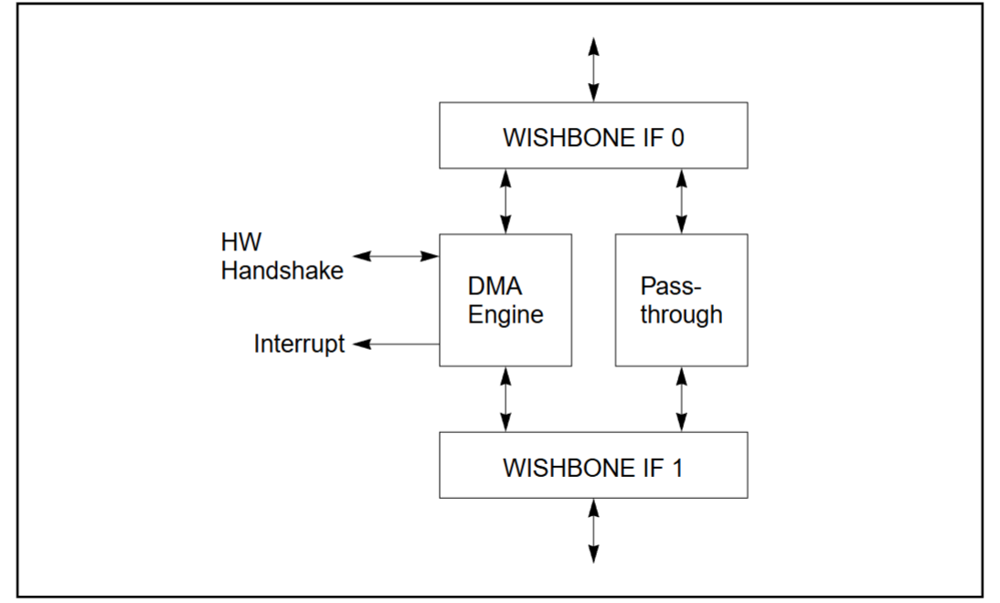
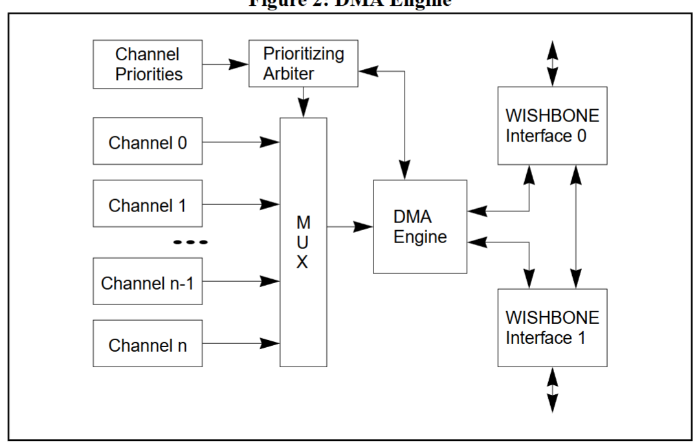

# wb_dma_top Design Specification

## 1. Introduction

`wb_dma_top` is a dual-interface WISHBONE DMA and bridge core. It supports programmed DMA transfers between two 32-bit WISHBONE interfaces, including transfers within one interface and transfers across interfaces. The core also supports pass-through bridging so masters on one interface can access slaves on the other interface.

The DMA subsystem is channelized and configurable for up to 31 channels. It supports priority-based arbitration, hardware-handshake operation, linked-list descriptors, circular buffer addressing, and memory-based FIFO operation through software-pointer control.

## 2. Module Diagram

## 3. Interface

### 3.1 Parameters

| Parameter | Width | Default | Description |
| --- | --- | --- | --- |
| `rf_addr` | 4 (effective) | `0` | Register-file select nibble compared to WISHBONE address bits `[31:28]` on each host-side slave interface. Match selects internal DMA register file; mismatch selects pass-through path. |
| `pri_sel` | 2 | `2'h0` | Arbitration priority-depth configuration: `0` = 1 level, `1` = 4 levels, `2` = 8 levels. |
| `ch_count` | integer | `1` | Number of active DMA channels exposed at top-level handshake ports (`1..31`). |
| `ch0_conf ... ch30_conf` | 4 each | `ch0_conf=4'h1`, others `4'h0` | Per-channel capability bitmap `{CBUF, ED, ARS, EN}`: Circular-buffer support, external-descriptor support, auto-restart support, channel existence. Channel 0 is required. |

### 3.2 Global Signals

| Signal | Direction | Width | Description |
| --- | --- | --- | --- |
| `clk_i` | Input | 1 | Core clock for DMA engine, register file, arbitration, and interface control. |
| `rst_i` | Input | 1 | Active-high reset input for top-level integration. |

### 3.3 WISHBONE Interface 0 (`wb0*`)

This interface provides both a slave-facing host access path and a master-facing DMA/pass-through access path.

| Signal | Direction | Width | Description |
| --- | --- | --- | --- |
| `wb0s_data_i` | Input | 32 | Slave-side write data from external master into core. |
| `wb0s_data_o` | Output | 32 | Slave-side read data returned to external master. |
| `wb0_addr_i` | Input | 32 | Slave-side address input. Upper nibble participates in register-file select. |
| `wb0_sel_i` | Input | 4 | Slave-side byte select. Core behavior is defined for 32-bit word accesses. |
| `wb0_we_i` | Input | 1 | Slave-side write/read qualifier. |
| `wb0_cyc_i` | Input | 1 | Slave-side cycle qualifier. |
| `wb0_stb_i` | Input | 1 | Slave-side transfer qualifier. |
| `wb0_ack_o` | Output | 1 | Slave-side normal completion. |
| `wb0_err_o` | Output | 1 | Slave-side error completion. |
| `wb0_rty_o` | Output | 1 | Slave-side retry completion. |
| `wb0m_data_i` | Input | 32 | Master-side read data from bus target into core. |
| `wb0m_data_o` | Output | 32 | Master-side write data from core to bus target. |
| `wb0_addr_o` | Output | 32 | Master-side address output. |
| `wb0_sel_o` | Output | 4 | Master-side byte select output. |
| `wb0_we_o` | Output | 1 | Master-side write/read qualifier. |
| `wb0_cyc_o` | Output | 1 | Master-side cycle qualifier. |
| `wb0_stb_o` | Output | 1 | Master-side transfer qualifier. |
| `wb0_ack_i` | Input | 1 | Master-side normal completion from target. |
| `wb0_err_i` | Input | 1 | Master-side error completion from target. |
| `wb0_rty_i` | Input | 1 | Master-side retry completion from target. |

### 3.4 WISHBONE Interface 1 (`wb1*`)

Interface 1 has the same signal semantics and widths as Interface 0, using `wb1*` names.

### 3.5 DMA Control and Interrupt Signals

| Signal | Direction | Width | Description |
| --- | --- | --- | --- |
| `dma_req_i` | Input | `[ch_count-1:0]` | Per-channel external DMA request trigger, used in hardware-handshake mode. |
| `dma_ack_o` | Output | `[ch_count-1:0]` | Per-channel acknowledge pulse indicating completion of a handshake-driven chunk transfer. |
| `dma_nd_i` | Input | `[ch_count-1:0]` | Per-channel force-next-descriptor control for linked-list operation. |
| `dma_rest_i` | Input | `[ch_count-1:0]` | Per-channel restart request to reload channel working state. |
| `inta_o` | Output | 1 | Interrupt output A. |
| `intb_o` | Output | 1 | Interrupt output B. |

## 4. Function Description

### 4.1 High-Level Operation

The core integrates two functions:

1. DMA transfer engine:
- Selects an eligible channel.
- Executes read/write transfers based on channel configuration.
- Updates channel state and completion/error status.

2. Pass-through bridge:
- If host access on an interface is not directed to the internal register file, slave-side transactions are forwarded to the opposite interface through combinational pass-through logic.

### 4.2 Register-File Selection vs Pass-Through Selection

For each host-side slave access (`wb0*` or `wb1*` slave-facing ports):

- If address nibble `[31:28]` equals `rf_addr`, access is handled by the internal DMA register file.
- Otherwise, pass-through mode is selected and the access is bridged toward the other WISHBONE interface.

Pass-through selection is combinational and active during a valid cycle.

### 4.3 DMA Channel Model

Each channel has a register set including:

- `CHn_CSR`: control/status and mode bits.
- `CHn_SZ`: total size and chunk size.
- `CHn_A0`, `CHn_A1`: source and destination addresses.
- `CHn_AM0`, `CHn_AM1`: source/destination increment masks.
- `CHn_DESC`: linked-list descriptor pointer.
- `CHn_SWPTR`: software pointer for FIFO-style memory buffering.

Global registers include core pause control and interrupt mask/source registers for `inta_o` and `intb_o`.

### 4.4 Channel Arbitration and Scheduling

Channel selection is priority-driven and round-robin within equal priority classes.

- Priority comes from per-channel CSR priority fields.
- Eligible channels must exist, be enabled, and satisfy mode-specific request conditions.
- In hardware-handshake mode, channel requests are qualified by `dma_req_i`.
- Channels with lower priority can be delayed by sustained higher-priority traffic.

### 4.5 Transfer Modes

#### 4.5.1 Normal DMA Mode

When a channel is enabled in normal mode, the DMA engine performs programmed transfers until total size completion or a stop/error condition.

- Source and destination interface selection is controlled by `SRC_SEL`/`DST_SEL`.
- Address increment behavior is controlled by `INC_SRC`/`INC_DST`.
- If `CHK_SZ` is non-zero, transfer can be chunked and re-arbitrated between chunks.

#### 4.5.2 Hardware-Handshake Mode

In hardware-handshake mode, external request input starts chunk transfer activity.

- Each accepted trigger transfers one chunk (`CHK_SZ` words; if chunk size is zero, total size semantics apply).
- `dma_ack_o[n]` acknowledges completion of the channel’s chunk transfer.
- Channel re-arbitration occurs between chunks.

### 4.6 Linked-List Descriptor Mode

When `USE_ED` is enabled, descriptors are fetched from memory and copied into working channel state.

- Descriptor fields update channel control bits, transfer size, addresses, and next pointer.
- If end-of-list is indicated, the channel completes and reports done/interrupt status as configured.
- Descriptor processing supports both normal and handshake transfer flow.

### 4.7 Circular Buffer and Software Pointer Behavior

Address mask registers limit which address bits increment, enabling wrap-around circular buffer operation.

- Low mask bits correspond to fixed low address alignment behavior.
- Software pointer mode stalls channel progress when DMA address reaches software-managed boundary, enabling FIFO-like behavior in memory.

### 4.8 Forced Descriptor Advance and Restart

- `dma_nd_i[n]` supports forcing descriptor advancement for channel `n` in linked-list handshake operation.
- `dma_rest_i[n]` requests channel restart by reloading channel working state; restart is intended for non-active transfer windows.

### 4.9 Interrupt and Status Behavior

Per-channel events (chunk done, channel done, channel error) feed interrupt source state. Mask registers route enabled events to `inta_o`/`intb_o`.

`CHn_CSR` status fields report channel busy/done/error state, and control fields include stop, mode, auto-restart, descriptor usage, and interrupt enables.

## 5. Implementation Details

### 5.1 Top-Level Composition

`wb_dma_top` integrates four primary functional blocks:

- `wb_dma_rf`: global/channel register file, interrupt control, and software/de-engine register update merge.
- `wb_dma_ch_sel`: channel request qualification, priority arbitration, selected-channel context muxing, and handshake acknowledge generation.
- `wb_dma_de`: DMA execution engine that performs transfer sequencing and descriptor-fetch/write-back control.
- Two `wb_dma_wb_if` instances: one per WISHBONE interface, each combining master adapter, slave adapter, register-file access decode, and pass-through ports.

### 5.2 Control/Data Flow Relationships

- Register file drives channel configuration/state into channel selector and DMA engine context.
- Channel selector emits selected channel context (`csr`, pointers, sizes, addresses, masks) plus start/next-descriptor qualifiers to DMA engine.
- DMA engine drives internal master transactions through both WISHBONE interface adapters and returns status/write-back updates to register file.
- Pass-through ports of both interface adapters are cross-coupled at top level to form bidirectional bridging.

### 5.3 DMA-Interface Integration Semantics

- Internal DMA master interface uses full-word byte-enable behavior (`4'hf`) for generated transfers.
- Slave adapter chooses register-file or pass-through path from address decode against `rf_addr`.
- Register-file path returns local register data/ack and deasserts local err/rty on that path.

## 6. Submodule List

### 6.1 `wb_dma_rf`

Role: DMA register/control subsystem with global registers, per-channel registers, interrupt generation, and DMA-engine write-back handling.

| Signal Group | Direction | Width | Purpose |
| --- | --- | --- | --- |
| `wb_rf_*` | In/Out | addr `8`, data `32` | Register file read/write access from interface-0 slave path. |
| `inta_o`, `intb_o` | Output | 1 each | Masked interrupt outputs. |
| `pointer*`, `ch*_csr/txsz/adr/am` | Output | 32 | Per-channel state exported to channel selector/engine. |
| `ch_sel`, `ndnr` | Input | 5 / 31 | Selected channel index and descriptor-advance bookkeeping from selector. |
| `de_*`, `ptr_set` | Input | control + data | DMA engine write-back and descriptor fetch update controls. |
| `dma_abort`, `pause_req` | Output | 1 | Engine control outputs derived from register writes. |

### 6.2 `wb_dma_ch_sel`

Role: Channel eligibility filtering, priority arbitration, selected-channel context muxing, and handshake-ack pulse generation.

| Signal Group | Direction | Width | Purpose |
| --- | --- | --- | --- |
| `req_i`, `ack_o`, `nd_i` | In/Out | 31 | External handshake requests, per-channel chunk acknowledgments, force-next-descriptor inputs. |
| channel context inputs | Input | per-channel 32-bit sets | Receives all channel register contexts from register file. |
| `ch_sel`, `de_start`, `ndr` | Output | 5/1/1 | Selected channel index and DMA-engine start/descriptor qualifiers. |
| selected context outputs | Output | 32 | Selected channel CSR/pointer/size/address/mask values to DMA engine. |
| `next_ch`, `de_ack`, `dma_busy` | Input | 1 | Engine completion/ack/status signals used for scheduling and acknowledgments. |

### 6.3 `wb_dma_de`

Role: DMA execution engine with transfer sequencing, source/destination master control, and channel state update generation.

| Signal Group | Direction | Width | Purpose |
| --- | --- | --- | --- |
| `mast0_*`, `mast1_*` | In/Out | mixed | Internal master control/data handshake to interface adapters. |
| `de_start`, `nd`, selected context | Input | control + 32-bit context | Launches and parameterizes channel execution. |
| `de_csr_we`, `de_txsz_we`, `de_adr*_we`, `de_fetch_descr`, `ptr_set` | Output | 1 | Register write-back and descriptor-load control. |
| `de_csr`, `de_txsz`, `de_adr0`, `de_adr1` | Output | 32/12/32/32 | Write-back values for channel registers. |
| `next_ch`, `de_ack`, `dma_busy/done/err` | Output | 1 | Channel completion/acknowledge/status results. |

### 6.4 `wb_dma_wb_if` (two instances)

Role: Per-interface adapter combining:

- `wb_dma_wb_mast` (DMA master-side Wishbone generation), and
- `wb_dma_wb_slv` (host-side slave decode, register-file access, pass-through handling).

Each instance exposes one host slave path, one host master path, one internal DMA master control path, and one pass-through coupling path.

## 7. Clock and Reset

- Single-clock operation on `clk_i` for DMA engine, arbitration, register file, and interface adapters.
- Top-level reset input is active high (`rst_i`).
- Reset initializes core control/status state and channel control state to defined reset behavior, including disabled interrupt masks and cleared channel-enable/status bits.

## 8. Constraints

- Data path is defined for 32-bit WISHBONE transfers.
- `ch_count` must reflect instantiated channel usage and is bounded by the design channel set (up to 31 channels).
- Channel 0 is required (`ch0_conf[0] = 1`).
- Register-file address mapping and pass-through selection depend on `rf_addr` match against address nibble `[31:28]`.
- `dma_rest_i` is intended for restart when no transfer is in progress for the channel.
- Circular-buffer/FIFO features require corresponding channel capability bits enabled in `chN_conf`.
