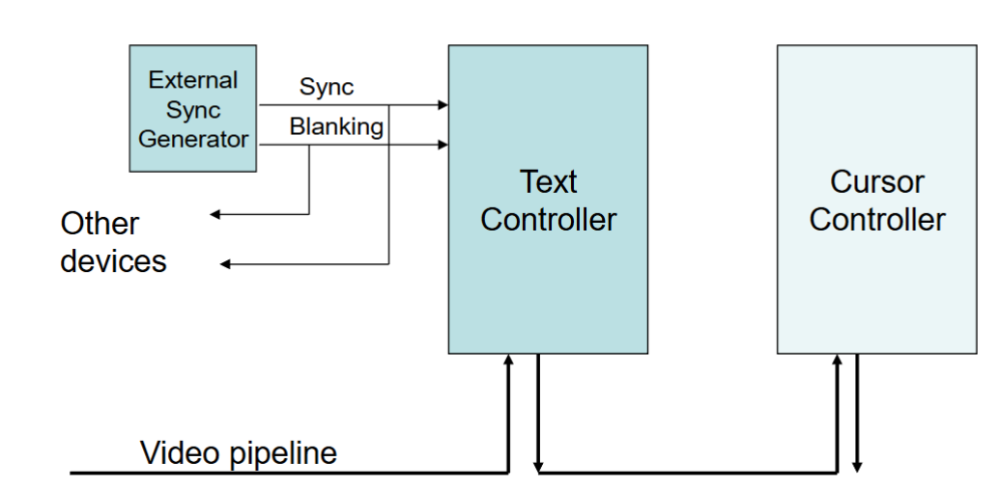

# rtfTextController Design Specification

## 1. Introduction

`rtfTextController` is a text-mode video overlay controller that renders character glyphs with foreground/background color attributes and optional cursor blinking. It is designed to operate in a video pipeline, typically after a bitmap/background stage, and can either replace or pass through incoming pixel data depending on windowing, transparency, and border conditions.

The module contains dual-port memories for text codes and attributes, plus a character bitmap store used by the video path. A processor-side slave interface is provided for screen memory access and runtime control-register programming.

## 2. Module Diagram

## 3. Interface

### 3.1 Top-Level Ports

| Signal | Direction | Width | Description |
| --- | --- | --- | --- |
| `rst_i` | Input | 1 | Active-high reset for control, timing, and output pipeline state. |
| `clk_i` | Input | 1 | Bus/control clock domain. |
| `cyc_i` | Input | 1 | Bus cycle qualifier. |
| `stb_i` | Input | 1 | Bus transfer strobe. |
| `ack_o` | Output | 1 | Bus acknowledge; write transfers acknowledge when selected, read transfers acknowledge after internal read-ready staging. |
| `we_i` | Input | 1 | Bus write enable. |
| `sel_i` | Input | 2 | Bus byte-lane select for 16-bit data path. |
| `adr_i` | Input | 64 | Bus address. High-order decode selects text RAM, attribute RAM, character bitmap region, or register region. |
| `dat_i` | Input | 16 | Bus write data. |
| `dat_o` | Output | 16 | Bus read data from selected memory/register source. |
| `lp` | Input | 1 | Light-pen strobe input. Rising edge latches current text address into light-pen register. |
| `curpos` | Input | 16 | External cursor position input port (present on interface; internal cursor generation uses programmed cursor register). |
| `vclk` | Input | 1 | Video pixel clock domain. |
| `eol` | Input | 1 | End-of-line timing pulse for horizontal timing/counter synchronization. |
| `eof` | Input | 1 | End-of-frame timing pulse for vertical timing/counter synchronization and blink timing. |
| `blank` | Input | 1 | Global blanking indicator; forces black output when asserted. |
| `border` | Input | 1 | Border-region indicator used in output-color selection. |
| `rgbIn` | Input | 25 | Incoming pipeline pixel. Lower 24 bits are RGB color; bit 24 is forwarded on pass-through paths. |
| `rgbOut` | Output | 25 | Output pipeline pixel after text/cursor composition and pass-through control. |

### 3.2 Address Map

| Address Window | Function | Effective Local Storage |
| --- | --- | --- |
| `0xFFFF_FFFF_FFD0_xxxx` | Text screen memory | 4K x 9 implemented (`adr_i[13:1]` used on bus write/read port). |
| `0xFFFF_FFFF_FFD1_xxxx` | Attribute memory | 4K x 9 implemented (`adr_i[13:1]` used). |
| `0xFFFF_FFFF_FFD2_xxxx` | Character bitmap memory window | 4K x 9 implemented (`adr_i[11:0]` used). |
| `0xFFFF_FFFF_FFDA_00xx` | Control/status registers | Register index from `adr_i[4:1]` (16-bit registers). |

### 3.3 Memory Entry Formats

- Text RAM entry (`9 bits`): character code (`[8:0]`), supporting up to 512 glyph indices.
- Attribute RAM entry (`9 bits`): background color code (`[8:5]`, 4 bits) and foreground color code (`[4:0]`, 5 bits).

## 4. Registers

All registers are 16 bits wide in the bus-visible map (`adr_i[4:1]` index).

| Reg | Name | Bits | Description |
| --- | --- | --- | --- |
| `0` | `numCols` | `[11:0]` | Number of displayed text columns. |
| `1` | `numRows` | `[11:0]` | Number of displayed text rows. |
| `2` | `windowLeft` | `[11:0]` | Horizontal window start offset relative to line timing reference. |
| `3` | `windowTop` | `[11:0]` | Vertical window start offset relative to frame timing reference. |
| `4` | `maxScanline` | `[4:0]` | Maximum scanline index per character row. |
| `5` | Pixel size | `[7:4]` / `[3:0]` | Vertical / horizontal pixel replication factors (`pixelHeight`, `pixelWidth`). |
| `7` | `txtTcCode` | `[4:0]` | Transparent background color code used for background pass-through selection. |
| `8` | Cursor start/blink | `[7:5]`, `[4:0]` | Blink/control selector and cursor start scanline. |
| `9` | Cursor end | `[4:0]` | Cursor end scanline. |
| `10` | `startAddress` | `[15:0]` | Display start address in text/attribute memory space. |
| `11` | `cursorPos` | `[15:0]` | Cursor position address used by cursor overlay logic. |
| `12` | `penAddr` | `[15:0]` | Latched light-pen text address. |

### 4.1 Readback Behavior

- Register reads return valid values for indices `0`, `1`, `11`, and `12`.
- Other register indices return zero in the current implementation.

## 5. Function Description

### 5.1 Operating Model

The controller renders text by combining three data sources:
- character code fetched from text memory,
- foreground/background attribute code fetched from attribute memory,
- glyph row bitmap fetched from character bitmap memory.

The rendered text output is then composed with `rgbIn` according to blanking, border state, text-window activity, pixel-on/pixel-off status, and transparent background selection.

### 5.2 Text Address Generation and Fetch

At video rate, the controller derives the current text-cell row/column from timing references and programmed geometry. For each active text position:
- `txtAddr` is formed as `startAddress + (row * numCols) + col`.
- Text RAM and attribute RAM are read at `txtAddr`.
- Glyph row data is fetched using `{char_code, rowscan[2:0]}`.

The fetch/load event is aligned to character and pixel timing (`ld_shft` and `nhp`) so glyph and attribute data remain phase-aligned through the pixel serializer pipeline.

### 5.3 Character Pixel Generation

- Glyph row bits are bit-reversed into display order.
- The row byte is loaded into an 8-bit parallel-to-serial shifter.
- Serialized bit `pix` indicates foreground (`1`) or background (`0`) for the current text pixel.
- Programmed pixel width/height settings replicate source character pixels across multiple video clocks and scanlines.

### 5.4 Cursor Behavior

Cursor activity is gated by address and scanline conditions:
- active when the current text address matches the programmed cursor location (with pipeline offset compensation), and
- active only between programmed cursor start/end scanlines.

When active, blink logic selects whether cursor pattern is applied. Cursor rendering is produced by XOR of glyph bits with a generated cursor mask, enabling blinking cursor visibility over text.

### 5.5 Transparent Background and Composition

Background transparency is controlled by `txtTcCode`:
- if the current text cell background code matches the transparent code condition, background pixels (`pix=0`) pass through `rgbIn`;
- otherwise background pixels use decoded background color.

Foreground pixels (`pix=1`) use decoded foreground color.

Output selection at pixel update time gives priority to:
1. global blanking (`blank` forces black),
2. window-outside/pass-through region (`iblank` passes `rgbIn`),
3. border pattern colors when `border` is asserted,
4. text foreground/background rendering with transparency behavior.

### 5.6 Light-Pen Capture

A rising edge on `lp` latches the current text address into `penAddr`. The latched value is readable through register `12`.

## 6. Implementation Details

### 6.1 Clock-Domain Partitioning

- `clk_i` domain: bus decode, register write/read path, memory write/read access for mapped regions, light-pen edge capture.
- `vclk` domain: line/frame counters, row/column derivation, glyph fetch pipeline, serializer, cursor/blink generation, and final pixel mux.

The design relies on dual-port memories to decouple bus-side access from video-side fetch without consuming external memory bandwidth.

### 6.2 Bus Handshake and Read Latency

- Region selects (`cs_text`, `cs_color`, `cs_rom`, `cs_reg`) are formed from high-order address decode plus cycle/strobe qualification.
- Writes acknowledge on selected accesses.
- Reads acknowledge after internal ready staging (`ramRdy` pipeline), matching synchronous memory read behavior.

### 6.3 Timing and Geometry Control Path

Two `HVCounter` instances generate horizontal/vertical position and next-position strobes from `eol/eof`, window offsets, and pixel replication settings. These counters drive:
- text row/column indexing,
- intra-character row scan selection,
- serializer load cadence and output pixel update timing.

A fixed pipeline compensation is applied in blanking-window logic to align rendered text with delayed glyph output path.

### 6.4 Color Decoding and Output Path

Foreground and background codes are converted by `rtfColorROM` into 24-bit RGB values. The output datapath composes these colors or pass-through input video according to control conditions.

`rgbOut` is 25 bits wide; internally generated color constants are 24-bit RGB and therefore drive the MSB low on those paths, while pass-through paths preserve incoming `rgbIn` bit 24.

### 6.5 Character Bitmap Access Note

The memory map reserves a character-bitmap window at `FFD2xxxx`. In this RTL revision, the character RAM write enable is tied inactive in the top module, so runtime bus writes to glyph storage are not performed by this integration unless write control is modified.

## 7. Submodule List

### 7.1 `HVCounter`

Role: Converts sync pulses and pixel-scaling parameters into raw counters, row/column positions, and next-position strobes.

| Port | Dir | Width | Description |
| --- | --- | --- | --- |
| `rst` | Input | 1 | Reset. |
| `vclk` | Input | 1 | Video clock. |
| `pixcce` | Input | 1 | Pixel-counter clock enable. |
| `sync` | Input | 1 | Synchronization pulse (`eol` or `eof`). |
| `cnt_offs` | Input | 12 | Window offset preload. |
| `pixsz` | Input | 4 | Pixel replication control. |
| `maxpix` | Input | 5 | Max sub-pixel/scan index per character axis. |
| `nxt_pix` | Output | 1 | Pixel-step strobe. |
| `pos` | Output | 12 | Derived row/column position. |
| `nxt_pos` | Output | 1 | Position-change strobe. |
| `ctr` | Output | 12 | Raw timing counter value. |

### 7.2 `syncRam4kx9_1rw1r`

Role: Dual-port 4K x 9 synchronous memory primitive used for text RAM, attribute RAM, and character bitmap storage.

| Port Group | Description |
| --- | --- |
| Write-side (`wclk`, `wce`, `we`, `wadr`, `i`, `wo`) | Bus-domain access path. |
| Read-side (`rclk`, `rce`, `radr`, `o`) | Video-domain fetch path. |
| Reset controls (`wrst`, `rrst`) | Port-local reset signals. |

### 7.3 `ParallelToSerial`

Role: Loads 8-bit glyph row data and shifts one bit per pixel step to produce `pix`.

| Port | Dir | Width | Description |
| --- | --- | --- | --- |
| `rst` | Input | 1 | Reset. |
| `clk` | Input | 1 | Shift clock (`vclk`). |
| `ce` | Input | 1 | Shift enable (`nhp`). |
| `ld` | Input | 1 | Parallel-load control (`ld_shft`). |
| `qin` | Input | 1 | Serial fill input when shifting. |
| `d` | Input | 8 | Parallel glyph row input. |
| `qh` | Output | 1 | Serialized pixel bit output. |

### 7.4 `rtfColorROM`

Role: Maps foreground/background color codes to 24-bit RGB values used by text composition.

| Port | Dir | Width | Description |
| --- | --- | --- | --- |
| `clk` | Input | 1 | Video clock. |
| `ce` | Input | 1 | Update enable. |
| `code` | Input | 5 | Color code. |
| `color` | Output | 24 | Decoded RGB value. |

### 7.5 `edge_det`

Role: Detects light-pen edges in the bus/control clock domain.

| Port | Dir | Width | Description |
| --- | --- | --- | --- |
| `clk` | Input | 1 | Sampling clock (`clk_i`). |
| `rstn` | Input | 1 | Active-low reset (`~rst_i`). |
| `dat_i` | Input | 1 | Light-pen input (`lp`). |
| `edge_rising` | Output | 1 | Rising-edge pulse (used for `penAddr` capture). |
| `edge_falling` | Output | 1 | Falling-edge pulse. |
| `edge_both` | Output | 1 | Either-edge pulse. |

### 7.6 `VT151` and `VT163`

Role:
- `VT151`: cursor blink/control selector multiplexer.
- `VT163`: synchronous counters used for blink-frame timing and internal counter functions in timing blocks.

## 8. Clock and Reset

- `rst_i` is active high.
- `clk_i` and `vclk` are independent clock domains.
- `eol` and `eof` provide horizontal/vertical synchronization events for text timing; the module expects these to be generated by external timing logic.

## 9. Constraints

- Implemented local memory depth in each mapped RAM region is 4K entries; higher address space within each reserved 64K window is not functionally implemented.
- Text/attribute entries are 9-bit effective payloads within a 16-bit bus interface.
- Displayed text area must be configured by `numCols`, `numRows`, `windowLeft`, and `windowTop` consistently with upstream timing to avoid rendering outside intended visible region.
- Transparent background operation depends on the programmed transparent code and attribute background code path; foreground pixels are always driven by text foreground color when active.
